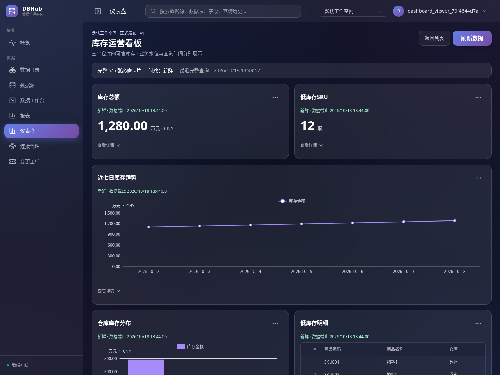
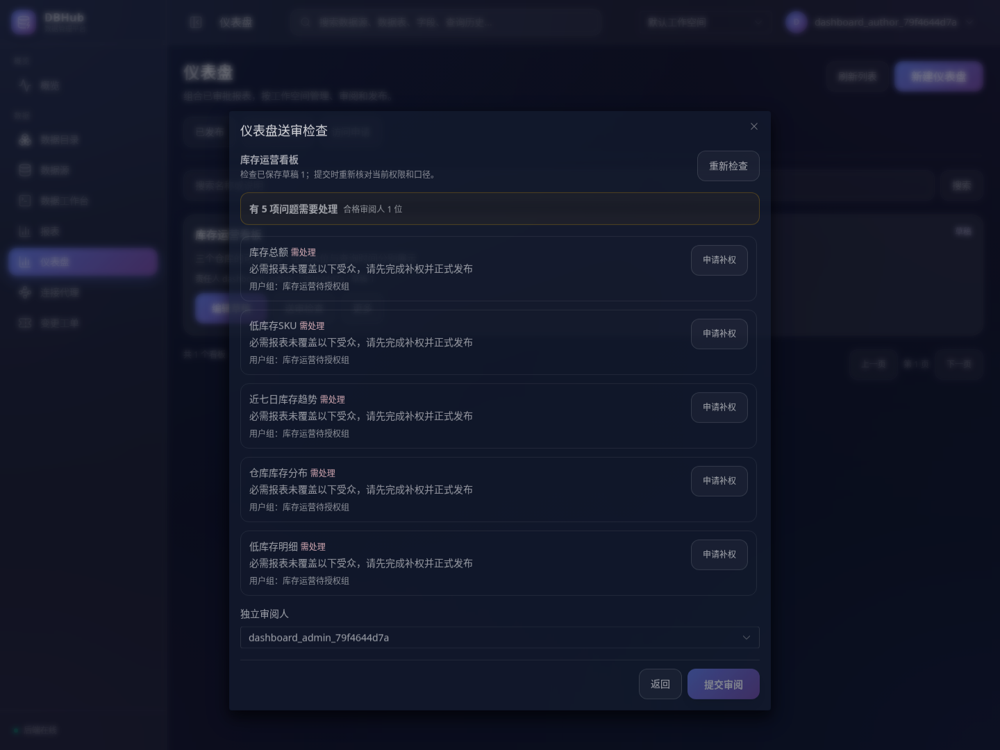
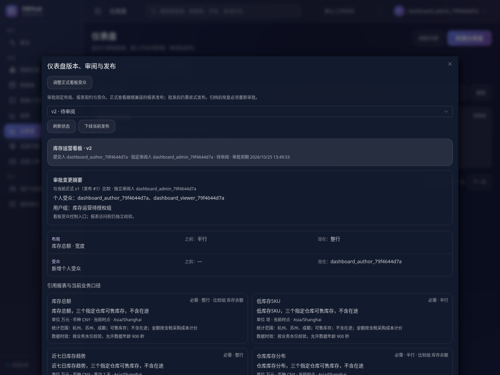

# 仪表盘易用性改进与验收

2026-10-18。在[第一阶段实现](./仪表盘第一阶段实施与验收.md)上完成业务展示、紧凑布局、送审预检和审批差异四项改进。用户在评估后授权“开始改进”；本期按前四项范围实施。开发分支为 `feat/phase1-release-validation`。

## 设计与实际交付

先生成并展示了[桌面与手机概念图](../design/images/dashboard-usability-concept.png)，用于明确布局方向。概念图使用虚构演示数据，不作为运行结果；没有记录用户逐项确认概念图。本期保留现有导航，预检和审批采用独立弹窗，查看页聚焦数据与异常状态。

展示可以调整：字段业务名称、千分位、小数位、卡片密度、详情折叠及按钮位置。以下业务语义继续由报表审批与后端校验控制：SQL、原始结果、单位与币种、统计范围、时间窗、比较口径、数据水位、受众和执行身份。展示配置不能用于修改计算结果或绕过授权。

| 场景 | 改进后的行为 |
| --- | --- |
| 报表开发 | 折叠的“业务展示”设置可配置字段别名、数字分组和 0–12 位小数；预览即时更新，保存草稿不会修改正式展示 |
| 指标卡 | 紧凑显示指标、单位/币种和业务水位，去掉重复技术字段名；真正发生舍入时提示，原始值保留在明细 |
| 图表与表格 | 使用业务图例和列名；图表不聚合、不排序结果，原有精度保护和表格回退继续生效 |
| 看板查看 | 主要操作为“刷新数据”；卡片重查和回执放入“更多”，查询时间、范围和原始结果放入详情；失败卡片显示重试 |
| 开发目录 | 按待审、批准、已发布等状态显示主要操作，管理操作收入“更多” |
| 送审 | 对已保存草稿统一列出问题、缺权人员/用户组和合格审阅人；可直接发起针对缺权目标的补权申请 |
| 审批 | 优先显示名称、卡片、布局、受众、比较口径和时效规则的变化；冻结 JSON 收入技术详情，仍需真实预览、验证、批准和显式发布 |

数字格式器直接处理十进制文本，避免先转换成 JavaScript `Number` 改写大整数或高精度小数。格式器不改变结果行；图表仍使用原有安全数值范围，超限时提示并回退表格。小数位是展示设置，单位没有换算功能。

## 后端与兼容性

本期没有新增数据库迁移、常驻服务或缓存。配置保存在已有报表定义的 `chart_config.display`：

```json
{
  "metrics": ["amount"],
  "display": {
    "labels": {"amount": "库存金额"},
    "grouping": true,
    "fraction_digits": 2
  }
}
```

后端限制 32 个字段名称、名称 1–64 字和小数位 0–12；拒绝控制字符、未知设置、重复展示名，以及契约中不存在的字段。表格支持字段别名，原始查询结果列名保留。展示配置属于需要审批的报表内容，不加入业务契约兼容哈希；仅改变展示的正式报表发布可由已有看板兼容跟随。

新增工作空间接口：

| 接口 | 行为 |
| --- | --- |
| `POST /api/v1/workspaces/{workspace}/managed-dashboards/{id}/preflight` | 输入已保存 `version`，在元数据快照中检查草稿、正式报表、契约、受众覆盖和审阅人；不运行 SQL，不创建审阅 |
| `GET /api/v1/workspaces/{workspace}/dashboard-reviews/{id}/summary` | 比较冻结版本与当前正式版；没有正式版时比较前一送审版，首次提交显示本次内容 |

两接口仅供有管理权限的责任人/管理员使用，遵循现有工作空间隔离并设置 `no-store`。摘要中的报表名称与当前业务契约继续要求普通报表查看权；无权时返回受限状态，不返回 SQL、报表账号或连接信息。当前正式口径变化会明确标记，不能把它冒充为历史冻结口径。

预检使用工作空间目录的批量读取，避免逐卡逐人的查询；候选审阅人必须是有效、独立的管理员且拥有所有引用报表的普通查看权。必需卡片缺权阻断提交，可选卡片缺权提示受限。显式用户组覆盖不会由当前成员碰巧拥有个人授权来替代。

预检是诊断结果，不能代替提交时的校验。提交仍重新读取权限和版本，审批与发布继续校验真实执行回执、当前授权和账号状态。补权申请只有在独立报表受众版本正式发布后才生效。

## 验收证据

可重复运行方式见[云环境说明](../../scripts/cloud/README.md)。本次构建、测试、浏览器结果和文件指纹记录于[易用性改进验收 JSON](../acceptance/dashboard-usability-2026-10-18.json)，保留上一期验收历史。

后端全量 `go test ./... -count=1`、全量竞态检查和 `go vet ./...` 通过。前端查询 14、报表 18、仪表盘 10 项测试及 TypeScript/生产构建通过。云端开发后端已更新为同一构建，登录、就绪、工作空间仪表盘接口和前端入口正常；迁移仍为 35 个，正常服务 6 个。

新增后端集成测试覆盖：一次列出必需/可选卡片的个人与组缺权、合格审阅人选择、预检后角色改变仍阻止提交、过期草稿版本、只读访问拒绝、跨工作空间隔离、摘要脱敏、当前正式版差异，以及仅修改展示时看板兼容跟随。

真实 Chromium 验收通过 13 项流程，页面脚本错误为 0。五张报表来自真实 PostgreSQL，使用独立只读账号发布，查看者没有个人连接。浏览器完成展示配置、缺权检查与补权闭环、独立审批发布、第二版差异审阅、卡片重查、503、离线、结果过期和切空间。503 使用明确的传输故障模拟，31 分钟过期使用浏览器时钟推进。

在 1440×1080 和 390×844 检查布局；手机首屏容纳两张指标卡，卡片同宽且页面没有横向溢出，查看区按钮触达高度至少 44px。实际截图人工复核了指标密度、中文标签、单位、业务水位、预检问题和版本差异；图表按原值绘制，详情可查看未格式化结果。此次未执行完整辅助技术或全部浏览器矩阵评估。

验收容器以只读文件系统运行，结束后清理本轮容器、网络、审计卷、测试 Schema、目标只读身份与临时凭据；不向开发工作空间保留演示数据。

## 实际截图

以下截图来自同一次隔离验收，测试账号及对象已销毁。








## 范围

后续阶段仍可评估筛选、订阅、导出等能力；本期聚焦已有功能的可用性。多实例部署、生产负载、商业 GaussDB 和完整数据源版本矩阵沿用上一期的独立验收要求。
