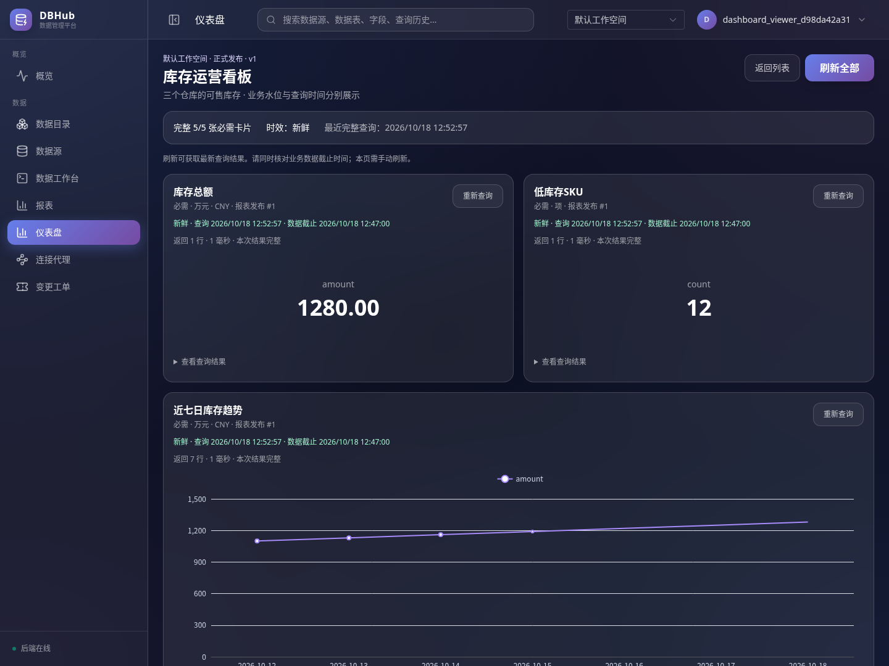
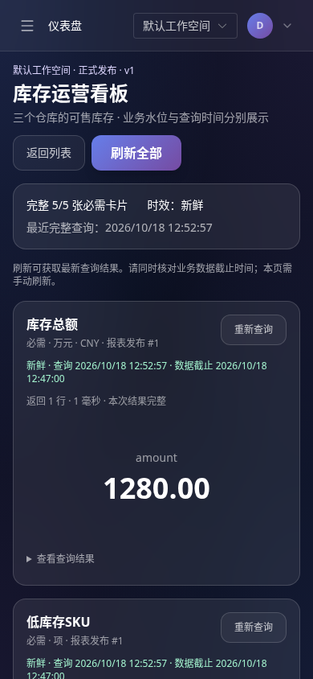

# 仪表盘第一阶段实施与验收

2026-10-18。本期对应[第一阶段设计](../项目管控/仪表盘第一阶段设计.md)，实现仪表盘及其必需的工作空间、报表口径和权限申请基础。开发分支为 `feat/phase1-release-validation`；没有合并或部署到外部生产环境。

后续已完成[易用性改进与验收](./仪表盘易用性改进与验收.md)：业务展示、紧凑布局、送审预检和审批差异。下文保留首轮实现与历史验收记录。

## 功能入口

登录后在页头选择工作空间，侧栏“仪表盘”进入 `/dashboards`。“概览”仍为平台概况。只读成员查看已发布看板及本人访问申请；开发者管理自己的草稿；工作空间管理员处理审阅、发布和成员配置。

基本流程：

1. 开发者在报表编辑页声明业务契约：指标含义、结果列/类型、单位、币种、时区、范围、时间窗、比较口径和水位列。
2. 独立管理员使用受管只读报表账号真实验证，明确确认契约及受众，批准后显式发布报表。旧报表缺少契约时仍可单独使用，不能加入仪表盘。
3. 创建仪表盘，添加最多 8 张可查看的正式报表；调整顺序、宽度、必需性、比较组及受众。先保存，再预览或送审。
4. 必需报表未覆盖拟受众时，负责人可按已保存卡片为所选用户/组发起补权。访问申请经独立报表受众版本审批并正式发布后才授予权限；批准但未发布仍无权。
5. 选择另一位有效管理员审阅。审阅人必须拥有全部报表的普通查看权，不能靠管理员身份绕过。运行冻结版本全部卡片，登记成功回执，确认后批准，再显式发布。
6. 查看者按仪表盘和报表权限交集读取。每次刷新解析当前兼容报表发布；不运行个人连接，也不回退到历史 SQL。

支持搜索、分页、草稿预览、审批人重分配、退回/撤回、受众专用版本、发布/下线/布局回滚、责任人移交、草稿删除和归档/恢复。归档立即下线并取消待审与未完成申请；恢复只得到草稿，需重新送审。

## 执行与可靠性

- 命令使用 UUID 和输入摘要防重，保存采用草稿版本比较，发布比较预期发布号。同一执行编号只登记一次，重复请求返回回执，不重新发送 SQL；回执不保存结果行。
- 每轮刷新保存元数据一致性快照，180 秒有效；服务器分配卡片执行 UUID。响应带实际仪表盘/报表发布、生命周期代次、刷新/卡片和契约，前端再次核对。
- 执行前、排队后发送 SQL 前、结果交付前重新校验成员代次、工作空间、父级发布、契约、账号代次和权限。撤权后再恢复、审阅人移出再分配回来，也不能复用旧上下文。
- 页面并发 2，每卡最多 1000 行、30 秒、2 MiB。原生驱动/JDBC 在读取阶段限制字节，HTTP 结果编码再限制；截断和契约不符不冒充成功。所有受管报表查询共用数据库租约：每用户 4、每账号 4、每工作空间 16、全局 64。
- 查询时间和业务水位分开；未知水位不以查询时间补齐。允许未知时效需空间策略及显式质量声明。比较组检查单位、币种、范围、时间窗、时区和水位差。
- 完整性只统计本轮全页刷新成功的必需卡片。旧结果不计成功；可选卡片另计；单卡重查保持“部分刷新”，不改写最近完整查询时间。
- 页面保鲜 5 分钟。仅网络/服务暂时失败保留内存中的上次成功结果，显示旧时间，30 分钟后清除。权限、契约、发布变化立即清除相应旧结果。退出、切空间或离开页面销毁结果；离线/转入后台暂停未完成查询，恢复后手动刷新。
- 审阅最多 7 天，验证证据 15 分钟；证据绑定真实执行回执、实际报表发布/账号、成员/组和指派版本。读取结果成功但最终回执失败，不能作为审批证据。
- 审计沿用执行前持久化、数据库幂等补写和存储故障拒绝操作，增加工作空间、仪表盘、刷新、报表正式发布和实际执行身份。日志不保存 SQL、结果行或密码。

## 工作空间与升级

迁移 **0028–0035**，完整库共 35 个迁移：

| 迁移 | 内容 |
| --- | --- |
| 0028 | 默认空间、成员、旧资源归属、组合外键、RLS、空间内唯一约束 |
| 0029 | 仪表盘版本/审阅/发布/刷新/租约，报表受众提案和访问申请 |
| 0030 | 同空间成员引用、不可变归属、平台身份审计 |
| 0031 | 成员资格代次与旧执行失效 |
| 0032 | 工作空间创建命令防重 |
| 0033 | 个人/用户组补权目标和终态理由 |
| 0034 | 持久回执绑定仪表盘父级，避免通用回执旁路 |
| 0035 | 审阅指派代次，阻断重分配前预览复用 |

既有资源迁入默认工作空间，不改历史批准 JSON、哈希及执行身份；旧个人报表、仪表盘及分享不自动升级为正式对象。原“全局发布”在界面显示为“工作空间共享”。

业务 API 使用 `/api/v1/workspaces/{id}/...`。只有一个有效空间时兼容旧路径；多个空间未指定时返回 428，不能猜测组织。全局登录身份与成员角色分开，角色每次从当前成员关系读取。平台管理员没有默认的其他空间业务读取权；平台身份审计单列，不混入组织日志。

业务仓库统一使用独立、非所有者、无超级用户/绕过 RLS/建角色权限的运行连接。作用域通过事务本地变量设置，连接归还时清除；未指定空间或无有效成员默认拒绝。旧资源接口、回执、查询任务、事务和后台采集也纳入作用域。

部署要求：

- 启动 `DATABASE_URL` 对应身份应拥有迁移对象，具备创建受限登录角色和授予当前 Schema 权限的能力（`CREATEROLE`）。程序创建独立随机运行身份；普通业务仓库不能使用所有者池读取组织表。数据库认证方式须允许该运行身份连接。
- 当前实现保留所有者池用于迁移、登录身份、受控成员管理、审计恢复、回执收尾及共享准入；应将启动凭据作为服务端密钥管理，不暴露给浏览器。两个池的连接预算都需计入元数据库容量。
- 正常停止会回收本进程生成的运行身份；进程被强杀可能遗留角色。恢复时先核对无活动进程和连接，再按确切角色名清理，不对全部 `dbhub_runtime_*` 批量删除。
- 备份迁移到新环境时使用 `pg_dump --no-owner --no-acl`，避免复制短期运行角色的授权。先备份，再升级；数据迁移不提供自动降级。
- 本轮验证共享租约的跨连接池原子性；完整多实例部署的负载、故障转移、普通工作台事务路由仍需单独验收。不能据此宣称整个平台已完成集群部署支持。

## 验证记录

测试使用 Cloud 的真实 PostgreSQL、MySQL、Redis 和 JDBC 服务，随机测试 Schema、用户及目标账号隔离。前后端构建与测试在既有容器执行，没有添加常驻服务。

```sh
./scripts/cloud/dev.sh exec -T backend go test ./... -count=1
./scripts/cloud/dev.sh exec -T backend go test -race ./... -count=1
./scripts/cloud/dev.sh exec -T backend go vet ./...
./scripts/cloud/dev.sh exec -T frontend sh -ec 'npm run test:query; npm run test:report; npm run test:dashboard; npm run build'
python3 scripts/cloud/dashboard_acceptance.py
```

后端全量测试、全量竞态检查和 `go vet` 通过；前端查询 14、报表 14、仪表盘 10 项状态测试及 TypeScript/生产构建通过。最终浏览器 10 项流程通过，页面脚本错误为 0，临时资源清理完成。具体构建指纹和云环境结果见[本期验收 JSON](../acceptance/dashboard-phase1-2026-10-18.json)，与历史设计检查分开保存。

| 设计场景 | 主要可执行证据 |
| --- | --- |
| V01–V04：兼容跟随、旧上下文失效、破坏性采纳、布局回滚 | `TestDashboardContractFollowingAndAdoption`、`TestDashboardAudienceVersionsRollbackAndDependencies` |
| A01–A05：个人/组覆盖、空受众、批准未授权、撤回、并发、正式生效 | `TestDashboardSubmissionPolicies`、`TestDashboardAccessRequestReleaseLoop`、`TestDashboardDraftAudienceRequestsAndGroupBenefitGuards` |
| R01–R03：审阅人资格、自审、重新分配、成员变化与验证过期 | `TestDashboardPhase1Lifecycle`、`TestDashboardSubmissionPolicies`、`TestDashboardReviewAssignmentAndValidationVersions` |
| Q01–Q04：契约、无损数字、水位、完整性和旧结果保留 | `TestContractCompatibilityBoundary`、`TestContractResultsAndWatermarks`、`TestContractChartMappingCannotDriftWithSameHash`；前端 `dashboard.test.ts` 和真实浏览器 |
| L01–L05：草稿、归档/恢复、停用、移交、依赖分层 | `TestDashboardPhase1Lifecycle`、`TestDashboardUnpublishCancelsUnreleasedRequests`、`TestMembershipRevokeRestoreInvalidatesOldQueryAndTransaction`、`TestDashboardAudienceVersionsRollbackAndDependencies` |
| T01–T05：仓库/RLS/旧路径、角色、迁移、组提权 | `TestWorkspaceIsolation`、`TestWorkspaceRuntimeRoleAndCompositeReferences`、`TestConcurrentMigrationWithSingleConnectionPools`、原迁移升级测试及组补权测试 |
| E01–E06：防重、配额、预算、撤权与回执 | 仪表盘生命周期/审阅状态/配额测试；`TestDashboardClusterQuotasAcrossPools`；原生与 `TestManagedReportJDBC` 的 2 MiB 拒绝测试；既有报表排队/交付撤权测试及前端状态测试 |
| U01–U02：桌面、手机、无横向溢出和脚本错误 | 系统 Chromium 真实浏览器，1440×1080 和 390×844；页面最大并发 2，单卡重查、503、31 分钟时钟和跨空间清除 |
| O01–O02：可靠审计、执行身份、旧功能边界 | 原审计故障测试、`TestDashboardPhase1Lifecycle` 的实际身份审计断言、旧个人报表/连接回归 |

这张表是测试关联索引，不表示每个设计条目下所有产品/部署组合均单独验收。7 天超期使用服务器时间判定，不等待 7 天进行耐久测试；本轮没有重新执行全部数据源版本矩阵、商业 GaussDB、浏览器辅助技术全套评估或生产多实例压力测试。

浏览器验收复用已有镜像和系统 Chromium，在只读生产后端容器运行当前构建；开发五张真实报表并用独立账号发布，由无个人数据库连接的用户查看。脚本在 `finally` 清理本轮容器、网络、审计卷、测试 Schema、只读账号及凭据文件。图表结果来自 SQL，503 为明确标注的传输故障模拟，时间保留验证使用浏览器时钟推进。

## 实际运行截图

桌面与手机来自同一次真实浏览器验收，截图中为本轮隔离演示数据，测试账号及对象已销毁。





## 第一阶段边界

P1/P2 继续暂缓：自由拖拽、全局筛选/参数、收藏/全屏、历史报表固定执行、订阅、自动刷新、导出、轮播、结果缓存及跨报表计算。未配置 AI 模型服务不影响本期功能。数据结果不进入 Redis。
