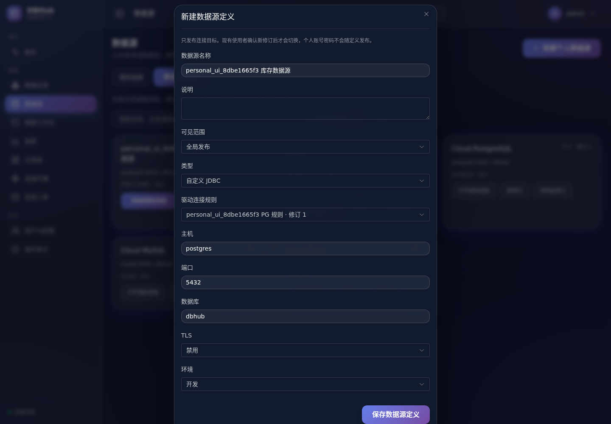
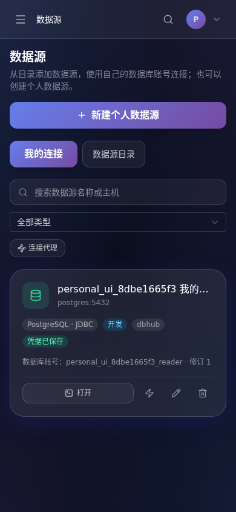
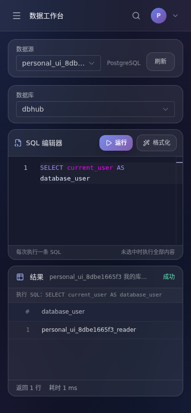

# 共享数据源与个人连接

本期实现“全局或个人配置、个人数据库身份”。方案依据见[评估](../架构设计/共享数据源与个人凭据方案评估.md)。本实例内的全局目录仅向登录用户开放，没有匿名数据源访问或注册入口；独立客户组织的租户隔离不在本期范围。

## 使用流程

1. 在“系统设置 → 驱动管理”引用已安装且校验通过的 JDBC 制品。普通用户建立个人配置，管理员也可以选择全局发布。JAR 的新增仍通过部署清单进行，网页不接受任意二进制上传。
2. 在设置中配置对应的连接规则。规则和驱动各自选择个人或全局范围；全局规则必须引用全局驱动。
3. 在“数据源目录 → 新建数据源定义”配置目标地址、库名、TLS 和固定驱动规则，直接发布个人或全局定义；发布者不需要填写数据库账号。也可以先新建个人数据源，再从个人连接卡片发布去凭据定义。
4. 其他用户进入“数据源目录”，点击“添加到我的连接”，核对目标并输入自己的数据库账号密码。发布者的账号密码不会被复制，表单不会代填发布者账号。
5. 以后从“我的连接”打开工作台。SQL 视图仍只有运行和格式化；操作同时受 DBHub 角色与数据库账号权限限制。只读平台角色可以配置自己的连接，仍不能执行写操作。

个人数据源会自动生成一份私有定义。移除个人连接不会删除目录定义；不用的定义可以停用。保留历史修订及其依赖，暂不提供历史版本物理清理。现已补齐[历史修订、停用影响确认和连接诊断](数据源修订与连接诊断验收.md)。被配置引用的用户删除返回 409，可先停用该用户，不静默转移其凭据或配置所有权。

## 修订与身份边界

- 数据源定义不包含用户名、密码、代理口令或 SSH 私钥。后端使用固定字段结构，拒绝发布载荷中的认证字段。
- 个人连接绑定明确的数据源修订；相同用户对同一逻辑数据源最多一份绑定。并发重复添加只有一份成功，其余返回 409。
- 新修订发布不会自动改变已有连接。使用者查看并确认修订、重新输入自己的凭据后才切换。首期所有新修订都显式确认，包含说明调整；不另做原位编辑入口。
- 全局定义只能由当前管理员管理。发布者失去管理员角色后，不能依靠历史所有权管理全局版本。个人配置仍由本人管理，停用的个人连接规则保留在设置中供重新启用。
- 停用某修订阻止后续新操作；已发送的操作可能完成。旧修订不会因新修订停用而自动改变状态，界面明确显示“停用此修订”。
- 修改账号、密码或目标配置会清理该个人连接的结构快照、标注和最近检查。结构快照是历史采集结果，不能证明目标数据库当前权限没有变化。
- 查询排队后以及发送 SQL 前重新检查用户状态、角色、连接配置和绑定可用状态。既有回执继续按用户防重，配置变化不会让旧编号重新获得执行权。
- 全局关系型定义需要明确数据库或服务名；工作台和采集使用发布的库，API 不接受另一个库名覆盖绑定。库内对象及跨库 SQL 的实际访问仍由个人数据库账号权限决定。

管理员的产品管理权限不授予读取或代用其他用户连接的权限。拥有宿主机、应用密钥或元数据库控制权的运维身份仍位于信任边界内。

## 关联功能

连接列表、详情、测试、SQL、Redis、结构浏览、采集、数据目录搜索、统计、血缘、查询历史、任务和导出按个人连接或当前用户过滤。后台血缘解析显式按活跃用户运行。

共享报表只共享定义，读取时解析查看者对同一发布修订的个人连接；没有匹配连接则不执行。审批工单的管理员也必须有该相同修订的个人连接，不能代用申请者账号。工单不接受 SELECT，执行仅返回类型、影响行数及耗时，不保存或向申请人返回审批人身份下的结果行，包括 DML RETURNING。导出审批不等于取得下载别人的结果的权限。公开查询结果和报表链接在本期关闭，迁移会撤销旧链接。

个人连接移除仍会按既有外键规则清理依赖它的报表等记录；共享报表定义的独立生命周期和无人值守服务账号留待后续设计。公共数据源定义及其他用户的个人连接保留。

## 生产目标地址限制

`APP_ENV=production` 下必须配置 `DBHUB_TARGET_ALLOWLIST`，以逗号分隔精确的主机与端口，例如：

```text
DBHUB_TARGET_ALLOWLIST=inventory.example.test:5432,warehouse.example.test:3306
```

空列表拒绝目标连接，包括连接测试。主机名和端口必须同时匹配；代理和 SSH 的网络端点也必须批准。生产编排已透传该变量。部署者负责批准可信域名及其 DNS，必要时结合基础设施网络策略限制实际 IP 和数据库可访问范围。

开发环境未配置列表时保留本地调试能力；配置列表后同样执行限制。受信任 H2 驱动的固定内存模式不访问外部网络。通用 JDBC 规则只接受网络端点和路径占位符，不开放任意连接属性、执行脚本或认证占位字段。

## 数据迁移与回退

新增迁移 [0022_personal_connections.sql](../../backend/internal/db/migrations/0022_personal_connections.sql)：

- 为已有驱动和规则标记兼容的全局范围；新增 API 配置默认个人私有。
- 为每条旧连接创建归属原创建者的私有定义，密码继续保留在原连接中，不复制给其他用户。
- 定义增加逻辑 ID、不可变修订、范围与启停状态，个人连接增加修订引用和用户/逻辑源唯一约束。
- 旧报表、仪表盘收回为私有，旧公开分享撤销。其他用户重新配置自己的数据库身份。
- 原先引用他人连接的待审、已批准工单收回为拒绝状态，需配置个人连接后重新提交；已有工单结果去除行数据，仅保留摘要。

上线前备份元数据库并说明共享行为变化。回退需要与旧版本相匹配的数据库备份；直接运行旧二进制会重新采用共享凭据行为，不能视为安全回退。迁移已使用真实 0021 数据形态验证，重复执行不重复复制定义或密码。

## 验收与复现

所有应用构建、测试和浏览器运行都在 Docker 中：

```sh
./scripts/cloud/dev.sh exec -T backend go test -timeout 180s -race -p=4 ./...
./scripts/cloud/dev.sh exec -T backend go vet -p=4 ./...
./scripts/cloud/dev.sh exec -T frontend sh -ec 'npm run test:query; npm run build'
python3 scripts/cloud/personal-browser-check.py
```

最后一条是宿主机编排脚本：临时账号和数据由容器内 psql 创建，Playwright/Chromium 在 `dbhub-personal-browser` 容器执行。凭据只留在私有运行目录和进程中，结束会删除本次创建的数据库、目录及用户夹具。浏览器容器可复用以避免重复安装，验收结束后可删除该指定容器。

后端核心用两个真实 PostgreSQL 账号验证 JDBC 的实际登录身份：一个只有 SELECT 权限，另一个具有写权限但对应平台只读角色。同时验证跨用户和管理员访问拒绝、私有驱动可见性、并发重复添加、元数据与导出隔离、共享报表查看者身份、新修订不自动转移密码、停用阻断与旧数据迁移。

浏览器覆盖管理员全局驱动与连接规则、发布库存定义、新用户添加个人连接、手机端输入与实际执行、个人驱动、新修订确认以及只读用户边界。最终执行结果见[验收记录](../acceptance/personal-connections-2026-10-17.json)。

本轮结果为后端 125 项及 `go vet` 通过、前端 14 项及类型检查/构建通过、三组浏览器共 46 项通过。全量 Go 测试的版本矩阵入口需要单独目标，本轮跳过，未重复宣称完整 12 版本分支验收。

桌面端直接发布无凭据定义：



手机端个人连接与实际数据库身份（全部为已清理的验收夹具）：





GaussDB 在需求中作为示例，本期未安装其驱动或验证实际服务；现有 PostgreSQL/MySQL/H2 制品继续使用。新增产品仍需按其真实版本验证连接、方言、元数据和只读行为。
