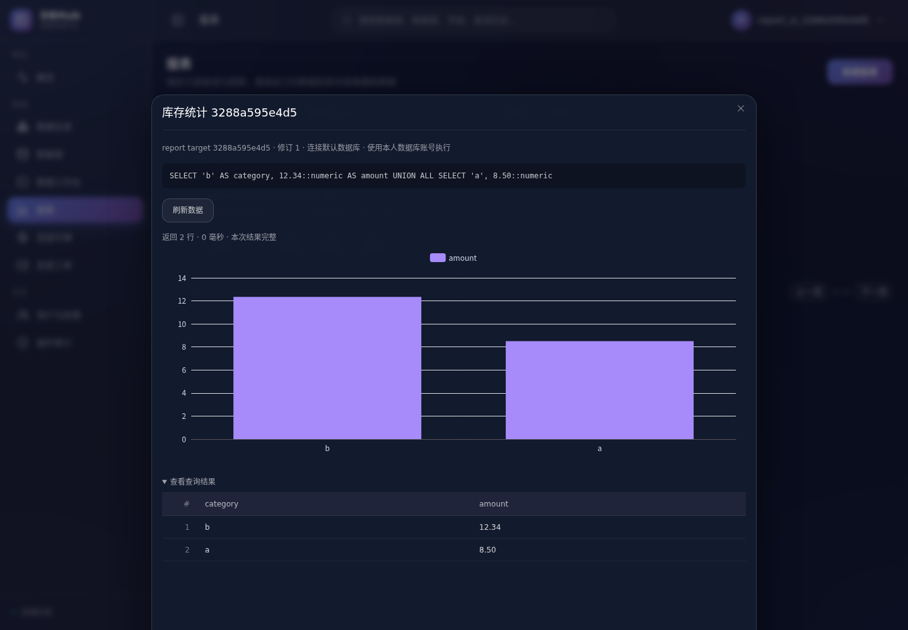
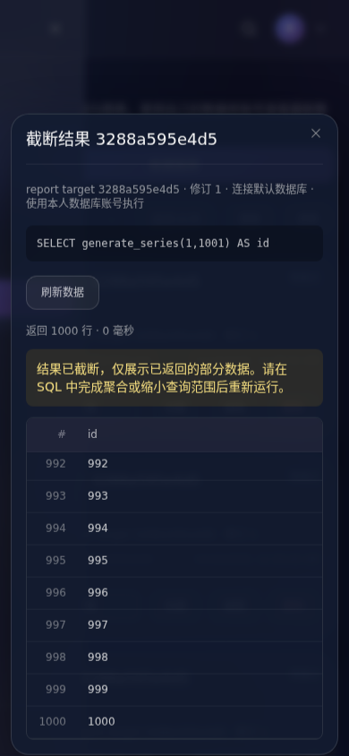

# 报表第一阶段

第一阶段提供独立创建、编辑、删除和收藏报表，保存只读 SQL、个人连接对应的数据源修订，以及表格、柱状图、折线图、饼图或指标卡的字段配置。报表支持“仅自己”和“登录后共享”。数据工作台继续保留既定的简化范围，不恢复图表、报表保存等工具栏按钮。

仪表盘在本阶段后置：导航不显示入口，原 `/dashboards` 地址跳转到报表；其后端定义接口保留。匿名分享接口继续拒绝创建，旧公开链接继续失效。

## 使用流程

在“报表”点击“新建报表”，选择本人的个人连接，填写名称、SQL 和可见性。运行预览后选择展示方式、维度和指标，再保存。表格允许直接保存合法 SQL；图表须先预览，确保字段映射可用。已有图表编辑后同样需要预览。

聚合、筛选和排序在 SQL 中完成。例如库存汇总可使用：

```sql
SELECT category, SUM(amount) AS total
FROM inventory
GROUP BY category
ORDER BY category;
```

图表按 SQL 返回顺序逐行展示，不在浏览器重新聚合或排序。指标卡需要一行、一个数值指标。表格支持滚动查看全部已返回行，不再静默限制为前 100 行。重复列名使用表格下标显示；图表引用重名列时要求为 SQL 列设置唯一别名。

报表执行使用数值保真传输：原生 PostgreSQL 的 NUMERIC 和超出 JavaScript 安全整数范围的整数按文本返回，JSON / JSONB 列保留原始 JSON 文本，避免浏览器先发生舍入。MySQL 和 JDBC 保留驱动返回的准确小数文本；因此 `rows` 中的数值列也可能是字符串。NULL 与零保持区分；非数值、非有限值和无法安全表示的高精度指标回退到原始结果表格并说明原因。旧报表中的浏览器聚合配置不再默默执行：查看时提示编辑，用户在 SQL 中明确统计口径后重新预览保存。旧 SQL 和配置不会在迁移中被改写或自动执行。

## 只读、身份和生命周期

创建与修改查询定义都通过实际 PostgreSQL / MySQL AST 检查，只接受单条只读 SELECT，PostgreSQL 允许只读 CTE，各方言允许已适配的 UNION 等查询；未适配语法拒绝执行。拒绝写 CTE、锁定查询、SELECT INTO、EXPLAIN 和管理语句。分号处于字符串内不影响判断。预览和查看执行时再次验证，历史保存的写语句也会被拒绝。

报表使用专用执行接口；服务端读取已保存定义，客户端不能替换 SQL、数据库、连接或事务。管理员同样被强制放入数据库只读事务，防止 SELECT 调用的函数隐藏写操作。该保护使用既有连接器的只读执行能力，未适配的 SQL 方言和不支持强制只读的连接不提供报表执行。

共享的是 SQL 与配置，不是凭据或发布者身份下的结果。私有报表只对所有者可见；共享报表还要求查看者当前具有该数据源权限。查询解析查看者对**相同不可变数据源修订**的个人连接；没有连接时提示配置自身数据库账号，不会代用其他人的账号或自动升级到新修订。授权撤销后隐藏报表并拒绝执行，排队完成后和真正发出 SQL 前会再次检查授权、连接与报表版本。

迁移 `0026_report_phase1.sql` 将报表绑定到数据源修订，原个人连接外键改为 `ON DELETE SET NULL`。发布者移除连接后，共享报表定义和其他人的个人连接均保留；发布者自己重新查看也必须配置对应修订的个人连接。删除报表、删除所属用户仍是删除定义的明确操作；本期不提供报表所有权转移。

## 可靠性与限制

- 创建必须携带非空 UUID `request_id`。编辑器为一次创建保留同一编号；相同编号和原始内容重试返回同一报表，编号用于不同内容返回 409。相同编号的并发创建只有一个记录。
- 修改必须携带当前 `version`，通过数据库条件更新防止并发覆盖。查看同样提交版本，定义已变化时要求重新加载，不能执行过期 SQL。
- 预览和查看复用工作台的服务端并发队列、持久执行编号、行列策略、超时、连接检查与审计。既有工作台请求指纹格式保持兼容；报表指纹额外绑定执行模式、报表 ID 和版本。
- 每次最多返回 1000 行、执行 30 秒，并服从服务端更严格的限制。结果超限会标记截断；图表暂停展示，改为清楚标注的部分结果表格。应在数据库完成汇总，不能把部分数据当成全量统计。
- 页面切换、关闭、取消和卸载会中止请求并使旧响应失效；相同报表在途请求不重复发出。失败会清除旧结果并展示实际错误，成功零行有单独空态。
- `REPORT_PREVIEW`、`REPORT_EXECUTE` 进入既有持久审计链路，执行记录含报表 ID、版本、执行编号、数据源修订和实际数据库账号，不存储 SQL 或结果行。CRUD 与收藏也记录操作审计。

查询结果不写入浏览器持久缓存，不跨账号缓存，也不做定时刷新、订阅或无人值守执行。每次查看与刷新均实时查询。第一阶段不包含复杂参数面板、导出、匿名链接、定时报表和仪表盘编辑器。

## 接口契约

| 接口 | 主要输入与约束 |
| --- | --- |
| `POST /reports` | 报表定义和非空 UUID `request_id`；同编号同内容返回同一记录 |
| `PUT /reports/{id}` | 仅所有者；必须携带当前 `version`，冲突返回 409 |
| `POST /reports/preview` | `connection_id`、`database`、`sql`、UUID `request_id`；始终只读 |
| `POST /reports/{id}/execute` | 仅接受 `version` 和 UUID `request_id`；SQL 与连接由服务端解析 |
| `GET /reports`、`GET /reports/{id}` | 实时检查报表可见性和数据源权限，返回查看者自己的连接编号或 0 |
| `DELETE /reports/{id}` | 仅所有者删除；不移除数据源定义或其他人的连接 |
| `POST /reports/{id}/star` | 有查看权限的登录用户，可重复设置收藏状态 |

## 验收

所有构建和应用测试在既有 Cloud Docker 环境执行，无新增常驻服务：

```sh
scripts/cloud/dev.sh exec -T backend sh -ec 'go test -race -count=1 -p=4 -timeout 300s ./...; go vet -p=4 ./...'
scripts/cloud/dev.sh exec -T frontend sh -ec 'npm run test:report; npm run test:query; npm run build'
DBHUB_BROWSER_TEST_SCRIPT=/app/scripts/cloud/report_browser_test.py scripts/cloud/browser.sh
```

后端专项使用真实 PostgreSQL、MySQL 和已验证 JDBC PostgreSQL，覆盖数据库只读事务、函数隐藏写入拒绝、不同实际账号、私有报表隔离、撤权、创建重试、并发编辑、截断与完整 SQL 汇总、空结果、审计和连接移除后的共享报表。升级测试从旧版本真实表结构迁移，并验证原报表修订回填及移除连接后保留。

前端回归覆盖请求竞态、重复点击、关闭与卸载、失败后旧结果清理、字段歧义、NULL、高精度指标、截断和旧配置。浏览器验收使用真实接口，包含独立创建预览、五种展示方式、并发编辑冲突、数据库错误、只读用户共享、发布者移除连接、1000 行滚动，以及桌面和手机页面。机器记录及截图见 `docs/acceptance/report-phase1-2026-10-18.json`。

2026-10-18 验收结果：Go 竞态测试 **230 项通过，15 个测试包**，`go vet` 通过；3 个特殊入口明确跳过，记录于机器报告。前端报表 12 项及工作台 14 项通过，类型检查与生产构建通过。9 项基础浏览器流程已在 Cloud 开发服务通过；最终生产镜像下连同新增数值精度检查，10 项全部通过，页面脚本错误为 0，无模拟业务响应。生产验收仅放行本次测试的 `postgres:5432` 目标，后端以 UID 65532、只读根文件系统和独立审计卷运行，结束前审计积压为 0。

临时浏览器、生产前后端、审计测试卷、测试网络及合成用户/连接/定义均已清理，保留 Cloud 的六个开发服务和最终两个应用镜像。生产业务数据量、实际组织使用负载、域名发布不在本次合成验收范围；本轮未重新部署 openGauss 实例，不能据此声称完成 GaussDB 报表实机验收。




