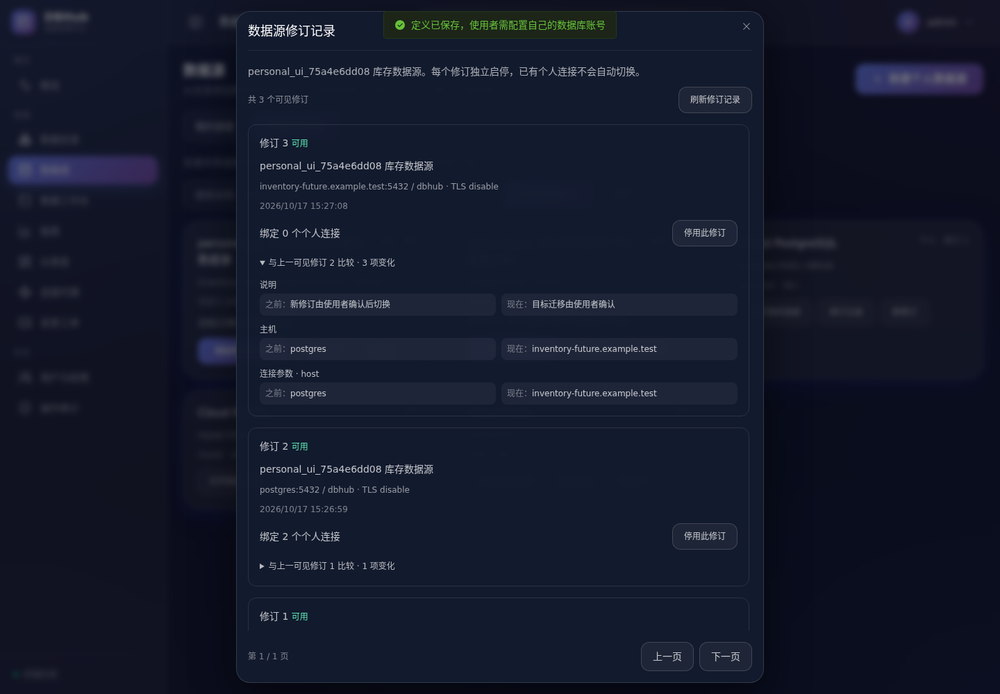
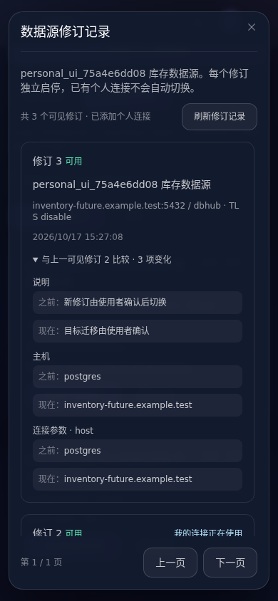
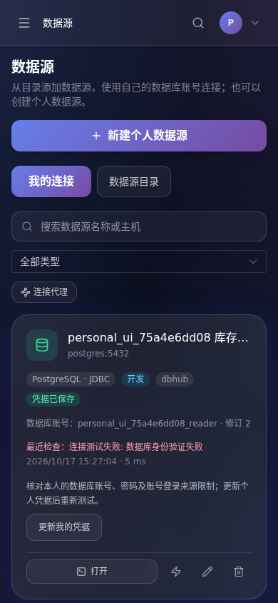

# 数据源修订管理与连接故障诊断

本轮在[共享定义与个人连接](共享数据源与个人连接验收.md)基础上补齐日常管理流程，不增加工作台高级操作。所有数据库操作仍使用操作者自己的个人连接。

## 修订管理

在“数据源目录”打开“修订记录”，可以分页查看历史修订、发布时间、连接目标以及相对上一可见修订的变化。差异包含名称、说明、可见范围、主机、端口、库或服务、TLS、环境、超时、驱动规则引用和连接参数。

历史查询先按当前用户的可见范围过滤，再计算差异。私有定义后来发布到全局时，其他用户不会从“之前”的字段中看到原私有配置。没有更早可见修订时，界面明确提示首次可见发布。

管理员管理全局修订、所有者管理个人修订时，可以看到该修订绑定的个人连接数量。普通使用者只看修订和自己的绑定标记，不获得其他人的连接数量、账号或凭据。

停用操作移入修订记录，旧修订和最新修订都可以独立启停：

1. 确认框说明修订号、受影响的个人连接数量以及已经发送的操作可能完成。
2. 提交时携带 `confirmed:true` 和刚查看的 `expected_binding_count`。
3. 服务端锁定修订后重新统计绑定数量。人数变化返回 409，界面刷新人数，管理者重新确认；缺少确认或数量返回 400。
4. 停用与新增绑定的共享锁互斥，避免漏掉并发加入的使用者。停用后不接受新绑定和新操作；其他修订及现有绑定的目标不会被修改。
5. 重新启用原修订后，使用者可以继续使用原来的个人身份；不会自动升级到最新目标。

绑定数量表示该修订当前保存的个人连接数量，包含停用用户保留的连接。它不表示正在运行的会话数，也不是已发出操作的取消保证。历史修订物理删除仍未开放。

## 连接故障诊断

连接检查失败返回平台生成的固定文案、稳定分类和处理建议。已保存连接的失败诊断随最近检查保留，刷新页面后仍可查看；草稿检查不覆盖已保存结果。原始异常、连接 URL、密码、令牌和 SQL 不进入诊断响应或持久化记录，连接检查日志也只记录用户、连接、类型、耗时和分类。

| 分类 | 提示与处理 |
| --- | --- |
| `authentication_failed` | 核对个人数据库账号、密码和登录来源限制；提供“更新我的凭据”入口 |
| `permission_denied` | 联系数据库管理员检查连接、库和版本信息读取权限 |
| `database_not_found` | 核对数据库或服务名；共享目标由发布者更正修订 |
| `tls_failed` | 核对证书、信任链、主机名及服务器 TLS 支持 |
| `dns_failed` / `network_unreachable` | 检查域名、地址、端口、代理和防火墙 |
| `timeout` / `capacity_exceeded` | 检查负载和容量，按需手动重新测试 |
| `driver_unavailable` | 管理员检查 JDBC 服务、服务认证及已安装制品 |
| `target_denied` / `configuration_invalid` | 检查平台允许目标和驱动配置 |
| `canceled` / `unknown` | 检查未完成或原因未确定，不猜测为密码错误 |

“更新我的凭据”打开本人连接的编辑表单，聚焦空密码框；共享目标仍不可在这里覆盖。用户重新输入并测试、保存后清理旧失败结果；关闭表单会清空内存中的输入密码。不自动重试连接，更不会重派 SQL。

原生接入保留可分类的错误原因链，同时用固定错误文本屏蔽底层连接信息。JDBC 建连从嵌套异常中识别 SQLSTATE、MySQL 错误号和 TLS、网络、超时类型，不再把所有失败统一标成认证问题。JDBC 内部服务认证失败与目标数据库账号认证失败分别处理。

分类只表达服务端给出的证据。例如 MySQL 对无权访问的数据库可能统一返回 1044，即使库实际上不存在，也应提示权限不足；只有收到相应不存在错误时才标记 `database_not_found`。未知驱动或未识别异常保持 `unknown`。

## 接口与升级

新增 `GET /api/v1/datasource-definitions/{id}/revisions?page=1&page_size=20`，返回 `{items,total,page,page_size}`。默认每页 20，最大 100；分页参数非法返回 400。每项增加：

```json
{
  "previous_revision": 1,
  "changes": [{"field":"host","label":"主机","before":"old.example.test","after":"new.example.test"}],
  "binding_count": 3
}
```

`binding_count` 仅管理者可见。没有更早可见版本时省略 `previous_revision`，`changes` 为空。数据源 ID 不存在或不可访问返回 404。

停用请求现在需要：

```json
{"enabled":false,"confirmed":true,"expected_binding_count":3}
```

启用仍使用 `{"enabled":true}`。已有脚本客户端需要随本次接口变更更新。

检查失败的 HTTP 400 响应保留原 `error`，在 `data` 内增加：

```json
{"diagnostic":{"code":"authentication_failed","title":"数据库身份验证失败","hint":"核对本人的数据库账号、密码及账号登录来源限制；更新个人凭据后重新测试。","action":"update_credentials"}}
```

输入校验、权限拒绝或定义停用等未进入检查的错误沿用原错误响应。成功检查不包含失败诊断。检查结果为已有 JSON 字段，无需改动历史数据；旧记录没有诊断时保留通用提示。

新增 [0023_definition_binding_index.sql](../../backend/internal/db/migrations/0023_definition_binding_index.sql)，为修订绑定统计及停用检查建立索引，不改动凭据和归属。后端和 JDBC 服务需使用本轮源码构建；未重用旧 JDBC 镜像作为新诊断功能的验收证据。

## 验收与复现

应用和浏览器均在 Docker 内运行：

```sh
./scripts/cloud/dev.sh exec -T backend go test -timeout 180s -race -p=4 ./...
./scripts/cloud/dev.sh exec -T backend go vet -p=4 ./...
./scripts/cloud/dev.sh exec -T frontend sh -ec 'npm run test:query; npm run build'
./scripts/cloud/dev.sh exec -T jdbc sh -ec 'mkdir -p /tmp/diagnostic-classes; javac -encoding UTF-8 -cp "/runtime/jdbc/lib/*" -d /tmp/diagnostic-classes /app/services/jdbc-runner/src/DBHubJdbc.java /app/services/jdbc-runner/test/ConnectionDiagnosticsTest.java; java -cp "/tmp/diagnostic-classes:/runtime/jdbc/lib/*" ConnectionDiagnosticsTest'
python3 scripts/cloud/personal-browser-check.py
```

后端覆盖历史与分页、私有前序修订不泄漏、管理者绑定统计、缺失确认、人数变化、并发绑定与停用、旧修订启停以及原生/JDBC 的真实 PostgreSQL 和 MySQL 故障。Java 专项覆盖 12 类原因组合及未知 SQLSTATE 清洗；Go 分类测试另覆盖 Redis 协议错误、DNS、证书、容量和未知原因。

本轮全量 Go 竞态测试通过 164 项、12 个测试包，`go vet` 通过；增加 0023 索引后另验证 5 项修订管理测试及真实 0021→0023 迁移。前端执行状态测试 14 项、类型检查和构建通过。两组桌面/手机浏览器共 37 项通过，页面脚本错误为 0。

浏览器扩展既有个人身份验收，实际制造 JDBC 密码错误、刷新后修复，并验证桌面和手机的修订差异、旧版本绑定人数、取消停用、过期人数确认拦截及恢复原身份。完整结果见[验收记录](../acceptance/revisions-diagnostics-2026-10-17.json)。

桌面端查看目标变化和历史绑定人数：



手机端修订查看保留可见的翻页区，普通用户不显示管理统计和启停操作：



真实认证失败的个人凭据修复入口（截图仅含已清理的验收账号）：



以上为修订与诊断阶段的历史记录。后续指定用户／用户组发布及本地 openGauss 演示见[授权、目录与 openGauss 验收](数据源授权目录与openGauss验收.md)；商业 GaussDB 和组织租户仍未验收。
