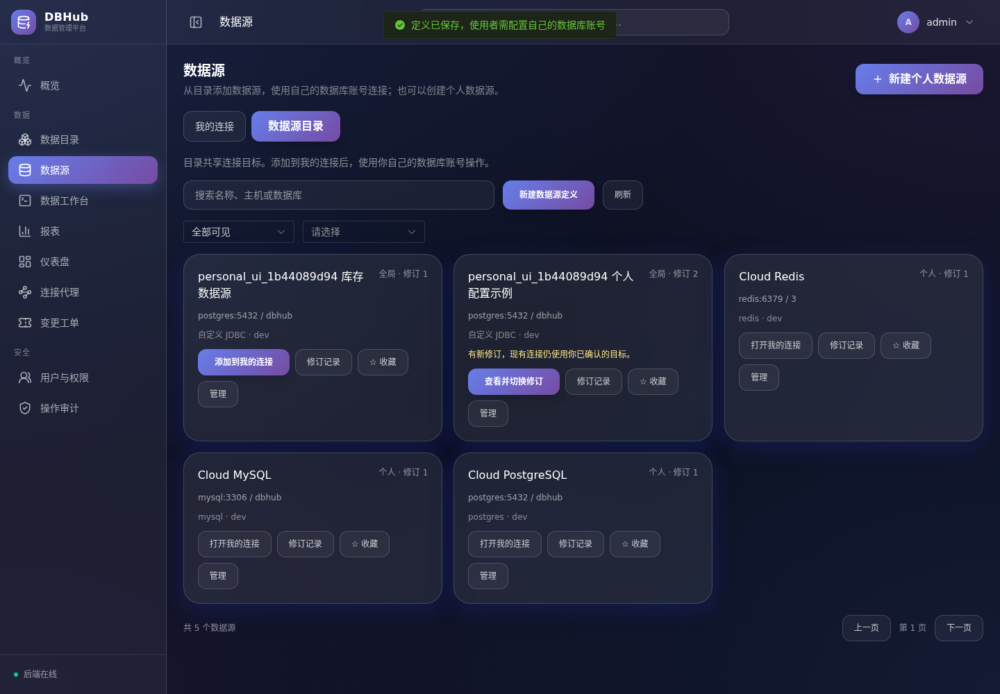
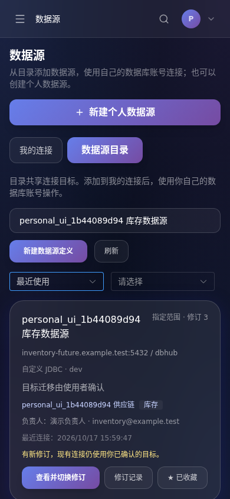
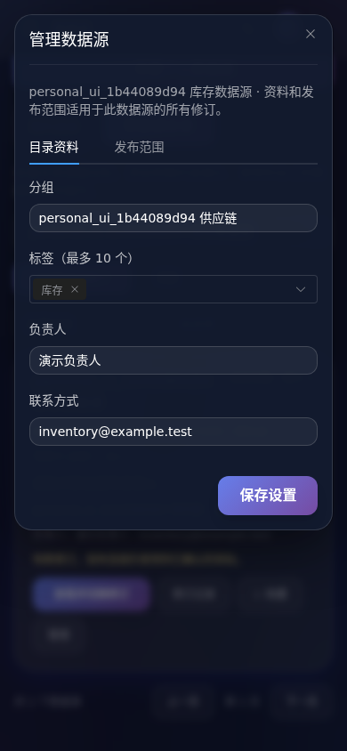
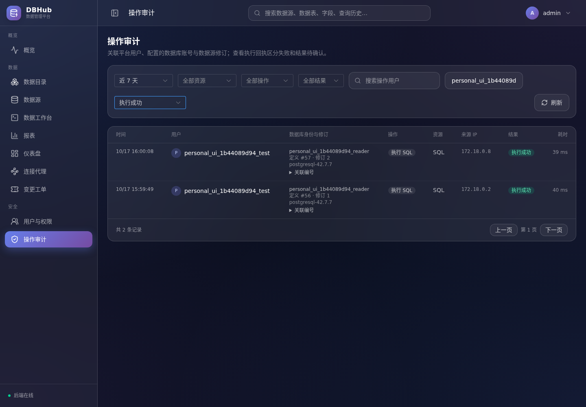

# 数据源发布授权、目录与 openGauss 验收

本轮延续[个人连接](共享数据源与个人连接验收.md)及[修订治理](数据源修订与连接诊断验收.md)，完成指定用户／用户组发布、审计关联和目录管理。数据工作台的 SQL 主操作仍为“运行、格式化”。验收摘要见[本轮记录](../acceptance/source-audience-directory-2026-10-17.json)，演示库证据见[openGauss 记录](../acceptance/opengauss-demo-2026-10-17.json)。

## 发布与个人身份

目录中的定义只描述连接目标，不含数据库账号密码。使用者添加到“我的连接”时，仍须确认目标修订并提供自己的数据库身份；管理员也不能读取或使用别人的个人连接凭据。

| 范围 | 可见及管理规则 |
| --- | --- |
| 个人定义 | 仅所有者可见及管理，其他管理员也不能查看 |
| 全局发布 | 所有活动用户可见，当前管理员管理发布配置 |
| 指定用户／用户组 | 当前管理员、直接授权用户、任一获授权组成员可见；配置由当前管理员管理 |

发布范围绑定整个数据源系列，覆盖所有已发布的历史修订。私有前序修订继续只对原所有者可见，不能从公开差异中泄漏。曾发布过的系列不能通过旧私有修订绕过当前管理员限制。

“新建数据源定义”可以选择“指定用户或用户组”作为初始范围，保存时仅管理员可见，再在“管理 → 资料与发布范围”中配置成员。全过程没有临时向全体公开的窗口。全局驱动与连接规则仍可复用，实例操作权限独立检查。

用户组位于系统设置，仅管理员可创建、编辑成员或删除。直接授权与用户组授权取并集；移出一个组不会撤销其他组或直接授权。受限发布不选成员时仅管理员可见。成员／授权列表最多各 500 项，拒绝重复、无效或已停用的用户。

授权从 PostgreSQL 实时读取，不使用 JWT 或 Redis 保存旧成员权限。撤销后，已有个人连接的后续 SQL、连接测试、结构及采集访问会被拦截；旧修订也不能绕过。缓存结构、历史搜索、共享报表和已批准导出下载同样检查当前可见性。用户仍能查看、删除本人保存的连接，便于清理自己的凭据；能力字段显示不可执行。

已发送的数据库操作可能完成，撤销不代表取消或回滚。授权控制的是平台发布和访问，不撤销数据库自身账号权限；用户仍可以用自己的账号创建独立个人数据源。

## 并发与防呆

发布范围、目录资料和用户组采用独立的乐观版本号。保存必须携带当前版本，旧表单返回 409，避免覆盖别人的修改。授权更新锁定系列；新绑定在取得共享锁后重新检查授权。并发添加与撤销结束后，即使绑定先保存成功，也不能继续使用已经撤销的发布权限。

新修订继续采用原来的显式确认机制，现有连接不会自动切换目标。停用修订继续要求当前绑定人数确认。新的系列读写锁遵循修订追加与管理的统一顺序，避免个人目标编辑和发布范围管理相互等待。

新增迁移 [0024_source_audience_directory.sql](../../backend/internal/db/migrations/0024_source_audience_directory.sql)：保留已有发布范围和个人凭据，初始化系列资料、用户组、授权与个人偏好；删除最后一条修订时清理无主系列。真实旧库升级与重复迁移均已验证。回退应用需要配套数据库备份，未提供逆向迁移。

## 目录与审计

目录支持名称／地址／库／标签搜索、目录分组、标签、负责人及联系方式、个人收藏和最近使用。搜索与分页在服务端完成，每页最多 100 条；分组列表只包含当前可见系列。收藏按用户和系列保存，重复设置幂等。最近使用由成功打开目标连接产生，最多每 30 秒更新一次，保存配置或客户端传时间不会伪造最近使用。

资料不修改连接目标，也不产生新的目标修订。标签去空白、去重，最多 10 个、每个 32 字符；分组 64 字符、负责人 100 字符、联系方式 200 字符。文本按普通文本显示。

审计新增固定字段快照：平台用户及角色、本人连接、数据源系列、修订 ID 和编号、配置的数据库登录账号、驱动、目标是否已打开、执行请求编号及持久化回执状态。事务复用已有目标会话时也能关联原身份。重复请求与冲突不会记为一次新的成功执行，结果待确认单独显示。

这里的数据库账号是实际用于建立连接的配置账号，不额外查询每条 SQL 执行时的有效角色；SQL 内执行角色切换需要结合目标数据库审计。日志不保存密码、Token、连接 URL、SQL 正文或参数。快照没有外键依赖，删除或改名不会改写已记录的关联字段。旧日志没有这些快照字段，不追溯编造。

本轮数据源验收最初采用请求结束后的尽力写入；后续已增加执行前持久化、数据库幂等补写和中断恢复，并补齐事务、取消、下载与鉴权拒绝覆盖，见[审计覆盖与可靠写入](审计覆盖与可靠写入.md)。不宣称事务性合规审计、不可篡改存储或数据库行级审计。组织租户、SSO 与跨实例查询调度仍不在本轮实现中。

## 接口

所有接口位于 `/api/v1`，保持本人连接执行边界。

| 方法与路径 | 用途 |
| --- | --- |
| `GET /datasource-definitions` | `keyword/category/view/page/page_size`；`view=all/favorites/recent` |
| `GET /datasource-definitions/categories` | 当前可见目录分组 |
| `GET /datasource-definitions/{id}/access` | 管理者查看成员 ID 与当前授权版本 |
| `PUT /datasource-definitions/{id}/access` | `mode,user_ids,group_ids,expected_version` |
| `PUT /datasource-definitions/{id}/profile` | `category,tags,maintainer,contact,expected_version` |
| `PUT /datasource-definitions/{id}/favorite` | 当前用户的 `favorite` 布尔值 |
| `GET/POST /user-groups` | 管理员分页查询／创建用户组 |
| `PUT/DELETE /user-groups/{id}` | 编辑／删除，要求 `expected_version` |
| `GET /audit-logs` | 管理员可增加 `database_account/outcome` 过滤 |

创建定义增加可选 `access_mode=global/restricted`，默认为全体发布。后续目标修订沿用系列当前授权，修改范围使用独立接口。不可见定义返回 404；本人已有连接因撤销授权而拒绝运行时返回 403。目录从原来的完整列表改为默认每页 20 条，脚本客户端需要使用分页；页面每页显示 12 条。

## openGauss 本地演示实测

使用 **openGauss 社区 6.0.0、单节点、PG 兼容模式**，服务端返回 `openGauss 6.0.0 build aee4abd5`。镜像为 `enmotech/opengauss` 的 amd64 固定摘要，来源和校验信息保存在验收记录，未使用可变 `latest`。配套官方 Maven 制品 `org.opengauss:opengauss-jdbc:6.0.0-og` 已校验上游摘要并锁定 SHA-256。

新增明确的 `org.opengauss.Driver` 连接规则，URL 模板为 `jdbc:opengauss://{host}:{port}/{database}`，使用 PostgreSQL 基础方言。真实 HTTP 验收覆盖官方驱动连接、本人 `current_user`、带引号参数、NULL／精确小数、建表与增删改查、主键元数据及采集、事务提交／回滚、数据库返回只读 SQLSTATE `25006`、超时后服务可继续使用。

演示容器限制 2 核 CPU、1.5 GiB 内存、256 个进程，无宿主端口，数据位于临时磁盘。MOT 恢复需要 NUMA 的 `mbind` 系统调用，仅增加 `SYS_NICE`，未使用 privileged 或 host networking；关闭 MOT NUMA 绑定和降低缓冲区后，首次手动验收约占 407 MiB 内存；完整脚本复验后的容器统计为 1.025 GiB，低于 1.5 GiB 上限（此读数不是峰值测量）。`max_process_memory` 按数据库允许的最小值配置为 2 GiB，这是数据库参数，容器的实际内存硬限制仍为 1.5 GiB。

验收结束已删除本次容器、数据目录、凭据文件和新下载的数据库镜像，保留验收摘要及作为产品依赖的 JDBC JAR。主磁盘可用空间恢复到约 5.2 GiB；之后临时浏览器容器也在验收完成后清理。

**商业 GaussDB、主备切换、分布式、非 PG 兼容模式、MOT 表、openGauss TLS 实例均未实测。** JDBC 连接检查继续明确返回兼容性未完整验证，不继承原生 PostgreSQL 的版本矩阵。本轮没有重跑原生 12 分支矩阵；全量测试覆盖当前 Cloud PostgreSQL 16、MySQL 8.4 和 Redis 7 的实际服务。

## 复现

```sh
./scripts/cloud/start.sh
./scripts/cloud/dev.sh exec -T backend go test -timeout 300s -race -p=4 ./...
./scripts/cloud/dev.sh exec -T backend go vet -p=4 ./...
./scripts/cloud/dev.sh exec -T frontend sh -ec 'npm run test:query && npm run build'

# 串行、可选；先确保 JDBC 已按当前源码和锁定清单启动。
python3 scripts/cloud/opengauss-demo-check.py

# 创建并清理随机命名的真实数据库角色、应用用户、定义及用户组。
DBHUB_AUDIENCE_BROWSER=1 python3 scripts/cloud/personal-browser-check.py
# 浏览器依赖容器可以在不再验收后删除：
docker rm -f dbhub-personal-browser
```

演示脚本要求现有 Cloud 服务运行，检查磁盘空间，在 `finally` 清理本轮资源，保留运行前已有镜像。测试期间不要重启 backend/JDBC；不要并行运行演示库、版本矩阵和需要大量磁盘写入的镜像构建。详细测试条目与截图见本轮验收记录。

本轮常规 Go 竞态套件通过 174 项、12 个测试包，`go vet` 通过；原生完整矩阵入口和未配置临时库的 openGauss 入口在常规套件中明确跳过。临时库单独补跑 8 个真实子场景及父测试，共 9 项通过，并完整复验了部署、测试、自动销毁脚本。追加共享报表撤销断言后，授权专项 7 项再次通过。前端 14 项、类型检查、构建、Java 12 类诊断和 31 项桌面／手机浏览器检查通过，页面脚本错误为 0。

下列截图只含已清理的演示账号、连接目标及资料。

桌面数据源目录：



手机上的最近使用、个人收藏与目录资料：



手机管理弹窗保留可见的保存操作：



按数据库账号与执行状态筛选后的身份、驱动和修订关联：


