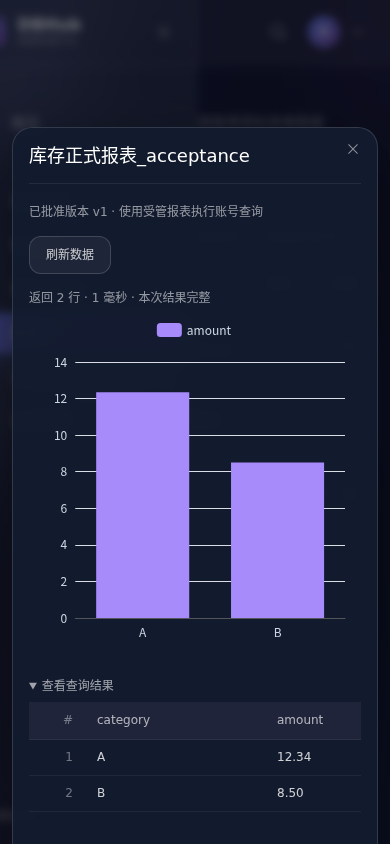

# 正式报表发布与执行账号

2026-10-18 实现版本管理、单级审批、独立报表执行账号和正式发布。原有个人报表继续使用查看者自己的个人连接；本模块采用独立的受管资源和授权，不自动提升任何历史共享报表的执行身份。

## 使用流程

1. 管理员在“报表 → 执行账号”添加数据库账号，选择已发布数据源的固定修订。数据库端先授予限定表或视图的读取权限，再测试只读连接。账号配置加密保存，用户名和数据源身份不能原地替换；更换身份须创建新账号。
2. 开发者在“我的开发”创建正式报表草稿，使用个人连接预览 SQL 并配置图表。也可以从个人报表点击“创建正式草稿”，复制当前定义后继续开发。
3. 保存草稿后提交审批。提交生成不可修改的内容版本；草稿可以继续修改，不影响送审版本或当前已发布版本。
4. 管理员在“开发与审批 → 待审批”审阅 SQL 和版本差异，选择同一数据源修订上的执行账号，指定用户或用户组作为受众。提交者不能审批自己的版本。
5. 使用选定账号运行冻结查询，确认实际返回的数据适合受众。验证成功后，15 分钟内可以批准；更改账号或受众会使前端验证状态失效。密码或账号状态发生变化也会使服务端拒绝旧验证。
6. 批准与发布分开操作。点击发布后，受众在“已发布”查看报表，无须配置个人数据库账号，也不会因此获得工作台、源目录或数据库元数据访问权。
7. 新版本按相同流程送审、批准并发布。可以下线当前报表，或回滚到仍满足账号、数据源和受众条件的历史已发布版本。

## 版本和身份边界

`sys_reports.version` 仍是个人报表的并发修改编号。正式报表新增独立主记录、工作草稿、不可变内容版本、一次性审批决定、只读验证记录、追加发布事件和幂等操作记录，见迁移 `0027_managed_reports.sql`。

提交版本固定名称、描述、SQL、数据源修订、数据库及图表配置。批准清单固定内容摘要、执行账号、受众、1000 行/30 秒执行上限；系统及查看者的更严格限制继续生效。摘要对 JSON 做规范化，避免 PostgreSQL JSONB 改变图表配置键顺序后造成误判。版本、验证和发布历史在数据库层阻止修改或删除；历史用户外键仅允许置空，并保留用户名快照。

当前已发布指针与草稿分离。正式查看元数据接口不包含执行 SQL、连接地址、数据库账号配置或审批内部说明；查询结果由获批 SQL 决定。客户端不能覆盖 SQL、数据库、账号、个人连接或事务；查看只能执行服务端解析的批准版本。队列中的 SQL 文本替换为报表标识，正式执行不写入查看者的普通查询历史。执行回执不保存结果行或可重放 SQL。

报表账号独立于 `sys_connections`，不能出现在个人工作台连接列表中。运行时不修改操作者身份来借用别人的个人凭据。操作审计同时保留访问用户、实际数据库账号、作者、审批者、发布者、内容版本、审批编号、发布序号和批准摘要。

统一执行账号不会自动继承查看者在数据库中的个人行级权限。第一版依靠受限数据库视图或分业务账号控制可读数据；同一获批查询的受众必须都可访问它的返回数据。账号连接测试只能证明连接与强制只读查询可用，不能代替审阅数据库读取权限和实际报表结果。

## 幂等、并发与撤权

- 草稿创建与修改、送审、审批、发布、下线、回滚、移交及账号维护均要求非空 UUID `request_id`。同一用户的编号重试返回原操作标识，不同操作或内容复用编号返回 409。含凭据的操作采用应用密钥派生的 HMAC 指纹，避免在幂等表留下可直接离线猜测的密码摘要。
- 草稿修改和移交校验 `version`。审批决定互斥，发布按 `expected_publication_no` 比较并原子切换，竞争请求只有一个成功。同一执行 UUID 不重复发送 SQL。
- 校验只接受单条合法只读 SQL，执行进入数据库只读事务；SELECT 调用函数中的隐藏写入也受限制。原生 PostgreSQL、MySQL 及已适配 JDBC 复用原有连接器能力。
- 入队、真正发送 SQL 前及交付结果前检查当前发布、账号状态、凭据代次、数据源状态和查看者授权。已开始的查询尽力取消；权限变化后未交付的结果不再返回，已展示的数据无法追溯收回。
- 数据源直接使用权限与正式报表授权分离。撤销查看者的直接数据源授权不会自动撤销已批准的报表授权；移除受众用户、移除组成员、停用用户或下线报表阻断正式访问。数据源或执行账号停用会阻断相关正式执行。
- 停用执行账号需要确认当前已发布报表数量。停用数据源修订同时确认个人连接及正式报表影响数量，数量变化时要求刷新确认。
- 作者移除个人连接或停用账号不删除正式报表。作者删除前必须移交正式报表责任人；删除后保留版本、审批、发布和审计历史。

## 接口

所有接口均在 `/api/v1` 下；对象级权限由服务端判断，管理接口不得用于普通查看。

| 方法与路径 | 输入要点与权限 |
| --- | --- |
| `POST /managed-reports` | 开发者/管理员；个人连接、SQL、名称、图表配置、`request_id` |
| `GET /managed-reports` | 开发者看自己的；管理员可选 `scope=all/pending`；名称/描述搜索和分页 |
| `GET /managed-reports/{id}` | 责任人或管理员；草稿、编辑编号、当前发布编号 |
| `PUT /managed-reports/{id}/draft` | 仅责任人；完整草稿、当前 `version`、`request_id` |
| `POST /managed-reports/{id}/submit` | 仅责任人；当前草稿 `version`、`request_id`；重新检查个人连接权限 |
| `GET /managed-reports/{id}/versions` | 责任人/管理员；分页查看冻结内容、审批状态及批准受众 |
| `POST /report-reviews/{id}/validate` | 非提交者的管理员；执行账号、`user_ids/group_ids`、执行 UUID；返回实际查询结果及 `validation_id` |
| `POST /report-reviews/{id}/decision` | 管理员批准/退回，责任人可撤回待审申请；批准需本管理员的有效验证编号，退回需原因 |
| `POST /managed-reports/{id}/releases` | 管理员；`kind=publish/rollback/unpublish`、`review_id`、`expected_publication_no`、`request_id`；下线的 `review_id=0` |
| `GET /managed-reports/{id}/releases` | 责任人/管理员；分页查看发布、下线及回滚事件 |
| `POST /managed-reports/{id}/transfer` | 管理员；当前草稿 `version`、新责任人 `owner_id`、`request_id` |
| `GET /published-reports`、`GET /published-reports/{id}` | 获批受众；仅返回当前正式版本的展示元数据 |
| `POST /published-reports/{id}/execute` | 获批受众；仅接受当前 `publication_no` 与执行 UUID |
| `GET /report-accounts` | 管理员；账号、状态及当前报表影响数量，不返回密码 |
| `POST /report-accounts` | 管理员；源修订、数据库用户名、密码、显示名称及 `request_id` |
| `POST /report-accounts/{id}/test` | 管理员；测试当前账号的只读连接 |
| `PATCH /report-accounts/{id}` | 管理员；当前 `version`、密码轮换或启停、`request_id`；停用需 `expected_reports` |

## 验证与复现

既有 Cloud Docker 服务即可运行，不新增常驻服务：

```sh
scripts/cloud/dev.sh exec -T backend sh -ec 'go test -race -count=1 -p=4 -timeout 300s ./...; go vet -p=4 ./...'
scripts/cloud/dev.sh exec -T frontend sh -ec 'npm run test:report; npm run test:query; npm run build'
docker build -t dbhub-backend:managed-reports backend
docker build --secret id=proxy_ca,src="$CODEX_PROXY_CERT" -t dbhub-frontend:managed-reports frontend
python scripts/cloud/managed_report_acceptance.py
```

生产验收脚本使用已构建镜像、独立元数据 schema、限定视图读取权限的数据库角色及独立审计卷。后端 UID 65532、只读根文件系统、无附加 capabilities，目标仅放行已有 Cloud 的 `postgres:5432`。通过真实浏览器执行多用户流程，并回归原个人报表流程，无模拟业务响应。为控制本轮 Cloud 磁盘占用，最终前端使用现有固定 Node 24.12.0 容器的构建产物，按原 Dockerfile 相同的 NGINX 运行阶段打包；浏览器下载、虚拟环境及缓存放在独立临时盘。无论成功或失败，脚本均清理本次创建的容器、网络、审计卷、schema、数据库角色及临时凭据文件；保留不含凭据的验收记录和截图。资源不足时可以仅清理本次构建产生的缓存，不运行全局 Docker prune。

后端专项覆盖实际 PostgreSQL 受限视图账号、原生 MySQL 受限账号、JDBC PostgreSQL、只读事务、隐藏函数写入拒绝、未绑定用户、摘要规范化、高精度数值、并发审批发布、版本隔离、回滚、账号轮换、源停用影响确认、排队撤权及交付前撤权，以及作者移交删除后的存续。

当前源代码全量验收：Go 竞态检查 250 项、16 个测试包通过，`go vet` 通过；前端报表 14 项及工作台 14 项通过，类型检查和生产构建通过。3 个特殊入口跳过：崩溃测试的独立子进程入口、独立版本矩阵入口、已销毁的 openGauss 演示实例入口；不将这些跳过计为通过。

最终生产镜像浏览器验收通过 20 项：正式报表流程 10 项、原有个人报表回归 10 项，业务响应模拟数和页面脚本错误均为 0。修复测试选择器后，在保留的独立验收运行环境中使用新建的用户和报表重新执行完整脚本；最终前端容器直接运行产物镜像，没有挂载替换页面资源。确认审计待投递数为 0 后，已删除本次临时容器、网络、卷、数据库 schema/角色和临时凭据文件，原 Cloud 服务保留运行。详细检查、镜像摘要、源文件摘要和原始记录摘要见[机器验收记录](../acceptance/managed-reports-2026-10-18.json)。

下图为未配置个人数据库连接的受众，使用受管账号查看正式报表的实际移动端页面：



## 本期范围

第一版提供单级审批与固定 SQL，不包含通用工作流、多级会签、动态参数、平台行级策略、定时订阅、匿名访问或结果缓存。现有个人报表共享仍采用各人的个人连接。

本次验收使用合成数据和本地容器；未重新部署 openGauss，也未连接真实 GaussDB 产品实例。尚未进行实际组织业务负载、跨企业租户隔离或对外域名上线验收。正式部署仍需配置组织实际的受限数据库账号及目标地址许可。
