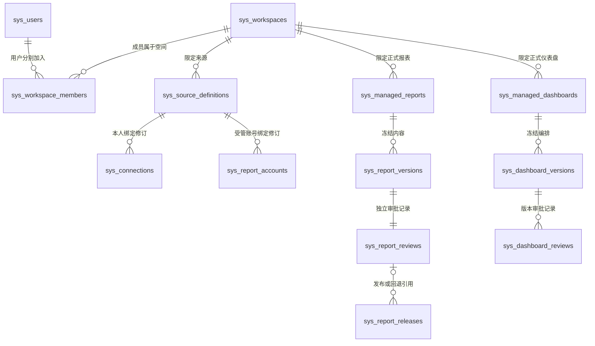

# 数据库模型设计

本文维护元数据库的对象关系、约束和迁移入口。完整DDL、函数、触发器及索引以[内嵌增量迁移](../../backend/internal/db/migrations/)为准；当前候选迁移至 0104，实际部署以 `schema_migrations` 核对。目标业务库由独立连接器访问，不属于DBHub元数据库。阶段及真实启用状态见[路线图](../项目管控/开发路线图与当前任务.md)。

## 1 核心对象关系

下图只列主要引用关系。空间内对象的引用还须满足同一workspace_id、所有者及当前授权约束；单个ID或一条外键不代表可访问。

## 2 现行结构入口

同一对象须叠加其后的全部迁移，不能单独执行下表某个文件来创建“当前结构”。表中列主要起点和重要补充，完整顺序在迁移目录；不在本文复制另一套CREATE TABLE。

账号与权限矩阵的增量迁移（#43）为平台账号增加受版本保护的开通状态及存储一次性凭据摘要、用途、到期与消费的记录。账号开通在事务内显式区分旧自动入空间的创建路径。账号操作与凭据发放序列化，旧会话继续通过既有认证版本失效。空间矩阵标志对存量空间默认关闭。菜单配置按原空间主键与配置版本存储稳定角色编号到菜单设置的映射，兼容读取空配置或缺失单元并继承旧显示。实际 DDL、唯一约束及到期索引以新增迁移为准。

#47 为 `sys_iam_workspace_state` 新增默认关闭的仪表盘矩阵标记。通过受限维护函数按工作空间显式启用，事务内追加三个内置角色的新版本、移转有效分配的角色版本引用、推进权限代次并留审计。复核保存签署时的资格依据，用于重新授权后识别旧签署；历史记录保留。复用原工作空间、角色及分配索引，无新增索引需求。

权限职责调整（#44）为 `sys_workspace_members` 新增布尔列 `matrix_admin`，默认 `false`。该列记录矩阵内的管理职责，既有业务数据身份和直接业务角色继续由原字段决定。成员资格写入复用同一空间的成员主键、权限代次和事务审计。默认工作空间的矩阵开关由新增迁移显式启用。按原有效许可映射普通成员的角色，保留成员状态、过期限制和既有组授权记录。迁移沿用现有主键、外键及索引。

常见图表（#45）通过 [0104](../../backend/internal/db/migrations/0104_report_chart_types.sql) 扩展 `sys_reports_chart_type_check` 的允许值。沿用 `chart_type` 列和 `chart_config` JSON 字段、原有索引及正式报表冻结结构。历史报表保留原字节，新增样式和热力图第二维由保存接口写入持久配置。

| 对象域 | 主要结构与约束 | DDL及索引入口 |
| --- | --- | --- |
| 身份与会话 | sys_users、旧sys_roles；当前认证版本、MFA、外部身份；会话与撤销状态另存Redis | [0002](../../backend/internal/db/migrations/0002_roles_users.sql)、[0043](../../backend/internal/db/migrations/0043_identity_security.sql)、[0044](../../backend/internal/db/migrations/0044_external_identity_revocation.sql) |
| 本人连接及网络 | sys_connections、sys_ssh_tunnels、sys_proxies；凭据加密、当前本人范围 | [0003](../../backend/internal/db/migrations/0003_ssh_tunnels.sql)、[0004](../../backend/internal/db/migrations/0004_connections.sql)、[0009](../../backend/internal/db/migrations/0009_proxies.sql) |
| 驱动、模板和共享定义 | sys_jdbc_drivers、sys_datasource_templates、sys_source_definitions；不可变制品/修订、范围内唯一、引用保护、个人绑定 | [0021](../../backend/internal/db/migrations/0021_connector_catalog.sql)、[0022](../../backend/internal/db/migrations/0022_personal_connections.sql)、[0023](../../backend/internal/db/migrations/0023_definition_binding_index.sql)、[0024](../../backend/internal/db/migrations/0024_source_audience_directory.sql) |
| 查询与工具 | sys_query_history、查询设置/策略/片段、sys_tickets；历史与工单结果有各自主体边界 | [0005](../../backend/internal/db/migrations/0005_query_history.sql)、[0013](../../backend/internal/db/migrations/0013_backend_completion.sql)、[0014](../../backend/internal/db/migrations/0014_query_shares_tickets.sql) |
| 执行登记及审计 | sys_query_executions防重与摘要回执；sys_audit_logs事件UUID幂等补写；本地待写卷另行持久化 | [0017](../../backend/internal/db/migrations/0017_query_executions.sql)—[0019](../../backend/internal/db/migrations/0019_query_execution_metrics.sql)、[0025](../../backend/internal/db/migrations/0025_reliable_audit.sql)、[0082](../../backend/internal/db/migrations/0082_query_execution_cancellation.sql) |
| 元数据、标注与血缘 | sys_meta_snapshots、标注和血缘缓存；采集快照与人工标注分开，完整采集后原子发布 | [0007](../../backend/internal/db/migrations/0007_meta_assets.sql)、[0011](../../backend/internal/db/migrations/0011_lineage.sql)、[0016](../../backend/internal/db/migrations/0016_rebuild_ast_lineage.sql)、[0020](../../backend/internal/db/migrations/0020_connection_checks.sql) |
| 个人报表与旧仪表盘 | sys_reports、sys_dashboards及历史分享表；个人并发version不等于正式内容历史 | [0008](../../backend/internal/db/migrations/0008_reports.sql)、[0026](../../backend/internal/db/migrations/0026_report_phase1.sql)、[0041](../../backend/internal/db/migrations/0041_report_chart_types.sql)、[0104](../../backend/internal/db/migrations/0104_report_chart_types.sql) |
| 正式报表 | sys_report_accounts、sys_managed_reports、sys_report_versions/reviews/validations/releases/commands；草稿、审批及发布指针分开 | [0027](../../backend/internal/db/migrations/0027_managed_reports.sql)、[0038](../../backend/internal/db/migrations/0038_report_parameters.sql) |
| 角色直接分配与业务负责人 | 直接角色分配使用空间、成员和稳定角色标识，更新授权代次并保存写入回执。受管报表增加独立业务负责人及代次，首次送审版本记录候选，签署和发布检查当前代次。新增迁移递增现有版本，存量数据维持原值。 | [权限与交付契约](../架构设计/内容与交付契约.md#82-阶段-3-正式报表复核与正常发布) |
| 工作空间与资格代次 | sys_workspaces、sys_workspace_members、组/受众引用、复合约束、RLS、成员及审批指派代次 | [0028](../../backend/internal/db/migrations/0028_workspaces.sql)—[0035](../../backend/internal/db/migrations/0035_dashboard_review_assignment_epoch.sql)、[0042](../../backend/internal/db/migrations/0042_workspace_capabilities.sql) |
| 正式仪表盘 | sys_managed_dashboards、版本、审批、发布、访问申请、刷新清单、逐卡回执绑定及共享租约 | [0029](../../backend/internal/db/migrations/0029_dashboard_lifecycle.sql)、[0033](../../backend/internal/db/migrations/0033_access_request_targets.sql)、[0034](../../backend/internal/db/migrations/0034_dashboard_receipt_binding.sql)、[0039](../../backend/internal/db/migrations/0039_dashboard_filter_values.sql) |
| 通知与源任务 | 站内通知、源任务/计划/检查历史、运维状态；原主体、幂等键、活动任务约束及租约 | [0036](../../backend/internal/db/migrations/0036_operations_inbox_source_tasks.sql)、[0037](../../backend/internal/db/migrations/0037_security_execution_boundaries.sql) |
| 报表导出与个人订阅 | sys_report_exports、订阅、逐期快照、交付、指标告警及事件；保存原批准与期限 | [0040](../../backend/internal/db/migrations/0040_report_exports.sql)、[0045](../../backend/internal/db/migrations/0045_report_subscriptions.sql) |
| 隔离正式报表导出 | sys_iam_isolated_formal_exports 按空间及报表登记；sys_report_exports 分开保存冻结输入与受限预览；sys_report_export_jobs 按空间及申请唯一，部分索引覆盖待执行和运行租约；sys_report_export_files 单独保存加密正式文件、生成时间、期限、大小和 SHA-256 | [0093](../../backend/internal/db/migrations/0093_isolated_formal_exports.sql) |
| 交付期限与周期 | 自动期次以空间、计划及周期起点唯一；到期索引支持分批清理正式文件、凭证与团队快照，保留原校验值和回执；通知独立保存入口期限，指标事件保存加密原发生值及策略指纹 | [0096](../../backend/internal/db/migrations/0096_delivery_retention_schedule.sql) |
| 隔离仪表盘交付 | 批准计划持久化选中卡片与逐人边界；任务按计划、周期、主体唯一，保存独立加密载荷、期限及校验值；收件授权与会话凭证分别绑定版本，告警事件独立于快照载荷保留 | [0097](../../backend/internal/db/migrations/0097_dashboard_delivery.sql) |
| 隔离订阅复核 | 报表显式登记与按数据集隔离资格单独保存。个人计划增加冻结确认依据及到期字段，旧记录保持兼容；团队申请以空间和编号识别，前序申请只允许一个后续版本，批准签名及名单证据独立保留。 | [0094](../../backend/internal/db/migrations/0094_isolated_subscription_reviews.sql) |
| 隔离逐人交付 | 正式文件一次凭证保存摘要与会话绑定；团队计划按收件人记录资格版本，每期按收件人唯一分配执行及加密快照，索引覆盖待执行和运行租约。 | [0095](../../backend/internal/db/migrations/0095_isolated_recipient_delivery.sql) |
| 固定业务办理 | 模板、执行账号、预览、核验、申请与执行回执，独立于SQL工单 | [0046](../../backend/internal/db/migrations/0046_business_operations.sql) |
| 权限与治理 | sys_iam_*目录、角色修订、来源、委派、提案、收紧记录、运行桥、最小托管及双人治理恢复 | [0047](../../backend/internal/db/migrations/0047_iam_foundation.sql)—[0049](../../backend/internal/db/migrations/0049_iam_governance.sql) |
| 权限执行与兼容加固 | 任务资格版本、只读影子、收紧屏障、当前许可/来源/目录计划，以及限期解除禁止的精确审批关联 | [0050](../../backend/internal/db/migrations/0050_iam_execution_versions.sql)—[0081](../../backend/internal/db/migrations/0081_iam_navigation_directory_plan.sql)，其中[0065](../../backend/internal/db/migrations/0065_iam_action_release_approval.sql)处理解除禁止 |
| 业务身份、数据集与组织范围 | `sys_business_identities`、`sys_business_datasets`、`sys_business_identity_datasets` 固定成员、数据集与执行账号版本。组织范围表保存固定身份、数据集版本的组合 | [0083](../../backend/internal/db/migrations/0083_business_identity_datasets.sql)、[0084](../../backend/internal/db/migrations/0084_business_organization_scopes.sql) |

## 3 必须保持的数据约束

- 空间内对象及引用链保持同一空间，个人连接、历史、任务和文件再检查当前主体。复合键、外键、RLS与后端检查共同生效，不能仅凭前端传入workspace_id放行。
- 驱动制品、模板/来源修订固定引用；模板修订追加，既有绑定不浮动升级。定义不保存认证材料；个人绑定与受管报表账号分开。删除被引用对象按迁移和仓储规则拒绝或受控处置，不一概级联清除。
- 内容版本与批准摘要不可原地改写，发布/下线/回退追加事件并检查预期发布号。历史操作者允许按已定义外键置空，姓名及真实签名快照保留；删除或冻结作者不删除正式内容历史。
- 命令防重键绑定原空间、主体、操作及内容指纹，授权/配置/凭据代次分别检查；版本不能倒拨。查询登记编号不能因TTL、失败、重启或历史清理而重新获得执行机会。
- 收紧、治理差异及审计按各自事务原子写入；当前收紧在恢复和回退后仍有效。新角色/许可表存在不代表已启用，当前兼容边界按[数据执行契约](../架构设计/数据接入与执行契约.md#7-功能治理与迁移的有效规则)维护。

## 4 索引与并发约束

| 查阅点 | 当前约束及索引用途 |
| --- | --- |
| 来源及绑定 | 范围内制品/模板修订唯一、本人逻辑源绑定唯一；definition_revision_id索引用于停用前绑定数检查，定义行锁与并发绑定互斥，见0022、0023、0028 |
| 正式报表 | 版本号和发布号在报表内唯一；待审索引、所有者列表索引及当前发布的复合引用见0027，随后叠加空间约束 |
| 仪表盘及访问申请 | 每对象最多一个pending审批的部分唯一索引；这不等于每版本只有一条历史审批。活动访问申请去重及刷新/执行租约到期索引见0029及其后续迁移 |
| 文件与任务 | 主体文件列表、审批队列、活动源任务、计划去重及租约领取分别索引；文件期限不能由索引清理绕过当前领取检查 |
| IAM治理 | 空间内稳定角色ID/修订、主体来源、提案幂等键及当前授权代次；0048增加来源/角色查询索引，后续迁移维护当前判定计划，不手工维护另一份DDL副本 |
| 业务身份与数据集 | 以空间与成员或数据集键组成主键，空间内来源和业务键唯一。映射复合外键限定空间，数据集反向引用与受管账号引用各有索引。保存使用预期版本并在事务中更新整组绑定。迁移新增空表，旧对象无需回填，回退时可保留表与记录 |
| 组织范围 | 范围主键为空间、成员和数据集，记录来源及上游版本。组合表主键追加三个业务维度，禁止重复组合。复合外键保持同空间，索引支持按数据集反查；清单事务内整体替换。迁移新增空表，范围与旧业务对象兼容 |
| 数据集行列策略 | `sys_business_row_column_policies` 以空间和数据集为主键及复合外键，固定数据集版本，按预期版本替换策略定义，使用既有空间管理员 RLS。[0085](../../backend/internal/db/migrations/0085_business_row_column_policies.sql) 新增空表。 |
| 数据集输出策略 | `sys_business_output_policies` 以空间与数据集为主键及复合外键，固定数据集和行列策略版本，以预期版本原子替换字段分类定义。采用同空间管理员 RLS。[0086](../../backend/internal/db/migrations/0086_business_output_policies.sql) 新增空表。 |
| 明文核查申请 | `sys_business_reveal_requests` 绑定空间、数据集、申请人、明确记录版本、字段、用途和策略版本。主键定位申请，索引支持按数据集反查。审批或收回在同一行的事务锁下进行，读计划再核对审批人与申请人的当前范围。见 [0086](../../backend/internal/db/migrations/0086_business_output_policies.sql)。 |
| 阶段 2 隔离报表登记 | `sys_iam_isolated_business_reports` 以空间与报表为主键，复合外键限制在同一空间的数据集与正式报表，引用隔离库登记。维护身份登记，运行账号只读，升级后为空。文件元数据与加密订阅快照保存交付策略指纹，旧记录默认为空。[0087](../../backend/internal/db/migrations/0087_isolated_business_reports.sql) |
| 隔离报表参数绑定 | 复用行列策略版本的 `definition.parameter_bindings` 保存批准视图列、比较方式和允许值域。报表冻结定义保存本发布采用的子范围，复核边界保存该参数范围的快照。 |
| 阶段 3 隔离报表复核 | `sys_iam_isolated_report_reviews` 登记阶段 3 报表，引用同空间阶段 2 绑定。按空间、数据集和成员在 `sys_iam_isolated_report_data_reviewers` 单独登记数据复核授权和有效期，授权重新登记会获得新身份。两张表由维护身份登记。 `sys_report_review_checks` 复用原审批记录，保存预览、基线、风险判定、数据边界和独立签名。 |
| 阶段 3 隔离仪表盘复核 | `sys_iam_isolated_dashboard_reviews` 登记同空间仪表盘和隔离标识。 `sys_dashboard_review_checks` 按审批及指派代次保存逐卡覆盖和单人跨数据集签名，复用既有数据集复核授权。审批行和卡片预览回执存放本次覆盖及策略指纹。 |
| 阶段 3 隔离下线与恢复 | `sys_iam_isolated_content_operators` 按纳管对象、人员、动作及有效期登记应急授权。运行身份通过隔离函数检查本人资格。`sys_content_availability_events` 追加正常下线申请、独立批准、应急停止和应急恢复，按空间、对象与发布基线查询，保存原因、操作者及原审批或停止事件。冻结版本、审批记录及正式发布号仍由原表维护。[0090](../../backend/internal/db/migrations/0090_isolated_content_availability.sql) |
| 阶段 3 隔离资产交接 | `sys_content_custody_items` 逐项关联空间冻结、对象和版本。空间和冻结编号用于查询，开放交接按对象唯一。候选、同意和复核复用治理变更回执及审计。冻结版本和批准签名保留。[0091](../../backend/internal/db/migrations/0091_isolated_content_custody.sql) |
| 阶段 3 隔离成员重新加入 | `sys_iam_isolated_custody_rejoins` 关联原冻结、平台账户及批准后的新成员主体，保留提名、批准人和批准时间。新主体只用于原空间，身份表限制无独立登录凭据，退出前的成员标识仍用于旧资产和交付。[0092](../../backend/internal/db/migrations/0092_isolated_custody_rejoins.sql) |

## 5 秘密、留存与升级

密码、私钥及口令字段使用既有AES-256-GCM加密，主密钥通过受控配置注入，不能写入代码或元数据库；主密钥丢失后无法仅靠数据库备份恢复凭据。JWT、刷新令牌、一次性码和密钥不写入文档或日志。

审计与查询历史按明确部署留存配置清理，默认不自动清理；未知结果和防重键不自动删除，不可变审批、内容版本和发布记录不纳入普通历史清理。文件/期次快照按其原期限处理，不能用普通清理改写批准或恢复过期业务数据。

数据库连接使用情况见[系统架构](../架构设计/系统架构总览.md)：元数据库有独立连接池，普通目标请求持有独占连接，本文不规定“所有目标长期池化”或复制未生效的空闲/生命周期参数。

升级新增迁移，不改写已应用历史文件，不通过复制本文片段初始化已有库。变更说明须包含受影响DDL/函数/索引、存量兼容、事务及回退边界；在隔离数据库验证升级和恢复。备份、密钥、审计卷与当前收紧的恢复要求见[部署运维指南](../部署运维/部署运维指南.md)。统一数据范围、团队交付等后续规划尚未交付时，不预建另一套策略或工作流表。

## 工作台脚本存储

迁移 `0098_workbench_scripts.sql` 对应 [#34 编码与验收计划](../项目管控/开发路线图与当前任务.md#workbench-34-must-plan)。`sys_sql_snippets` 由迁移 0028 纳入空间范围。0098 沿用脚本标识序列和正文存储，新增目录、显式类型和逐人只读授权。

| 持久对象 | 增量结构和索引 |
| --- | --- |
| `sys_sql_snippets` | 清理旧片段后增加必填 `script_type`，接受 `mysql`、`postgres`、`redis`，同时收口旧 `visibility` 列及对应索引。新增可空 `folder_id` 和必填 `version`，正文继续映射到原文本列，版本从 1 开始并递增。目录引用以 `(workspace_id, user_id, folder_id)` 匹配同一所有者、同一空间的目录。为按空间、所有者、目录和更新时间分页列脚本建立索引。 |
| `sys_script_folders` | `id, workspace_id, user_id, parent_id, name, created_at, updated_at`。`parent_id` 为空表示顶层，父目录复合外键限定同空间同所有者。空间、所有者、上级和名称用于同一层级重名检查与目录读取。文件在根目录时 `folder_id` 为空。 |
| `sys_script_read_grants` | `workspace_id, script_id, reader_user_id, granted_at`。使用空间、脚本及读者作为唯一键，脚本和有效成员引用同一空间。索引按空间、读者、脚本支持「分享给我」。授权按当前空间有效成员主体记录，撤回时同步写入既有审计。 |

默认绑定以原 `connection_id, database_name` 为基础。服务端记录足以核对原目标的非敏感连接标识和来源定义修订，连接被移除后原绑定作为失效状态保留。显式解除时清理关联字段。Redis 库名保存实际固定逻辑库。个人连接改绑到其他来源或固定逻辑库变化时保留正文，要求重新确认。脚本字段及列表响应均按用途控制连接信息，凭据沿用原连接存储。

目录创建时可以选本人已有目录为上级。目录可重命名，父级关系在本期固定。脚本可在根目录及本人目录间移动。同级目录名以去除首尾空白和忽略大小写后的值去重。逐人授权记录脚本所有者和获邀成员版本，外键绑定到脚本和当前空间成员，成员资格失效后原授权不再有效。绑定记录单独保留最近明确确认的连接编号和配置签名，用于区分无绑定和绑定失效。

新脚本检查当前空间和主体。对于显式类型记录，读取由所有者或当前有效授权决定，更新、移动、授权由所有者决定。RLS 同时约束空间和对象可见性，核对旧的宽松策略合并后仍有效隔离。接口检查和写入在同一受控事务内完成。按当前版本保存，冲突保留已提交版本和待编辑内容；移动更新目录引用和版本，分享继续指向同一脚本标识。授予与撤回操作按唯一键去重。

当前尚未投入生产，用户已确认工作台旧脚本可清理。采用新增一次性迁移，复用脚本表和标识序列。同一迁移先加入类型字段，以尚无显式类型识别旧片段，清理后再设置类型必填并切换到逐人访问。停用旧片段的写入入口与数据库升级按同一候选统筹，迁移版本继续用 `schema_migrations` 记账。原查询历史、执行回执、连接及源定义各按现有保留规则处理。

升级预演在隔离元数据库布置旧私有与旧共享片段，同时布置查询历史及回执作为保留对照。核对清理前后数量和范围、新脚本及授权可用、重跑升级保留新写入。按既有备份和恢复流程验证回退，回退需保留新版本脚本数据的可恢复性。
