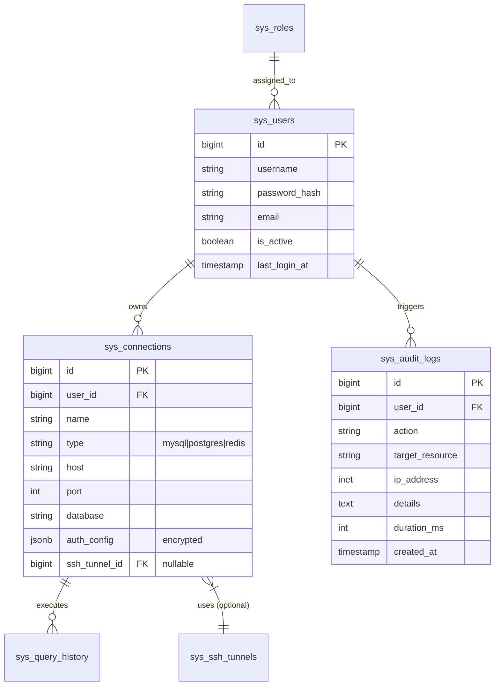

# 数据库设计 (Metadata Schema)

## 云端补齐：迁移 0013–0016

`sys_sql_snippets`：`id BIGSERIAL PK`，`user_id BIGINT NOT NULL FK sys_users(id) ON DELETE CASCADE`，`name VARCHAR(200) NOT NULL`，`sql_text TEXT NOT NULL`，`database_name VARCHAR(200) NOT NULL DEFAULT ''`，`connection_id BIGINT NULL FK sys_connections(id) ON DELETE SET NULL`，`visibility VARCHAR(20) CHECK private/shared`，创建/更新时间均 `TIMESTAMPTZ NOT NULL DEFAULT NOW()`；索引 `(user_id,visibility)`。

`sys_query_policies`：`id BIGSERIAL PK`，`connection_id BIGINT FK sys_connections(id) ON DELETE CASCADE`，数据库/schema/表名 `TEXT NOT NULL`，`role_code VARCHAR(30) FK sys_roles(code)`，`column_permissions JSONB DEFAULT '{}'`，`row_conditions JSONB DEFAULT '[]'`，`updated_by BIGINT FK sys_users(id)`，`updated_at TIMESTAMPTZ`；连接、数据库、schema、表、角色联合唯一。

`sys_query_settings`：`user_id BIGINT PK/FK sys_users(id) ON DELETE CASCADE`，`timeout_ms INTEGER DEFAULT 30000 CHECK 1000..120000`，`max_rows INTEGER DEFAULT 1000 CHECK 1..10000`，`block_unsafe_write BOOLEAN DEFAULT TRUE`，`updated_at TIMESTAMPTZ`。

完整 DDL 以 [0013_backend_completion.sql](../../backend/internal/db/migrations/0013_backend_completion.sql) 为准；同时增加 SSH 公钥校验字段 `host_key TEXT` 与工单执行人、时间、JSON 结果、错误字段。会话、撤销与在线状态存储在 Redis，以会话剩余有效期设置 TTL。

`0014_query_shares_tickets.sql` 新增 `sys_query_shares`（令牌哈希、所有者、JSON 快照、1–30 天期限、撤销、访问次数）和工单审批人；工单状态扩展为 pending/approved/rejected/executing/executed/failed。

`0015_export_requests.sql` 新增 `sys_export_requests`（申请人、目标连接、CSV/JSON 格式、行数、原因、JSON 快照、审批状态、审批人和创建时间），下载限定本人或管理员且必须批准。`0016_rebuild_ast_lineage.sql` 清除旧正则推测的 SQL 边缓存，保留外键与其他资产边，从成功查询历史重新解析 AST。

DBHub 的元数据存储采用 PostgreSQL (推荐 v14+)。本设计专注于系统自身的配置管理、用户权限及审计日志，不包含用户连接的目标数据库结构。

## 1. 实体关系图 (ER Diagram)



## 2. DDL 建表脚本

### 2.1 基础配置与扩展

```sql
-- 启用 UUID 扩展（可选）
CREATE EXTENSION IF NOT EXISTS "uuid-ossp";

-- 创建更新时间触发器函数
CREATE OR REPLACE FUNCTION update_updated_at_column()
RETURNS TRIGGER AS $$
BEGIN
    NEW.updated_at = NOW();
    RETURN NEW;
END;
$$ language 'plpgsql';
```

### 2.2 用户与权限 (`sys_users`, `sys_roles`)

```sql
CREATE TABLE sys_roles (
    id SERIAL PRIMARY KEY,
    code VARCHAR(50) NOT NULL UNIQUE, -- admin, developer, readonly
    name VARCHAR(100) NOT NULL,
    description TEXT,
    created_at TIMESTAMPTZ DEFAULT NOW()
);

CREATE TABLE sys_users (
    id BIGSERIAL PRIMARY KEY,
    username VARCHAR(64) NOT NULL UNIQUE,
    password_hash VARCHAR(255) NOT NULL,
    email VARCHAR(255),
    role_id INT REFERENCES sys_roles(id),
    is_active BOOLEAN DEFAULT TRUE,
    last_login_at TIMESTAMPTZ,
    created_at TIMESTAMPTZ DEFAULT NOW(),
    updated_at TIMESTAMPTZ DEFAULT NOW()
);

CREATE TRIGGER update_sys_users_modtime 
    BEFORE UPDATE ON sys_users 
    FOR EACH ROW EXECUTE PROCEDURE update_updated_at_column();
```

### 2.3 SSH 隧道配置 (`sys_ssh_tunnels`)

用于访问位于私有网络中的数据库。

```sql
CREATE TABLE sys_ssh_tunnels (
    id BIGSERIAL PRIMARY KEY,
    user_id BIGINT REFERENCES sys_users(id) ON DELETE CASCADE,
    name VARCHAR(100) NOT NULL,
    host VARCHAR(255) NOT NULL,
    port INT DEFAULT 22,
    username VARCHAR(100) NOT NULL,
    auth_type VARCHAR(20) NOT NULL, -- 'password' or 'private_key'
    private_key TEXT, -- 加密存储
    passphrase TEXT,  -- 加密存储
    password TEXT,    -- 加密存储
    created_at TIMESTAMPTZ DEFAULT NOW(),
    updated_at TIMESTAMPTZ DEFAULT NOW()
);
```

### 2.4 数据库连接配置 (`sys_connections`)

```sql
CREATE TABLE sys_connections (
    id BIGSERIAL PRIMARY KEY,
    user_id BIGINT REFERENCES sys_users(id) ON DELETE CASCADE,
    ssh_tunnel_id BIGINT REFERENCES sys_ssh_tunnels(id) ON DELETE SET NULL,
    
    name VARCHAR(100) NOT NULL,
    type VARCHAR(20) NOT NULL CHECK (type IN ('mysql', 'postgres', 'redis', 'mongo')),
    
    -- 连接详情
    host VARCHAR(255) NOT NULL,
    port INT NOT NULL,
    database VARCHAR(100), -- 默认数据库
    username VARCHAR(100),
    password TEXT, -- 加密存储
    
    -- 高级选项
    ssl_mode VARCHAR(20) DEFAULT 'require',
    connection_timeout INT DEFAULT 10,
    
    -- 颜色标记 (UI)
    color_label VARCHAR(20),
    
    created_at TIMESTAMPTZ DEFAULT NOW(),
    updated_at TIMESTAMPTZ DEFAULT NOW()
);

CREATE INDEX idx_conn_user ON sys_connections(user_id);
```

### 2.5 审计与日志 (`sys_audit_logs`)

```sql
CREATE TABLE sys_audit_logs (
    id BIGSERIAL PRIMARY KEY,
    user_id BIGINT REFERENCES sys_users(id) ON DELETE SET NULL,
    connection_id BIGINT REFERENCES sys_connections(id) ON DELETE SET NULL,
    
    trace_id VARCHAR(64), -- 请求追踪 ID
    action VARCHAR(50) NOT NULL, -- e.g., QUERY, CONNECT, DELETE
    resource_type VARCHAR(50),   -- e.g., DATABASE, CONNECTION
    resource_name VARCHAR(255),
    
    ip_address INET,
    user_agent TEXT,
    
    status SMALLINT DEFAULT 1, -- 1: Success, 0: Failed
    error_message TEXT,
    
    duration_ms INT, -- 执行耗时
    params JSONB,    -- 操作参数快照
    
    created_at TIMESTAMPTZ DEFAULT NOW()
) PARTITION BY RANGE (created_at);

-- 按月分区策略示例
CREATE TABLE sys_audit_logs_y2026m01 PARTITION OF sys_audit_logs
    FOR VALUES FROM ('2026-01-01') TO ('2026-02-01');
```

### 2.6 数据资产快照与标注（M1/M2，0007_meta_assets.sql）

```sql
-- 连接所属环境：dev 开发 / test 测试 / prod 生产（资产树徽标、M6 高危拦截地基）
ALTER TABLE sys_connections
    ADD COLUMN environment VARCHAR(10) NOT NULL DEFAULT 'dev'
        CHECK (environment IN ('dev', 'test', 'prod'));

-- 元数据采集快照（「同步字典」产物；人工标注不入本表，重新采集不覆盖人工内容）
CREATE TABLE sys_meta_snapshots (
    id              BIGSERIAL PRIMARY KEY,
    connection_id   BIGINT NOT NULL REFERENCES sys_connections(id) ON DELETE CASCADE,
    database_name   VARCHAR(128) NOT NULL,
    schema_name     VARCHAR(128) NOT NULL DEFAULT '',
    table_name      VARCHAR(128) NOT NULL,
    table_type      VARCHAR(16)  NOT NULL DEFAULT 'table',     -- table | view
    table_comment   VARCHAR(512) NOT NULL DEFAULT '',
    estimated_rows  BIGINT NOT NULL DEFAULT 0,
    data_bytes      BIGINT NOT NULL DEFAULT 0,
    raw_columns     JSONB NOT NULL DEFAULT '[]'::jsonb,         -- 列结构快照
    raw_indexes     JSONB NOT NULL DEFAULT '[]'::jsonb,
    raw_keys        JSONB NOT NULL DEFAULT '[]'::jsonb,        -- 主键/外键/唯一键
    ddl_text        TEXT NOT NULL DEFAULT '',
    synced_at       TIMESTAMPTZ NOT NULL DEFAULT NOW(),
    CONSTRAINT uq_meta_snapshot_obj
        UNIQUE (connection_id, database_name, schema_name, table_name)
);
CREATE INDEX idx_meta_snap_conn ON sys_meta_snapshots(connection_id);
CREATE INDEX idx_meta_snap_name ON sys_meta_snapshots(table_name);

-- 人工标注：表级与列级共表，column_name 为空串表示表级标注
CREATE TABLE sys_asset_annotations (
    id              BIGSERIAL PRIMARY KEY,
    connection_id   BIGINT NOT NULL REFERENCES sys_connections(id) ON DELETE CASCADE,
    database_name   VARCHAR(128) NOT NULL,
    schema_name     VARCHAR(128) NOT NULL DEFAULT '',
    table_name      VARCHAR(128) NOT NULL,
    column_name     VARCHAR(128) NOT NULL DEFAULT '',
    owner_user_id   BIGINT REFERENCES sys_users(id) ON DELETE SET NULL,
    business_desc   VARCHAR(1000) NOT NULL DEFAULT '',
    tags            TEXT[] NOT NULL DEFAULT '{}',
    sensitivity     VARCHAR(16) NOT NULL DEFAULT 'normal'
        CHECK (sensitivity IN ('normal', 'sensitive', 'confidential')),
    starred_by      BIGINT[] NOT NULL DEFAULT '{}',
    updated_by      BIGINT REFERENCES sys_users(id) ON DELETE SET NULL,
    updated_at      TIMESTAMPTZ NOT NULL DEFAULT NOW(),
    CONSTRAINT uq_asset_annotation_obj
        UNIQUE (connection_id, database_name, schema_name, table_name, column_name)
);
CREATE INDEX idx_asset_anno_owner ON sys_asset_annotations(owner_user_id);
```

### 2.7 报表与仪表盘、分享（M3/M4，0008_reports.sql）

```sql
-- 报表：一张图表 = 一次保存的查询 + 图表配置
CREATE TABLE sys_reports (
    id              BIGSERIAL PRIMARY KEY,
    name            VARCHAR(128) NOT NULL,
    description     VARCHAR(512) NOT NULL DEFAULT '',
    connection_id   BIGINT NOT NULL REFERENCES sys_connections(id) ON DELETE CASCADE,
    database_name   VARCHAR(128) NOT NULL DEFAULT '',
    sql_text        TEXT NOT NULL,
    chart_type      VARCHAR(16) NOT NULL DEFAULT 'table'
        CHECK (chart_type IN ('table','bar','line','pie','metric')),
    chart_config    JSONB NOT NULL DEFAULT '{}'::jsonb,
    visibility      VARCHAR(16) NOT NULL DEFAULT 'private'
        CHECK (visibility IN ('private','shared')),
    owner_user_id   BIGINT NOT NULL REFERENCES sys_users(id) ON DELETE CASCADE,
    starred_by      BIGINT[] NOT NULL DEFAULT '{}',
    created_at      TIMESTAMPTZ NOT NULL DEFAULT NOW(),
    updated_at      TIMESTAMPTZ NOT NULL DEFAULT NOW()
);
CREATE INDEX idx_reports_owner ON sys_reports(owner_user_id);
CREATE INDEX idx_reports_conn ON sys_reports(connection_id);

-- 仪表盘：报表的有序组合（12 栅格 layout）
CREATE TABLE sys_dashboards (
    id              BIGSERIAL PRIMARY KEY,
    name            VARCHAR(128) NOT NULL,
    description     VARCHAR(512) NOT NULL DEFAULT '',
    visibility      VARCHAR(16) NOT NULL DEFAULT 'private'
        CHECK (visibility IN ('private','shared')),
    layout          JSONB NOT NULL DEFAULT '[]'::jsonb, -- [{report_id,x,y,w,h}]
    owner_user_id   BIGINT NOT NULL REFERENCES sys_users(id) ON DELETE CASCADE,
    starred_by      BIGINT[] NOT NULL DEFAULT '{}',
    created_at      TIMESTAMPTZ NOT NULL DEFAULT NOW(),
    updated_at      TIMESTAMPTZ NOT NULL DEFAULT NOW()
);

-- 分享令牌：只存哈希，支持报表与仪表盘
CREATE TABLE sys_share_tokens (
    id              BIGSERIAL PRIMARY KEY,
    subject_type    VARCHAR(16) NOT NULL CHECK (subject_type IN ('report','dashboard')),
    subject_id      BIGINT NOT NULL,
    token_hash      VARCHAR(128) NOT NULL UNIQUE,
    created_by      BIGINT NOT NULL REFERENCES sys_users(id) ON DELETE CASCADE,
    expire_at       TIMESTAMPTZ,
    access_count    INT NOT NULL DEFAULT 0,
    revoked         BOOLEAN NOT NULL DEFAULT FALSE,
    created_at      TIMESTAMPTZ NOT NULL DEFAULT NOW()
);
CREATE INDEX idx_share_subject ON sys_share_tokens(subject_type, subject_id);
```

### 2.8 代理管理（M5 前置，0009_proxies.sql）

```sql
CREATE TABLE sys_proxies (
    id          BIGSERIAL PRIMARY KEY,
    user_id     BIGINT NOT NULL REFERENCES sys_users(id) ON DELETE CASCADE,
    name        VARCHAR(128) NOT NULL,
    type        VARCHAR(32)  NOT NULL DEFAULT 'http' CHECK (type IN ('http', 'https', 'socks5', 'db_proxy', 'custom')),
    host        VARCHAR(255) NOT NULL,
    port        INTEGER NOT NULL,
    username    VARCHAR(128),
    password    TEXT,                                     -- AES-256-GCM 加密
    description VARCHAR(512) NOT NULL DEFAULT '',
    status      VARCHAR(16)  NOT NULL DEFAULT 'active' CHECK (status IN ('active', 'inactive')),
    created_at  TIMESTAMPTZ NOT NULL DEFAULT NOW(),
    updated_at  TIMESTAMPTZ NOT NULL DEFAULT NOW()
);
CREATE INDEX idx_proxies_user ON sys_proxies(user_id);
ALTER TABLE sys_connections ADD COLUMN IF NOT EXISTS proxy_id BIGINT REFERENCES sys_proxies(id) ON DELETE SET NULL;
```

### 2.9 查询历史与元数据补充（0005_query_history.sql，元数据接口不落库）

```sql
CREATE TABLE sys_query_history (
    id              BIGSERIAL PRIMARY KEY,
    user_id         BIGINT NOT NULL REFERENCES sys_users(id) ON DELETE CASCADE,
    connection_id   BIGINT NOT NULL REFERENCES sys_connections(id) ON DELETE CASCADE,
    database_name   VARCHAR(128) NOT NULL DEFAULT '',
    sql_text        TEXT NOT NULL,
    status          SMALLINT NOT NULL, -- 1 成功 0 失败
    affected_rows   BIGINT,
    execution_time_ms INT NOT NULL,
    error_message   TEXT,
    created_at      TIMESTAMPTZ NOT NULL DEFAULT NOW()
);
CREATE INDEX idx_qh_user ON sys_query_history(user_id, created_at DESC);
CREATE INDEX idx_qh_conn ON sys_query_history(connection_id);
```

### 2.10 工单中心（前端 Mock，M6 规划落库）

> **当前**：Step24 工单中心为前端 Mock（localStorage `dbhub_tickets_v1` + ChangeTicketPane 复用），便于演示血缘一键建单与审批流；**后端规划**（见 PRD M6 扩展）：
```sql
-- 规划：变更工单（DDL/DML/索引），含 SQL、风险、审批流
CREATE TABLE sys_tickets (
    id              BIGSERIAL PRIMARY KEY,
    title           VARCHAR(128) NOT NULL,
    type            VARCHAR(16)  NOT NULL CHECK (type IN ('ddl','dml','index')),
    table_name      VARCHAR(128) NOT NULL,
    sql_text        TEXT NOT NULL,
    risk            VARCHAR(16) NOT NULL CHECK (risk IN ('low','medium','high')),
    status          VARCHAR(16) NOT NULL DEFAULT 'pending'
        CHECK (status IN ('pending','approved','rejected','executed')),
    requester_id    BIGINT NOT NULL REFERENCES sys_users(id) ON DELETE CASCADE,
    reason          TEXT NOT NULL DEFAULT '',
    created_at      TIMESTAMPTZ NOT NULL DEFAULT NOW(),
    updated_at      TIMESTAMPTZ NOT NULL DEFAULT NOW()
);
```

## 3. 安全策略


### 3.1 敏感数据加密
所有涉及密码、私钥的字段（`private_key`, `passphrase`, `password`）**严禁明文存储**。
- **加密算法**: AES-256-GCM
- **密钥管理**: 密钥应通过环境变量 `APP_SECRET_KEY` 注入，不得写入代码或数据库。

### 3.2 连接池管理
后端 Go 服务应维护所有活跃数据库连接的连接池。
- **空闲超时**: 300s
- **最大生命周期**: 3600s
- **最大连接数**: 根据实例规格动态调整


## 连接器目录与自定义数据源（0021）

驱动制品不可变，模板修订追加发布；停用通过 enabled，不重绑既有实例。外键默认 RESTRICT，禁止删除被引用版本。数据源实例以 template_revision_id 固定模板及驱动，parameters 仅保存非敏感结构化字段，口令沿用 sys_connections.password 加密。以下 DDL 与迁移一致：

```sql
-- Immutable driver artifacts and template revisions. State may be disabled, never rebound.
CREATE TABLE sys_jdbc_drivers (
 id BIGSERIAL PRIMARY KEY,
 artifact_id VARCHAR(120) NOT NULL UNIQUE,
 name VARCHAR(100) NOT NULL,
 version VARCHAR(80) NOT NULL,
 class_name VARCHAR(255) NOT NULL,
 sha256 CHAR(64) NOT NULL,
 enabled BOOLEAN NOT NULL DEFAULT true,
 created_by BIGINT NOT NULL REFERENCES sys_users(id),
 created_at TIMESTAMPTZ NOT NULL DEFAULT now()
);
CREATE TABLE sys_datasource_templates (
 id BIGSERIAL PRIMARY KEY,
 template_key VARCHAR(80) NOT NULL,
 revision INTEGER NOT NULL CHECK(revision > 0),
 name VARCHAR(100) NOT NULL,
 product VARCHAR(80) NOT NULL,
 driver_id BIGINT NOT NULL REFERENCES sys_jdbc_drivers(id),
 dialect VARCHAR(20) NOT NULL DEFAULT '' CHECK(dialect IN ('','mysql','postgres')),
 url_template TEXT NOT NULL,
 fields JSONB NOT NULL CHECK(jsonb_typeof(fields)='array'),
 enabled BOOLEAN NOT NULL DEFAULT true,
 created_by BIGINT NOT NULL REFERENCES sys_users(id),
 created_at TIMESTAMPTZ NOT NULL DEFAULT now(),
 UNIQUE(template_key, revision)
);
CREATE INDEX idx_datasource_template_driver ON sys_datasource_templates(driver_id);
ALTER TABLE sys_connections DROP CONSTRAINT sys_connections_type_check;
ALTER TABLE sys_connections ADD CONSTRAINT sys_connections_type_check CHECK(type IN ('mysql','postgres','redis','mongo','jdbc'));
ALTER TABLE sys_connections ADD COLUMN template_revision_id BIGINT REFERENCES sys_datasource_templates(id);
ALTER TABLE sys_connections ADD COLUMN parameters JSONB NOT NULL DEFAULT '{}'::jsonb CHECK(jsonb_typeof(parameters)='object');
ALTER TABLE sys_connections ADD CONSTRAINT connection_template_kind CHECK((type='jdbc')=(template_revision_id IS NOT NULL));
CREATE INDEX idx_connection_template ON sys_connections(template_revision_id);
ALTER TABLE sys_meta_snapshots ADD COLUMN metadata_status JSONB NOT NULL DEFAULT '{}'::jsonb;
```
