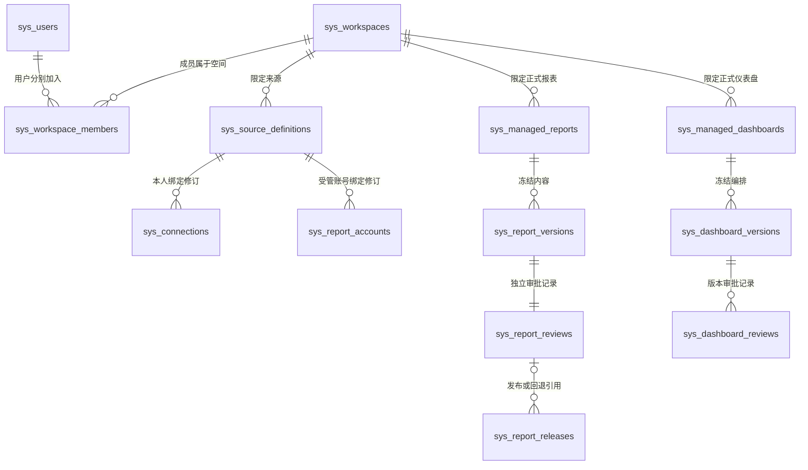

# 数据库模型设计

本文维护元数据库的对象关系、约束和迁移入口。完整DDL、函数、触发器及索引以[内嵌增量迁移](../../backend/internal/db/migrations/)为准；当前目录已到0081，实际部署以schema_migrations核对。目标业务库由独立连接器访问，不属于DBHub元数据库。阶段及真实启用状态见[路线图](../项目管控/开发路线图与当前任务.md)。

## 1 核心对象关系

下图只列主要引用关系。空间内对象的引用还须满足同一workspace_id、所有者及当前授权约束；单个ID或一条外键不代表可访问。

## 2 现行结构入口

同一对象须叠加其后的全部迁移，不能单独执行下表某个文件来创建“当前结构”。表中列主要起点和重要补充，完整顺序在迁移目录；不在本文复制另一套CREATE TABLE。

| 对象域 | 主要结构与约束 | DDL及索引入口 |
| --- | --- | --- |
| 身份与会话 | sys_users、旧sys_roles；当前认证版本、MFA、外部身份；会话与撤销状态另存Redis | [0002](../../backend/internal/db/migrations/0002_roles_users.sql)、[0043](../../backend/internal/db/migrations/0043_identity_security.sql)、[0044](../../backend/internal/db/migrations/0044_external_identity_revocation.sql) |
| 本人连接及网络 | sys_connections、sys_ssh_tunnels、sys_proxies；凭据加密、当前本人范围 | [0003](../../backend/internal/db/migrations/0003_ssh_tunnels.sql)、[0004](../../backend/internal/db/migrations/0004_connections.sql)、[0009](../../backend/internal/db/migrations/0009_proxies.sql) |
| 驱动、模板和共享定义 | sys_jdbc_drivers、sys_datasource_templates、sys_source_definitions；不可变制品/修订、范围内唯一、引用保护、个人绑定 | [0021](../../backend/internal/db/migrations/0021_connector_catalog.sql)、[0022](../../backend/internal/db/migrations/0022_personal_connections.sql)、[0023](../../backend/internal/db/migrations/0023_definition_binding_index.sql)、[0024](../../backend/internal/db/migrations/0024_source_audience_directory.sql) |
| 查询与工具 | sys_query_history、查询设置/策略/片段、sys_tickets；历史与工单结果有各自主体边界 | [0005](../../backend/internal/db/migrations/0005_query_history.sql)、[0013](../../backend/internal/db/migrations/0013_backend_completion.sql)、[0014](../../backend/internal/db/migrations/0014_query_shares_tickets.sql) |
| 执行登记及审计 | sys_query_executions防重与摘要回执；sys_audit_logs事件UUID幂等补写；本地待写卷另行持久化 | [0017](../../backend/internal/db/migrations/0017_query_executions.sql)—[0019](../../backend/internal/db/migrations/0019_query_execution_metrics.sql)、[0025](../../backend/internal/db/migrations/0025_reliable_audit.sql) |
| 元数据、标注与血缘 | sys_meta_snapshots、标注和血缘缓存；采集快照与人工标注分开，完整采集后原子发布 | [0007](../../backend/internal/db/migrations/0007_meta_assets.sql)、[0011](../../backend/internal/db/migrations/0011_lineage.sql)、[0016](../../backend/internal/db/migrations/0016_rebuild_ast_lineage.sql)、[0020](../../backend/internal/db/migrations/0020_connection_checks.sql) |
| 个人报表与旧仪表盘 | sys_reports、sys_dashboards及历史分享表；个人并发version不等于正式内容历史 | [0008](../../backend/internal/db/migrations/0008_reports.sql)、[0026](../../backend/internal/db/migrations/0026_report_phase1.sql)、[0041](../../backend/internal/db/migrations/0041_report_chart_types.sql) |
| 正式报表 | sys_report_accounts、sys_managed_reports、sys_report_versions/reviews/validations/releases/commands；草稿、审批及发布指针分开 | [0027](../../backend/internal/db/migrations/0027_managed_reports.sql)、[0038](../../backend/internal/db/migrations/0038_report_parameters.sql) |
| 工作空间与资格代次 | sys_workspaces、sys_workspace_members、组/受众引用、复合约束、RLS、成员及审批指派代次 | [0028](../../backend/internal/db/migrations/0028_workspaces.sql)—[0035](../../backend/internal/db/migrations/0035_dashboard_review_assignment_epoch.sql)、[0042](../../backend/internal/db/migrations/0042_workspace_capabilities.sql) |
| 正式仪表盘 | sys_managed_dashboards、版本、审批、发布、访问申请、刷新清单、逐卡回执绑定及共享租约 | [0029](../../backend/internal/db/migrations/0029_dashboard_lifecycle.sql)、[0033](../../backend/internal/db/migrations/0033_access_request_targets.sql)、[0034](../../backend/internal/db/migrations/0034_dashboard_receipt_binding.sql)、[0039](../../backend/internal/db/migrations/0039_dashboard_filter_values.sql) |
| 通知与源任务 | 站内通知、源任务/计划/检查历史、运维状态；原主体、幂等键、活动任务约束及租约 | [0036](../../backend/internal/db/migrations/0036_operations_inbox_source_tasks.sql)、[0037](../../backend/internal/db/migrations/0037_security_execution_boundaries.sql) |
| 报表导出与个人订阅 | sys_report_exports、订阅、逐期快照、交付、指标告警及事件；保存原批准与期限 | [0040](../../backend/internal/db/migrations/0040_report_exports.sql)、[0045](../../backend/internal/db/migrations/0045_report_subscriptions.sql) |
| 固定业务办理 | 模板、执行账号、预览、核验、申请与执行回执，独立于SQL工单 | [0046](../../backend/internal/db/migrations/0046_business_operations.sql) |
| 权限与治理 | sys_iam_*目录、角色修订、来源、委派、提案、收紧记录、运行桥、最小托管及双人治理恢复 | [0047](../../backend/internal/db/migrations/0047_iam_foundation.sql)—[0049](../../backend/internal/db/migrations/0049_iam_governance.sql) |
| 权限执行与兼容加固 | 任务资格版本、只读影子、收紧屏障、当前许可/来源/目录计划，以及限期解除禁止的精确审批关联 | [0050](../../backend/internal/db/migrations/0050_iam_execution_versions.sql)—[0081](../../backend/internal/db/migrations/0081_iam_navigation_directory_plan.sql)，其中[0065](../../backend/internal/db/migrations/0065_iam_action_release_approval.sql)处理解除禁止 |

## 3 必须保持的数据约束

- 空间内对象及引用链保持同一空间，个人连接、历史、任务和文件再检查当前主体。复合键、外键、RLS与后端检查共同生效，不能仅凭前端传入workspace_id放行。
- 驱动制品、模板/来源修订固定引用；模板修订追加，既有绑定不浮动升级。定义不保存认证材料；个人绑定与受管报表账号分开。删除被引用对象按迁移和仓储规则拒绝或受控处置，不一概级联清除。
- 内容版本与批准摘要不可原地改写，发布/下线/回退追加事件并检查预期发布号。历史操作者允许按已定义外键置空，姓名及真实签名快照保留；删除或冻结作者不删除正式内容历史。
- 命令防重键绑定原空间、主体、操作及内容指纹，授权/配置/凭据代次分别检查；版本不能倒拨。查询登记编号不能因TTL、失败、重启或历史清理而重新获得执行机会。
- 收紧、治理差异及审计按各自事务原子写入；当前收紧在恢复和回退后仍有效。新角色/许可表存在不代表已启用，当前兼容边界按[数据执行契约](../架构设计/数据接入与执行契约.md#7-功能治理与迁移的有效规则)维护。

## 4 索引与并发约束

| 查阅点 | 当前约束及索引用途 |
| --- | --- |
| 来源及绑定 | 范围内制品/模板修订唯一、本人逻辑源绑定唯一；definition_revision_id索引用于停用前绑定数检查，定义行锁与并发绑定互斥，见0022、0023、0028 |
| 正式报表 | 版本号和发布号在报表内唯一；待审索引、所有者列表索引及当前发布的复合引用见0027，随后叠加空间约束 |
| 仪表盘及访问申请 | 每对象最多一个pending审批的部分唯一索引；这不等于每版本只有一条历史审批。活动访问申请去重及刷新/执行租约到期索引见0029及其后续迁移 |
| 文件与任务 | 主体文件列表、审批队列、活动源任务、计划去重及租约领取分别索引；文件期限不能由索引清理绕过当前领取检查 |
| IAM治理 | 空间内稳定角色ID/修订、主体来源、提案幂等键及当前授权代次；0048增加来源/角色查询索引，后续迁移维护当前判定计划，不手工维护另一份DDL副本 |

## 5 秘密、留存与升级

密码、私钥及口令字段使用既有AES-256-GCM加密，主密钥通过受控配置注入，不能写入代码或元数据库；主密钥丢失后无法仅靠数据库备份恢复凭据。JWT、刷新令牌、一次性码和密钥不写入文档或日志。

审计与查询历史按明确部署留存配置清理，默认不自动清理；未知结果和防重键不自动删除，不可变审批、内容版本和发布记录不纳入普通历史清理。文件/期次快照按其原期限处理，不能用普通清理改写批准或恢复过期业务数据。

数据库连接使用情况见[系统架构](../架构设计/系统架构总览.md)：元数据库有独立连接池，普通目标请求持有独占连接，本文不规定“所有目标长期池化”或复制未生效的空闲/生命周期参数。

升级新增迁移，不改写已应用历史文件，不通过复制本文片段初始化已有库。变更说明须包含受影响DDL/函数/索引、存量兼容、事务及回退边界；在隔离数据库验证升级和恢复。备份、密钥、审计卷与当前收紧的恢复要求见[部署运维指南](../部署运维/部署运维指南.md)。统一数据范围、团队交付等后续规划尚未交付时，不预建另一套策略或工作流表。
