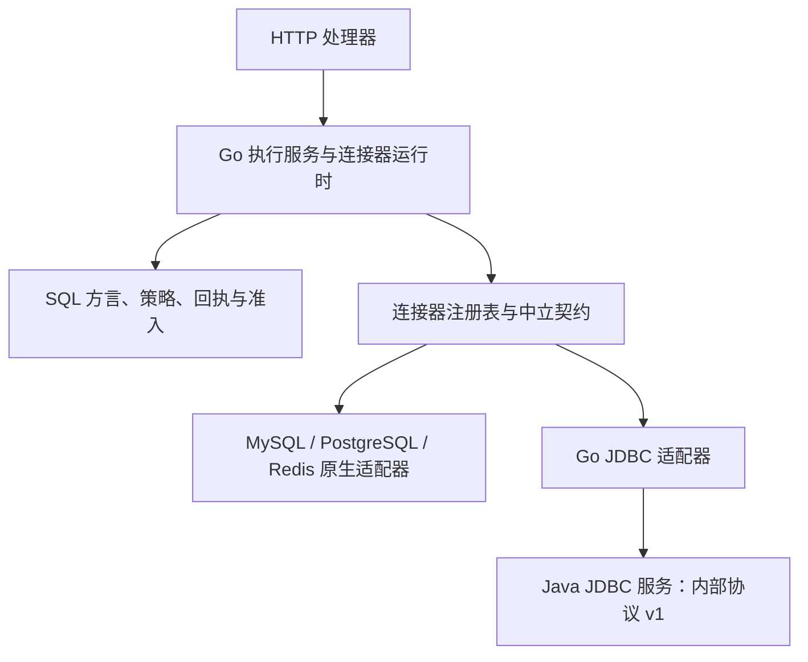

# 数据源连接器抽象设计

状态：P1 与 JDBC 首版已实现，2026-10-17。运行入口、限制和验收见[连接器与 JDBC 自定义数据源验收](../开发指南/连接器与JDBC自定义数据源验收.md)。产品名称见[功能命名与自定义数据源规划](../项目管控/功能命名与自定义数据源规划.md)。

本期在此基础上实现了[共享定义与个人身份隔离](../开发指南/共享数据源与个人连接验收.md)：驱动和规则可为个人或全局，实际建连始终解析当前用户的个人连接。0021 的旧共享连接行为由 0022 取代。

## 实现边界

采用连接器接口、原生适配器和可选 JDBC 服务。MySQL、PostgreSQL 默认使用 Go 原生驱动，Redis 保留原生键值操作。JDBC 提供新增产品的配置入口，不能凭一个驱动类就自动获得 SQL 方言、行列策略、事务或完整采集能力。

Go 继续负责认证、角色与目标权限、AST 校验、行列策略、并发准入、防重认领、发送前登记、回执、审计和元数据快照发布。Java 负责目标连接、已授权操作的执行、JDBC 元数据及带类型的值转换，不读取 DBHub 元数据库，不接受终端用户直接调用。

图表示当前模块依赖；源码是本节 Mermaid。原生路径在进程内执行，JDBC 路径通过内部 HTTP JSON RPC。生产单机 Compose 不发布 Java 端口；跨主机部署应在可信服务网络内提供 TLS 或服务网格传输保护。

## 代码落点

| 目录 | 职责 |
| --- | --- |
| `backend/internal/connector` | 中立会话、小接口、值类型、能力、错误和注册表 |
| `connector/native` | 包装现有驱动；Redis WATCH/Lua 等原子写入留在适配器 |
| `connector/jdbc` | 内部 RPC、参数重绑定、带类型的值解码、取消与清理 |
| `backend/internal/connectorruntime` | 将保存配置变成不可变建连参数；统一能力与 SQL 准入；运行时门面 |
| `backend/internal/target` | 迁移保留的原生驱动实现及兼容结果别名 |
| `backend/internal/datasource` | CRUD、检查、密码复用保护、驱动登记与模板发布 |
| `backend/internal/sqlparse` | MySQL/PostgreSQL AST、命名参数与 JDBC 占位符转换 |
| `services/jdbc-runner` | JDK 17 服务、固定制品清单、校验下载与生产 Dockerfile |

注册表在 `server.NewRouter` 中组装后注入查询、数据源、数据目录和工单处理器。未知类型与重复 ID 明确拒绝；没有 PostgreSQL 默认兜底。业务处理器不持有目标 pgx、database/sql 或 go-redis 连接。DBHub 自身仓储与认证 Redis 不属于目标连接器。

## 契约和能力

可编译契约以 `connector/contract.go` 为准。基础 `Session` 只有 `Probe` 和 `Close`，按需实现 `SQLExecutor`、`MetadataReader`、`TransactionBeginner`、`Transaction`、`KeyReader`、`KeyWriter`。请求和结果不引用 HTTP、仓储连接或具体驱动类型。

能力字段为 `sql`、`format`、`metadata`、`collect`、`keys`、`transactions`、`enforced_read_only` 和可选 `reason`。结构浏览与完整采集独立判断：未知产品可使用通用 JDBC 元数据浏览，但没有经过完整范围验证时不允许采集后清理旧快照。角色权限仍在能力之后单独校验。

公开 `GET /connections/{id}/capabilities` 供工作台选择视图。SQL 视图仅保留运行、格式化；Redis 使用键值视图；H2 等无 SQL 方言的实例显示结构浏览。停用或服务未配置有明确原因。

## 驱动、模板和实例

迁移 `0021_connector_catalog.sql` 增加不可变驱动版本、追加发布的模板修订，以及实例的模板修订外键和结构化参数。

- 部署清单固定制品 ID、版本、驱动类、SHA-256、HTTPS 来源和依赖 ID；启动先校验全部文件，再按驱动建立独立类加载器。
- 管理员只能登记服务实际已加载且校验通过的制品。浏览器不上传或执行任意 JAR；新驱动由部署清单引入并重建服务。
- 模板发布校验 URL 规则、占位字段、驱动接受能力和方言匹配，发布新修订不改变旧修订及其绑定实例。首次发布直接成为可用修订，没有额外草稿状态。
- 实例固定模板修订和驱动校验值，不引用浮动的“最新版本”。凭据独立加密存储，不进入 URL 或检查记录。
- 驱动/模板停用阻止后续读取配置后开启的新会话；已经取得配置快照的请求和已开始操作可能继续完成并清理。停用不等于撤销目标数据库执行，不重派已有操作。
- 被引用驱动或模板删除返回 409。模板修改使用新修订，实例迁移必须显式编辑并重新检查。

已知 PostgreSQL/MySQL 使用固定网络 URL；H2 使用固定内存 URL。其他已部署驱动可通过包含 `//{host}:{port}` 的通用网络模板定义字段，无需修改 Go 数据库类型分支；通用模板不启用 SQL、事务或完整采集。特殊 URL、认证、Catalog/Schema 映射仍需产品适配。

## 会话、事务、防重与错误

普通请求独占一个目标会话，结束即关闭，不增加跨用户连接池。显式事务固定同一物理连接，沿用 Go 的用户/数据源归属、串行使用、空闲清理和数量限制。关闭使用独立的 5 秒上下文，清理错误记日志，不覆盖已取得结果。

Go 在元数据库中以 `(user_id, request_id)` 唯一认领执行并持久化发送前状态，连接器的 `BeforeExecute` 钩子成功后才发送用户 SQL。Java 另使用带入口/用户的执行键和会话内集合拒绝重复发送，但它不替代 Go 的持久化回执。HTTP 客户端不跟随重定向，不自动重发用户 SQL。

错误分类与执行结果分开：未发送是 `rejected`；取得成功响应是 `succeeded`，事务内仅表示语句完成；可靠的语句拒绝或未完成的只读查询是 `failed`；可能已经发送但结果无法确认是 `unknown`。取消、通信和提交响应丢失不能被解释成写入回滚。PostgreSQL 可靠 SQLSTATE 保守映射，其他未知厂商错误不冒充确定失败。

MySQL/PostgreSQL JDBC 使用目标服务端只读事务，不能仅靠 `setReadOnly(true)`。未知方言在 Go 校验阶段拒绝，工单、导出、预览和报表也使用同一运行时。已有防重与队列主要覆盖 `/query/execute`，没有扩写成所有 API 的全局分布式配额。

## RPC 与资源限制

内部协议版本为 1：artifacts、validate-template、open、probe、metadata、execute、begin、commit、rollback、cancel、close。Open 返回随机会话、协议版本和 5 分钟租约，会话同时验证随机归属标识。Token 至少 32 字符，服务端常量时间比较；健康检查不返回凭据或目标详情。

| 资源 | 当前边界 |
| --- | --- |
| 活动会话 | 32；每会话串行、重复执行键集合最多 1000 条 |
| 建连 | 最多 4 个并发，无等待队列，预算最多 30 秒 |
| HTTP 处理 | 8 个线程、64 个排队任务 |
| 关闭/终止 | 4 个线程、64 个排队任务 |
| 请求 / 执行 | 请求最多 2 MiB；执行最多 120 秒，跟随 Go 更严格预算 |
| 查询结果 | 最多 10000 行，默认 1000；结果行 JSON 预算 8 MiB |
| 单字段 | 文本最多 1 Mi 字符，二进制最多 1 MiB；超限明确拒绝 |
| 元数据 | 单次 Schema/表列表最多 5000，字段最多 10000；超限拒绝完整清单 |

Java 使用 JDBC 游标、fetch size 和 MaxRows 限制目标读取，HTTP 返回当前有界整包结果，尚未实现 RPC 分块流式传输。取消只报告请求已发送，不能保证目标执行停止。租约到期、超时或 Close 会终止并关闭会话；驱动不响应中断时仍可能延迟释放，连接池与故障隔离扩展留待实际负载验证。

## 数据值与元数据

RPC 明确区分 SQL NULL、JSON 文本、字符串、布尔、整数、小数、浮点、二进制、日期、时间和带/不带时区时间戳。JDBC 的整数和精确小数以文本返回，避免 JavaScript 精度损失；二进制使用 base64，响应可附列类型、精度和标度。原生路径的公开值类型保持原有契约。

JDBC 元数据通过 `DatabaseMetaData` 读取当前实例配置的库及其 Schema、表/视图、字段、主键、索引、外键；不承诺跨库枚举。DDL 和统计在 `metadata_status` 标为 `unsupported`。读取失败不伪装为空清单。

完整采集保留同源跨实例互斥、配置修订检查和整轮事务发布。元数据库 Commit 响应丢失返回发布 `unknown`，界面提示刷新数据目录核实，不声称旧快照一定保留。

## 阶段状态与后续扩展

P1 原生接口及业务路径迁移、N1/N2 命名和能力入口、J1 JDBC 首版已交付。真实新增产品为 H2 2.4.240 的检查、元数据浏览与采集；MySQL/PostgreSQL JDBC 作为已有方言的对照。原生 12 分支兼容证据独立保存，不自动授予 JDBC 全版本兼容结论。

P3/J2 继续按需求增加产品方言、特殊认证和 URL、可信 JAR 上传、代理/SSH、连接池、RPC 流式传输、分布式调度和完整容量测试。本轮性能记录是 3 类 PostgreSQL 负载各 20 次串行 HTTP 样本，不能声称已完成 P99、吞吐或生产容量验收。后续引入连接池必须按实例、配置修订、认证身份、数据库和传输配置隔离，并验证归还时的事务/会话状态重置。

接口、字段和约束见 [API 规范](../接口规范/API接口规范.md)与[数据库模型](../数据库设计/数据库模型设计.md)，执行与采集边界见[执行可靠性](../开发指南/SQL工作台执行可靠性.md)和[检查与采集可靠性](../开发指南/数据源检查与采集可靠性.md)。
