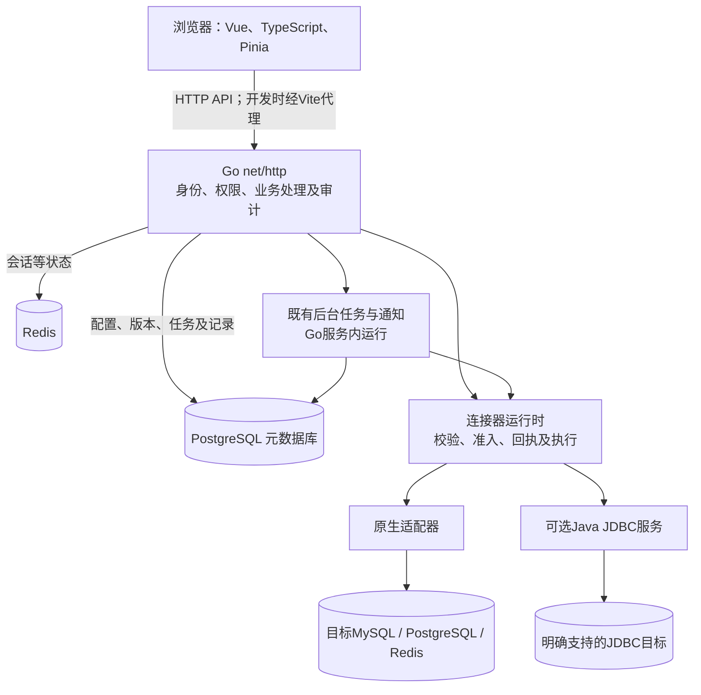

# 系统架构总览

更新日期：2026-10-24。本文描述当前代码的主要组件，模块状态见[功能总览](../项目管控/功能模块总览与实现验收状态.md)，业务交接见[流程与状态图](../项目管控/核心业务流程与状态图.md)。

## 1 当前组件

API路由组装见[server/router.go](../../backend/internal/server/router.go)，后台维护见[automation/service.go](../../backend/internal/automation/service.go)，连接器职责及支持边界见[连接器设计](数据接入与执行契约.md#1-数据源身份与能力)。可选JDBC未配置时不能视为可用；示意图不代表所有外部环境已验收。

## 2 执行与数据边界

- 元数据库连接池服务DBHub自身。普通目标请求按需独占连接并在结束后关闭，显式事务持有专用连接；尚无跨请求长期复用的统一目标连接池。
- SQL结果按上限收集后返回有界JSON，当前不提供通用前端流式结果接口。通知/待办按既有接口实现，不承诺所有操作都有WebSocket。
- 个人操作解析本人连接；正式内容解析获准受管账号。角色许可、内容受众、原数据上限和执行身份分别检查。
- 写操作保留发送前登记、幂等回执和未知结果核实。取消或通信失败不表示业务事务已经回滚。
- 权限基础已有隔离实现，真实权限未切换；统一部门数据规则、完整新审批及团队交付按当前路线分期，不新增通用IAM或工作流平台。

## 3 前端职责

技术栈为Vue 3、TypeScript、Vite、Vue Router、Pinia、Element Plus、Tailwind CSS和ECharts；具体版本以[package.json](../../frontend/package.json)及锁文件为准，不维护历史构建体积或写死版本副本。

| 位置 | 职责 |
| --- | --- |
| [router/index.ts](../../frontend/src/router/index.ts) | 路由、登录与工作空间上下文、当前许可检查及同权旧链接 |
| [stores/user.ts](../../frontend/src/stores/user.ts) | 身份、空间、能力快照、有效来源及切换时失效处理 |
| [layouts/](../../frontend/src/layouts/) | 旧布局、按启用状态选择的自适应布局及动态权限菜单 |
| [api/](../../frontend/src/api/) | 已有请求封装和业务接口，不在组件重复拼装同一协议 |
| [views/](../../frontend/src/views/) | 报表、仪表盘、工作台、连接、治理及其他业务页面 |
| [components/](../../frontend/src/components/) | 通用组件与已有图表复用，结合本次功能抽取必要公共部分 |

前端按当前路由、Store、布局和业务组件组织；公共部分在实际复用时抽取。

### 3.1 权限与请求状态

新权限界面按启用范围使用服务端许可目录和当前快照，旧模式继续兼容。菜单、路由和按钮不能替代服务端授权。跨空间切换须清理旧结果、取消旧请求并防止迟到响应覆盖新上下文；无空间、无菜单和独立本人/平台入口保持可达。

统一数据规则和新审批策略未实施时显示相应受限说明，不能用前端按钮开放尚无执行约束的能力。流程解释见[核心流程图](../项目管控/核心业务流程与状态图.md)，不在架构文档重复业务状态表。

### 3.2 组件与界面维护

复用现有API、类型、用户状态、EChart/ChartCard及业务组件，保持[UI设计规范](../界面设计/UI设计规范.md)中的主题和响应式约定。按本次功能覆盖加载、空数据、失败、无权限及键盘操作，不要求所有控件套用同一种缩放动画或固定像素布局。

路由懒加载与图表按需引入沿用现有配置；构建、测试与实际浏览器检查按任务选择。

## 4 后端职责

Go版本及依赖以[go.mod](../../backend/go.mod)和vendor为准。路由采用标准库net/http，入口见[server/router.go](../../backend/internal/server/router.go)。

| 位置 | 职责 |
| --- | --- |
| [cmd/server/](../../backend/cmd/server/) | 服务启动、配置和依赖组装 |
| [server/](../../backend/internal/server/) | 路由、空间与治理入口、身份及动作守卫 |
| [auth/](../../backend/internal/auth/)、[middleware/](../../backend/internal/middleware/) | 登录、会话、当前身份加载及请求边界检查 |
| [iam/](../../backend/internal/iam/) | 稳定许可/路由目录、有效来源与依赖判定 |
| [db/](../../backend/internal/db/) | 元数据仓储、版本事务、授权/治理、回执及后台任务持久状态 |
| [connectorruntime/](../../backend/internal/connectorruntime/)、[connector/](../../backend/internal/connector/) | 建连参数、连接器能力、准入和原生/JDBC执行 |
| [queryapi/](../../backend/internal/queryapi/)、[reportapi/](../../backend/internal/reportapi/)、[businessops/](../../backend/internal/businessops/) | 查询、内容交付与固定业务执行，沿各自契约分权 |
| [automation/](../../backend/internal/automation/) | 复用现有持久任务、维护、订阅及通知，不另建通用调度引擎 |
| [httpx/](../../backend/internal/httpx/)、[auditlog/](../../backend/internal/auditlog/) | 统一响应/错误及审计持久化边界 |

### 4.1 维护边界

权限、事务、连接器和执行可靠性按[数据执行契约](数据接入与执行契约.md)维护；内容版本、受众和交付按[内容契约](内容与交付契约.md)维护。代码规范及验证命令见[开发指南](../开发指南.md)，结构升级使用新增迁移，当前产品验收与真实启用以路线图为准。
