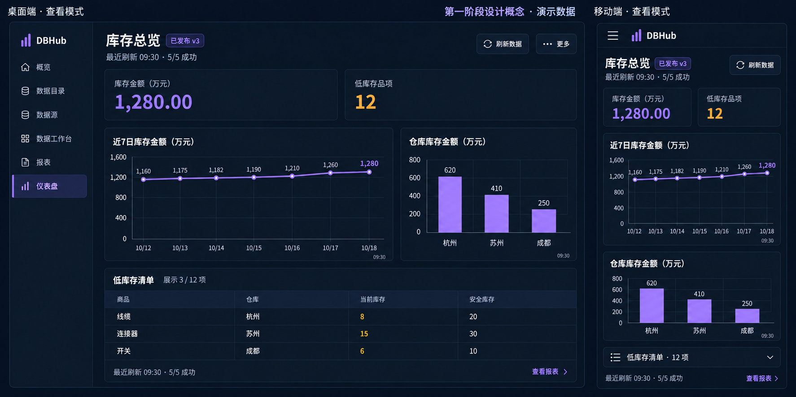

# 仪表盘第一阶段设计

> 2026-10-18 · 第一阶段实现版。工作空间、报表契约、权限申请及仪表盘前后端已实现；实际验证范围、操作接口和限制见[实施与验收](../开发指南/仪表盘第一阶段实施与验收.md)。概念图仍为设计样本，不能替代运行截图；[评审问题对照](仪表盘设计评审问题闭环.md)。

## 1. 产品定位与范围

仪表盘组合已发布正式报表，为业务人员提供整体情况、趋势和明细。报表负责查询、数据库执行账号、数据口径和自身授权；仪表盘负责布局、报表引用、必需卡片、受众及自身发布版本。数据每次查询，不冻结业务结果。

第一阶段采用工作空间作为组织边界，支持同一组织多用户，也为不同组织独立使用提供隔离规则。已按[工作空间隔离设计](../架构设计/报表与仪表盘工作空间隔离.md)实现元数据隔离和独立成员角色；生产开放仍需按实际部署方式配置元数据库启动权限，并完成组织入驻治理和容量验收。

| 优先级 | 首期范围 |
| --- | --- |
| P0 | 工作空间成员、角色与对象隔离；我的开发、已发布、管理员待审目录；搜索与分页 |
| P0 | 草稿可有 0–8 份本人可查看的正式报表，送审需 1–8 份且至少一张必需；每份只出现一次，默认全部必需 |
| P0 | 指标、表格、折线、柱状和饼图；上移/下移、移除、四种宽度；桌面栅格和移动端图表单列 |
| P0 | 草稿、预览、指定审批人、送审、单级审批、发布、下线、回滚、责任人移交 |
| P0 | 跟随兼容的当前正式报表；每轮固定实际执行版本；受众覆盖校验及权限申请闭环 |
| P0 | 业务口径、查询时间、数据截止时间、整页完整性、时效和部分失败状态 |
| P0 | 手动刷新、单卡重试、执行回执、撤权、限流、字节预算、可靠审计 |
| P0 | 未送审草稿删除、正式对象归档/恢复、审批超期及当前依赖影响查询 |
| P1 | 拖动布局、收藏、全屏；报表支持声明式参数后再增加统一筛选；评估独立的报表授权版本，减少受众调整带来的发布次数 |
| P2 | 完整授权和撤销机制下的历史报表固定执行；订阅、自动刷新、导出、轮播和结果缓存 |

第一阶段不在仪表盘编辑 SQL，不跨报表计算或在浏览器聚合结果，不支持匿名访问、任意 HTML 或连接账号覆盖。`/dashboard` 保留为平台“概览”，`/dashboards` 为当前工作空间的业务“仪表盘”。

## 2. 现状与实施前提

旧 `/dashboards` 页面跳转到报表，旧 `sys_dashboards` 及 CRUD 仍保留，依赖个人报表和个人连接。新版采用独立受管模型；旧对象、旧 `shared` 标记、个人报表和公开分享链接不自动升级。旧接口不能修改新版对象，也必须经过组织边界检查。

复用 `ReportResult`、`reportChart`、ECharts、结果表格、可靠审计、只读执行、持久回执和查询准入。以下是新增前提，必须随本期设计落地：

- 所有引用链先带工作空间上下文，覆盖报表、数据源、账号、用户组、审批、回执和旧接口。
- 报表新增获批的业务/结果契约及受众调整流程，见[报表口径与权限变更契约](../架构设计/报表口径与权限变更契约.md)。既有正式报表需先补充契约并审批后才能加入看板，不能自动宣称口径兼容。
- 执行核心加入仪表盘和刷新上下文守卫；不能只在仪表盘 HTTP 入口校验。

本期复用实现模式，不抽象通用审批平台，也不新增常驻 Redis 或工作流服务。

## 3. 页面与业务操作

### 3.1 目录与编排

只读用户进入“已发布”；开发者增加“我的开发”；工作空间管理员增加“待审批”“权限申请”和“归档”。查看页与管理页分离，普通查看者没有管理按钮。目录展示名称、责任人、仪表盘正式版本与草稿状态；不向受众展示待审版本和内部意见。

编辑页主操作为“添加报表”“保存草稿”“提交审批”，预览为次级操作。选择器仅返回本工作空间内本人有权查看、契约完备、当前可执行的正式报表。属性包括宽度、顺序及“必需/可选”，不展示数据库凭据；必需性修改属于新内容版本。

送审区配置拟发布用户/组、比较组及数据质量要求，人员选择只使用本空间的成员目录。受众和质量要求随内容冻结；审批人可以批准或退回，不能在批准后修改冻结受众。审批人重分配不修改内容版本。

“整行/半行/宽列/窄列”分别为桌面 12/6/8/4 栅格，高度按图表类型给定。移动端图表和明细单列，简短指标可两列，卡片 DOM 顺序就是阅读顺序。排序可通过按钮和键盘完成，首期不做自由拖拽。

预览只执行已保存草稿；有未保存内容时先提示保存，不能用旧草稿结果冒充当前编辑内容。409 保存冲突保留本地内容供核对，不自动覆盖。

### 3.2 查看与质量提示

顶部显示工作空间、名称、仪表盘版本、必需卡片完整性、最近一次完整刷新时间及数据时效。主操作是“刷新数据”，单卡失败出现“重试”；有报表权限才能查看其详情。

查询成功时间不等于源数据截止时间。每卡显示实际报表版本、查询成功时间和业务水位；后者未知时写“数据截止时间未提供”。相同比较组的统计范围、单位、币种、时区、时间窗和业务水位须符合批准规则，不能仅因查询成功就标记业务可用。

无报表权限的卡片仅显示“内容不可访问”和“申请访问”，不返回报表名称、字段、契约、版本或数据库错误。无仪表盘权限时不返回布局；标题与描述本身也是获批的展示内容。

| 整页维度 | 规则 |
| --- | --- |
| 完整性 | 分别显示必需卡片与可选卡片的成功/总数；分母不因失败或无权限而缩小 |
| 完整 | 所有必需卡片在最近一次全页刷新中成功、仍获授权且可用；不把上次成功结果计入本轮 |
| 部分可用 | 任一必需卡片失败、截断、超限、无权、口径变化或未完成；已有成功卡片继续显示 |
| 时效正常 | 必需卡片满足获批时效规则及比较组水位差要求 |
| 时效待核实/已过期 | 未提供水位、存在旧结果、超龄或水位不齐；即使查询成功也不显示“完整且时效正常” |
| 不可用 | 全部必需卡片不可执行，或仪表盘已下线/归档/被撤权 |

可选卡片失败须单独计数和提示，不能以绿色成功标识掩盖。单卡重试可以恢复该卡，但页面保持“部分刷新”；只有下一次全页刷新完整通过，才更新“最近完整刷新”时间。每卡独立查询，跨报表不承诺数据库事务快照。

### 3.3 概念图



演示“库存总览”使用亚洲/上海时区和三个仓库范围；金额使用 CNY、万元，计数使用项，库存数量使用件。查询时间 09:30、源数据截止 09:25。当前总额与仓库分布同属余额比较组，七日趋势具有不同时间窗。五张卡片均必需且时效正常，才显示完整 5/5。图表和数字在产品中由数据绑定组件绘制；[演示数据](../design/dashboard-phase1-demo.json)仅为设计样本。

## 4. 报表版本跟随与刷新上下文

### 4.1 审批固定什么

仪表盘版本冻结布局、逻辑报表 ID、必需性、预期报表契约、跟随策略、比较组和受众。第一阶段唯一允许的策略为 `follow_published`。送审时观察到的报表发布序号保存为审阅证据，不作为永久执行锁。

添加报表时服务端保存所选契约。后续保存布局或送审不会暗中把它替换为新契约；不兼容时由责任人在差异页明确确认“采用新口径”，绑定其观察到的当前报表发布号并递增草稿版本。普通 PUT 不接受客户端契约哈希，也不自动确认口径变化。

报表的新发布或回滚在契约兼容时，下一轮刷新直接使用其当前正式版本，不要求仪表盘重新送审。报表审批人负责确认 SQL/数据口径与兼容性声明，管理端展示依赖影响；仪表盘审批明确接受这一跟随策略。系统不能仅凭列名一致推断业务语义相同。

| 底层变化 | 仪表盘行为 |
| --- | --- |
| 兼容的内容修复、同口径发布/回滚、仅调整受众 | 新刷新解析当前正式版；无维护性停卡；每个用户仍按当前授权检查 |
| 账号同一身份密码轮换 | 不变更契约；旧在途查询按凭据代次守卫处理，后续用新凭据 |
| 契约不兼容，例如币种、范围、时间窗、结果结构、执行身份或数据源边界变化 | 只阻断受影响卡片并提示管理者重新确认口径；新草稿采用新契约后走审批 |
| 撤销权限、下线报表、停用账号或数据源 | 立即阻断相应新执行/交付，无历史版本或个人账号回退 |

首期不开放固定历史报表执行。回滚仪表盘只恢复历史布局与引用契约，数据仍用当前正式报表；界面明确说明它不会回滚报表或业务数据。回滚前重新检查当前契约、受众和执行条件。

### 4.2 一轮刷新固定什么

1. 客户端请求新的刷新上下文；服务端验证工作空间、成员、仪表盘和当前报表权限，解析当时当前发布号。
2. 服务端在元数据一致性事务中解析当前报表发布、批准摘要、账号代次和契约，保存该轮版本清单；生成每卡执行 UUID。无权卡片只保存内部状态，响应不泄漏其元数据。
3. 上下文默认 180 秒有效，绑定操作者、工作空间、仪表盘发布和可执行卡片；仅保存控制元数据，不保存结果。每次创建返回新的服务端上下文 ID；创建不执行 SQL，卡片执行 ID 的重复请求只查回执。
4. 单卡请求只使用该上下文和服务端分配的执行 UUID。执行前、出队发送 SQL 前、交付前检查父级仪表盘、报表当前发布、账号、成员及授权。
5. 若报表在途中发布，旧卡片响应返回版本变化，不在同一请求中悄悄切换 SQL。用户发起新刷新即可解析兼容的新版本；不要求维护者修改看板。若仪表盘本身发布变化，则清除整页旧上下文并重新加载。
6. 到期不再发 SQL，执行超时受 30 秒和上下文剩余时间的更严格值约束；取消运行中查询为尽力操作。状态与回执读取也重新校验权限。

并发中的老结果不能覆盖新页面。每个成功响应携带实际仪表盘/报表发布号、上下文 ID、查询时间及水位；UI 以代次核对后展示。查看者不接收 SQL、账号配置或批准内部说明。

## 5. 受众覆盖与权限申请

### 5.1 发布门槛

查看权限取工作空间成员资格、仪表盘授权和报表授权的交集，角色本身不提供数据读取权。作者、审批者和发布者也不例外。至少一张卡片必需，默认全部必需，不能发布给没有任何可完整查看内容的空受众。

- 明确用户：每位受众必须是有效成员，并对全部必需报表具备当前读取权限。
- 用户组：每份必需报表必须显式授权同一工作空间的该组，不能只枚举当下成员就承诺未来成员也可查看。仅“当前成员碰巧都有其他权限”不通过结构覆盖校验。
- 至少存在一名有效、可完整查看的受众；全为空组时阻止发布。可选报表允许部分受众无权，但审批摘要必须列出覆盖差异。
- 发布预检、批准和发布提交时重新校验覆盖、组版本与报表状态；最终提交使用一致性锁/版本检查。过期预检不能作为授权凭证。

发布后成员或报表权限变化，仍逐卡动态判断；受影响用户看到部分可用或不可用，管理端展示缺失权限原因。撤权操作不能因仪表盘依赖而被强制阻止。仪表盘撤权/下线不撤销用户原有的独立报表权限。

### 5.2 权限申请闭环

缺失权限不能自动继承。查看者可对不可访问卡片申请本人报表权限；管理者可在发布预检中为拟发布用户/组发起补权申请。普通用户不能为任意其他用户或整个组申请授权。受限卡片的目标由服务端解析，不接收外部报表 ID。

申请进入本工作空间的站内处理队列，由资源负责人处理并提交相应受众变更，管理员按原报表/仪表盘审批规则审阅；具体协议见[受众变更契约](../架构设计/报表口径与权限变更契约.md#2-受众变更与访问申请)。不发送外部邮件或聊天消息。

| 申请状态 | 语义 |
| --- | --- |
| `pending` | 等待处理，不代表已有权限 |
| `processing` | 已关联冻结的受众变更审批，尚未生效 |
| `approved_pending_release` | 变更已批准，等待显式发布，仍未授权 |
| `fulfilled` | 相关正式发布已生效，重新计算确认目标权限覆盖后才标记完成 |
| `rejected/cancelled/expired` | 原因可追溯，无新权限；未发布的关联变更不得绕过终态继续授予权限 |

申请默认 7 天有效，支持撤回、拒绝原因、状态查询和处理人重分配。资源下线/归档使其关联申请失效；通用申请状态响应不泄漏本来无权查看的名称。对未知或其他工作空间目标返回一致的受理/不可访问语义，不提供存在性探测。

报表授权一旦生效即属于独立报表访问权，申请和审批界面明确告知：仪表盘下线不自动收回该权限。首期不实现“仅限某看板内读取”的派生授权。

## 6. 审批人、状态与发布

提交前检查：内容有效、契约已批准、拟受众覆盖必需卡片，且至少存在一名本工作空间内有效管理员，拥有全部引用报表查看权且不是提交者。提交者选择审批人；没有候选者时返回明确阻断原因和补权/人员配置路径，不生成无法处理的待审申请。管理员没有全部数据权限时，不能通过仪表盘预览绕过。

第一阶段每个仪表盘最多一个待审版本；草稿可继续修改，再次送审需先撤回旧申请。审批人指定、重新分配及处理均校验当前成员角色和报表权限；可重新分配给其他合格管理员，保留历史。权限变化导致无法处理时，`pending` 保持不变并显示阻断原因，而非自动批准或消失。

| 维度 | 状态与规则 |
| --- | --- |
| 资源生命周期 | `active/archived/deleted`；删除仅限从未送审草稿 |
| 内容版本 | 不可变递增编号；草稿编辑版本另行比较 |
| 审批 | `pending/approved/rejected/withdrawn/expired/cancelled`；决定一次性，退回需原因 |
| 待审超期 | 7 天，服务端读写时判断，后台扫描只负责补标；重新送审生成新版本 |
| 正式发布 | 独立指针与发布序号；审批通过不自动发布；下线清空指针并追加事件 |

审批预检 15 分钟有效，绑定审批人、内容摘要、当前引用清单、契约、受众和组版本；批准时重新校验。发布者也必须是当前合格管理员，提交时再检查最新依赖与覆盖。兼容报表更新使旧预检失效时，只需重新预检，不要求重新编排或冻结内容。

普通发布不能用旧内容版本倒退覆盖当前新版本；回滚必须选择曾经发布的版本并明确确认。发布、下线、回滚校验预期仪表盘发布号，并发竞争只有一个成功。所有提权和数据变更审批均禁止自审；权限申请的受益人不能为自己的新增个人授权批准变更。人员不足时明确提示补齐合格审批者，不提供自审后门。

## 7. 数据口径、时效与保留

报表契约声明逻辑指标、结果结构、单位/币种、IANA 时区、统计范围、时间窗、执行边界和业务水位规则；这些都属于报表审批内容，不由看板现场推断。比较组须为同口径；不同单位的概览卡可以并列，但不能被标为可对账的比较组。

数据水位优先使用报表批准的结果列映射。服务端验证时间格式、时区及同一结果的水位一致性；零行或未返回水位时为未知，不能用查询成功时间填充。需要多源统一水位时由报表 SQL/数据服务计算，仪表盘不在浏览器补算。

默认要求必需卡片可验证水位。确实无法提供时，审批人可明确批准 `allow_unknown_freshness` 并记录业务理由；页面持续显示时效待核实，不能显示绿色时效正常。比较组的最大水位差也必须显式批准。

| 时间/状态 | 默认与行为 |
| --- | --- |
| 查询结果页面保鲜 | 5 分钟，超过后标记“展示结果待刷新”，与业务水位是否新鲜分别判断 |
| 上次成功数据保留 | 普通网络/数据库超时后仅在当前页面内存最多保留 30 分钟，期间持续提示旧数据；到期清除。更严格组织策略优先 |
| 业务数据时效 | 由报表契约声明最大数据年龄；演示为 15 分钟，未知不得猜测 |
| 比较组水位差 | 演示为最多 5 分钟；超限标记口径/时点待核对，不计算假合计 |
| 已知撤权/下线/归档/口径不兼容 | 立即清除相关结果，不使用保留时间宽限 |

全页刷新计数区分成功、无数据、失败、不可访问和未完成；空结果有合法水位时可视为查询成功，时效未知则保持待核实。必需卡片失败时不宣称整个看板可用于完整业务判断。

展示期间按服务端基准时间持续重算页面年龄和业务数据年龄，不只在请求完成时计算一次；不因用户切换本地时区或调整系统时钟而重置新鲜度。这个状态计时不自动发起 SQL 刷新。

## 8. 删除、归档、离职与依赖统计

从未送审草稿允许责任人删除，使用版本比较和 UUID，保留删除标记及命令回执，重复请求不重新创建对象。从曾经送审开始，资源采用归档而非删除历史。

归档由责任人操作未发布资源，或由管理员确认影响后原子下线并归档。待审申请记为取消、相关未完成权限申请终止、刷新上下文失效；版本、决定、发布和审计保留。资源维护 `lifecycle_epoch`，归档/恢复时递增，审批及刷新绑定其代次，发布只接受当前代次的批准。恢复归档只生成可编辑草稿，不恢复发布或旧审批效力，需重新送审。旧批准记录保持不可变，也不能在恢复后重新发布或回滚复活。

有效受管责任人在同一工作空间内移交；移交不赠予报表读取权限。新责任人若缺少报表权限可先补权或归档，已发布内容不会借其个人连接运行。停用成员先撤销访问；有活动资源时阻止彻底删除并要求移交。仅有归档历史的成员可以退出/删除登录身份，保留历史成员标识及名称快照，由工作空间管理员承担归档管理，不强迫逐件转移历史资源。

| 依赖统计 | 用途 |
| --- | --- |
| 当前生效引用 | 只计未归档且当前发布指向版本的引用，供报表发布/停用影响提示 |
| 开发引用 | 单列当前草稿和待审内容，提示开发者处理；不冒充线上影响 |
| 历史引用 | 保留追溯与审计，不计入当前影响，不自动阻止报表发布或成员退出 |

报表下线、账号停用、权限收紧始终能执行，展示当前受影响的看板与卡片数量；不能为了保持看板完整而拒绝安全撤权。永久数据清除遵守组织留存策略，首期不提供绕过审计的历史清空接口。

## 9. 幂等、执行与资源预算

所有维护动作、访问申请、重分配、归档/恢复和刷新创建使用 UUID。命令指纹绑定工作空间、操作者、操作、目标和完整输入；同号同内容返回原标识，不同内容 409。草稿、审阅及发布分别使用各自版本比较与锁。

刷新默认前端并发 2，每页最多 8 卡，每卡 1000 行/30 秒或更严格限制，结果预算 2 MiB；读取/编码时超限明确失败，不先无限缓冲。服务器独立执行现有用户/账号/全局准入并增加工作空间配额，直接请求和多标签页不能绕过。多实例配额通过持久查询控制层统一，未经跨实例验收不能宣称集群限流已完成。

回执指纹绑定工作空间、实际成员、刷新上下文、卡片、仪表盘及报表实际发布、执行身份。重复执行返回既有 40901 回执，不重复发送 SQL；回执不包含结果行。响应丢失先核对回执，未知/运行中不自动重跑；用户明确新刷新才分配新 UUID。

页面切换/退出/切换工作空间会取消未发送任务、尽力取消在途查询并清空图表和内存。后台和离线暂停新请求，回来需手动刷新。已交付数据无法追溯收回，离线页面无法即时获知撤权；服务端拦截后续执行与结果，前端获知失效时立即清除。不开启结果持久缓存或跨用户共享缓存。

## 10. 数据模型与接口

| 对象 | 核心职责 |
| --- | --- |
| `sys_managed_dashboards` | 工作空间、责任成员、草稿/编辑版本、生命周期及代次、当前发布指针及发布号 |
| `sys_dashboard_versions` | 不可变布局、逻辑报表/预期契约、必需性、比较组、受众、质量要求和跟随策略；无结果或凭据 |
| 冻结定义中的 `tiles` | 保存逻辑报表及契约引用；依赖查询按当前、开发、历史展开，不另复制引用表 |
| `sys_dashboard_reviews` | 指定审批者、一次性决定、受众、批准摘要、截止时间及当前审阅版本 |
| `sys_dashboard_reviews.validation/validated_at` | 15 分钟验证证据，绑定内容、实际依赖、成员/组和审阅指派代次；不代替实时授权 |
| `sys_dashboard_releases` | 追加发布/下线/回滚事件，保留内容版本及操作者快照 |
| `sys_dashboard_refreshes`、`sys_dashboard_refresh_tiles` | 操作者绑定的短期刷新版本清单、期限、卡片执行 UUID；无结果缓存；过期后按策略清理控制记录，审计保留 |
| `sys_access_requests` | 同组织的目标、申请人/受益用户或组、状态、期限和关联受众变更；不直接持有授权 |
| `sys_report_commands` | 复用工作空间内命令防重；仪表盘使用独立操作类型和输入摘要 |
| `sys_dashboard_query_leases` | 同元数据库上的用户/账号/工作空间/全局报表执行并发租约 |

以下为创建草稿的实际请求示例。`request_id` 为命令 UUID，更新时还需提供草稿 `version`。每个卡片使用稳定 `key`；契约由服务端从正式报表补齐，后续变更必须显式采纳。前端默认全部 `required=true`。

```json
{
  "request_id": "e6c65750-1bc4-4c65-9d4e-2522533c879a",
  "definition": {
    "name": "库存总览",
    "description": "库存金额、仓库分布与低库存明细",
    "tiles": [
      {"key": "amount", "report_id": 101, "required": true, "width": "wide", "comparison_group": "余额"},
      {"key": "warehouse", "report_id": 102, "required": true, "width": "narrow", "comparison_group": "余额"}
    ],
    "user_ids": [3],
    "group_ids": [],
    "quality": {"allow_unknown_freshness": false, "max_watermark_skew_seconds": 300}
  }
}
```

名称/描述长度、卡片数量、键唯一性、宽度枚举、未知字段及请求体大小由服务端限制。查看响应逐卡授权裁剪，不能直接序列化内部冻结定义。

所有业务接口前缀为 `/api/v1/workspaces/{workspace_id}`，下表省略前缀。旧接口也必须遵守组织解析规则。本期将三种刷新模式收敛为同一入口，创建上下文本身不执行 SQL；每次手动刷新生成新上下文，卡片执行编号由服务端分配，重试相同卡片执行不会重发 SQL。

| 方法与路径 | 实际用途 |
| --- | --- |
| `GET/POST /managed-dashboards`、`GET /managed-dashboards/{id}` | 管理目录（scope、q、page、page_size）、创建/读取草稿 |
| `PUT /managed-dashboards/{id}/draft` | 完整保存，校验草稿版本与命令 UUID |
| `GET /dashboard-report-catalog` | 当前本人可读取、契约完备的正式报表 |
| `POST /managed-dashboards/{id}/adopt-contract` | 显式采纳指定报表当前契约，绑定观察到的发布号和草稿版本 |
| `POST /managed-dashboards/{id}/submit` | 同步检查覆盖、口径和所选独立审阅人，失败不生成待审记录 |
| `GET /managed-dashboards/{id}/versions` | 冻结版本、审阅状态、是否曾发布 |
| `POST /managed-dashboards/{id}/refreshes` | `mode=published/draft/review`；审阅模式另提供 `review_id`，权限分别校验 |
| `POST /dashboard-reviews/{id}/reassign` | 重新分配合格审阅人，增加指派代次、清除旧验证 |
| `POST /dashboard-reviews/{id}/validate`、`POST /dashboard-reviews/{id}/decision` | 登记全部卡片成功回执后的短期证据；批准/退回/撤回 |
| `POST /managed-dashboards/{id}/releases` | publish/unpublish/rollback；校验预期发布号 |
| `POST /managed-dashboards/{id}/transfer` | 同空间移交活动资源，校验草稿版本 |
| `POST /managed-dashboards/{id}/delete` | 仅从未送审草稿，校验版本和 UUID |
| `POST /managed-dashboards/{id}/archive`、`POST /managed-dashboards/{id}/restore` | 归档使在途上下文失效，恢复为草稿 |
| `GET /published-dashboards`、`GET /published-dashboards/{id}` | 当前获权目录、裁剪布局及质量规则 |
| `POST /dashboard-refreshes/{refresh_id}/tiles/{key}/execute` | 使用服务器分配的执行编号，校验所有父级及执行边界 |
| `GET /dashboard-refreshes/{refresh_id}/tiles/{key}/receipt` | 当前本人安全回执；不返回 SQL、账号、结果行 |
| `POST /published-dashboards/{id}/access-requests` | 查看者按 `tile_key` 申请本人权限，服务端解析受限目标 |
| `POST /managed-dashboards/{id}/access-requests` | 管理者按已保存草稿版本为其中拟受众用户/组申请补权 |
| `GET /access-requests`、`POST /access-requests/{id}/assign,reject,cancel` | 站内受理、拒绝、撤回；命令实际使用各自单一路径 |
| `GET /managed-reports/{id}/current-audience`、`POST /managed-reports/{id}/audience-changes` | 从当前正式版创建独立受众提案，关联请求后走报表原有审批/发布 |
| `GET /managed-dashboards/{id}/current-audience`、`POST /managed-dashboards/{id}/audience-changes` | 固定当前布局的仪表盘受众版本，独立审阅后显式发布 |
| `GET /managed-reports/{id}/dashboard-dependencies`、`GET /managed-reports/{id}/dashboard-impact` | 当前/开发/历史分页依赖、发布兼容性影响 |

不存在通用“客户端任意指定报表批量运行”接口。预检与最终提交通过一致性事务、引用/成员/组版本和行锁解决竞态；不依赖浏览器隐藏按钮作为控制。

## 11. 审计与交互标准

审计记录工作空间、实际访问用户/成员、仪表盘/内容/发布、刷新、tile、实际报表版本/发布/契约、执行数据库身份及结果状态。访问申请还记录申请人、受益对象、处理人、关联审批与最终生效发布；权限和归档操作都有明确事件，不把“批准”误记为“已授予”。不保存密码、SQL 正文或结果行。

可靠审计失败时沿用拒绝执行规则，审计查询、积压和回执也按组织隔离。跨组织探测的拒绝事件只对有权运营者可见，不把对方资源名称写回响应。

正文对比度 4.5:1、关键交互/图形 3:1，键盘焦点可见，移动触控目标至少 44px；加载、无数据、时效未知、过期、无权限和失败不能只靠颜色区分。图表有可访问名称与准确结果表格，数值不依赖悬浮读取。URL 不含结果、凭据或未声明参数。

## 12. 实施顺序与验收清单

按“组织隔离与报表契约/补权 → 受管仪表盘生命周期 → 刷新执行守卫 → 编排、审批与查看”实施。对外开放前必须验证所有既有旁路；前置未完成时不能将本设计称为已上线。

以下保留原始验收要求编号；已执行的测试、对应场景与未覆盖的部署条件见[实施与验收](../开发指南/仪表盘第一阶段实施与验收.md)，不把检查清单的条目数量当作测试通过数：

| 编号 | 必须验证的业务场景 |
| --- | --- |
| V01 | 报表兼容发布或同口径回滚后，新刷新正常，无批量维护性停卡 |
| V02 | 刷新中报表发布，老请求不切换 SQL、不交付失效结果；新刷新恢复 |
| V03 | 币种/范围/执行身份等契约变化只阻断对应卡片，重新确认契约后才能恢复 |
| V04 | 仪表盘回滚只回滚布局，不运行报表历史 SQL；已下线报表无回退 |
| A01 | 用户缺任何必需报表权限不能发布给该用户；可选卡差异显式展示 |
| A02 | 用户组不能依赖当前成员偶然的个人权限通过覆盖校验；空受众被阻止 |
| A03 | 权限申请经批准但未发布仍无权，正式生效且覆盖满足才为完成 |
| A04 | 并发受众变更不丢失已有授权；申请撤回/过期不得被关联旧审批继续授予 |
| A05 | 发布后组成员/报表授权变更继续动态校验；无权卡名称及字段不泄漏 |
| R01 | 无合格非提交者审批人时送审被阻断，不生成悬空待审 |
| R02 | 审批人失权可重分配，自审和为自己新增个人权限审批均被拒绝 |
| R03 | 待审 7 天超期、预检 15 分钟到期、发布前依赖变化均重新检查 |
| Q01 | 查询 09:30、数据 09:25分别展示；水位缺失不以查询时间替代 |
| Q02 | 比较组币种/范围/时区不符或水位差超限时不能显示时效正常 |
| Q03 | 必需卡失败不缩小分母，旧结果和单卡重试不能冒充全页新成功 |
| Q04 | 页面保鲜 5 分钟和旧结果保留 30 分钟独立计时，已知撤权立即清除 |
| L01 | 未送审草稿可防重删除；已送审内容只能归档，历史保留 |
| L02 | 归档同时下线、取消待审和相关未完成申请，并阻断在途结果 |
| L03 | 恢复只得到草稿；历史批准不能直接复活；普通发布不能倒退版本 |
| L04 | 成员停用立即失权；活动资源删除前移交；只有归档历史不阻止退出 |
| L05 | 依赖统计区分当前/开发/历史，历史引用不计线上影响 |
| T01 | 跨组织资源 ID、tile、组、账号、回执、刷新及审批引用均被拒绝 |
| T02 | 伪造工作空间、切换组织后的旧请求、旧 API 及全局角色均无法绕过隔离 |
| T03 | 平台管理员无默认组织数据读取权；原“全局共享”仅在所属组织内有效 |
| T04 | 迁移保留原批准摘要和历史记录，既有客户不被错误赋予另一个组织权限 |
| T05 | 管理员不能通过空组授权再自行入组完成个人提权；另一合格管理员处理并记录组版本 |
| E01 | 同 UUID 命令防重，重复执行回执不重发 SQL；未知状态不自动重跑 |
| E02 | 页面并发 2、服务端组织/用户配额及全局准入覆盖直接调用和多标签页 |
| E03 | 2 MiB/1000 行/30 秒与刷新 180 秒期限正确执行，失败不冒充空结果 |
| E04 | 大整数、小数、JSON 数值、截断行为和独立报表一致，无浏览器聚合 |
| E05 | 撤销看板/报表/成员/账号授权分别在排队和结果交付前拦截 |
| E06 | 多实例准入配额和恢复需共同验收，未通过时只能按已验证单实例容量开放 |
| U01 | 1440×1000 桌面和 390×844 移动端可用；键盘能添加、排序、保存和查看 |
| U02 | 无页面横向溢出，表格局部滚动，状态可访问，页面脚本错误为 0 |
| O01 | 审计落盘失败拒绝操作，站内请求、批准和实际授权生效可逐一追溯 |
| O02 | 旧仪表盘、旧分享和个人连接不自动进入正式目录或提供执行身份回退 |

本期同时交付功能代码、0028–0035 数据迁移、专项后端测试、前端状态测试和隔离运行的浏览器验收。P1/P2 保留原定范围，实际生产业务负载和商业 GaussDB 集群不在本轮验收范围内。
