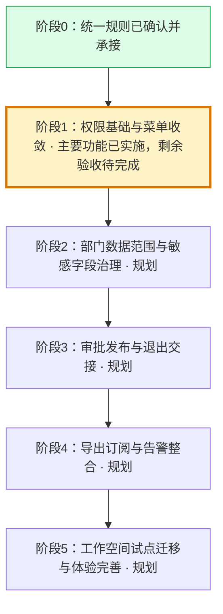

# DBHub 开发路线图与当前任务

更新日期：2026-10-24。本文是唯一当前执行入口，直接维护阶段、验收标准、剩余关口和启用边界，不依赖旧定稿或本地过程文件才能理解范围。

- [功能模块](功能模块总览与实现验收状态.md)：已实现、待验收和后续规划。
- [核心业务流程与状态图](核心业务流程与状态图.md)：六类图和异常分支。
- [数据接入与执行契约](../架构设计/数据接入与执行契约.md)、[内容与交付契约](../架构设计/内容与交付契约.md)：承接仍有效的业务、安全、迁移和后续规则。
- [项目文档目录](../README.md)、[开发指南](../开发指南.md)：正式资料与维护方式。

## 开发路线

| 阶段 | 交付范围 | 当前状态 |
| --- | --- | --- |
| 0 | 菜单、许可、角色、工作空间、旧权限映射及独立性等规则 | 已确认；有效规则已归入正式契约，定稿过程文件退出正式资料 |
| 1 | 菜单、自定义角色、用户/组分配、委派、治理复核、来源解释、任务边界及兼容回退 | 主要功能已实施；当前页面、约定外部范围及独立验收待完成 |
| 2 | 业务身份、部门/仓库/运输组织、完整行列条件、分类/脱敏及受控明文 | 后续规划；先身份/数据集映射，再证明条件执行和输出约束 |
| 3 | 报表/仪表盘新复核与发布策略、下线恢复、完整退出托管和接任 | 后续规划；复用现有对象、版本及审批记录 |
| 4 | 新导出策略、个人/团队复核、逐收件人执行领取、期限及告警 | 后续规划；复用原队列和快照，仪表盘交付单独验收 |
| 5 | 明确空间和主体的真实试点、差异确认、回退、体验完善及推广 | 后续规划；真实启用另行明确授权 |

当前真实权限未切换，旧权限继续兼容。阶段1不提前启用阶段2—4的新数据规则、业务策略和团队交付。一般功能及异常可用性问题仍按具体缺陷处理，不因性能测试移除而取消。

## 生效规则索引

原D01—D08的有效内容归入以下正式契约；本表只定位规则，不另建定稿或评审文件。

| 编号 | 规则及维护位置 |
| --- | --- |
| D01 委派、角色和分配 | [许可、来源及可授予范围](../架构设计/数据接入与执行契约.md#71-许可来源及可授予范围) |
| D02 主管与审批发布 | [当前审批发布](../架构设计/内容与交付契约.md#2-开发审批与发布)、[阶段3的新策略](../架构设计/内容与交付契约.md#8-已确认的后续内容与交付规则) |
| D03 数据和敏感字段 | [阶段2数据执行](../架构设计/数据接入与执行契约.md#8-已确认的数据执行目标阶段2规划)、[敏感核查及输出](../架构设计/内容与交付契约.md#8-已确认的后续内容与交付规则) |
| D04 工作空间 | [空间与数据身份](../架构设计/内容与交付契约.md#1-工作空间与数据身份)、[受控复制边界](../架构设计/内容与交付契约.md#8-已确认的后续内容与交付规则) |
| D05 旧权限迁移 | [逐主体兼容](../架构设计/数据接入与执行契约.md#72-旧权限逐主体兼容)、[启用与回退](../架构设计/数据接入与执行契约.md#73-撤权启用与回退) |
| D06 导出与订阅 | [当前交付](../架构设计/内容与交付契约.md#6-导出订阅和通知)、[阶段4期限与复核规则](../架构设计/内容与交付契约.md#8-已确认的后续内容与交付规则) |
| D07 写入边界 | [请求与目标会话](../架构设计/数据接入与执行契约.md#2-请求与目标会话) |
| D08 退出与应急 | [冻结、治理恢复及回退](../架构设计/数据接入与执行契约.md#73-撤权启用与回退)、[退出接任与内容恢复](../架构设计/内容与交付契约.md#8-已确认的后续内容与交付规则) |

## 阶段1当前待办

1. 完成当前版本业务员、开发者、主管、管理员的页面与关键任务走查，分别检查空间/平台管理，覆盖跨空间、直达URL、按钮、异常、键盘、明暗主题和无障碍。既有当前版本浏览器复验被URL策略阻断，旧截图仅作历史证据，不能记成当前实测。
2. 将下列A01—A51及A52安全部分逐项对应到实际结果、证据和未验原因；先复用现有有效证据，不因资料收敛重新跑全部测试。跳过、缺环境和无法证明不算通过。
3. 明确并完成已约定但未配置的外部连接器、SSO等验证范围；未完成项目保留待验，不用单一PG/本地账号案例代替全部环境。
4. 汇总必要发布包、恢复和回退证据，由业务、数据及发布责任人独立验收。演示人物不作为实际责任人，验收通过不等于授权真实切换。

## 阶段1验收标准

以下为仍有效的原验收编号和判定标准，不记录某次运行结果。技术证据与产品签署分开；在当前范围内逐项获得结论前，剩余产品验收保持待完成。预期使用独立案例与一致性数据，保留精确金额、NULL和原掩码，不用新解析器生成自己的标准答案。

| ID | 功能、安全与兼容标准 |
| --- | --- |
| A01 | 当前工作副本、存量配置及数据约束有可恢复基线，未提交和未跟踪必要文件已纳入；HEAD不能替代工作副本 |
| A02 | 所有现有入口/端点/DB函数/后台动作有目录项和处理决定；未知项不纳入启用包 |
| A03 | 未知许可拒绝；admin不获未来新许可；新许可默认不加入既有角色/委派 |
| A04 | 同一动作在菜单、直达URL、API和数据层结果一致，无遗漏未保护端点 |
| A05 | 增量结构可在旧数据上升级；原ID、旧字段、签名、期限及来源不丢失 |
| A06 | 新旧运行版本并存时，旧服务不写坏新结构；不支持的任务版本暂停，不降级执行 |
| A07 | readonly双路径逐主体显示原工具去留；未确认项实际保持完整旧模式 |
| A08 | 固定原admin动作，无无意新增能力、数据或原合法动作丢失 |
| A09 | 多角色不会改变legacy数据身份；个人和正式受管路径各自保持原数据、列、NULL/掩码及SQL限制 |
| A10 | 未知源约束、身份映射或数据差异阻止对应切换；无策略不会被误判成原本默认拒绝 |
| A11 | 旧JWT、伪造客户端角色/版本、前端缓存都不能产生新权；服务端解释来源、期限和版本 |
| A12 | 平台治理不自动成为空间成员；本人安全与合法平台操作在无空间时可达 |
| A13 | Go/SQL同一固定案例判定完全一致；历史admin分支不成为新许可后门 |
| A14 | 连接池复用和并发空间事务不串actor/space；安全定义及search_path没有因新函数放宽 |
| A15 | catalog.page不暴露元数据；metadata和preview另授，数据集范围单独校验 |
| A16 | 账号维护、运行读取、运行启停分别授权；任何角色不读取他人口令/个人任务 |
| A17 | 新业务查看/开发不含写；原合法SQL/Redis写范围单列保持，受控业务与SQL工单复核不混用 |
| A18 | 对象ID、任务ID、连接ID换成其他空间/用户后拒绝；路径/请求头空间冲突拒绝 |
| A19 | 撤权/到期/冻结返回成功后，下一次相关授权检查均拒绝；旧会话、缓存、按钮及链接不能继续用 |
| A20 | 撤一来源但还有合法来源，权限按剩余来源解释；撤尽才完全失权；组增减也生效 |
| A21 | 撤权与批准、发布、队列提交并发有明确事务顺序；不得在已确认撤权之后沿用旧批准新增授权 |
| A22 | 旧任务仍显示原策略、指派、真实签名；新许可不补造数据复核或改变旧独立性 |
| A23 | 队列及领取使用原空间和当前主体，不借执行者/管理员或当前UI空间授权 |
| A24 | 旧文件原7天/原主体保持；撤权后不能领取；不误开新24小时文件和团队交付 |
| A25 | 执行结果未知时保留原请求核实路径，不因切空间、冻结或回退重发写入/外发 |
| A26 | 治理动作同时满足当前许可、委派上限、目标主体/对象及期限；自己可执行不等于可授予 |
| A27 | 新角色/角色启用/组扩张都预览完整受益范围；无关联成员也不能跳过定义扩张复核 |
| A28 | 扩权待审期间有效权限不变；独立合格人批准后才应用；作者和受益人不能批准 |
| A29 | 复核人、作者或委派失效时不能沿用旧待办；无合格候选暂停，不自动转管理员 |
| A30 | 预览/批准基线变化返回冲突，不部分生效；只更新精确目标，不覆盖并发撤权或无关配置 |
| A31 | 重复提交幂等；审计/持久化失败不得授新权或宣称撤权成功 |
| A32 | 成员先冻结访问，再托管资产；本空间退出不影响另一空间；平台停用则所有空间失效 |
| A33 | 最后治理人可紧急冻结；独立恢复需两名不同预登记身份及实际核验，单人/过期/复用证据拒绝 |
| A34 | 恢复仅有限期治理，不补业务查看、原角色/组/个人凭据或旧订阅；到期停止 |
| A35 | 换空间、换人、版本变化和撤权后，迟到响应不进入页面/缓存；草稿、弹窗、选中详情清理 |
| A36 | 任意角色名称均按许可工作；普通查看角色只有报表/仪表盘，无工作台、连接或共享账号 |
| A37 | 11目录配置和原13侧栏/3辅助页去向完整，技术只读、本人代理/任务不丢失 |
| A38 | 隐藏菜单不等于撤权，合法直达仍可达；真正撤许可后URL和API同时拒绝 |
| A39 | 首页按有效个人选择→空间推荐→首个获准入口；无入口明确空状态，不跳技术概览 |
| A40 | 无空间、权限加载失败、空间停用均有安全返回；不自动进入其他空间或临时高权限页 |
| A41 | 通知、搜索、自动补全、数量及面包屑不泄露受限对象；原空间无权则摘要受限 |
| A42 | 旧URL/收藏/通知保持原空间及对象类型/ID，确认切换后重新验权，不按当前空间重解释 |
| A43 | 模板复制等后续能力未完成时明确禁用；现有功能入口不会绕过新许可和旧数据上限 |
| A44 | 随机性能值不再作为真实运行信息；现有真实统计标明来源与时间，未采集显示未配置 |
| A45 | 影子只读，不写目标库、不外发、不跑新交付；无意扩权/未批准收窄均为0，未知不算通过 |
| A46 | 只有确认主体使用新模型，未确认主体所有入口保持LEGACY_GUARDED；无法隔离则空间不切换 |
| A47 | 切换/回退同时影响API、DB、worker和页面；不支持最低桥接版本时拒绝启用 |
| A48 | 回退后撤权、冻结、期限、作废凭证仍生效；旧admin不复活；新授权未在旧基线则暂停 |
| A49 | DB故障或撤权记录不可读时进入安全受限状态，不能用旧快照兜底；恢复后先核对收紧记录 |
| A50 | 回退不重写签名、业务发布号、原文件期限，不清空未知回执或重跑历史；新模式独有对象暂停保留 |
| A51 | 1024/736/390/320宽度、键盘、明暗主题均能完成关键任务；表格局部滚动不使操作不可达 |
| A52 | 授权或审计故障不得放行；拒绝原因及操作来源可追溯。原性能部分已按SC-P1-20261024-01移除，不计为通过 |

关键边界出现无意扩权、未批准收窄、未知映射启用、串空间、凭据泄漏、撤权复活、签名伪造或原数据限制丢失时不得放行。证据应能定位源码/配置版本、主体/空间、原来源、预期/实际、时间和审计关联，不包含真实秘密或无关业务数据。

## 已生效范围调整

SC-P1-20261024-01：用户已要求去掉性能测试任务。性能基准、固定负载对照、压测、p95门槛和专项性能复验均从当前任务及阶段1门槛移除，不自动恢复，不将历史失败或停止记为通过。

原A52编号保留，仅执行授权/审计故障拒绝和原因/来源可追溯的安全部分；原P1-00的基线备份恢复及其他功能、安全、兼容、故障恢复验收继续有效。真实运行信息仍标明来源和时间，未配置不捏造监控值。

## 证据与真实启用

必要的当前回执、失败和停止现场索引保存在被忽略的 .local-docs 中，不作为正式规则来源，也不提交历史运行材料。某次回归数量不代替上述逐项验收；本次资料整理未新增运行或签署结论。

真实启用须明确目标空间、主体、能力、配置与运行版本、原数据约束、责任人和回退方案，在相应能力及独立验收通过后另行授权。未确认主体保持完整原模式；恢复或回退先核对当前收紧，不能复活旧权。未来范围变更直接维护本页及对应契约，不另立日期计划或重复评审。
