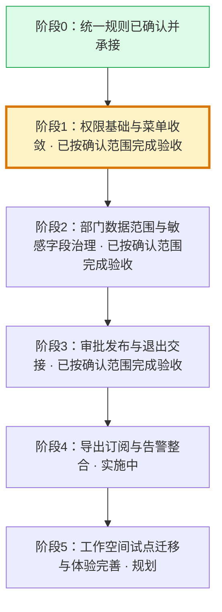

# DBHub 开发路线图与当前任务

更新日期：2026-10-26。本文是唯一当前执行入口，直接维护阶段、验收标准、剩余关口和启用边界，不依赖旧定稿或本地过程文件才能理解范围。

- [功能模块](功能模块总览与实现验收状态.md)：已实现、待验收和后续规划。
- [核心业务流程与状态图](核心业务流程与状态图.md)：六类图和异常分支。
- [数据接入与执行契约](../架构设计/数据接入与执行契约.md)、[内容与交付契约](../架构设计/内容与交付契约.md)：承接仍有效的业务、安全、迁移和后续规则。
- [项目文档目录](../README.md)、[开发指南](../开发指南.md)：正式资料与维护方式。

## GitHub 任务映射与当前补充

2026-11-11：本页继续作为进度权威；[知数 DBHub Project](https://github.com/users/xielforever/projects/5) 是同步视图，配置与状态映射见 [project-governance.json](../../.github/project-governance.json)。更新任务时先维护本页相关结论，再同步对应 Issue 和 Project 并读回。原始日志与截图仍保留在被忽略的 `.local-docs`，远端正文中的摘要不代表原始制品已发布。既有历史验收记录保持原样。

2026-11-17：当前及后续任务按[接口功能优先与必要页面核验](#api-first-acceptance)验收。

### 本期 MoSCoW 与核心链路验收

2026-11-18 确认产品 Must 为「连接数据库 → 查询并展示 → 保存并重新打开报表」，由 [P5-03 / #32](https://github.com/xielforever/DBHub/issues/32) 跟踪。**核心链路本地隔离验收通过，工作包判定为 Done。** 真实试点启用与推广由阶段 5 父项 [#15](https://github.com/xielforever/DBHub/issues/15) 跟踪。

| 本期顺序 | 事项与依据 |
| --- | --- |
| **Must · Done** | [#32](https://github.com/xielforever/DBHub/issues/32) 已在同一候选版本、工作空间、个人 PostgreSQL 连接和目标库完成核心链路验收，报表重开的独立执行回执已归档。 |
| **候选 Should** | 首批用户明确需要周期交付时，评估个人订阅与站内领取的产品入口。按实际使用频次和已确认的试点目标复评。 |
| **候选 Could** | CSV 导出、团队分发、仪表盘交付及指标告警等次序按试点使用反馈确定。既有分项技术验收按各自记录引用。 |
| **阶段及试点关口** | [#14](https://github.com/xielforever/DBHub/issues/14) 核对阶段 4 契约。[#15](https://github.com/xielforever/DBHub/issues/15) 跟踪阶段 5 的真实试点启用、独立验收和推广。[#30](https://github.com/xielforever/DBHub/issues/30) 确认真实试点空间、主体与权限差异，[#31](https://github.com/xielforever/DBHub/issues/31) 演练回退。真实启用另行授权，推广范围按试点验收结果评审。 |

**#32 核心链路验收条件**

- 在已授权的本地隔离环境，用具备相应权限的开发者和一份预期结果已知的 PostgreSQL 样本。整轮固定前后端构建或验收工作区快照、空间、连接 ID、目标数据库和验收主体。测试时登记实际标识。
- 从个人连接页选择或保存已获准的连接，连接测试成功。打开数据工作台，确认同一个连接及数据库，执行带固定排序的只读 SQL，页面结果列、行和关键值与样本一致。失败时显示当次错误。
- 在工作台成功结果的图表入口保存为本人可见的表格报表，登记报表 ID。离开工作台，从报表列表重新打开。服务端读回的报表定义和实际执行回执证明仍使用原连接、数据库和查询定义，页面展示与该查询预期一致。只有一次保存提示、静态截图或旧缓存结果时，整链验收仍待完成。
- 将前后端版本或快照、空间和源标识、预期与实际结果、查询及重新执行回执、报表 ID 和必要页面操作记录归档。全部满足后记录 #32 的工作包验收结论。

复用 [#5](https://github.com/xielforever/DBHub/issues/5) 的数据库接入与查询确认、[#10](https://github.com/xielforever/DBHub/issues/10) 的查询目标选择、[#11](https://github.com/xielforever/DBHub/issues/11) 的实际连接与 SQL 接口证据，以及 [#7](https://github.com/xielforever/DBHub/issues/7) 的工作台结果展示和个人报表重开证据。#7 从报表页新建，本轮补验了从工作台结果直接保存的路径。

2026-11-18 在本机 `main` 基准 `ebc75d7c4558ecaa33591178ab7c39e00006a263` 的工作区候选上完成联验，快照 SHA-256 为 `b157d4045bf96583f19b991235ce9b0e1d209ae772440d37636064f88fc927dd`。整轮使用空间 `1`、开发者 `2`、同一个人连接 `3` 及 PostgreSQL 16.15 的 `iam_test` 隔离库。连接检查已持久化，工作台查询实际显示两行并核对了 SQL 错误反馈。按用户确认修复表格报表创建配置和失败提示后，从工作台保存了私有报表 `1`（版本 `1`）。

工作台查询回执为 `e78a0b82-3dd6-4cc3-827f-19ea8f556a64`。保存后将隔离样本第 2 行从 `42` 更新为 `43`，从个人报表列表打开时以原连接、库和 SQL 重新执行，显示 `43`。持久化回执 `4a19a355-9853-4168-9ccb-75c0085a4964` 读回为 `succeeded`。前端类型检查和构建通过。验收记录、两次回执和页面证据归档于 `.local-docs/p5-03-core-20261118/数据库查询保存与重开报表验收.md`。

| 范围 | Issue 映射 | 当前进展与剩余事项 |
| --- | --- | --- |
| 阶段1验收证据 | [P1-01 / #3](https://github.com/xielforever/DBHub/issues/3) | A01—A51及A52安全部分已逐项映射。工作副本恢复、定向回归和 CCE 修订 1、2 镜像的隔离共库、切换、回退及数据读回通过，按版本复用 A51 页面证据。P1-01 技术验收完成，Done |
| 角色与任务矩阵 | [P1-02 / #4](https://github.com/xielforever/DBHub/issues/4) | 四类角色完成 44 项实际权限检查及业务读回，跨空间拒绝、撤权与到期复验通过。四项必要键盘交互通过，结合已有角色任务矩阵完成验收，Done |
| 外部数据库连接器 | [P1-03 / #5](https://github.com/xielforever/DBHub/issues/5) | 用户确认数据库接入和查询验收通过。企业 OIDC 移出验收范围，按用户确认收口，Done |
| 独立验收与恢复回退 | [P1-04 / #6](https://github.com/xielforever/DBHub/issues/6) | 已复用 #3 恢复、升级和隔离回退实证，补验 CCE 发布包及审计跨重启补写、防重和故障拒绝。用户统一确认业务、数据和发布三项，Done |
| A2全站对齐 | [UI-01 / #7](https://github.com/xielforever/DBHub/issues/7) | CCE 修订 2 三处页面修复已获用户确认，四角色接口和业务流程及必要页面交互已通过。按用户确认移出剩余外部联验后，本轮验收完成，Done |
| 知数品牌 | [UI-02 / #8](https://github.com/xielforever/DBHub/issues/8) | 55 份素材及浏览器图标复核通过，已验两类停用分享页及兼容侧栏。用户确认 PowerPoint 按已实测的 Windows LTSC 2024 范围验收，SVG 与透明 PNG 插入和等比缩放通过，Done |
| 登录反馈 | [UI-03 / #9](https://github.com/xielforever/DBHub/issues/9) | 密码反馈、两步验证、恢复码和安全返回原工作空间已有隔离实测。企业 OIDC 联验移出，以现行范围收口，Done |
| 查询目标联合选择器 | [UI-04 / #10](https://github.com/xielforever/DBHub/issues/10) | 隔离浏览器真实 PostgreSQL、Redis、H2 元数据、跨能力确认与取消、成员撤权清理及同类 SQL 切换后的 Monaco 撤销和重做均通过。QT01–QT08 范围验收完成，Done |
| node101基础服务 | [INFRA-01 / #11](https://github.com/xielforever/DBHub/issues/11) | 本机 node101 配置已交付和应用。源 19 的连接检查保存并读回，SQL 返回 3 行 4 列，执行回执为 `succeeded`。用户确认 CCE 正式数据库可查询，并同意按本机接口实测收口，取消本机浏览器重复验证。Done |
| 阶段2—5 | [P2 / #12](https://github.com/xielforever/DBHub/issues/12)、[P3 / #13](https://github.com/xielforever/DBHub/issues/13)、[P4 / #14](https://github.com/xielforever/DBHub/issues/14)、[P5 / #15](https://github.com/xielforever/DBHub/issues/15) | P2 与 P3 按确认的隔离范围完成阶段技术验收，均为 Done。P4 的 #25–#29 已完成首批隔离验收，阶段关口单独核对，保持 In Progress。P5 为后续规划。真实启用须另行明确授权 |

### P2–P5 子任务与依赖

进度按下方最新验收记录维护，[GitHub Project #5](https://github.com/users/xielforever/projects/5) 为同步视图。实施前按各 Issue 与对应业务契约确认范围及验收条件。真实权限切换和推广须另行明确授权。

| 阶段父项 | 子任务 | 范围与验收重点 | 前置依赖 |
| --- | --- | --- | --- |
| [P2 / #12](https://github.com/xielforever/DBHub/issues/12) | [P2-01 / #16](https://github.com/xielforever/DBHub/issues/16) 业务身份与数据集映射 | 先定义业务身份及其对应的数据集，作为组织范围、行列条件和脱敏的基础。 | 阶段 1 相关基础 |
| [P2 / #12](https://github.com/xielforever/DBHub/issues/12) | [P2-02 / #17](https://github.com/xielforever/DBHub/issues/17) 部门/仓库/运输组织范围 | 确认部门、仓库和运输组织的数据范围。 | #16 |
| [P2 / #12](https://github.com/xielforever/DBHub/issues/12) | [P2-03 / #18](https://github.com/xielforever/DBHub/issues/18) 行列条件约束 | 在已确认的数据集和组织范围上落实行、列条件。 | #16、#17 |
| [P2 / #12](https://github.com/xielforever/DBHub/issues/12) | [P2-04 / #19](https://github.com/xielforever/DBHub/issues/19) 分类脱敏与受控明文 | 确认字段分类、脱敏规则和受控明文的启用条件。 | #16–#18 |
| [P2 / #12](https://github.com/xielforever/DBHub/issues/12) | [P2-05 / #20](https://github.com/xielforever/DBHub/issues/20) 执行与输出约束验收 | 验证执行侧的组织与行列约束，以及输出侧的脱敏和受控明文。 | #16–#19 |
| [P3 / #13](https://github.com/xielforever/DBHub/issues/13) | [P3-01 / #21](https://github.com/xielforever/DBHub/issues/21) 报表新复核发布策略 | 确认报表复核发布策略，复用对象版本和审批记录。 | 阶段 2 相关能力 |
| [P3 / #13](https://github.com/xielforever/DBHub/issues/13) | [P3-02 / #22](https://github.com/xielforever/DBHub/issues/22) 仪表盘新复核发布策略 | 确认仪表盘复核发布策略，复用对象版本和审批记录。 | 阶段 2 数据约束、#21 报表复核与参数边界、仪表盘所需获批数据契约 |
| [P3 / #13](https://github.com/xielforever/DBHub/issues/13) | [P3-03 / #23](https://github.com/xielforever/DBHub/issues/23) 下线与恢复 | 落实报表和仪表盘的正常下线、应急停止、应急恢复，复用对象版本和审批记录。 | 阶段 2 数据约束、#21 报表复核发布、#22 仪表盘复核发布和逐卡依赖约束 |
| [P3 / #13](https://github.com/xielforever/DBHub/issues/13) | [P3-04 / #24](https://github.com/xielforever/DBHub/issues/24) 完整退出托管及接任 | 落实退出托管、接任及交接，复用对象版本和审批记录。 | 阶段 2 数据约束、#21 报表复核、#22 仪表盘复核、#23 下线与恢复、阶段 1 冻结及治理接续 |
| [P4 / #14](https://github.com/xielforever/DBHub/issues/14) | [P4-01 / #25](https://github.com/xielforever/DBHub/issues/25) 新导出策略（复用队列快照） | 保留独立导出审批，分离审批预览与批准后生成的正式文件，复用队列、快照及回执。 | #12 正式报表行列和脱敏执行、#21 活动发布和参数边界、#23 停止与恢复、#24 托管和冻结及 #13 跨项关口 |
| [P4 / #14](https://github.com/xielforever/DBHub/issues/14) | [P4-02 / #26](https://github.com/xielforever/DBHub/issues/26) 个人与团队复核 | 落实并验收个人与团队复核，明确计划确认、独立批准、冻结名单和复核资格。 | #25 个人导出批准、预览与队列；阶段 2 数据范围、脱敏与参数，阶段 3 活动发布、停止与冻结 |
| [P4 / #14](https://github.com/xielforever/DBHub/issues/14) | [P4-03 / #27](https://github.com/xielforever/DBHub/issues/27) 逐收件人执行领取、权限与撤权 | 验收正式文件本人领取、团队订阅逐人执行和领取、收件权限及撤权。 | #25 正式文件与生成回执、#26 冻结名单和逐人批准范围、阶段 2 数据边界和阶段 3 发布及收紧规则 |
| [P4 / #14](https://github.com/xielforever/DBHub/issues/14) | [P4-04 / #28](https://github.com/xielforever/DBHub/issues/28) 期限及告警 | 将期限和告警接入导出、订阅流程，复用队列快照。 | #25 正式文件、生成回执与旧文件兼容；#26 个人和团队复核期限；#27 本人凭证、逐人期次及授予撤权 |
| [P4 / #14](https://github.com/xielforever/DBHub/issues/14) | [P4-05 / #29](https://github.com/xielforever/DBHub/issues/29) 仪表盘交付单独验收 | 单独验收仪表盘导出、订阅和告警，覆盖适用的逐收件人权限及撤权。 | #22 已复核看板及逐卡契约、#25 正式文件队列、#26 订阅复核、#27 本人及逐人交付、#28 自动周期、期限清理及告警 |
| [P5 / #15](https://github.com/xielforever/DBHub/issues/15) | [P5-01 / #30](https://github.com/xielforever/DBHub/issues/30) 明确试点空间与主体并完成差异确认 | 确认试点工作空间与主体，记录与原模式的差异。 | 阶段 1–4 相关能力 |
| [P5 / #15](https://github.com/xielforever/DBHub/issues/15) | [P5-02 / #31](https://github.com/xielforever/DBHub/issues/31) 试点回退，未确认主体保持原模式 | 验证试点可回退，未确认的主体继续使用完整原模式。 | #30 |
| [P5 / #15](https://github.com/xielforever/DBHub/issues/15) | [P5-03 / #32](https://github.com/xielforever/DBHub/issues/32) Must · 连接、查询展示与报表重开 | 同版本、同源的个人报表链路本地隔离验收通过，独立执行回执已归档，Done。 | 核心链路复用 #5、#7、#10、#11 |

2026-11-18 开始实施 [P2-01 / #16](https://github.com/xielforever/DBHub/issues/16)，P2 与 P2-01 为 In Progress，使用本地 `main` `ebc75d7` 及当前工作区。首项覆盖业务身份、数据集和受管执行账号的显式版本绑定。验收在隔离环境核对接口、有效期、版本、跨空间隔离和兼容边界。P2-02 至 P2-05 仍为 Todo。

2026-11-18 P2-01 本地实现及技术验收完成，状态为 Done。新增迁移 0083 及空间管理员的登记和读回接口，验证业务身份与数据集绑定、版本和到期失效、整组回滚、跨空间拒绝、持久审计及既有执行兼容。隔离回归 6 项通过，受保护历史归档恢复测试因未配置跳过。依据为本地 `main` `ebc75d7` 加当前工作区，证据见 `.local-docs/p2-01-20261118/隔离验收.md`。P2 父项保持 In Progress，P2-02 至 P2-05 仍为 Todo。

2026-11-18 [P2-02 / #17](https://github.com/xielforever/DBHub/issues/17) 开始实施，状态为 In Progress。按身份和数据集登记部门、仓库和运输组织的完整组合，验证组合保持、版本与有效期、空间隔离及审计。依据为本地 `main` `ebc75d7` 加当前工作区，P2-03 至 P2-05 仍为 Todo。

2026-11-18 P2-02 本地实现与隔离技术验收完成，状态为 Done。迁移 0084 保存完整组织组合，接口区分已登记和当前可用范围。版本变动、到期和账号停用后可用范围为空，组织范围读写持久审计。定向回归 7 项通过、1 项因历史归档未配置而跳过。证据见 `.local-docs/p2-02-20261118/隔离验收.md`。P2 父项保持 In Progress，下一项 [P2-03 / #18](https://github.com/xielforever/DBHub/issues/18) 为 Todo。

2026-11-18 [P2-03 / #18](https://github.com/xielforever/DBHub/issues/18) 开始实施，状态为 In Progress。本次落实受管 PostgreSQL 视图的行列策略登记和参数化计划，验证整组交并、明确禁止、列白名单和版本失效。产品执行与输出链路随 P2-05 验收。

2026-11-18 P2-03 本地实现和隔离技术验收完成，状态为 Done。迁移 0085 保存数据集行列策略。用受限账号对实际隔离 PostgreSQL 视图执行同一计划，返回预期 2 行 2 列。定向回归 8 项通过，历史归档恢复因未配置跳过。证据见 `.local-docs/p2-03-20261118/隔离验收.md`。P2 父项保持 In Progress，下一项 [P2-04 / #19](https://github.com/xielforever/DBHub/issues/19) 为 Todo。生产执行及输出约束继续随 #20。

2026-11-18 [P2-04 / #19](https://github.com/xielforever/DBHub/issues/19) 开始实施，状态为 In Progress。先落实现有已确认的字段分类、默认脱敏、原有上限和派生保护。现有 `report.reveal` 为规划许可，受控明文的独立审批职责待确认，相关实施和 #20 综合验收在确认点后推进。

2026-11-18 用户确认 #19 的受控明文由专门授权的数据复核人独立审批。按该范围推进隔离实现及技术验收，真实动作许可、目标主体和部署仍须按项目关口另行授权。

2026-11-18 用户确认 #20 先在本地隔离环境验收已发布报表入口，以现有查看资格与明确绑定的受管 PostgreSQL 数据集为前置条件。按发布号、源和账号校验，测试默认脱敏、交互核查及交付前复核。生产部署和真实权限启用另行授权。

2026-11-18 P2-04 本地实现及隔离技术验收完成，状态为 Done。迁移 0086 固定字段分类和行列策略版本，受控明文绑定独立复核、用途、记录键、版本和字段。默认脱敏、旧限制继承、到期和撤回通过。证据见 `.local-docs/p2-04-20261118/隔离验收.md`。

2026-11-18 P2-05 已发布报表隔离链路通过。默认返回预期 2 行 4 列，其中受保护字段为 NULL；交互明文限定为批准的 1 行 1 列。实际查询执行中撤回后交付返回 409 且无数据，成功与拒绝均读回审计。联合回归 9 项通过、1 项因历史归档未配置而跳过。证据见 `.local-docs/p2-05-20261118/已发布报表隔离验收.md`。

2026-11-18 用户确认按已发布报表隔离验收范围收口 [P2-05 / #20](https://github.com/xielforever/DBHub/issues/20)，任务结论为 Done。复用同一工作区快照的验收结果。独立导出、订阅和实际通知渠道未纳入本次验收，生产部署和真实权限启用另依授权推进。P2-01 至 P2-05 均已按各自范围收口，[P2 父项 #12](https://github.com/xielforever/DBHub/issues/12) 与阶段里程碑保留开放，阶段收口按其验收和关口办理。

2026-11-18 阶段 2 收口复核。用户确认补齐阶段契约验收后再收口。阶段 1 基础依赖 #3–#6 已完成，#16–#20 的隔离验收按各自范围成立。#12 在 Project 保持 In Progress，[阶段 2 里程碑](https://github.com/xielforever/DBHub/milestone/2) 保持开放。

| 阶段契约检查 | 当前依据及待补验收 |
| --- | --- |
| 业务身份、数据集、组织范围、行列条件、默认脱敏与受控明文 | 已读回各子项证据。已发布报表隔离执行通过，包括独立审批的记录级明文、执行中撤权阻断和审计。沿用 P2-05 工作区快照，本轮未重跑。 |
| 正式发布拦截未知分类 | 正式发布路径校验复核、执行账号和受众。受管报表的发布事务仍缺阶段 2 字段分类检查，待验证未知分类拒绝且不生成发布版本，以及分类齐备时的发布结果。 |
| 独立文件、订阅与实际通知 | 隔离验收入口已验证拒绝文件及通知用途的受控明文。实际报表导出和订阅执行走兼容路径，站内通知及 Webhook 有独立实现。待在实际入口验证阶段 2 数据约束、文件及订阅快照不含受控明文，以及通知负载和资源访问的边界。 |
| 真实启用 | 按本页「证据与真实启用」另行授权和验收。阶段技术验收使用明确纳入的隔离对象。 |

2026-11-18 阶段 2 按用户确认的本地隔离范围完成正式入口验收。正式发布遇未知分类返回 409 且无发布事件，分类齐全后发布成功。只读查看、独立审批后的 CSV 文件及个人订阅快照只含授权范围内的脱敏数据。站内通知与本地 Webhook 仅携带提示和资源引用。撤回范围后旧文件和订阅快照不可领取，待发 Webhook 停止，新的订阅执行被拒绝。原记录级明文与执行中撤销回归同轮通过。最终回归 14 项通过、0 失败、1 项因缺受保护历史归档跳过。证据见 `.local-docs/p2-stage-20261118/阶段契约验收.md`，依据为本地 `main` `ebc75d7` 加验收工作区，31 个关键文件的清单 SHA-256 为 `2e143ae302cca5a0df35c18a48c42cd892d21fd843064727eb324bb8eb132024`。P2 技术验收达到收口条件，状态为 Done。真实权限启用及生产部署仍需单独授权。

2026-11-18 阶段 3 范围和依赖核对。阶段 2 #12 已完成，31 个验收文件与记录一致，依赖证据覆盖本地隔离下明确绑定受管 PostgreSQL 数据集的正式报表。阶段 3 本批先处理 #21 的报表送审、复核及正常发布策略。#22 仪表盘复核发布、#23 下线与恢复、#24 退出托管及接任继续由各自工作包跟踪。阶段 3 里程碑 #3 开放。

#21 已核对现有冻结报表版本、审批、15 分钟真实只读预览及发布记录。阶段 3 契约要求当前资格覆盖目标受众及允许的数据和参数范围，提交人和受益人回避，高风险业务与数据复核分别签署，发布人与提交人独立；当前合格业务复核人可兼发布。待确认高风险触发条件及数据复核授权范围。#19 的受控明文审批资格沿用其原用途。现有阶段 2 隔离报表计划可用于已批准视图的固定列投影；覆盖无法证明的对象须继续阻断新策略。拟验收常规发布、双复核缺签拒绝、自审和受益回避、撤权、预览过期、基线变更及兼容记录保留。策略确认前暂停实施，Project 按待办映射保留 Todo。

2026-11-18 用户确认 #21 按风险条件决定复核节点，数据复核资格按数据集单独授权。#21 开始本地隔离实现。首发、敏感字段、范围扩大或执行来源／账号变更须双复核，未扩展边界的内部字段修订走业务复核。正式规则维护在[内容与交付契约](../架构设计/内容与交付契约.md#82-阶段-3-正式报表复核与正常发布)。

2026-11-18 #21 按确认范围完成本地正式报表技术验收，状态为 Done。高风险走独立双复核，未扩大边界的内部字段修订走业务复核。等值、枚举、数值及日期区间在已批准 PostgreSQL 视图中与组织范围取交集。正常查看、实际 CSV 及订阅快照通过，分别扩大枚举、数值上限和日期上限均触发数据复核。报表旧签名、预览过期、受益回避及授权撤销等边界一并复验。隔离回归 16 项通过、1 项因历史归档缺失跳过，通用参数及映射 4 项通过。证据见 `.local-docs/p3-01-20261118/报表复核发布验收.md`。#13 尚有 #22–#24，阶段里程碑保持开放。真实权限与生产启用另行授权。

2026-11-18 #22 范围和依赖核对。范围为仪表盘送审、复核和正常发布，复用冻结版本、复核指派、逐卡真实预览、审批记录和发布号。下线与恢复随 #23，退出托管与接任随 #24，仪表盘文件和周期交付另行验收。本地 #21 的 27 个关键文件与验收快照一致，可复用数据集授权、分类、组织范围和批准参数边界。本轮只核对现有仪表盘代码及历史证据。

#22 的接入缺口是仪表盘必需及可选卡片均须引用有获批数据契约的正式报表，#21 的受管执行入口目前拒绝带数据契约的报表。补通时须保留原契约校验，覆盖脱敏后的列类型、空值、时效水位和逐卡真实结果，并证明全局筛选的全部允许值都落在引用报表的批准范围内。待用户确认首批是否所有卡片均使用已纳管且具备获批契约的报表，以及高风险跨数据集仪表盘采用一人覆盖全部数据集或分别签署。策略确认前暂停实施，#22 在 Project 保留 Todo，#13 与阶段里程碑开放。

2026-11-18 用户确认 #22 隔离验收的必需及可选卡片均使用通过 #21 复核且具备获批数据契约的报表。高风险仪表盘由一名独立数据复核人覆盖全部引用数据集。按此实施，看板下线、恢复和真实启用仍依相应范围。

2026-11-18 #22 按确认范围完成仪表盘本地隔离技术验收，状态为 Done。必需及可选卡片均经过 #21 复核且有获批数据契约。全局筛选范围逐卡检查，实测两数据集的卡片取数、脱敏和时效水位。高风险由一名独立数据复核人覆盖全部数据集，一处授权或覆盖不足即拒绝。数据复核授权撤销、重新登记及报表换版均阻止用旧签名发布。收窄到内部必需卡片的修订可走单级业务复核。最终回归 24 项通过、0 失败、1 项因历史归档缺失跳过。证据见 `.local-docs/p3-02-20261118/仪表盘复核发布验收.md`。#13 尚有 #23 和 #24，阶段里程碑保持开放。

2026-11-18 #23 核对范围和依赖。#21 与 #22 已完成本地隔离正常发布验收，#22 的 26 个关键文件与当前工作区核对一致，其最终隔离回归也包含 #21。现有发布记录、活动发布指针和下线时未结申请的取消可复用。兼容回滚仅核对部分当前边界，阶段 3 下线审批及应急恢复单独落实。仪表盘归档恢复、退出托管和接任沿各自入口。

2026-11-18 用户确认应急停止与恢复分别授权、由不同人执行，快速恢复限本次停止前生效的获批版本。正常下线走独立业务复核，登记原因和依赖。恢复再次验证当前约束，无法证明安全则走常规送审。#23 开始本地隔离实现，状态 In Progress。#13 与阶段里程碑保持开放，#24 待办。

2026-11-18 #23 完成本地隔离技术验收，状态为 Done。报表和仪表盘正常下线均通过独立业务复核，依赖和原因变化阻断批准。应急停止和恢复分别授权，账号停用时仍可停止。快速恢复复用停前生效的获批版本，分配新发布号。当前授权失效或卡片依赖换版时拒绝恢复；旧刷新、报表发布号、CSV 与订阅快照保持失效。仪表盘下线后按新修订重新审批和发布通过。最终隔离回归 25 项通过、0 失败、1 项因未配置受保护历史归档而跳过。证据见 `.local-docs/p3-03-20261118/下线与恢复验收.md`，依据为本地 `main` `ebc75d7` 加验收工作区，23 个关键文件清单 SHA-256 为 `84f0c449e1f15198b42231ff21b491f25c59bba037023f4f2eaa086e830ae207`。#13 尚有 #24 完整退出托管及接任，阶段里程碑 #3 保持开放。真实权限、生产启用和浏览器交互依各自关口。

2026-11-18 #24 范围与依赖核对。#21、#22、#23 已完成各自隔离技术验收。#23 的 23 个关键文件与当前工作区匹配，同次日志包含 #21、#22 回归。现有冻结持久化收紧，登记报表和仪表盘数量，并取消部分访问申请及限制连接任务。旧移交只改责任人和草稿版本，缺少逐项托管、候选接受及独立复核。

2026-11-18 用户确认 #24 首批按受管报表和仪表盘验收。空间治理人提名，候选接受后独立复核。托管期间满足原发布约束的已发布内容继续服务原受众，失效按 #23 办理。同一平台账号重新加入须经全新独立授权，原会话、个人资源和交付继续失效。开始本地隔离实施，#13 与里程碑 #3 保持开放。

2026-11-18 #24 完成本地隔离技术验收，状态为 Done。计划退出保留现行治理接续，冻结后逐项登记两张受管报表和一张仪表盘，原有资格的受众继续使用合规正式版本。候选拒绝、重新提名、接受和独立审批通过。接任保留原正式发布号及审批历史，撤回原待审版本，接任人可按现行策略重新送审。同一平台账号经独立授权，使用新登录取得新的只读成员身份。旧会话及其刷新后的令牌继续被原空间拒绝，旧连接、原受众权、个人订阅和旧快照未恢复。最终隔离回归 32 项通过、0 失败、1 项因未配置受保护历史归档跳过。证据见 `.local-docs/p3-04-20261118/退出托管与接任验收.md`，依据为本地 `main` `ebc75d7` 加验收工作区，29 个关键文件清单 SHA-256 为 `15d8d901d5e42d77d79779a2c74f4a532df42eb1f50429800e4caf2a254717be`。#13 与阶段 3 里程碑保持开放，阶段收口依关口另行核对。

2026-11-18 #13 阶段 3 收口复核。#12 前置依赖已收口，#21–#24 已关闭。当前工作区与 #24 最终验收清单的 29 个关键文件一致，历史联合回归 32 项通过、0 项失败、1 项因未配置受保护历史归档跳过。本轮用合成数据补验托管期间的原发布边界。原负责人冻结后，为现有查看者扩大组织范围，报表和仪表盘卡片在同一发布号下都返回了新增部门的数据。该阶段关口失败，#13 在 Project 保持 In Progress，阶段 3 里程碑保留开放。运行时收紧和复验范围待用户确认。日志与核对清单见 `.local-docs/p3-stage-gate-20261118/阶段3收口核对.md`。真实启用仍按单独关口办理。

2026-11-18 用户确认补齐原发布运行时校验并联合验收。报表查询、仪表盘卡片、导出和订阅须校验原审批边界。正式下线沿 #23，扩大范围后沿 #21 或 #22 重新审批。实施与联验期间保留 #13 和阶段 3 里程碑开放。

2026-11-18 #13 阶段 3 关口通过，按确认的本地隔离技术范围收口。范围扩大时，原发布的报表、旧刷新与新刷新的卡片、导出生成、已批准 CSV 与订阅快照均返回 409 且无结果。已排队的订阅暂停且无新快照。收回扩大范围后，原报表可继续查询。独立接任保留原发布号时仍受原审批约束。托管仪表盘在报表由其他人负责时也独立阻断超范围卡片。整批 32 项通过，既有订阅入队用例首次失败，单项与五项交付联验均复跑通过，累计 33 个不同用例完成验证。历史基线归档未配置，跳过 1 项。依据为本地 `main` `ebc75d7` 加未提交工作区，41 个关键文件清单 SHA-256 为 `7c997c248120d9bdc9fa2a18083ce0fe6b4b077cec66c8543dcaa4abfa3866f6`。见 `.local-docs/p3-stage-gate-20261118/阶段3收口核对.md`。阶段判定为 Done，GitHub 视图按此同步。真实启用继续按单独关口办理。

2026-11-18 #14 阶段 4 范围及依赖核对。里程碑 #4 开放，子项为 #25 新导出策略、#26 个人与团队复核、#27 逐收件人执行、领取和撤权、#28 期限和告警、#29 仪表盘专项交付验收。#12、#13 均已收口，阶段 3 最终 41 个关键文件与当前工作区一致。阶段 2 原始 31 个文件中的 13 个随后发生变化，当前依赖以阶段 3 同版回归验证的正式报表、实际导出、个人订阅、下线恢复和托管关口为准。

#25 现有导出在申请时生成加密快照，审批后从原快照编码下载。已有订阅队列具备领取、租约、回执和快照能力，当前导出还没有批准后生成并独立保存正式文件的工作流。首批拟沿用本地隔离下明确纳管的正式报表，保留独立审批、CSV/JSON/XLSX、分类脱敏和有效上限取最小。拟验收无人批准时无正式文件、同一审批只入队一次、当前发布或数据边界失效时阻止生成、存量七天文件的兼容读回。首批验收切分及批准后正式文件使用哪次取数待用户确认。#14 和 #25 在 Project 保留 Todo。

2026-11-18 用户确认 #25 首批验收到审批后排队及正式文件生成。后台按原申请人的冻结参数重新取数，保留现有独立审批和阶段 2、3 的当前约束。本人领取和凭证随 #27，到期与清理联验随 #28，仪表盘交付随 #29。#25 进入本地隔离实施。

2026-11-18 #25 完成本地隔离技术验收，状态为 Done。同一审批只入队一次，工作器按原申请人与冻结参数重新取数，CSV、JSON、XLSX 均实测文件内容、脱敏、加密和回执。审批预览和正式文件分开保存。范围、有效行数上限或发布审批证据失效以及租约过期时无可生成文件。存量文件的原模式和期限回归通过。最终回归 18 项通过、0 项失败、1 项因缺少受保护历史归档跳过。依据为本地 `main` `ebc75d7` 加未提交工作区，52 个关键文件清单 SHA-256 为 `40900c639403eaadf2f4b4cafe701cb38c0dd1a6c9052a88ccf406762bf8c06b`。证据见 `.local-docs/p4-01-20261118/正式报表导出生成验收.md`。#14 和阶段 4 里程碑保持开放，#26–#29 按各自范围处理。

2026-11-18 #26 范围及前置依赖核对。#25 已完成关闭，52 个关键文件与当前工作区一致，可直接复用个人导出的独立审批、受限预览、版本冲突检查及批准后入队。现有个人订阅支持本人保存、手动及到期执行和停用，缺新计划的显式复核和续期节点。契约已确认个人新计划 90 天复核、团队计划独立复核并冻结批准名单和 30 天复核期限。团队创建与复核仍是规划许可，现有管理员和报表导出复核角色不自动继承资格。契约尚未定义团队导出审批流程。

拟首批沿用本地隔离受管报表，复验个人导出，验收个人订阅确认和团队订阅独立批准及冻结名单。计划固定活动发布、参数和范围。新增组成员不得沿旧批准自动加入。逐收件人执行、领取和撤权由 #27 验收，期限到期调度、清理和告警联验由 #28 验收，仪表盘交付由 #29 验收。首批是否纳入团队导出、个人订阅开通及续期确认主体、团队复核资格按数据集或空间登记待用户确认。#26 保持 Todo，#14 保持 In Progress，阶段 4 里程碑保持开放。

2026-11-18 用户确认 #26 首批覆盖个人导出、个人订阅和团队订阅。个人订阅由本人明确确认开通和续期。团队订阅由按数据集单独授权的一名独立复核人批准，须覆盖冻结合格名单和参数范围，创建资格另行登记。进入本地隔离实施，团队逐人执行与领取仍由 #27 验收。

2026-11-18 #26 完成本地隔离技术验收，状态为 Done。个人导出独立审批及批准后入队复验通过。新个人订阅由本人明确确认，按冻结参数和活动发布实际运行，90 天到期停止入队，显式续期方可恢复。计划修改、发布或组织范围变化时受当前版本及批准边界约束。团队复核独立检查数据集资格、当前创建资格、审批人与收件人的回避和全名单覆盖。实际批准两人冻结名单，新增组成员通过重提审批，待审名单变化阻止用旧依据批准。团队批准有效 30 天，逐人执行和领取仍由 #27 验收。最终回归 20 项通过、0 项失败、1 项因缺少受保护历史归档跳过。依据为本地 `main` `ebc75d7` 加工作区，59 个关键文件清单 SHA-256 为 `a6cd43133cc2890b0d6a2614fa91ce30ff51c4a879ced1c7248d7f5c0d8c02d2`。证据见 `.local-docs/p4-02-20261118/个人与团队订阅复核验收.md`。#14 与阶段 4 里程碑保持开放。

2026-11-18 #27 范围及依赖核对。#25、#26 均已完成关闭。#26 的 59 个关键文件与当前工作区一致，其中同版复验覆盖 #25 的正式文件和旧导出。#25 已保存独立加密文件、申请人、批准版本、校验值及 24 小时文件期限，现有下载仍只处理旧模式。#26 已保存活动发布、冻结名单、参数、逐人批准范围和 30 天复核证据，团队申请尚未入队执行。原个人队列和快照已具备主体绑定、发布校验及撤权阻断，可为新路径复用。

首批拟沿用本地隔离受管 PostgreSQL 正式报表，验收个人正式文件的本人领取，以及团队订阅按冻结名单逐人执行和领取。计划负责人只读送达状态，收件资格与创建资格分开。到期调度、清理和告警联验由 #28 接续，仪表盘由 #29 独立验收。待确认团队收件权的授予方式、单人数据范围收紧后的交付行为、正式文件 10 分钟凭证能否重复兑换。#27 保持 Todo，#14 保持 In Progress，阶段 4 里程碑保持开放。

2026-11-18 用户确认 #27 在冻结名单内逐人授权，收紧后新期次按现行子范围继续，范围扩大须重审。已撤收件资格的新授予只影响新期次。个人文件凭证绑定本人会话、空间和文件，一次兑换。进入本地隔离实施。

2026-11-18 #27 完成本地隔离技术验收，状态为 Done。#25 正式文件由原申请人以原登录会话在 10 分钟内兑换，实际并发兑换仅一次成功，文件校验值及脱敏一致。#26 冻结名单内独立逐人授权，两个收件人按各自当前数据范围执行和领取，负责人只看状态。收紧可执行新期，旧快照无法证明当前合规时拒绝。队列中途撤权跳过该人，重授只影响新期；范围扩大须另审，其他收件人继续。负责人失权时计划暂停。团队期次通过接口显式触发并由后台工作器执行。最终回归 21 项通过、0 项失败、1 项因未配置受保护历史归档跳过。以本地 `main` `ebc75d7` 加工作区为依据，67 个关键文件清单 SHA-256 为 `c33e2c5436b9ccfafb9ad6634d1d175f8575704d9c8647cf51fa61f0c54d1bd7`，证据见 `.local-docs/p4-03-20261118/逐收件人执行与领取验收.md`。#28 期限清理、告警联验及 #29 仪表盘专项交付待验，#14 与阶段 4 里程碑保持开放。

2026-11-18 #28 范围及依赖核对。#25–#27 均已以 completed 关闭，#27 的 67 个关键文件与当前工作区一致，并有同批次 #25、#26 回归证据。正式文件 24 小时、本人一次领取凭证最长 10 分钟、个人与团队复核分别 90 天和 30 天、期次快照 7 天及通知入口 24 小时分别计时，存量文件保留原七天口径。当前已有到期读取阻断、个人计划定时入队、个人快照清理、个人指标告警和回环 Webhook 的既有证据。新正式文件、领取凭证、团队快照的到期清理，通知入口独立期限，以及清理后告警原发生值与处置记录的联合验收仍待补齐。

团队工作器当前只消费已显式触发的期次。#28 的 Issue 与契约尚未明确是否同时验收按计划自动创建团队期次。拟沿用本地隔离受管 PostgreSQL 报表，超期立即拒绝读取，后台移除过期业务载荷并保留审计元信息。是否把团队自动周期触发纳入本项，以及是否扩展为团队逐人指标告警，待用户确认。#28 保持 Todo，#14 保持 In Progress，阶段 4 里程碑保持开放。

2026-11-18 用户确认 #28 纳入自动周期触发，同一周期去重且跳过错过的历史期次。沿用个人指标告警，联验正式导出和团队交付的站内通知、到期与清理，兼容复验个人 Webhook。进入本地隔离实施。

2026-11-18 #28 完成隔离受管报表的后台与 HTTP 接口技术验收，状态为 Done。正式文件、凭证、快照及通知入口分别按有效期处理，过期业务载荷可重复清理，批准、校验值和回执保留。团队自动调度只创建当前周期且同周期去重、到期复核不再入队，逐人执行继续受 #27 的当前权限约束。正式导出和团队站内送达通知仅含状态和资源引用，通知入口到期后独立领取仍按各自期限处理。个人告警清理后可读回原触发值、恢复值和处置记录，现有个人 Webhook 兼容通过。联合回归 15 项通过、0 项失败、1 项因未配置受保护历史归档跳过。依据为本地 `main` `ebc75d7` 加工作区，74 个关键文件清单 SHA-256 为 `c99f12f587a0989697636580e99d29f1ef485521ac5deaf59f762d27ab15bf8a`，证据见 `.local-docs/p4-04-20261118/交付期限自动周期与告警验收.md`。前端跳转及真实启用未验收，#29 仪表盘专项待验，#14 与阶段 4 里程碑保持开放。

2026-11-18 #29 范围及依赖核对。#22 和 #25–#28 在 GitHub 均已完成关闭，#28 的 74 个关键文件与当前工作区一致，含 #25–#27 同版回归。现有仪表盘有已发布版、逐卡执行、批准参数、受众和契约检查。仪表盘导出及个人、团队订阅许可仍为规划态，当前文件、队列、个人告警与自动周期按报表建模。需把 #22 的看板发布号、逐卡报表发布号、过滤参数、执行账号代次和数据契约绑定到实际仪表盘交付，分别核对生成和读取。

拟以本地隔离、所有卡片均经 #21/#22 复核的受管 PostgreSQL 看板验证整板和逐卡交付。至少使用两个数据集及两名收件人，数据范围不同，且只有一人能访问可选卡。必需卡片校验失败时整份交付失败，可选卡片受限只保留无数据状态。验证岗位回避、冻结名单内逐人收件授权、后台按本人逐卡执行、本人固定期次领取、负责人只读状态，以及入队后、执行中、出件后撤权。较窄范围仅影响本人后续期次，无法证明仍合规的旧快照拒绝领取，扩大须重审，重新授权只对新期次生效。正式文件和个人/团队订阅沿用阶段 4 对应的期限、复核及清理口径。

待确认历史交付只读取获批期次还是允许历史版本再取数、跨数据集交付复核的签署方式以及指标告警的首批范围。现有报表链路与仪表盘查看证据用于确定依赖。#29 保持 Todo，#14 保持 In Progress，阶段 4 里程碑开放。

2026-11-18 用户确认 #29 只领取已生成的固定历史期次，每次交付复核由一名独立复核人覆盖全部数据集。个人订阅绑定获批指标卡，团队交付仅发送逐人状态。进入本地隔离实施。

2026-11-18 #29 完成受管仪表盘专项的本地隔离技术验收，状态为 Done。一名独立复核人覆盖两个数据集，整板 CSV 按卡归档，单卡 JSON 和 XLSX 实际生成并由本人会话一次领取。自动期次分别返回两位收件人各自的范围，缺少可选卡资格仅见受限状态，负责人只见回执。入队后与真实查询中撤权阻止该收件人生成和领取，范围收紧只交付已获批子范围，扩大须重审，重新授权不恢复旧期。旧快照不重算，当前授权、发布或依赖变化无法通过原期次核对时拒绝领取。实测清理后原指标触发值、恢复值和处置保留，站内通知与领取期限独立。联合回归 15 项通过、0 项失败、1 项因未配置受保护历史归档跳过。依据为本地 `main` `ebc75d7` 加工作区，95 个关键文件清单 SHA-256 为 `0fa443d2a6e5851881429b66cec276ba66aa98645de6e2a1a7a82de2e913dd0d`，证据见 `.local-docs/p4-05-20261118/仪表盘交付专项验收.md`。本轮覆盖后端与 HTTP 接口，浏览器及真实启用未验收。#14 与阶段 4 里程碑保持开放，阶段关口另行核对。

2026-11-18 外部数据库与登录验收范围确认。用户确认 #5 数据库接入和查询验收通过，并同意移除企业 OIDC 验收。#5 按用户确认收口，历史连接结果、版本矩阵及未记录的分项明细按各自证据保留。本机密码、两步验证、恢复码及安全跳转已有实测，#9 移除唯一剩余的企业联验后收口。#7 的 19L 企业 OIDC 联验从验收范围移除，外部接收端及仍依赖外部环境的页面场景继续暂缓。此次调整为 Project 验收范围及状态记录。

2026-11-18 UI-01 本轮验收完成。用户确认将图册 23L 企业外部接收端及其他需真实外部环境的页面交互移出本轮，相关场景记为未执行。此前已移出的 19L 企业 OIDC 联验按原记录保留。#7 依据 [CCE 修订 2 用户验收](https://github.com/xielforever/DBHub/issues/7#issuecomment-6944616668) 中的 07R、08L、09L 和代表页面，以及 `.local-docs/p1-02-ui01-api-20261117/联合补验记录.md` 中的四类角色、业务流程与必要交互实测完成。本轮复用原验收证据，证据对应 `main` 的 `ebc75d7c4558ecaa33591178ab7c39e00006a263` 加验收时工作区与 CCE 修订 2。

2026-11-17 P1-01 当前副本恢复与定向复验。基于本地 `main` 的 `ebc75d7` 加验收前工作区，归档恢复后 2,133 个文件逐项 SHA-256 与原工作区一致，含 459 个未跟踪文件，恢复版 Compose 配置解析通过。最新留存本机归档的五个库在无网络的临时 PostgreSQL 恢复，所有者、173 张用户表和 852 个约束已读回。用当前源码将隔离元库从 0081 升级到 0082，重复迁移无新增，四类既有记录指纹一致。后端 23 个顶层及 26 个子用例、前端 62 项与类型检查通过。A51 复用同版组件及样式的已有布局和必要键盘证据。#3 保持 In Progress，当前与前序发布版本共库、回退联动及具名独立验收随 #6 收口。证据见 `.local-docs/p1-01-20261117/当前副本恢复与定向复验.md`。

2026-11-17 P1-01 发布版本隔离验收收口。按四个镜像摘要使用 CCE 修订 1、2，两版共库查询和回执读回通过；混合版本拒绝切换，前序心跳自然过期后 40 项治理接口通过。退回修订 1 后仍保留 0082、撤权、冻结、到期、注销及未知回执。停止隔离元库时权限和就绪接口返回 503，恢复后业务查询可用且收紧继续生效。业务签名、原发布号、文件期限和导出校验值一致，未知任务保持暂停。#3 技术验收完成，#6 继续跟踪具名发布验收，#5 跟踪外部联验，真实权限启用另按当前阶段办理。证据见 `.local-docs/p1-01-release-pair-20261117/同版共库与回退验收.md`。

2026-11-17 P1-04 发布包与审计接口补验。复用 #3 本机五库恢复、0082 升级和修订 1、2 隔离回退。CCE 现网读回修订 2 部署及就绪，离线核对修订 1 回退值与现网负载均衡配置。CCE 发布前元库归档摘要匹配、归档目录可读取，实际恢复结果引用 #3 本机归档。以修订 2 后端镜像独立验证审计待补写、队列满时 503 且零目标写入、重建及重启后同一事件仅有一条、原业务写入仅一条，普通成员审计访问 403。业务、数据和发布责任人分别核对后待具名签署，#6 保持 In Progress。证据和签署清单见 `.local-docs/p1-04-20261117/独立验收清单与接口补验.md`。

2026-11-18 P1-04 用户统一确认业务、数据和发布三项验收，按当前 CCE 修订 2 和前序修订 1 的证据范围将 #6 收口为 Done。数据结论保留本机归档实际恢复与 CCE 发布前元库归档校验的各自范围。确认来源和结论见 `.local-docs/p1-04-20261117/独立验收清单与接口补验.md`。真实权限启用按当前阶段另行授权。

品牌、登录、联合选择器及基础服务的历史依据分别位于 `.local-docs/brand-20261029/验收记录.md`、`.local-docs/login-feedback-20261029/验收记录.md`、`.local-docs/界面设计/query-target-picker-20261029/实施验收.md` 和 `.local-docs/node101-switch-20261106/验收记录.md`。本次同步未重跑这些业务测试，不改变阶段1剩余验收、性能排除及真实启用边界。

2026-11-17 P1-02 与 UI-01 接口联合补验。当前 `main` HEAD `ebc75d7c4558ecaa33591178ab7c39e00006a263` 加前后端和编排指纹 `e43a52018ddc24640ef88256114aaf13d5a20cd53d2517bcaaad3af1ddda2a58` 对应 CCE 修订 2 可比的 1,944 个前后端文件。四类隔离角色 44 项权限检查、实际业务共 73 次 HTTP 请求符合预期。验收含原空间及第二空间读回、撤权与到期、冻结恢复、审批发布、报表与仪表盘、连接及元数据、导出订阅与审计。67 个 Go 顶层用例和 137 个子用例最终通过，四项必要页面交互及生产构建通过。P1-02 为 Done。UI-01 的企业身份、外部接收端和其他需外部环境的连接器场景仍待验。证据见 `.local-docs/p1-02-ui01-api-20261117/联合补验记录.md` 及 `summary.json`。

2026-11-17 INFRA-01 当前配置及接口验收。应用现有 Compose 覆盖确认后端探针 65 秒、元库 verify-full、证书只读及既有 Redis 逻辑库。工作空间 1 的测试源 19 检查回执持久化成功，`dbhub_test.public.sample_orders` 查询返回 3 行 4 列，请求 `39367466-43eb-47a7-ba01-e8bf7eb9b342` 独立读回为 succeeded。数据库列表接口实测 19.7 秒超过页面原 15 秒，远端覆盖已应用新的数据库列表等待 90 秒。Compose 14 项、前端查询专项 40 项、类型检查及构建通过。Chrome 已确认同一测试源与库，页面发出查询并显示结果仍待补验。历史中断请求复查仍显示 running，原始记录保留。证据见 `.local-docs/infra01-20261117/验收与配置交付.md`。

2026-11-17 INFRA-01 验收范围确认与收口。用户确认 CCE 已接入正式数据库并可查询，同意取消本机浏览器重复执行 SQL 与核对结果的要求。node101 接入按上述本机接口实测和已应用的配置交付验收。浏览器原有超时记录保留，取消的步骤记为未执行。补充的本机权限等待配置已应用，权限接口连续三次返回 200，权限回归 9 项及前端类型检查通过。#11 按调整后的范围完成。CCE 正式库可查询由用户确认，node101 证据对应本机后端及测试源 19。依据为本地 `main` 的 `ebc75d7c4558ecaa33591178ab7c39e00006a263` 加工作区改动。

**Windows 讲述人专项范围调整。** UI-01 至 UI-04 已移除各角色的语音播报、查询回执播报及语音历史取证。下方相关实测及待验描述作为历史记录保留。必要的键盘、焦点、可访问名称、错误关联、状态语义、对比度及强制色检查继续按 A51、A2 U10 和[当前验收方式](#api-first-acceptance)执行。[GitHub 范围记录](https://github.com/xielforever/DBHub/issues/7#issuecomment-6887009618)

2026-11-16 UI-01 图册逐项验收核对。`统一验收记录.md` 已按 01L 至 24R 列出 48 个画面的本机真实页面、接口或流程证据及具体待验状态，首轮观察作为历史保留。给定环境 13:24 新加坡时间的公开首页请求返回 HTTP 200，HTML 入口 `index-DZwnR40E.js`，当时本机参考入口 `index-CxfrTVPB.js`。给定环境的当前构建复验和用户视觉确认适用于全表，企业 OIDC 继续随 #5、#9 跟踪。证据位于 `.local-docs/界面设计/ui-acceptance-20261114/`。

2026-11-16 UI-01 执行解释的实测字段与方言识别补验。图册 24 左页隔离 PostgreSQL 接口和生产前端解析使用同一实际结果，核对扫描节点实际两行与节点时间、关闭计时时的零行和时间缺项、JSON 计划、同名列普通查询及真实失败回执。两类合法前置注释原先未识别，按 A2 改用同次执行的来源方言后，通过无空格行注释和嵌套注释的真实结果解析复验。137 项前端测试、类型检查和生产构建通过。入口 `index-Bj3djCiX.js`，证据见 `.local-docs/界面设计/ui-acceptance-query-20261114/执行解释实测与方言识别验收.md`。浏览器接入超时，计划列和结果切换的当前构建页面复验待执行。

2026-11-16 UI-01 Redis 工作台键类型与到期补验。图册 06 右页在本机隔离 Redis 中通过实际产品接口核对列表顺序、集合成员、有序集合零分值、同名创建冲突、只读写入拒绝与管理员 TTL 切换。实际到期的键从扫描结果消失，详情通过 `40401` 表示键已不存在，来源缺失仍使用 `40400`。真实 Redis 集成用例、137 项前端测试、类型检查和生产构建通过，入口 `index-BGNS8HUo.js`。浏览器接入超时，当前构建的到期回执、目录清理及页面交互待复验。证据见 `.local-docs/界面设计/ui-acceptance-query-20261114/Redis工作台键类型与过期验收.md`。

2026-11-16 UI-01 Redis 工作台与 SQL 执行解释浏览器复验。独立 Chrome 在本机隔离真实服务完成图册 06 右页与 24 左页的 1024、736、390、320px 浅深主题八组核对。Redis 浏览器实际读回各受测键类型和到期回执，移除旧键值及写入控件并分列返回数与当前数。修复刷新期间键盘丢焦后，重复按键只发一次读取，用户主动移焦后回执保留其选择。PostgreSQL 计划实际行数、节点时间、原始计划、JSON、普通查询和失败切换通过，窄屏计划表可用键盘滚动。137 项前端测试、类型检查和生产构建通过，入口 `index-CqZ7gvgs.js`。14:46 新加坡时间给定环境公开首页仍加载 `index-DZwnR40E.js`，当前构建环境复验与用户视觉验收仍待执行。证据见 `.local-docs/界面设计/ui-acceptance-query-20261114/工作台与执行解释浏览器复验.md`。

2026-11-16 UI-01 个人安全与兼容系统设置改密补验。图册 01 右页用本机隔离只读身份，20 右页用开发者身份。1024、736、390、320px 浅深主题在两入口共 16 组实际浏览器通过。错误当前密码返回 400，表单清空并回焦，保留新密码。在途重复键盘提交只产生一次实际改密请求。实际 200 后回登录，原密码与第二个已登录会话刷新均返回 401，新密码登录成功并读回原身份。本轮应用源码未改，类型检查和生产构建通过，入口 `index-CqZ7gvgs.js`。给定环境和其余安全设置写入仍待验。证据见 `.local-docs/界面设计/ui-acceptance-password-20261116/个人安全与兼容设置改密验收.md`。

2026-11-16 UI-01 仪表盘真实故障与单卡回执补验。图册 04 右页在本机隔离 PostgreSQL 用已发布双卡验证真实故障和恢复。基线中，单卡恢复后读取未重跑主卡的回执误用未执行编号，HTTP 404 并清空正常结果。按 A2 修复后，1024、736、390、320px 浅深主题八组通过。真实故障只影响对照卡，重复失败回焦，修复后局部重试只执行对照卡。主卡与对照卡分别读回原编号和新编号，均为 200，数据保留，回执读取不重复执行。切换参数后两卡各返回一行。137 项前端、类型检查及生产构建通过，入口 `index-D6dTo9ql.js`。15:26 新加坡时间给定环境首页仍加载 `index-DZwnR40E.js`。证据见 `.local-docs/界面设计/ui-acceptance-dashboard-sql-20261116/仪表盘真实故障与单卡回执验收.md`。

2026-11-16 UI-01 正式报表参数边界与空结果补验。图册 02 右页实测越界整数原先写入地址、收到 400 后无字段错误关联。先补 A2，再给阅读页的筛选、刷新和恢复默认补输入检查。1024、736、390、320px 浅深主题八组通过空必填、整数越界、整数小数输入、保留地址且零查询、字段关联与回焦。实际下限 4 返回零行，更正到 3 返回一行，直达无效地址由服务端返回 400，恢复默认返回两行。整数与小数精度有定向回归，前端全量 138 项、类型检查和生产构建通过，入口 `index-DQy2Yxx2.js`。15:41 新加坡时间给定环境首页仍加载 `index-DZwnR40E.js`。证据见 `.local-docs/界面设计/ui-acceptance-report-parameters-20261116/正式报表参数边界与空结果验收.md`。

2026-11-16 UI-01 元数据空目录与字段刷新补验。图册 07 左页通过真实 H2 读回空模式、表与视图，复现刷新和重试期间键盘丢焦。按 A2 修复后，1024、736、390、320px 浅深主题八组通过字段等待保焦、在途防重、模拟 503 后实际重试 200、保留改选焦点以及旧样表响应不覆盖视图。未发 SQL 执行请求。138 项前端、类型检查、生产构建与隔离夹具通过，入口 `index-CYmkqjfk.js`。15:56 新加坡时间给定环境首页仍加载 `index-DZwnR40E.js`。证据见 `.local-docs/界面设计/ui-acceptance-metadata-states-20261116/元数据空目录与字段刷新验收.md`。

2026-11-16 UI-01 H2 结构采集与任务回执补验。图册 07 左页新回执显示完整接单编号，任务记录链接带来源，提交期间防重保焦，接单后可用 Tab 跳到链接。1024、736、390、320px 浅深主题八组以及主动移焦一组通过。九个任务从工作台实际 202 接单，再在图册 10 右页按同一标识完成，图册 07 右页按来源读回一张表和一个视图的实际字段。浏览器未发 SQL 执行请求。前端 138 项、类型检查、生产构建和隔离夹具通过，入口 `index-Dp4OLJj_.js`。16:16 新加坡时间给定环境首页仍加载 `index-DZwnR40E.js`。证据见 `.local-docs/界面设计/ui-acceptance-h2-collect-20261116/H2结构采集与任务回执验收.md`。

2026-11-16 UI-01 指标与数据集目录补验。图册 11 右页复现键盘重试丢焦，按 A2 修复为在常驻刷新按钮保焦及在途防重。1024、736、390、320px 浅深主题八组通过实际口径搜索、分页、键盘分类、详情回焦、模拟 503 后实际恢复及主动移焦。受控读者实际读回两份已发布口径，兼容入口的受众内管理员只见获准数据集，受众外作者及草稿搜索为空。指标实际下线后，刷新返回零项并撤下旧详情。前端 138 项、类型检查、生产构建及隔离夹具通过，入口 `index-DenkbMzK.js`。16:35 新加坡时间给定环境首页仍加载 `index-DZwnR40E.js`。证据见 `.local-docs/界面设计/ui-acceptance-metric-catalog-20261116/指标与数据集目录验收.md`。其他受控许可组合、给定环境当前构建及用户视觉确认仍待验。

2026-11-16 UI-01 目录许可与兼容用户写入补验。图册 11 右页按 A2 修复获准口径详情显示无许可报表链接，报表与仪表盘入口由实际目标许可决定。六种受控授权、四档宽度共 24 组通过，另验两种兼容身份。图册 20 左页八组实际新建及角色更新读回通过，取消无写入，八次更新 HTTP 200 后邮箱仍为初始值，目录回读后未见编辑回执。隔离库确认八个启用只读成员、零邮箱更新。用户编辑整体待修复。前端 138 项、类型检查、生产构建及隔离夹具通过，入口 `index-CI3e8Oeu.js`。16:49 新加坡时间给定环境首页仍加载 `index-DZwnR40E.js`。证据见 `.local-docs/界面设计/ui-acceptance-catalog-access-20261116/目录许可与兼容用户写入验收.md`。UI-01 保持 In Progress。

2026-11-16 UI-01 兼容用户编辑与生命周期复验。图册 20 左页按 A2 和 API 契约修复邮箱静默丢失及更新回执消失。用现有全局身份许可约束邮箱，角色和获准邮箱在同一事务确认。四档宽度浅深主题八组通过实际角色、邮箱、回执和刷新读回，数据库确认八个账号均写入新角色和邮箱。目录模拟 503 后保留回执，实际重试 200 且无新增写操作。普通空间管理员只读邮箱并实际更新角色，平台管理员可清空获准账号邮箱。另一合成账号实测取消、停用、启用、重置密码及删除。新增接口和三个既有后端集成测试、前端 138 项、类型检查及生产构建通过，入口 `index-BL8nxHTz.js`。17:09 新加坡时间给定环境首页仍加载 `index-DZwnR40E.js`。证据见 `.local-docs/界面设计/ui-acceptance-user-edit-20261116/兼容用户编辑与生命周期验收.md`。

2026-11-16 UI-01 平台备份告警与留存补验。图册 19 右页按 A2 修复空归档在执行中及失败时显示 `0.00 MiB`。四档宽度浅深主题八组通过真实超期、首次成功、进行中、超时失败和再次成功。失败保留上次成功时间及旧归档。再次成功后保留两份校验通过的归档，实际清理三份超期样本及校验文件，手工文件保留。隔离库确认两笔成功和一笔失败审计、四条管理员通知及其他角色零通知。非平台角色零运行状态请求，接口认证拒绝为 403。前端 138 项、类型检查、生产构建和夹具通过，入口 `index-BtuiM15e.js`。17:26 新加坡时间给定环境首页仍加载 `index-DZwnR40E.js`。证据见 `.local-docs/界面设计/ui-acceptance-runtime-backup-20261116/平台备份告警与留存验收.md`。

2026-11-16 UI-01 四种代理查询与键盘补验。图册 08 右页按 A2 修复测试结果回焦。HTTP CONNECT、HTTPS CONNECT、SOCKS5、DB Proxy 分别覆盖四档宽度及各自浅深主题，共八组真实拨号、个人连接绑定读回、显式目标确认和实际 PostgreSQL 查询通过，每次结果两行。后端代理分别核对两次带查询标记的会话。真实 HTTPS 证书名不匹配返回 400，被引用代理确认删除返回 409，取消、键盘防重和等待期间主动移焦通过。前端 138 项、三个代理传输回归、类型检查、生产构建和最终夹具通过，入口 `index-DG-fVY3C.js`。17:47 新加坡时间给定环境首页仍加载 `index-DZwnR40E.js`。证据见 `.local-docs/界面设计/ui-acceptance-proxy-query-20261116/四种代理查询与键盘验收.md`。

2026-11-16 UI-01 兼容用户组保存与撤权补验。图册 20 右页修复权限重核导致搜索、保存回执和受拒提示丢失，以及保存等待时的键盘失焦。四档宽度浅深主题八组通过真实创建、成员变更及写后读回，另验模拟 503 后实际 200 的只读重试。两种真实并发组修改均拒绝旧版本并成功读回后重新提交。实际删除合成授权组后，数据库查无组授权，原组员的数据源修订读取由 200 转为 404。开发者零用户组请求，兼容用户邮箱回执回归通过。前端 138 项、类型检查、生产构建及最终夹具通过，入口 `index-DwiR3Bf6.js`。20:43 新加坡时间给定环境首页仍加载 `index-DZwnR40E.js`。证据见 `.local-docs/界面设计/ui-acceptance-compat-groups-20261116/兼容用户组保存与撤权验收.md`。

2026-11-16 UI-01 权限恢复补验。图册 22 左页先补 A2 规范，再修复刷新及权限更新时的焦点和结果提示丢失。八组无菜单页及受限页、功能未授权页各一组通过。模拟 503 后原位重试实际返回 200，连按只发一次读取。独立复核前报表读取实际为 403，复核后同一会话主动打开原报表实际为 200，并读回获批分配。查询工作台在原地址恢复且未执行 SQL。138 项前端测试、类型检查、生产构建及隔离夹具通过。本机入口 `index-BzxkjrxS.js`，21:02 新加坡时间给定环境首页实际加载 `index-DZwnR40E.js`。证据见 `.local-docs/界面设计/ui-acceptance-access-restored-20261116/权限恢复与原入口验收.md`。

2026-11-16 UI-01 空间资源与审批策略补验。图册 14 左、右两页先补 A2 规范，再修复共用刷新和错误重试时的焦点丢失。四档宽度浅深主题每页八组通过，另验兼容和动作受控管理员。空间汇总显示两份报表，受控读者只有报表入口，仅读到获准发布的一份。策略保持只读，观察员无治理审批入口，受控治理管理员实际读回审批目录。越权直达零分类请求，直接接口实际分别返回 403。模拟 503 后保焦、在途防重、实际 200 和主动移焦均通过。138 项前端测试、类型检查、生产构建及隔离夹具通过，入口 `index-DLYqj3bA.js`。21:17 新加坡时间给定环境首页加载 `index-DZwnR40E.js`。证据见 `.local-docs/界面设计/ui-acceptance-space-read-20261116/空间资源与审批策略验收.md`。

2026-11-16 UI-01 已保存连接诊断补验。图册 24 右页及 08 左页先补 A2 规范，再修复测试按钮在途焦点丢失及 320px 卡片溢出。四档宽度浅深主题八组，通过 PostgreSQL 凭据、数据库、网络、TLS 及 Redis 凭据共 40 次实际失败和刷新读回。两种凭据更正通过空密码框聚焦、取消零写入、草稿成功不替换历史、实际保存及重新测试回执。通信断开显示未取得新回执，刷新读回原记录。前端 138 项、类型检查、生产构建与隔离夹具通过，入口 `index-CBRUI5UJ.js`。21:30 新加坡时间给定环境实际加载 `index-DZwnR40E.js`。证据见 `.local-docs/界面设计/ui-acceptance-connection-diagnostics-20261116/已保存连接诊断与凭据更正验收.md`。

2026-11-16 UI-01 个人两步验证补验。图册 01 右页修复状态读取失败后重试丢失键盘焦点。四档宽度浅深主题八组实际绑定、下载十枚一次性恢复码、新会话消耗一枚、动态码或恢复码关闭、旧会话拒绝及当前空间权限恢复。错误密码、无效动态码和已用恢复码拒绝，绑定取消清除二维码。数据库确认八个合成身份两次会话版本变化并在关闭后清除因子和恢复码。前端 138 项、类型检查、生产构建与隔离夹具通过，入口 `index-C0WNHMTv.js`。21:47 新加坡时间给定环境首页加载 `index-DZwnR40E.js`。证据见 `.local-docs/界面设计/ui-acceptance-personal-mfa-20261116/个人两步验证启停与会话验收.md`。

2026-11-16 UI-01 同一生产构建复验。入口 `index-C0WNHMTv.js` 的 48 幅逐页证据已汇齐。38 个入口场景通过四档宽度浅深主题 304 组布局和状态核对，另通过八组正式报表及仪表盘阅读和交付流程、八组真实 PostgreSQL 和 Redis 工作台、八组 H2 字段与九条真实采集终态，以及受众基准与实际连接诊断。138 项前端测试、类型检查、两次生产构建和两套隔离夹具均通过。22:06 新加坡时间给定环境首页加载 `index-DZwnR40E.js`。四项统一验收记录已刷新，证据见 `.local-docs/界面设计/ui-acceptance-current-build-20261116/同一生产构建逐页复验.md`。

2026-11-16 UI-01 治理待办与退回撤回补验。图册 15 左页及 16 左页按 A2 修复无治理分类资格时的错误入口、刷新丢焦和窄屏状态折行。受益人与复核人在四档宽度浅深主题各八组实测，覆盖本人相关申请、获准治理及连接任务入口。模拟 503 后保焦、在途防重、实际重试与切换后丢弃迟到响应通过。不同合成账号实际退回与撤回分别返回 200，重新读取原编号并核对无新增授权。320、390px 状态徽标单行，138 项前端测试、类型检查、生产构建及隔离夹具通过。入口 `index-CzgoQJEx.js`，22:20 给定环境首页加载 `index-DZwnR40E.js`。证据见 `.local-docs/界面设计/ui-acceptance-governance-inbox-20261116/治理待办与申请退回撤回验收.md`。

2026-11-16 UI-01 正式报表非整数筛选补验。图册 02 右页按 A2 修复无效日期、时刻及布尔值手动提交发出查询且未关联错误的问题。四档宽度浅深主题八组通过高精度小数、带时区截止时刻与 UTC 结果、日期及布尔三态、前进后退和重载、非法旧链接实际 400 及手动刷新拦截。前端 140 项、类型检查、生产构建及隔离夹具通过，入口 `index-EGxaVLUk.js`。22:37 给定环境首页加载 `index-DZwnR40E.js`。证据见 `.local-docs/界面设计/ui-acceptance-report-types-20261116/正式报表小数日期与布尔筛选验收.md`。

2026-11-16 UI-01 仪表盘筛选与水位反馈补验。图册 04 右页按 A2 修复无效筛选写入地址、旧链接错误后表单消失及页头查询丢焦。四档宽度浅深主题八组通过高精度小数、日期、带时区时间、布尔三态实际绑定取数、重载、恢复默认、键盘防重和错误字段回焦。水位不可用时，原卡片实际 HTTP 409 中显示具体拒绝原因，同编号回执实际 HTTP 200，读取无新增查询。数据库读回精确小数 48 个批次、显式空值与布尔真各 16 个批次。前端 140 项、类型检查、生产构建、后端两个相关包和隔离夹具通过，入口 `index-BPMV88f7.js`。22:57 给定环境首页加载 `index-DZwnR40E.js`。证据见 `.local-docs/界面设计/ui-acceptance-dashboard-filters-20261116/仪表盘筛选与水位反馈验收.md`。

2026-11-16 UI-01 正式报表文本及枚举补验。图册 02 右页按 A2 修复含补充平面字符的输入截断，以及非法枚举在手动刷新时重复发出查询。四档宽度浅深主题八组通过 Unicode 边界值和两种客群值实际 PostgreSQL 取数、真实空结果、前进后退与重载、两个非法旧链接实际 400、错误关联和键盘回焦。前端 142 项、类型检查、生产构建和隔离夹具通过，入口 `index-Fs5VKgZP.js`。23:15 给定环境首页加载 `index-DZwnR40E.js`。证据见 `.local-docs/界面设计/ui-acceptance-report-text-20261116/正式报表文本与枚举筛选验收.md`。

2026-11-16 UI-01 正式报表图表及结果表补验。图册 02 右页按 A2 对齐报表图例和结果表的业务名称，补共享结果表强制色焦点、查询在途焦点和小数尾零误判。柱、折线、饼、指标卡、透视、堆叠及双轴实际发布，四档宽度浅深主题 56 个组合通过。原始明细、精确值回退、实际筛选切换和空结果、在途防重、320px 强制色及键盘局部滚动均有证据。前端 143 项、类型检查、生产构建和隔离夹具通过，入口 `index-D6wJOQ5k.js`。23:29 给定环境首页加载 `index-DZwnR40E.js`。证据见 `.local-docs/界面设计/ui-acceptance-report-charts-20261116/正式报表图表及结果表验收.md`。

2026-11-16 UI-01 正式报表下钻与受众补验。图册 02 右页按 A2 修复下钻核对丢焦、改选仍打开旧行以及成功后覆盖原报表历史。两类真实隔离身份在四档宽度浅深两主题共 16 个组合通过。未获准者下钻和直达均实际 404，零目标执行。获准者真实取数 200、保持精确编号和转义文本、后退恢复原筛选，另验实际点击柱形及 320px 总览变化取消旧请求。前端 143 项、类型检查、生产构建和隔离夹具通过，入口 `index-8CNY-tiI.js`。23:45 给定环境首页加载 `index-DZwnR40E.js`。证据见 `.local-docs/界面设计/ui-acceptance-report-drill-20261116/正式报表下钻与受众验收.md`。

2026-11-17 UI-01 当前构建统一回归。两套隔离服务产物 271 个路径和 SHA-256 一致，入口 `index-8CNY-tiI.js`。对照图册 48 幅汇总本机代表性证据，38 个入口共 304 组，正式内容八组、SQL 和 Redis 八组、H2 字段八组、采集九组、受众及诊断均通过。数据库读回 H2 10 次成功、0 次失败，含原浏览器中止后的同编号核对。前端 143 项、两次类型检查、生产构建和隔离夹具通过。00:00 新加坡时间给定环境首页加载 `index-DZwnR40E.js`。证据见 `.local-docs/界面设计/ui-acceptance-current-build-20261116/当前构建统一回归-02.md`。

2026-11-17 UI-01 四类实际角色入口补验。与图册统一回归的 271 个构建文件一致。四类动作受控合成角色完成四档宽度浅深主题 32 组菜单及 44 项直达与接口对照。页面放行 15 项、拒绝 29 项，受限页的对应业务请求均为零。接口按自身许可实际 18 项 200、26 项 403。兼容 13 个旧侧栏地址、三个辅助地址及动作受控七个旧址去向通过。隔离管理员实际隐藏报表菜单，业务员仍由旧地址查询一行，首页回退至仪表盘，无菜单用户可进入个人安全。前端 143 项、类型检查、生产构建和隔离夹具通过。00:16 给定环境首页加载 `index-DZwnR40E.js`。证据见 `.local-docs/界面设计/ui-acceptance-role-matrix-20261117/四类角色菜单旧址与接口验收.md`。

2026-11-17 UI-01 U20 L06/L10 当前构建补验。在与图册统一回归 271 个文件指纹一致的 `index-8CNY-tiI.js` 上，四档宽度和浅深主题共八组通过实际 PostgreSQL 查询、语句错误、键盘取消及同编号服务端取消回执。390px 深色复验响应交付失败后原编号核实成功、数据库先失败时保留语句错误，两例均只提交一次。320px 深色复验强制颜色、减少动态与主动移焦。前端 143 项、类型检查、生产构建及隔离夹具通过。00:27 新加坡时间给定环境首页返回 200 并加载 `index-DZwnR40E.js`。证据见 `.local-docs/界面设计/ui-acceptance-query-states-20261117/当前构建查询取消与核实验收.md`。

2026-11-17 UI-01 图册 17 左页工单影响行数与执行边界补验。真实 PostgreSQL `UPDATE … RETURNING` 修改一行，初测执行摘要错误记录为零行。更新 A2 和 API 规范后，原生 PostgreSQL 以数据库命令标签记账。复验执行人详情、申请人重读和持久化回执均为「影响 1 行」，无结果行、列或重复变更。四档宽度浅深主题八组验证本人申请无审批动作、其他申请可独立复核及关闭回原行。无本人同修订连接返回 400，旧页面的重复审批和执行均返回 409。143 项前端测试、类型检查、生产构建、隔离夹具及后端四项定向测试中的 PostgreSQL 场景通过，其中 MySQL 子项因无隔离 DSN 跳过。前端 271 个文件与统一回归一致，入口 `index-8CNY-tiI.js`。00:41 新加坡时间给定环境首页仍加载 `index-DZwnR40E.js`。证据见 `.local-docs/界面设计/ui-acceptance-ticket-gates-20261117/工单审批与实际行数验收.md`。

2026-11-17 UI-01 图册 05 左页仪表盘草稿并发补验，连验 03 左页报表。在两个标签页真实保存，仪表盘旧修订返回 409 后再开仍读旧目录快照，报表返回目录再开可读到最新修订。按 A2 修复仪表盘按编号打开和冲突恢复。四档宽度浅深主题八组验证保留本地改动、取消无请求、确认只读最新修订以及用户再次保存。390px 深色额外模拟目录打开和弹窗恢复各一次 503，均可重试并读到最新值。只读角色从正式发布入口读回原发布 1，卡片实际取数一行。前端 143 项、类型检查、生产构建、三项后端专项及两轮夹具通过。本机新生产入口 `index-BjgGXG_X.js`，本轮验证范围为上述页面。01:01 新加坡时间给定环境首页加载 `index-DZwnR40E.js`。证据见 `.local-docs/界面设计/ui-acceptance-dashboard-conflict-20261117/仪表盘草稿并发与恢复验收.md`。

2026-11-17 UI-01 新构建图册统一回归。本机 `index-BjgGXG_X.js` 在主流程、JDBC/H2、角色环境的 271 个前端产物指纹相同。38 个实际入口共 304 组布局无全页溢出，同版业务证据补齐图册 48 幅。正式报表及仪表盘八组实际阅读、设计、审批和发布通过，报表由隔离后端独立只读回查新发布。SQL 与 Redis 八组、H2 字段八组、受众及连接诊断通过。H2 九次采集均按接单编号读回成功，隔离数据库确认 9 成功、0 失败。四类角色复验 32 组菜单、44 项直达及接口、16 个兼容入口和七个动作受控旧址。动作受控开发者在浏览器以已批准契约的样例报表创建仪表盘，按编号读取修订 1 后实际保存并读回修订 2。前端 143 项、生产构建与隔离夹具通过。01:08 新加坡时间给定环境首页仍引用 `index-DZwnR40E.js`。证据见 `.local-docs/界面设计/ui-acceptance-current-build-20261116/当前构建统一回归-03.md`。

2026-11-17 UI-01 当前构建视觉对照。本机 `index-DenfxxYK.js` 的两轮主流程与 H2 隔离环境前端产物 271 个路径和 SHA-256 一致。38 个入口四档宽度浅深主题共 304 组检查通过。正式内容八组、SQL 与 Redis 八组、H2 字段八组、采集九组、受众与连接诊断通过，隔离后端独立读回新发布报表，H2 数据库核验九条成功、零条失败。前端 145 项、类型检查、生产构建及隔离服务读回通过。离线对照页配对图册 48 幅与 99 张实测截图，Chrome 桌面及窄屏可打开。01:57 新加坡时间给定环境首页仍引用 `index-DZwnR40E.js`。其余业务分支、给定环境同版复验和用户视觉确认待完成。证据见 `.local-docs/界面设计/ui01-visual-handoff-20261117/视觉验收对照说明.md`。

2026-11-17 UI-01 仪表盘待审版本退回及撤回补验。图册 05 右页在 320px 浅色初验中，退回立即提交且按钮卸载后焦点丢失。按 A2 补冻结版本确认、意见保留、结果与重试回焦。四档宽度浅深主题八组通过取消零写入、真实退回、作者读回意见、重新送审及真实撤回。390px 深色补验模拟提交 503 后用原请求编号实际完成，以及版本读取 503 后保留回执和只读重试恢复。每组重开读回 v1 已退回及 v2 已撤回，原正式仪表盘仍实际取数。新本机入口 `index-DI8Tv167.js`，同版正式内容八项、145 项前端测试、类型检查、生产构建和隔离服务读回通过。02:19 新加坡时间给定环境首页仍引用 `index-DZwnR40E.js`。证据见 `.local-docs/界面设计/ui-acceptance-current-build-20261116/仪表盘退回与撤回验收.md`。

2026-11-17 UI-01 仪表盘改派及到期补验。图册 05 右页按 A2 修复改派后键盘焦点丢失及缺回执，并收窄候选显示。四档宽度浅深主题八组通过实际改派、待办转交、旧验证清除和新审阅人实际取数登记；同一到期样例在八组读为已过期且无写动作，作者经目录搜索重新送审，读回 v2 待审和 v1 已过期。390px 深色验证模拟改派 503 后用原编号成功、模拟读回 503 后保留回执及只读重试回焦。`index-BuJbnf03.js` 上同版退回撤回八组、正式内容八项、145 项前端测试、类型检查、生产构建和隔离后端读回通过。02:33 新加坡时间给定环境仍加载 `index-DZwnR40E.js`。证据见 `.local-docs/界面设计/ui-acceptance-current-build-20261116/仪表盘改派与到期验收.md`。

2026-11-17 UI-01 正式报表和仪表盘目录补验。图册 02、04 左页按 A2 修复键盘刷新丢焦，统一常驻刷新、重试回焦及等待防重。四档宽度浅深主题共 16 组验证实际搜索及空结果、模拟连续 503、实际恢复、主动移焦、阅读取数和返回保筛选。390px 浅深主题核对作者和审阅人读取开发对象、过期对象从待审阅范围退出、正式受众独立、只读直达管理零请求。`index-CRaCgquL.js` 上正式内容八项、145 项前端测试、类型检查、生产构建及隔离后端读回通过。02:45 新加坡时间给定环境首页仍加载 `index-DZwnR40E.js`。证据见 `.local-docs/界面设计/ui-acceptance-current-build-20261116/正式内容目录刷新与角色验收.md`。

2026-11-17 UI-01 正式内容动作许可与受众补验。沿用 `index-CRaCgquL.js`，与目录回归的 271 个产物一致。七种动作受控角色在四档宽度浅深主题共 56 组、224 项检查，96 项实际目录读取与预期一致，128 项受限零内容请求，正式内容 48 次实际取数各一行。核对入口级未授权、分类级不可用、无受众空目录、报表与仪表盘查看动作独立、开发和审阅范围。开发者真实新建草稿后，开发目录只读回本人新对象。145 项前端测试、类型检查、生产构建和隔离夹具通过。02:59 新加坡时间给定环境首页仍加载 `index-DZwnR40E.js`。证据见 `.local-docs/界面设计/ui-acceptance-role-matrix-20261117/正式内容动作许可与受众验收.md`。

2026-11-17 UI-01 兼容空间策略与外观偏好补验。图册 20 右页复现写入失败后开关显示开启而实际关闭，按 A2 修复读回状态、等待防重、写后读取失败及只读恢复。四档宽度浅深主题八组验证失败保留、实际开启及刷新读回、实际恢复关闭，隔离库确认最终关闭。390px 深色另验重复按键和读回失败，浅色验等待主动移焦。只读账号八组管理分类零成员或策略请求，外观偏好刷新保留。前端 145 项测试、类型检查、生产构建及隔离夹具通过。入口 `index-B0DoRgb-.js`，03:12 新加坡时间给定环境首页仍加载 `index-DZwnR40E.js`。证据见 `.local-docs/界面设计/ui-acceptance-current-build-20261116/工作空间策略保存与偏好验收.md`。

2026-11-17 UI-01 当前构建的全站视觉对照。入口 `index-B0DoRgb-.js`，主流程、H2、空间策略及补拍环境的 271 个产物路径与 SHA-256 一致。48 幅图册配对 105 张实际截图，含 05 右页退回、撤回、改派和到期、20 右页策略状态。38 个入口四档宽度浅深主题共 304 组，正式内容八组、真实 SQL 与 Redis 八组、H2 字段八组、采集九组、受众及诊断通过。H2 数据库独立确认九条成功、零条失败。145 项前端测试、类型检查及生产构建通过，Chrome 验证全部图像可离线加载。03:20 新加坡时间给定环境仍使用 `index-DZwnR40E.js`。证据见 `.local-docs/界面设计/ui01-visual-handoff-current-20261117/视觉验收对照说明.md`。

2026-11-17 UI-01 发布通知已读和原对象补验。图册 16 右页按 A2 修复单条已读失败后丢提示并跳转，以及单条标记关闭详情时焦点被表格覆盖。四档宽度浅深主题八组（兼容只读与动作受控业务员）验证实际发布仪表盘通知、模拟写失败、定向重试、在途防重、写成功读失败和原对象实际取数。另一收件人的八条对照通知仍未读。另验正式报表通知、显式标记后聚焦总数及页眉一致、受众外零两类通知。入口 `index-6wunlHmo.js`，145 项前端测试、类型检查、生产构建及隔离后端独立读回通过。03:39 新加坡时间给定环境仍加载 `index-DZwnR40E.js`。证据见 `.local-docs/界面设计/ui-acceptance-current-build-20261116/发布通知已读与原对象验收.md`。

2026-11-17 UI-01 通知与业务待办刷新补验。按 A2 修复图册 16 左右页手动刷新与重试丢焦。四档宽度及浅深主题分别八组，实测已发布报表通知和已分配仪表盘审阅待办的读取。另验空待办、旧通知链接和主动移焦，共 19 组。模拟连续 503 后实际恢复，等待中按键防重，仅请求当前分类，恢复焦点与实际列表一致。同版另验正式报表通知写失败及重试，原空间报表实际取数，另一人仍未读。145 项前端测试、类型检查、生产构建及隔离夹具通过，入口 `index-Do7HrAFk.js`。03:54 新加坡时间给定环境仍加载 `index-DZwnR40E.js`。证据见 `.local-docs/界面设计/ui-acceptance-current-build-20261116/通知与业务待办刷新验收.md`。

2026-11-17 UI-01 空间运行统计补验。图册 11 左页两种入口修复刷新和重试丢焦。四档宽度浅深主题共 16 组实际读回，另验主动移焦、连续故障、缺项、拒绝与离页取消。一条实际 PostgreSQL 查询后，今日查询 `2 → 3`、审计 `11 → 12`，连接与活跃用户保持原值。对照运维的个人查询仍为零，无许可业务员零页面读取且实际接口返回 403。隔离库确认相同空间、账号与连接只增加一条成功查询。145 项前端测试、类型检查、生产构建及隔离夹具通过，入口 `index-DL-Yp6tl.js`。04:09 新加坡时间给定环境仍加载 `index-DZwnR40E.js`。证据见 `.local-docs/界面设计/ui-acceptance-current-build-20261116/空间运行统计刷新与实际计数验收.md`。

2026-11-17 UI-01 正式报表审批验证失效补验。图册 03 右页修复审批被拒后保留旧验证结果的问题。四档宽度浅深主题共八组在确认期间实际轮换合成执行账号的 PostgreSQL 凭据，旧批准 409 且状态仍待审批。读回状态和账号、保留适用输入后重新取数、批准及分步发布，只读用户实际读回八份新发布。另验真实停用后的 403、账号恢复及零发布。隔离库确认八次批准均使用新代次且每份仅发布一次，停用对照仍待审批。145 项前端测试、类型检查、生产构建及隔离夹具通过，入口 `index-Cp9EBrz5.js`。04:25 新加坡时间给定环境仍加载 `index-DZwnR40E.js`。证据见 `.local-docs/界面设计/ui-acceptance-current-build-20261116/正式报表审批验证失效与恢复验收.md`。

2026-11-17 UI-01 访问申请弹窗冲突补验。修复动作受控审阅人兼有待办许可时队列漏读以及关联版本读取失败后重试丢审批意见。四档宽度浅深主题八组加一组模拟连续 503，分别联验原申请、受众提案、确认中真实轮换凭据、旧批准 409、关联 v2 复验、独立批准及单独发布。批准待发布阶段申请人仍无法读报表，发布 #2 后九件申请实际生效，原仪表盘可选卡片均读到真实样例行。数据库确认九件各一条新发布和实际生效号。145 项前端测试、类型检查、生产构建、既有两个后端回归及最终夹具通过，入口 `index-D9bK8f5h.js`。04:48 新加坡时间给定环境仍加载 `index-DZwnR40E.js`。证据见 `.local-docs/界面设计/ui-acceptance-current-build-20261116/访问申请弹窗冲突与恢复验收.md`。

2026-11-17 UI-01 当前构建统一复验。`index-D9bK8f5h.js` 的主流程、H2 字段、H2 采集与访问申请前端构建的 271 个文件路径及 SHA-256 一致。38 个实际入口的四档宽度浅深主题共 304 组通过。正式报表及仪表盘八组、真实 PostgreSQL 与 Redis 八组、H2 字段八组、结构采集九组及代表性业务状态通过。H2 数据库确认九条成功、零条失败。Chrome 核对 48 幅图册与 107 张同版实测图在桌面和手机离线正常显示。145 项前端测试、类型检查、生产构建与两套隔离夹具通过。04:58 新加坡时间给定环境首页仍为 `index-DZwnR40E.js`，05:01 公开登录配置返回 `configured=false`。证据见 `.local-docs/界面设计/ui01-visual-handoff-d9bk8f5h-20261117/视觉验收对照说明.md`。

2026-11-17 UI-01 菜单配置补验。图册 12 右页修复保存分组后桌面与窄屏导航仍按旧映射显示的问题。新构建 `index-CeONjRHy.js` 完成五个动作受控主体、三个兼容主体、五档宽度及浅深主题的 80 组实际导航。八组审计直达、八组首页校验通过。两名具备许可的主体仍能直接读取隐藏的审计入口，其余六名接口均为 403。真实保存和恢复的回执均确认许可未变，最终读回恢复前的条目与推荐设置。146 项前端测试、类型检查和生产构建通过。给定环境首页仍引用 `index-DZwnR40E.js`。证据见 `.local-docs/界面设计/ui-acceptance-role-matrix-20261117/菜单配置分组与兼容模式验收.md`。

2026-11-17 UI-01 操作审计补验。图册 18 右页补齐仪表盘操作、资源筛选和详情中的发布、卡片、草稿与审阅字段。修复版 `index-D9jrAekz.js` 的四档宽度浅深主题共 40 组，核对实际仪表盘卡片执行、正式报表执行、仪表盘发布、审阅验证和决定。回执请求与事件身份逐组一致。无审计许可的业务员及仅有空间审计权的角色分别请求空间与平台审计，均实际返回 403。146 项前端测试、类型检查和生产构建通过。给定环境首页仍引用 `index-DZwnR40E.js`。证据见 `.local-docs/界面设计/ui-acceptance-role-matrix-20261117/仪表盘与报表审计筛选验收.md`。

2026-11-17 UI-01 平台与工作空间审计补验。图册 18 右页沿用 `index-D9jrAekz.js`，平台管理员在五档宽度、浅深主题共 10 组切换实际登录和报表执行审计。两个接口分别读回原事件，另一范围同条件查询为零。切换保留已提交的筛选和复选框焦点，回到第一页并清除旧详情。真实迟到的平台 200 没有覆盖当前工作空间结果，写入状态单次模拟 503 后实际 200 恢复。证据见 `.local-docs/界面设计/ui-acceptance-role-matrix-20261117/平台与工作空间审计切换验收.md`。

2026-11-17 UI-01 仪表盘草稿职责补验。图册 05 左右页修复只具备审阅或设计权限时出现不适用的草稿操作，以及待审版本撤回显示与冻结提交者不一致。修复版 `index-CPoLNOts.js` 在四档宽度、浅深主题八组核对审阅责任人的版本读取与操作边界。三个可编辑角色真实保存读回修订 2，完整开发者实际送审及撤回，四项无权请求均返回 403。前端 146 项、类型检查和生产构建通过。给定环境仍为 `index-DZwnR40E.js`。证据见 `.local-docs/界面设计/ui-acceptance-role-matrix-20261117/仪表盘草稿职责与送审权限验收.md`。

2026-11-17 UI-01 正式报表草稿冲突补验。图册 03 左页修复旧修订 409 后可反复提交的问题。修复版 `index-Bl7VUBEP.js` 四档宽度浅深主题八组实测冲突、取消、只读恢复和新修订保存。模拟 503 后实际 200，旧预览清除；合成责任人实际移交后，原责任人保存 403、读回 404，保留本地输入。只读账号实际执行原发布号 1，结果 200。前端 146 项、类型检查和生产构建通过。给定环境仍为 `index-DZwnR40E.js`。证据见 `.local-docs/界面设计/ui-acceptance-dashboard-conflict-20261117/正式报表草稿冲突与移交恢复验收.md`。

2026-11-17 UI-01 当前构建和正式报表职责统一复验。`index-Bl7VUBEP.js` 核对仅设计、仅审批、仅发布和正式读者四类角色的实际权限，确认批准后读者仍无法读取，独立发布后才实际取数。38 个入口 304 组、正式内容 8 项、PostgreSQL 与 Redis 八组、H2 字段八组及采集九组通过。主流程与 H2 两套隔离环境的 272 个文件路径及 SHA-256 一致。离线更新 48 幅图册和 101 张同版实测截图并验证加载。146 项前端测试、类型检查及生产构建通过。给定环境仍加载 `index-DZwnR40E.js`，公开企业登录状态 `configured=false`。证据见 `.local-docs/界面设计/ui01-visual-handoff-bl7vubep-20261117/视觉验收对照说明.md`。

2026-11-17 UI-01 原空间同页换链补验。图册 21 右页修复权限请求返回前提前改变当前空间的问题。新构建 `index-abuggeD-.js` 四档宽度浅深主题八组，原报表权限暂扣并换链后当前空间仍为 2，两类对象零预读。确认新仪表盘链接后，原空间权限、详情与执行均实际返回 200，结果一行。另验模拟 503 保留当前空间和确认焦点、报表重试实际取数、无成员资格零对象读取。147 项前端测试、类型检查及生产构建通过，给定环境仍为 `index-DZwnR40E.js`。证据见 `.local-docs/界面设计/ui-acceptance-workspace-link-20261114/原空间同页换链与迟到响应验收.md`。

2026-11-17 UI-01 双空间审批发布策略补验。图册 14 右页沿用 `index-abuggeD-.js`，在两个隔离空间实际读回不同的数据时效设置。Chrome 四档宽度浅深主题八组从页头切换并返回，依次显示「不允许 → 允许 → 不允许」。390px 深色释放旧空间迟到的实际 HTTP 200，当前策略仍显示「允许」。无策略读取权限的成员在两个空间均无预读，直读均返回 403。前端 147 项、类型检查、生产构建和隔离后端夹具通过。给定环境仍加载 `index-DZwnR40E.js`。证据见 `.local-docs/界面设计/ui-acceptance-space-policy-20261117/双空间审批发布策略验收.md`。

2026-11-17 UI-01 空间资源入口与对象权限补验。图册 14 左页沿用 `index-abuggeD-.js`，三类受控角色在四档宽度和浅深主题共 24 组通过。三个角色读回相同的 6 个数据源、2 个报表、2 个仪表盘，入口按角色许可显示。数据源目录排除受限来源，正式目录排除草稿及未获准对象，获准报表和仪表盘分别实际取数 1 行。仅有汇总许可的账号三个目录零预读，直接请求均返回 403。前端 147 项、类型检查、生产构建和隔离后端夹具通过。给定环境仍加载 `index-DZwnR40E.js`。证据见 `.local-docs/界面设计/ui-acceptance-space-resource-links-20261117/空间资源入口与对象权限验收.md`。

2026-11-17 UI-01 个人及用户组分配到期补验。图册 13 右页沿用 `index-abuggeD-.js`，复跑四档宽度浅深主题共 8 组。已打开的个人与组分配表自动显示已到期，期间零分配重读。原会话中唯一来源到期转为 403、原页面撤下，重叠权限仍由长效个人来源提供，未获批组员始终 403。数据库确认两条分配自然到期，撤销时间为空。前端 147 项、类型检查、生产构建、隔离后端夹具通过。首轮桌面深色观察超时原样保留。证据见 `.local-docs/界面设计/ui-acceptance-assignment-expiry-20261117/成员与用户组授权到期验收.md`。

2026-11-17 UI-01 治理预览和申请到期补验。图册 15 左页修复影响预览已经到期仍可提交的问题。最终 `index-D2PCJ9NQ.js`，角色定义和成员分配在四档宽度浅深主题各八组，取消零提交，过期预览退回焦点、改期重试与真实迟到响应均通过。另通过共享对话框正常提交一条角色定义，独立复核详情在实际到期后撤下操作、转入已处理，直接批准返回 400。数据库确认零角色或分配生效。前端 148 项、类型检查、生产构建及隔离后端夹具通过。证据见 `.local-docs/界面设计/ui-acceptance-governance-expiry-20261117/治理预览与已提交申请到期验收.md`。

2026-11-17 UI-01 治理申请详情补验。图册 15 左页补齐原申请中的角色、分配主体、组成员和委派范围，分开展示申请截止时间与变更有效期。最终 `index-BdyD9qN0.js`，五条实际提交和两条合成历史记录在四档宽度浅深主题 56 组核对。读详情零写入，键盘开合回焦通过。独立批准一条增组申请，数据库新增一名组员且新增分配为零。前端 148 项、类型检查、生产构建和隔离后端夹具通过。证据见 `.local-docs/界面设计/ui-acceptance-governance-details-20261117/治理申请详情与独立复核验收.md`。

2026-11-17 UI-01 现版统一回归及视觉对照。主流程与 JDBC/H2 的 272 个产物路径和 SHA-256 逐项一致，入口 `index-BdyD9qN0.js`。38 个入口 304 组、正式报表与仪表盘八组、PostgreSQL 和 Redis 八组、H2 字段八组及采集九组通过。隔离后端独立读回新发布报表及 H2 九条成功、零条失败。48 幅设计及 103 张同版截图全部离线加载，桌面和窄屏键盘验证通过。前端 148 项、类型检查和两套生产构建通过。09:02:55 新加坡时间给定环境仍加载 `index-DZwnR40E.js`，企业登录 `configured=false`。证据见 `.local-docs/界面设计/ui01-visual-handoff-bdyd9qn0-20261117/视觉验收对照说明.md`。

2026-11-17 UI-01 成员状态与自然到期补验。图册 12 左页修复有效筛选排除到期成员后焦点落到页面主体。修复构建 `index-B11MUH1B.js`，两类治理权限、四档宽度浅深主题八组通过。原焦点在被移除控件时回到访问状态，已移到搜索框时原位保留。旧会话原空间从 200 变为 404，第二空间及个人身份仍为 200。另核对停用、冻结历史及托管信息。前端 148 项、类型检查、生产构建与隔离后端夹具通过。证据见 `.local-docs/界面设计/ui-acceptance-member-status-20261117/成员状态与到期回焦验收.md`。

2026-11-17 UI-01 角色停用与重新授权补验。图册 13 左页修正角色停用确认的作用范围，构建 `index-BM2dGLsA.js` 在四档宽度浅深主题核对启用与停用 16 组。实际停用后个人和组原分配均撤销，响应 202、执行边界待确认。角色经独立批准启用修订 2，原会话报表仍为 403，新的独立分配批准后才实际读回一行。独立来源的仪表盘目录全程 200。前端 148 项、类型检查、生产构建及隔离后端读回通过。给定环境本轮首页返回代理使用提示，当前部署版本待读回。证据见 `.local-docs/界面设计/ui-acceptance-role-lifecycle-20261117/角色停用与重新授权验收.md`。

2026-11-17 UI-01 兼容业务工作台补验。图册 18 左页先补 A2 收藏交互规范，再修复取消及重试后的焦点。`index-BsIsbvHt.js` 在本机隔离 Chrome 核对三个账号默认首页和兼容入口，四档宽度浅深主题共 8 组实际取消与读回，另验模拟写入和读取失败。真实取消只改当前账号，重试只读取，后端独立确认报表仍可读取。前端 148 项、类型检查、生产构建和隔离夹具通过。给定环境同版复验和用户视觉确认待完成。证据见 `.local-docs/界面设计/ui-acceptance-business-favorites-20261117/兼容业务工作台收藏与回焦验收.md`。

2026-11-17 UI-01 受控业务操作补验。图册 17 右页按 A2 规范修复模板、申请列表和切页的键盘焦点。`index-B1AIp7gM.js` 在本机隔离 Chrome 通过四档宽度浅深主题共 8 组，真实读回 21 条记录的两页，核对 503 后同页重试和主动移焦。另一模板「会员发券」按实际申请、独立审批与原申请人执行，目标库确认两张券、一条回执，刷新读回同一执行编号及校验值。前端 148 项、类型检查、生产构建和隔离夹具通过。其余模板及角色、给定环境同版复验和用户视觉确认待完成。证据见 `.local-docs/界面设计/ui-acceptance-operation-directory-20261117/业务操作目录分页与会员发券验收.md`。

2026-11-17 UI-01 库存与运输模板补验。图册 17 右页按 A2 规范修复预览错误关联及键盘焦点。`index-DhxJ_cwb.js` 在本机隔离 Chrome 验证低于预留、已签收后推进的实际拒绝，以及输入两步时不发请求。库存 60 → 40、已揽收 → 运输中分别走完独立审批和原申请人执行。目标库读回预留 35、有效行版本 2、各一条回执，刷新回执校验值一致。四种内置模板正常流程已有本机浏览器证据。前端 148 项、类型检查、生产构建和隔离夹具通过。其余角色组合、给定环境同版复验及用户视觉确认待完成。证据见 `.local-docs/界面设计/ui-acceptance-operation-templates-20261117/库存与运输模板验收.md`。

2026-11-17 UI-01 治理审批及迁移补验。`index-DhxJ_cwb.js` 在本机隔离 Chrome 验证限期解除和配置包启用的实际申请、回避及独立批准。限期解除前及待批准报表均为 403，批准期间原会话实际读回一行，到期恢复 403，数据库保留原禁止和原授予来源。配置包只读对照零目标库连接，独立批准仅切换指定合成主体。同包回退后授权代次升至 87，查询权限未恢复。前端 148 项、类型检查、生产构建及两个隔离夹具通过。本轮沿用现有产品源码，给定环境同版复验及用户视觉确认待完成。证据见 `.local-docs/界面设计/ui-acceptance-governance-release-20261117/限期解除与隔离配置包验收.md`。

2026-11-17 UI-01 Redis 连接任务及修订补验。`index-DhxJ_cwb.js` 在本机 Chrome 与隔离后台执行器实测 Redis 7.4.11。实际手动检查、错误凭据、关联重试与五分钟定时检查各一条，数据库保留四条历史，计划暂停至版本 2。待办和我的连接两入口按账号读回各自任务。另验 Redis 两个定义修订以及新修订启停，原个人连接仍使用修订 1。前端 148 项、类型检查、生产构建和隔离后端验证通过。其余适用连接器、角色、给定环境同版复验和用户视觉确认待完成。证据见 `.local-docs/界面设计/ui-acceptance-redis-tasks-20261117/Redis后台检查与修订验收.md`。

2026-11-17 UI-01 同版统一复验及视觉对照。`index-DhxJ_cwb.js` 实测 38 个入口 304 组，正式内容读写、审批与发布八组，PostgreSQL 与 Redis 查询八组，H2 字段八组及实际采集九组。主流程与 H2 的 272 个前端产物校验一致。对照页配对 48 幅图册和 107 张同版实测图，核对全部图片、桌面和手机布局及键盘操作。前端 148 项、类型检查、生产构建和隔离后端读回通过。证据见 `.local-docs/界面设计/ui01-visual-handoff-dhxjcwb-20261117/视觉验收对照说明.md`。

2026-11-17 UI-01 图册 24L 执行解释格式补验。实际 PostgreSQL XML 计划初测显示 Base64。按 A2 和 API 规范修复后端 XML 标量序列化。以 `index-DhxJ_cwb.js` 和修复后端，在四档宽度浅深主题八组核对 XML、YAML 原文、实际行数和执行 SQL 快照，另验 320px 截断提示、选中执行及普通查询回退。真实 HTTP 回归确认 XML 原文、`bytea` Base64 和 XML 空值。前端 148 项、生产构建和后端目标执行包通过，MySQL 和专项版本矩阵跳过。给定环境同版复验和用户视觉确认待完成。证据见 `.local-docs/界面设计/ui-acceptance-explain-formats-20261117/执行解释格式与截断验收.md`。

2026-11-17 UI-01 图册 24L MySQL 执行解释补验。MySQL 8.4.11 实际返回带 `#` 行注释的 JSON 计划时，初测页面显示为普通结果。按 A2 修复前端方言识别。`index-CqxVGC-c.js` 四档宽度浅深主题八组通过 `TRADITIONAL`、JSON、TREE 原文、执行 SQL 和普通查询回退，另验前置注释和切换 PostgreSQL 目标清理旧计划。同版 PostgreSQL XML、YAML 八组及 320px 截断和选中执行通过。前端 148 项、类型检查、生产构建及先前跳过的两项真实 MySQL 回归通过。其他适用连接器、给定环境同版复验和用户视觉确认待完成。证据见 `.local-docs/界面设计/ui-acceptance-mysql-explain-20261117/MySQL执行解释验收.md`。

2026-11-17 UI-01 至 UI-04 统一验收结果。`index-CqxVGC-c.js` 在主流程与 H2 两套隔离构建中 272 个产物逐项一致。实测 38 个入口 304 组、正式内容八组、PostgreSQL 与 Redis 查询八组、H2 字段八组及采集九组，后台独立读回新发布报表及九条 H2 成功任务。计划专项、受众及连接诊断同版通过。图册 48 幅配对 105 张同版实测图及 8 张标注版本的专项图，Chrome 解码 161 张。148 项前端测试、类型检查、生产构建及隔离读回通过。#8、#10 沿用已确认的实测结论，#7 仍待给定环境同版复验和视觉确认，#9 企业 OIDC 仍依赖 #5。证据见 `.local-docs/界面设计/ui01-visual-handoff-cqxvgc-20261117/四项统一验收结果.md`。

2026-11-17 UI-01 MySQL 连接诊断与采集补验。`index-CqxVGC-c.js` 四档宽度浅深主题八组验证 MySQL 8.4.11 的错误凭据及库不存在，16 次主场景实际失败均持久化读回。另验等待防重、主动移焦、个人凭据修复和通信中断后恢复上次记录。390px 实际采集 1 张表、1 个视图，原任务跳转读回各 2 个字段，隔离库确认 1 条成功、0 条失败。生产构建及独立夹具通过。证据见 `.local-docs/界面设计/ui-acceptance-mysql-connections-20261117/MySQL连接诊断与结构采集验收.md`。

2026-11-17 UI-01 图册 07R 数据目录窄屏修复。基线的「视图」在 390px 逐字换行。按 A2 保留短标签单行，长对象名左对齐折行，目录和字段表沿用共享局部键盘滚动及焦点显露。`index-Kp7YG2-R.js` 四档宽度浅深主题八组通过标签、长名称、局部滚动及关闭回原对象。隔离库独立读回 1 张表、2 个视图及各 2 个字段。148 项前端测试、类型检查及生产构建通过。证据见 `.local-docs/界面设计/ui-acceptance-asset-table-20261117/数据目录窄屏标签与键盘验收.md`。给定环境同版与用户视觉确认待完成。

2026-11-17 UI-01 视觉交付与 UI-03 给定环境只读核对。48 幅离线对照保留原全站复验和专项版本记录，07R 首图更新为 `index-Kp7YG2-R.js` 的 390px 深色实测，Chrome 解码 162 张图片并确认目录定位、桌面并排、窄屏堆叠及键盘展开。13:01 新加坡时间给定环境首页返回 200 并加载 `index-DZwnR40E.js`，公开登录接口返回 200 及 `configured=false`。给定环境同版、用户视觉确认及企业 OIDC 联验待完成。证据见 `.local-docs/界面设计/ui01-visual-handoff-cqxvgc-20261117/A2视觉验收对照-含07R复验.html` 与 `给定环境-1301.json`。

2026-11-17 UI-01 U09 六档宽度整体验收。`index-Kp7YG2-R.js` 的 38 个实际入口在 1440、1280、1024、736、390、320px 浅深主题共 456 组通过，补齐此前统一布局复验未包含的两档桌面宽度。保留入口标题、对应接口、首个键盘焦点及整页横向溢出检查，零失败。以此次生产构建结果作为当前布局证据，其余专项沿用各自验收快照。证据见 `.local-docs/界面设计/ui-acceptance-current-build-20261116/pages-13/results.json`。

2026-11-17 UI-01 CCE 发布。镜像标签 `xyc-20261117-ui01-c008a8f1fe` 基于 `main` 的 `ebc75d7c4558ecaa33591178ab7c39e00006a263` 与冻结的工作区快照。前后端镜像摘要已从 SWR 读回，CCE 的 Helm 修订 2 前后端均就绪，82 项数据库迁移与快照一致。发布中后端因旧审计目录权限检查反复退出，收紧该目录权限后通过就绪检查。16:10 新加坡时间，原报表入口、前端健康检查和 API 就绪检查均返回 HTTP 200，入口脚本 `index-Kp7YG2-R.js` 的 SHA-256 与本机验收构建一致。登录后视觉确认和逐画面的待验场景继续跟踪。发布和公开验证证据见 `.local-docs/helm/xyc-releases/ui01-candidate-20261117/`。[CCE 报表入口](http://122.112.225.253/reports?workspace_id=1)

2026-11-17 UI-01 CCE 用户视觉确认。用户对工作空间 1 的本次清单回复「都正常」。清单包含 07R 数据目录直达与刷新、08L 我的连接标题与操作区、09L 数据源目录筛选，以及 02L/02R 报表、04L/04R 仪表盘、06L/06R 数据工作台、16L/16R 待办与通知的代表性检查。以 CCE Helm 修订 2、前端入口 `index-Kp7YG2-R.js` 记录本次视觉清单通过。其余画面、授权角色组合和业务状态按逐画面记录继续验收。[CCE 报表入口](http://122.112.225.253/reports?workspace_id=1) [GitHub 用户验收记录](https://github.com/xielforever/DBHub/issues/7#issuecomment-6944616668)

2026-11-16 UI-01 数据目录标注与血缘补验。实际 PostgreSQL 采集后读回父表与子表、两笔标注和两行实际预览。从双向外键关系核对中文影响统计，工单预填保留原空间、库表及风险，取消无工单写入。390px 深色表标注和 320px 浅色列标注保存回执均获键盘焦点，切换对象后分别读回。前端 136 项、类型检查、生产构建和隔离夹具通过。入口 `index-CpDGBq08.js`，依据为本地 `main` HEAD `ebc75d7` 加未提交工作区，证据见 `.local-docs/界面设计/ui-acceptance-source-tasks-20261114/数据目录标注血缘与预览验收.md`。UI-01 保持 In Progress。

2026-11-16 UI-01 正式报表目录窄屏状态与键盘补验。先修复发布状态逐字换行，再补表格已有滚动时聚焦按钮仍被裁切的问题。管理员在 1024、736、390、320px 浅深两主题共八组通过状态和待审批计数单行、表格局部滚动、键盘打开版本详情及关闭回原行。320px 开发者实际编辑返回和送审通过，HTTP 200 读回冻结 v1「待审批」，无批准按钮。前端 136 项、类型检查、生产构建和最终隔离夹具通过。依据为本地 `main` HEAD `ebc75d7` 加未提交工作区、入口 `index-BwiBPmBP.js`，证据见 `.local-docs/界面设计/ui-acceptance-developer-role-20261114/正式报表目录窄屏与键盘验收.md`。给定环境 09:08 新加坡时间只读获取 HTML 入口，仍加载 `index-DZwnR40E.js`。

2026-11-16 UI-01 主管正式报表窄屏复核。320px 复现验证结束和取消批准后焦点丢失，按 A2 补齐标题、验证结果及审批回焦。1024、736、390、320px 浅深两主题八组通过冻结版本打开、标题可见焦点、审批门槛和原行回焦。320px 深色通过验证在途防重、模拟 503 后原位重试、取消及真实批准。批准实际 200、重读模拟 503 时保留回执，键盘重试实际 200 且仅发读取。单独发布 200，合成只读用户在 390px 从目录打开发布 #1、v1，实取一行。前端 136 项、类型检查、生产构建和隔离验收通过。本地 `main` HEAD `ebc75d7` 加未提交变更，入口 `index-CdBB7mpq.js`，证据见 `.local-docs/界面设计/ui-acceptance-reviewer-directory-20261115/正式报表主管窄屏复核验收.md`。给定环境 09:34 新加坡时间 HTTP 200，仍加载 `index-DZwnR40E.js`，UI-01 保持 In Progress。

2026-11-16 UI-01 正式报表退回与撤回补验。320px 浅色主管通过必填退回意见、取消零写入、模拟 503 后意见保留和错误获焦，实际退回 200 后聚焦 v1 回执。736px 深色开发者读回原意见，实际重新送审得到冻结 v2，取消撤回零写入，再确认实际 200 并聚焦撤回回执。版本分别读回 v1 已退回、v2 已撤回，发布序号为 0；390px 独立主管待办实际 200，只剩原仪表盘待审。本轮产品源码未改，类型检查、生产构建及隔离验收通过。本地 `main` HEAD `ebc75d7` 加未提交变更、入口 `index-CdBB7mpq.js`，证据见 `.local-docs/界面设计/ui-acceptance-reviewer-directory-20261115/正式报表主管窄屏复核验收.md`。UI-01 保持 In Progress。

2026-11-16 UI-01 仪表盘访问申请报表审批弹窗补验。按 A2 修复标题焦点和提案自动打开后关窗失焦。四档宽度浅深主题八组通过原行打开、标题边线、Tab 留在弹窗及 Esc 回焦。320px 深色隔离实例通过提案自动打开及关闭回原申请、独立执行验证与实际批准、独立发布 #2。原关联按钮随申请生效移除，关窗聚焦申请状态。390px 原申请人实际读回解锁卡片一行，内联版本详情回归通过。前端 136 项、类型检查、生产构建与隔离验收通过。本地 `main` HEAD `ebc75d7` 加未提交变更，入口 `index-Ds4CVuUj.js`。证据见 `.local-docs/界面设计/ui-acceptance-developer-role-20261114/访问申请报表审批弹窗验收.md`。给定环境 10:00 新加坡时间仍加载 `index-DZwnR40E.js`，UI-01 保持 In Progress。

2026-11-16 UI-01 访问申请关联审批补验。原构建从应关联 v2 的申请 #1 打开了申请 #2 的 v13，v2 位于通用列表第二页。先补 A2 与 API 规范，再按报表及审批号精确读取，自动打开采用创建回执。当前隔离构建两条申请分别读回 v2、v13，模拟错版本时无可操作版本，重试仅重新读取原编号。实际验证与批准 v2 均为 200，申请 #1 待发布、申请 #2 仍审批中；新创建后自动打开 v14，通用版本目录实际翻页正常。136 项前端、类型检查、生产构建、后端申请发布集成与隔离验收通过。本地 `main` HEAD `ebc75d7` 加未提交变更，入口 `index-D94LxAYB.js`，证据见 `.local-docs/界面设计/ui-acceptance-developer-role-20261114/访问申请关联审批验收.md`。给定环境 10:16 新加坡时间仍加载 `index-DZwnR40E.js`，UI-01 保持 In Progress。

2026-11-16 UI-01 主管导出审批补验。320px 复现预览重试、取消批准及批准后详情读回失败三处失焦，按 A2 修复原按钮、结果标题及回执焦点。动作受控主管实测预览模拟 503 后键盘重试不重复请求、真实 200 返回一行。取消批准零写入；正式批准 200 后详情模拟 503，只读重试实际成功并回原回执。390px 合成申请人实际下载原快照一行 CSV，下载响应快照指纹和审批记录一致。八组详情开关及预览流程可完成，736、390、320px 导出目录行按钮的焦点轮廓右侧仍裁切。136 项前端、类型检查、生产构建和隔离夹具通过。入口 `index-oZjmi83B.js`，本地 `main` HEAD `ebc75d7` 加未提交变更。证据见 `.local-docs/界面设计/ui-acceptance-delivery-20261114/主管导出审批与领取验收.md`。给定环境 10:35 新加坡时间仍加载 `index-DZwnR40E.js`，UI-01 保持 In Progress。

2026-11-16 UI-01 导出目录焦点补验。按 A2 规范统一报表导出目录和正式报表目录的焦点滚入视口行为，避免方向键滚动在 Tab 切换后继续移动。1024、736、390、320px 浅深两主题共八组通过真实预览、关窗回原行和焦点轮廓检查，其中六组窄屏也通过方向键后立即 Tab 的检查。320px 深色正式报表目录开关后回焦，两方向键及连续焦点采样通过。136 项前端测试、类型检查、生产构建及隔离夹具通过，入口 `index-CV6Z87F_.js`，依据为本地 `main` HEAD `ebc75d7` 加未提交变更。证据见 `.local-docs/界面设计/ui-acceptance-delivery-20261114/主管导出审批与领取验收.md`。给定环境 10:47 新加坡时间仍加载 `index-DZwnR40E.js`。角色矩阵剩余业务与无障碍组合、给定环境当前构建及用户视觉验收仍开放，UI-01 保持 In Progress。

2026-11-16 UI-01 操作审计窄屏键盘补验。320px 深色复现关闭详情后焦点轮廓裁切及方向键后立即 Tab 的滚动漂移，按 A2 规范接入共享焦点与滚动逻辑。生产构建使用真实隔离审计记录，1024、736、390、320px 浅深两主题共八组通过键盘开启、原执行编号、标题焦点和关闭回原行。六组窄屏方向键后立即 Tab 全部保持焦点轮廓及稳定滚动。另验模拟 503 重试、736px 的 20／1 分页、320px 强制颜色及减少动态，切换到普通成员空间后撤下已打开的原详情与记录。前端 136 项、类型检查、生产构建及最终隔离夹具通过，入口 `index-BWTd3Arx.js`，依据为本地 `main` HEAD `ebc75d7` 加未提交工作区。证据见 `.local-docs/界面设计/ui-acceptance-audit-scope-20261115/操作审计筛选与空间边界验收.md`。其余角色与业务组合、给定环境当前构建和用户视觉确认仍开放，UI-01 保持 In Progress。

2026-11-16 UI-01 图册 15R 迁移与回退补验。320px 复现只读对照与刷新完成后焦点落到页面根节点，按 A2 修复等待期间保留焦点、就近错误关联及真实回执和状态标题回焦。隔离生产构建在 1024、736、390、320px 两主题的八组刷新和只读对照均通过，目标库连接数均为 0。模拟两处 503 后可重试，连续 Enter 防重，回执迟到保留用户主动移动的焦点，切换主体清除旧回执。隔离后端三个治理集成测试验证默认拒绝启用、独立复核、运行桥接门槛，以及回退保留撤权、到期和授权代次单调递增。前端 136 项、类型检查和生产构建通过，入口 `index-BMHUmgTm.js`，依据为本地 `main` HEAD `ebc75d7` 加未提交工作区。证据见 `.local-docs/界面设计/ui-acceptance-governance-20261114/空间治理补验.md`。隔离浏览器配置包批准启用与回退操作链、其余角色场景、给定环境当前构建及用户视觉确认仍待验，UI-01 保持 In Progress。

2026-11-16 UI-01 隔离配置包申请、独立审批及回退补验。旧权限方案的合成合格人员有当前委派，但迁移页与独立复核入口只读尚未启用的普通角色许可。已接入本人接口返回的隔离迁移资格，沿用原治理判定、环境登记和委派检查，审批详情显示固定配置包编号。736px 合成申请人读回 30 项许可收窄和零目标库连接，实际准备配置包及提交后仍为配置版本 1，自审按钮未出现。390px 独立账号实际批准后读回配置版本 3、代次 3 和同一个「当前采用」的包。320px 取消回退无写入，实际确认回退后读回版本 5、代次 87，配置包转为「保留记录」，合成迁移主体查询入口未恢复。取消回焦及成功提示跨权限刷新保留仍待修。隔离后端 4 项、前端 136 项、类型检查、生产构建通过，入口 `index-lN73yIQr.js`，依据为本地 `main` HEAD `ebc75d7` 加未提交工作区。证据见 `.local-docs/界面设计/ui-acceptance-governance-20261114/空间治理补验.md`。其余角色场景、给定环境和用户视觉确认待验，UI-01 保持 In Progress。

2026-11-16 UI-01 回退取消回焦及回执复验。重新独立批准同一轮合成配置包，1024、736、390、320px 的浅深主题八组取消均回到原按钮，零写入。320px 实际回退一次返回 200，隔离模拟权限重读及迁移状态读取各一次 503。权限恢复后页面重建，迁移状态读取失败期间及只读重试成功后均显示同一原配置包回执，活动指针已清空。回执在八组布局完整可见，切换工作空间并返回后清除，配置包记录仍可读。前端 136 项、类型检查、生产构建及隔离夹具通过，入口 `index-Bd--Zl9i.js`，依据为本地 `main` HEAD `ebc75d7` 加未提交工作区。证据见 `.local-docs/界面设计/ui-acceptance-governance-20261114/空间治理补验.md`。剩余角色场景、给定环境当前构建及用户视觉确认待验，UI-01 保持 In Progress。

2026-11-16 UI-01 专职数据管理员驱动与模板补验。按 A2 图册 10 左页修复取消停用和写入成功后焦点丢失。合成专职数据管理员登记已安装的 H2 2.4.240 驱动，发布两份共享模板修订。四档宽度浅深主题八组取消停用回原按钮，取消删除也回原按钮，零写入。实际停用和重新启用修订 2 各一次，HTTP 200，结果提示获得键盘焦点。独立只读账号分别读回修订 1 及修订 1、2，隔离数据库确认一驱动两修订。前端 136 项、类型检查、生产构建及隔离验收通过，入口 `index-CK_6GI8h.js`。依据为本地 `main` HEAD `ebc75d7` 加未提交工作区，证据见 `.local-docs/界面设计/ui-acceptance-jdbc-manager-20261116/专职数据管理员驱动与模板验收.md`。给定环境当前构建、其余场景和用户视觉确认仍待验，UI-01 保持 In Progress。[GitHub 验收记录](https://github.com/xielforever/DBHub/issues/7#issuecomment-6907739058)

2026-11-16 UI-01 报表导出到期补验。基线在页面持续打开时保留过期预览、批准或下载入口。按 A2 图册 23 左页修复到期显示和焦点。320px 深色主管打开的实际预览到期自动关闭，390px 浅色申请人的下载入口到期自动撤下，均回同一快照详情标题，无浏览器审批或下载请求。另验过期预览与下载均被后端以 403 拒绝，数据库确认两条快照状态和版本均保留。前端 136 项、类型检查、生产构建和隔离夹具通过。入口 `index-CxfrTVPB.js`，依据为本地 `main` HEAD `ebc75d7` 加未提交工作区，证据见 `.local-docs/界面设计/ui-acceptance-delivery-20261114/报表导出快照到期验收.md`。其余场景、给定环境当前构建和用户视觉确认待验，UI-01 保持 In Progress。

2026-11-16 UI-02 用户确认以已实测的 Windows PowerPoint LTSC 2024 为交付验收范围，具体为 Office LTSC Professional Plus 2024 `16.0.17932.21056` x64。此前 SVG 与透明 PNG 的插入、等比缩放、兼容侧栏及两类停用分享页有实测依据。复核当前 55 份素材与交付 ZIP 逐文件字节一致，包含 20 个独立 SVG、20 张透明 PNG、4 个 ICO 尺寸及 3 个应用图标。源码指纹及验收记录位于 `.local-docs/界面设计/ui-unified-20261112/`，本地 `main` HEAD `ebc75d7` 加未提交工作区，UI-02 范围验收完成。

2026-11-16 UI-03 用户确认暂无已配置企业 OIDC 的 DBHub 验收入口。已有隔离身份提供方、动态验证码和恢复码证据。企业联验及实际配置证据随 #5 等待可用环境，UI-03 保持 In Progress。

2026-11-17 UI-03 隔离单点登录回跳反馈补验。未关联身份经本机 OIDC 返回后转用密码，当时 401 会同时保留两条错误。按 A2 统一密码和 SSO 的表单反馈，并消费失败回跳标记。新生产构建 `index-jDJ58jhv.js` 八组真实回跳及密码返回 401 均保持单一表单反馈、密码框回焦，刷新不恢复旧提示。隔离已关联身份的两步验证实际 401 后清空并回焦，正确动态码 200 后读回只读本人。密码模拟 503 后保留帮助按钮焦点，真实 200 后到 `/profile?workspace_id=1`。产品恢复码首次使用、复用拒绝和换码重试通过。前端 144 项、类型检查、生产构建、后端 OIDC 与 MFA 两项及隔离夹具通过。01:31 新加坡时间给定环境仍引用 `index-DZwnR40E.js`。证据见 `.local-docs/界面设计/ui03-current-sso-20261117/登录回跳与验证反馈复验.md`，真实企业 OIDC 待验。

2026-11-17 UI-03 单点登录原链接补验。390px 深色初测从 `/profile?workspace_id=1#sso-return` 发起单点登录，真实两步验证成功后进入报表目录，回跳缺少原地址。按 A2 和 API 规范将有效站内地址保存到同次一次性授权状态。新构建 `index-DenfxxYK.js` 四档宽度实测直接单点登录、两步验证及未关联后密码登录均回到原路径、工作空间参数和片段。无有效成员资格的原链接进入工作空间确认页，保留原地址，报表读取零次。旧的单一反馈八组复跑通过，前端 145 项、类型检查、生产构建、后端三项及两轮隔离夹具通过。01:45 新加坡时间给定环境首页仍引用 `index-DZwnR40E.js`。证据见 `.local-docs/界面设计/ui03-sso-return-20261117/单点登录原地址补验.md`，真实企业 OIDC 待验。

2026-11-16 UI-01 正式报表下线、只读恢复及重新发布补验。390px 隔离浏览器下线写入真实 200、回执 #3，后续版本读取依次为模拟 503、模拟 503、真实 200。等待及再次失败保留键盘焦点，连按回车无额外读取，恢复后焦点进入原下线回执且未重复写入。独立读取确认报表下线后返回 404、独立卡片仍返回一行。736px 深色从下线状态重新发布兼容 v2，读回发布 #4 并聚焦成功回执；只读浏览器确认原仪表盘的两张卡均返回 200，各一行。前端 136 项、类型检查、生产构建与最终隔离夹具通过。构建 `index-CKCl0xGl.js`，工作区依据为本地 `main` HEAD `ebc75d7` 加未提交变更，证据追加到 `.local-docs/界面设计/ui-acceptance-developer-role-20261114/正式报表回滚与依赖影响验收.md`。

2026-11-16 UI-01 正式报表回滚依赖影响补验。影响预检读回 1 个受影响仪表盘，使用错误数量提交返回 409，报表仍为发布 #2。先补 A2 规范，再修复版本动作回执与回焦。390px 隔离浏览器通过预检 503 后错误回焦、在途防重、取消零写入，以及按实际数量回滚至发布 #3、内容 v1 并聚焦成功回执。736px 深色只读会话中，依赖仪表盘仍为发布 #1，必需卡片提示口径变化且无执行请求，独立卡片实际返回一行。直接执行不兼容卡片返回 404。前端 136 项、类型检查、生产构建和最终隔离夹具通过，依据为本地 `main` HEAD `ebc75d7` 加未提交工作区、入口 `index-EUgyN_VT.js`。证据见 `.local-docs/界面设计/ui-acceptance-developer-role-20261114/正式报表回滚与依赖影响验收.md`。

2026-11-15 UI-01 图册 04R 受限卡片本人申请反馈补验。先补 A2 规范，再把提交中、失败和成功反馈归位到原卡片，失败保留理由和请求编号。390px 本机隔离浏览器通过取消零提交、在途重复回车零新增，以及真实写入返回 200 后模拟响应丢失。同一编号重试真实返回 200，焦点进入成功回执，申请队列只有待受理 #1 且未返回受限报表编号，主卡继续可读。736px 深色复验申请回执保留用户主动移动的焦点。前端 136 项、类型检查、生产构建和隔离夹具通过。依据为本地 `main` HEAD `ebc75d7` 加未提交工作区、入口 `index-s7NAGoz4.js`，证据见 `.local-docs/界面设计/ui-acceptance-developer-role-20261114/仪表盘受限卡片本人申请反馈验收.md`。

2026-11-15 UI-01 仪表盘回滚后读回失败补验。736px 深色隔离浏览器复现回滚成功后重试读回从 v1 跳到 v2。先补 A2 规范，再保留原选版本编号用于恢复选择，错误期间撤下旧详情和动作。最终实测回滚写入 200，版本自动读回与首次手动重试各模拟 503，重试在途连按只发一次读取。成功回执 #4 保留，第二次手动重试真实 200，恢复选中 v1，焦点回到版本选择。独立服务读回确认 #4、半宽卡片、当前报表 #2 及一行数据。前端 136 项、类型检查、生产构建和隔离夹具通过。依据为本地 `main` HEAD `ebc75d7` 加未提交工作区、入口 `index-BcRzENA2.js`。证据追加于 `.local-docs/界面设计/ui-acceptance-developer-role-20261114/仪表盘历史布局回滚与冲突验收.md`。

2026-11-15 UI-01 仪表盘历史布局回滚补验。390px 隔离 Chrome 使用发布 #2 打开确认，另一会话将仪表盘下线至 #3 后，旧确认返回 409，目录重读显示「已下线」，关闭详情后焦点回到「查看版本」。使用 #3 重新确认返回 200，恢复历史布局 v1，焦点进入「回滚已确认 · 发布记录 #4」，边线和间隔均为 2px。实际卡片执行使用当前兼容报表发布 #2 并读回一行。前端 136 项、类型检查、生产构建和隔离夹具通过。依据为本地 `main` HEAD `ebc75d7` 加未提交工作区、入口 `index-BIdrR3IG.js`，证据见 `.local-docs/界面设计/ui-acceptance-developer-role-20261114/仪表盘历史布局回滚与冲突验收.md`。给定环境 14:44 UTC 的只读复核仍加载 `index-DZwnR40E.js`，平台身份页显示尚未配置 OIDC。

2026-11-15 UI-01 仪表盘多目标受众申请补验。390px Chrome 一次为三个合成拟受众提交申请，队列读回已有权限 1 项、待受理 2 项。仅一项进入独立批准及正式发布后，已有权限项仍显示生效发布 #1，新生效项显示 #2 并实际读回 1 行，另一项仍待受理且报表读取返回 404。320/390/736/1024px 浅深两主题八组实测键盘刷新及逐项目标状态。类型检查、生产构建和隔离夹具通过，依据为本地 `main` HEAD `ebc75d7` 加未提交工作区及入口 `index-Bi7yn-QM.js`。证据见 `.local-docs/界面设计/ui-acceptance-developer-role-20261114/仪表盘多目标受众申请验收.md`。

2026-11-15 UI-01 仪表盘访问申请撤回及发布冲突补验。已批准待发布时撤回后，旧提案发布返回 409，申请人读取报表仍为 404。两个同基准提案分别批准，先发布的一份生效，后一份返回 409。按 A2 修复撤回后失焦，390px 浅色通过写入失败、键盘防重、真实撤回和状态聚焦，736px 深色通过撤回成功后的列表读回失败与只读刷新恢复。前端 136 项、类型检查、生产构建、隔离夹具通过。依据为本地 `main` HEAD `ebc75d7` 加未提交工作区，入口 `index-Bi7yn-QM.js`，证据见 `.local-docs/界面设计/ui-acceptance-developer-role-20261114/仪表盘访问申请撤回与发布冲突验收.md`。

2026-11-15 UI-01 仪表盘受限卡片访问申请补验。三个合成账号通过 Chrome 完成本人申请、基准发布 #1 的受众提案及独立验证批准，验证实际读回 1 行，提案人无自审入口。同一隔离服务读回已批准待发布时仍隐藏受限卡片详情，直接访问报表返回 404。正式发布返回 200 后申请生效为报表发布 #2，仪表盘仍为发布 #1，原卡片及独立报表可读取，卡片实际返回 1 行。浏览器刷新读回两张卡片和数据。生产构建与夹具通过，依据为本地 `main` HEAD `ebc75d7` 加未提交工作区、入口 `index-B-qAj3ht.js`。证据为 `.local-docs/界面设计/ui-acceptance-developer-role-20261114/仪表盘访问申请到发布生效验收.md`。

2026-11-15 UI-01 仪表盘报表库和受众读取补验。初测两个重试按钮在读取中卸载导致失焦。按 A2 修复后 390px 浅色、736px 深色通过连续 503、键盘防重、独立恢复与焦点处理。实际报表库和受众读取 200，草稿输入及卡片保持，用户移焦后保留选择。暂扣真实报表库 200 响应时关闭表单，浏览器取消请求且焦点回到「新建仪表盘」。前端 136 项、类型检查、生产构建和隔离夹具均通过，打包入口 `index-B-qAj3ht.js`。证据见 `.local-docs/界面设计/ui-acceptance-developer-role-20261114/仪表盘报表库与受众重试验收.md`，依据为本地 `main` HEAD `ebc75d7` 加未提交工作区。

2026-11-15 UI-01 仪表盘设计键盘与草稿复验。用两张实际已发布的隔离报表复现添加后焦点留在禁用按钮、移到首位时失焦与空布局边线不一致。按 A2 修复添加和到达排序边界时回到被编辑卡片、空布局使用共享焦点样式。320/390/736/1024px 浅深两主题八组通过真实草稿读回和键盘排序，320px 浅色及 1024px 深色通过移除回焦。保存后刷新读回草稿 1，更新返回 200 并读回草稿 2。前端 136 项、类型检查、生产构建和隔离夹具通过，入口 `index-Bfh2cCT0.js`。依据为本地 `main` HEAD `ebc75d7` 加未提交工作区，证据见 `.local-docs/界面设计/ui-acceptance-developer-role-20261114/仪表盘设计键盘与草稿验收.md`。

2026-11-15 UI-01 确认期间即时撤权生产构建复验通过。390px 隔离 Chrome 实际加载 `index-wr7UF4Vi.js`。撤销合成开发者原空间资格后，服务端返回原空间权限 404，浏览器重读成员列表并撤下旧空间，禁用确认，焦点移到资格失效提示，实测焦点边线与间隔各 2px。原空间报表详情及执行请求均为 0。按取消返回第二空间，第二空间权限和报表目录均返回 200。生产构建与隔离夹具通过，依据为本地 `main` HEAD `ebc75d7` 加未提交工作区。证据见 `.local-docs/界面设计/ui-acceptance-workspace-link-20261114/原工作空间确认补验.md`。其余角色和业务状态、给定环境当前构建与用户视觉仍待验。

2026-11-15 UI-01 确认期间即时撤权。隔离场景经正式成员接口撤销合成开发者默认空间资格，版本 1→2，原空间权限返回 404，第二空间返回 200。浏览器在旧列表到达后未请求原报表，但原空间仍显示且确认可用。按 A2 增加拒绝后重读资格，资格撤销后清除旧选项、禁用确认并调整键盘焦点。前端 136 项、类型检查和生产构建通过，依据本地 `main` HEAD `ebc75d7` 加未提交工作区，入口 `index-wr7UF4Vi.js`。修复后的浏览器复验遇到隔离会话过期及连接超时，结论待补。证据见 `.local-docs/界面设计/ui-acceptance-workspace-link-20261114/原工作空间确认补验.md`。Project 保持 In Progress。

2026-11-15 UI-01 个人报表收藏跨空间补验。两个实际隔离空间各只显示自己的收藏，链接带个人报表分类、收藏范围、原空间与对象编号。另一空间打开旧收藏，原空间权限实际 200 后才读取和执行对应报表，两个空间分别读回 `17` 和 `29`。按 A2 修复详情关闭焦点，390px 和 736px 回对应打开按钮，320px 取消合成收藏后，旧链接仍可读已获准对象，关闭回搜索框。第二空间收藏仍在。前端 135 项、类型检查、生产构建和隔离夹具通过。依据为本地 `main` HEAD `ebc75d7` 加未提交工作区，构建入口 `index-d_ZubroG.js`。证据见 `.local-docs/界面设计/ui-acceptance-workspace-link-20261114/原工作空间确认补验.md`。给定环境当前构建与用户视觉待验，Project 保持 In Progress。

2026-11-15 UI-01 原空间权限重验故障补验。390px 深色初测模拟权限 GET 503 后未读取原报表，但焦点回到页面主区域。按 A2 修复后确认按钮保留焦点、阻止重复提交，错误后直接重试。原空间权限实际 200 后才读取同空间报表，详情和执行均为 200，返回 1 行。736px 浅色确认用户移焦后故障不抢焦，取消重新核验并返回第二空间。320px 无原空间成员资格时确认仍禁用。前端 135 项、类型检查、生产构建和隔离夹具通过。依据为本地 `main` HEAD `ebc75d7` 加未提交工作区，构建入口 `index-gEYA_NiO.js`。证据见 `.local-docs/界面设计/ui-acceptance-workspace-link-20261114/原工作空间确认补验.md`。给定环境再次只读确认加载 `index-DZwnR40E.js`，报表右方向键不移焦，身份页显示未配置 OIDC。UI-01 和 UI-03 保留给定环境待验。

2026-11-15 UI-01 与 UI-03 生产构建补验。用隔离 Chrome 实际加载打包产物，首轮复现错误密码 HTTP 401 导致提交输入框失焦。按 A2 修复后，320px 实际 401 回到密码框，736px 延迟模拟 503 保留用户移到的帮助按钮，390px 密码成功 HTTP 200 回到指定工作空间待办。隔离主管真实读回冻结 v1，目录模拟 503 关闭后回标题，键盘重试返回实际 HTTP 200 并保持焦点。前端全量 135 项、类型检查、生产构建及隔离夹具通过。依据为 `main` HEAD `ebc75d7` 加未提交工作区，最终入口 `index-CIBIU7-C.js`，证据见 `.local-docs/界面设计/ui-acceptance-reviewer-directory-20261115/生产构建登录与审阅联合复验.md`。给定环境当前构建、用户视觉及企业身份联验仍待完成。

2026-11-15 UI-01 主管目录不可用补验。隔离主管从真实待办打开冻结 v1，模拟目录 GET 返回 503，Esc 关闭后回目录标题，并保留工作空间与分类。修复原重试按钮卸载后焦点落到页面根节点。320、390、736、1024px 浅深主题八组真实读回目录且标题焦点可见。再次失败回到重试按钮，用户已移焦时迟到失败保持原焦点。浏览器取证区间 API 写请求为 0。前端 134 项、类型检查、生产构建及隔离夹具通过。依据为本地 `main` HEAD `ebc75d7` 加未提交工作区，构建入口 `index-CSyJV0TJ.js`，证据见 `.local-docs/界面设计/ui-acceptance-reviewer-directory-20261115/目录失败与键盘重试验收.md`。给定环境复验和用户视觉待完成，Project 保持 In Progress。

2026-11-15 UI-01 U20 L05/L08 兼容用户表单补验。390px 初测基础角色下拉遮挡「取消」，保存中使其横移 25.39px。按 A2 修复下拉宽度、换行、收起命中区域及保存按钮宽度。320px、390px、1280px 复验角色选择后点击取消、提交期间按钮几何稳定、连点仅一条请求及模拟 503 保留输入。390px 键盘收起及重开读回默认角色通过。前端 134 项、类型检查、生产构建及隔离夹具通过。依据为本地 `main` HEAD `ebc75d7` 加未提交工作区，构建入口 `index-DApgNG_l.js`，证据见 `.local-docs/界面设计/ui-acceptance-loading-20261115/用户表单取消与提交验收.md`。给定环境复验和用户视觉待完成，Project 保持 In Progress。

2026-11-15 UI-01 U20 L04 查询身份切换补验。390px 隔离 Chrome 在同一标签页由合成兼容管理员切换为开发者。退出清除旧编辑器和结果，开发者打开管理员旧地址时旧目标不生效。初测旧地址提示误挡已加载的候选，先补 A2 规范，再将工作台的地址提示与候选读取失败分别显示。复验开发者可直接选择本人专用连接，旧提示清除，编辑器从空白启动，实际执行返回 HTTP 200 并读回一行。前端 134 项、类型检查、生产构建及两轮隔离夹具通过。依据为本地 `main` HEAD `ebc75d7` 加未提交工作区，构建入口 `index-_f_3QvqF.js`。证据见 `.local-docs/界面设计/ui-acceptance-loading-20261115/查询身份切换验收.md`。给定环境复验及用户视觉待完成，Project 保持 In Progress。

2026-11-15 UI-01 U20 L03 资产目录分页补验。按 A2 修复等待时表头和分页焦点消失。390px 隔离 Chrome 从 111 个对象连续翻至第 3 页，等待保留表头、请求页码、总数正在确认和焦点。后退再前进取消旧第二页，第三页实际结果保持。当前页模拟 503 后真实重试恢复原页。待翻页时新筛选回到第一页，仅显示 1 个匹配对象。自动测试覆盖传输忽略取消时旧成功和旧失败。前端 133 项、类型检查、生产构建和隔离夹具通过。依据为本地 `main` HEAD `ebc75d7` 加未提交工作区，构建入口 `index-DVz-sfCT.js`，证据见 `.local-docs/界面设计/ui-acceptance-source-tasks-20261114/资产目录分页与乱序验收.md`。给定环境复验及用户视觉待完成，Project 保持 In Progress。

2026-11-15 UI-01 U20 L02 平台运行同条件刷新补验。按 A2 图册 19 修复刷新时焦点丢失、旧明细仍可操作及缺少忙碌区语义。390px 隔离 Chrome 实测保留真实上次快照与读取时间，重复 Enter 只读取一次，旧明细暂停操作。模拟 503 撤下快照和时间，键盘重试实际 200 读回。切换分类时取消旧读取，重进读取新快照。前端全量 133 项、类型检查、生产构建及隔离夹具通过。依据为本地 `main` HEAD `ebc75d7` 加未提交工作区，构建入口 `index-DE4Yg2DI.js`，证据见 `.local-docs/界面设计/ui-acceptance-source-tasks-20261114/平台运行同条件刷新验收.md`。给定环境复验及用户视觉待完成，Project 保持 In Progress。

2026-11-15 UI-01 U20 L12 连接草稿弹窗补验。按图册 24 修复草稿检查时按钮原生禁用造成的焦点丢失。390px 隔离 Chrome 暂扣真实 PostgreSQL 成功和失败响应，验证 Esc 或 Tab 到取消关闭后回焦、连续重开 Redis 与 PostgreSQL、旧请求取消、草稿清理及新结果读回。等待中连按只产生一次诊断，最终无残留遮罩、滚动锁或提示，连接配置写入为零。前端 133 项、类型检查、生产构建及隔离夹具通过。依据为本地 `main` HEAD `ebc75d7` 加未提交工作区，构建入口 `index-DLi-vjHa.js`，证据见 `.local-docs/界面设计/ui-acceptance-loading-20261115/连接弹窗关闭与重开验收.md`。给定环境复验及用户视觉待完成，Project 保持 In Progress。

2026-11-15 UI-01 U20 L10 查询取消键盘补验。390px 隔离 Chrome 首测焦点落到页面根节点且两个状态位于忙碌区。按 A2 §6.3.6 修复后，Shift+Tab 可达取消按钮，Enter 取消后保留焦点，连按只核实一次原编号。确认取消聚焦结果标题，超时聚焦核实按钮，用户移焦后不抢焦。结果仅有一个状态节点，置于忙碌正文之外。强制色与减少动态下状态、可见焦点和静态标记保持。真实错误及前端 133 项、类型检查、生产构建和隔离夹具通过。依据为本地 `main` HEAD `ebc75d7` 加未提交工作区，构建入口 `index-BgADa0Tp.js`，证据见 `.local-docs/界面设计/ui-acceptance-developer-receipt-20261115/查询取消键盘与语义验收.md`。给定环境复验及用户视觉待完成，Project 保持 In Progress。

2026-11-15 UI-01 U20 L09 后台采集补验。按 A2 图册 10 和数据执行契约修复列表及详情将阶段刻度显示为百分比、采集回执结束时间早于发布的问题。390px 隔离 Chrome 实测 202 接单、排队和执行状态、离页后同一编号完成、成功才出现目录入口。完成时间在离页区间内，浏览器无任务请求，真实发布 111 张表及 0 个视图，目录读回隔离样表。前端全量 133 项、类型检查、生产构建、后端七个集成子场景和隔离夹具通过。依据为本地 `main` HEAD `ebc75d7` 加未提交工作区，构建入口 `index-ByFnKy-9.js`，证据见 `.local-docs/界面设计/ui-acceptance-source-tasks-20261114/后台采集离页验收.md`。给定环境和用户视觉待验，Project 保持 In Progress。

2026-11-15 UI-01 U20 L06 查询执行状态补验。按 A2 和回执契约补齐取消确认字段及迁移 0082，核实原编号期间保留「取消中」。隔离 Chrome 在 1039px 通过真实 PostgreSQL 成功、数据库错误、取消中及已取消、语句先失败后取消、交付故障的未知状态和原编号核实。390px 实际取消过程及布局复验通过。无重复执行，写入结果未知继续按原规则拦截。前端 133 项、类型检查、生产构建、后端真实 PostgreSQL 迁移与 HTTP 集成复验、查询服务专项均通过。依据为本地 `main` HEAD `ebc75d7` 加未提交工作区，构建入口 `index-CnFZfXfc.js`，证据见 `.local-docs/界面设计/ui-acceptance-developer-receipt-20261115/查询执行状态补验.md`。给定环境复验及用户视觉待完成，Project 保持 In Progress。

2026-11-15 UI-01 U20 L05 普通表单下拉补验。兼容用户管理在角色等待和空结果时显示旧默认值，按图册 20 先补规范，再让新建和编辑弹窗逐次读取、按本次角色校验回填、区分空与失败、关闭即取消。390px 隔离 Chrome 通过模拟空和 503、真实重试 200、键盘取消原请求、重开及失效选择清理，用户写入为 0。选项刚收起时立即点击取消的鼠标时序保留待验。前端 133 项、类型检查、生产构建和隔离夹具通过，构建入口 `index-BRHAz1dn.js`。依据为本地 `main` HEAD `ebc75d7` 加未提交工作区，证据见 `.local-docs/界面设计/ui-acceptance-loading-20261115/普通表单角色选项验收.md`。给定环境复验与用户视觉仍待验，Project 保持 In Progress。

2026-11-15 UI-01 U20 L11 已发布报表目录补验。320px 深色基线在加载时缺表头，终态筛选栏宽度变动 8px。按 A2 §6.3 先补规范，再保持表头与列宽并预留滚动条位置。隔离 Chrome 在 1440、736、390、320px 浅深主题八组实测真实等待到 HTTP 200 终态。页头、标签、筛选和五列表头位置及宽度稳定，加载期间旧行撤下，320px 用方向键仅滚动表格。无匹配搜索与清空后恢复通过。前端全量 133 项、类型检查、生产构建及隔离夹具通过，构建入口 `index-C6nSVKbl.js`。依据为本地 `main` HEAD `ebc75d7` 加未提交工作区，证据见 `.local-docs/界面设计/ui-acceptance-loading-20261115/加载响应式与表头验收.md`。给定环境复验与用户视觉仍待验，Project 保持 In Progress。

2026-11-15 UI-01 U20 L07 仪表盘局部加载补验。390px 隔离双卡片实际查询中主卡先完成，对照卡模拟 503 后主卡数据保留。仅重试对照卡，先补 A2 规范再修复焦点。复验查询中聚焦标题，再次失败聚焦重试按钮，成功保留标题并显示部分刷新 2/2。原下限 1 的真实对照卡响应在代理暂扣，切换下限 3 清理旧结果并取消原请求，两张新卡分别返回 200 且只显示编号 3，汇总完整 2/2。前端全量 133 项、类型检查、生产构建及隔离夹具通过，构建入口 `index-B0e52ptq.js`。依据为本地 `main` HEAD `ebc75d7` 加未提交工作区，证据见 `.local-docs/界面设计/ui-acceptance-dashboard-loading-20261115/仪表盘局部加载与参数切换验收.md`。其他 L 项、给定环境和用户视觉继续验收，Project 保持 In Progress。

2026-11-15 UI-01 U20 加载专项补验。390px 隔离 Chrome 对已发布报表目录的真实响应施加 50/300/6000ms 延迟。50ms 无骨架闪烁，300ms 显示骨架，6 秒在约 5 秒出现继续等待说明，成功响应后显示真实数据。同步核对同条件模拟 503 后实际重试、慢搜索取消及快结果保持、离开后快速重新进入清理。前端 133 项、隔离夹具通过。产品源码无改动。依据为本地 `main` HEAD `ebc75d7` 加未提交工作区，逐项证据及其余加载缺口见 `.local-docs/界面设计/ui-acceptance-loading-20261115/加载专项逐项核对.md`。U20 与 UI-01 仍有剩余验收，给定环境及用户视觉待确认，Project 为 In Progress。

2026-11-15 UI-01 A39 首页优先级与复核补验。隔离动作受控的合成业务员验证有效个人偏好优先，其次是空间推荐、首个获准入口和无菜单。个人选择被隐藏后实际落到推荐仪表盘，全部菜单隐藏后个人设置仍可达，服务端拒绝保存隐藏入口且保留历史偏好。初测保存后丢失焦点，先补 A2 规范再修复。390px 实测正常保存聚焦回执，真实 PUT 成功但模拟首次读回 503 时聚焦「重新核对首页」，按键复核只读取，成功后聚焦回执。前端全量 133 项、类型检查、生产构建和隔离夹具通过，构建入口 `index-CwVxcBoj.js`。代码为本地 `main` HEAD `ebc75d7` 加未提交工作区，证据见 `.local-docs/界面设计/ui-acceptance-home-priority-20261115/个人首页优先级与复核验收.md`。给定环境、用户视觉及其余场景继续验收，UI-01 保持 In Progress。

2026-11-15 UI-01 至 UI-04 统一验收核对。给定环境真实报表页面加载 `index-DZwnR40E.js`，6 个分类均可 Tab 停靠且右方向键停在原分类。当前本地 `main` HEAD `ebc75d7` 加未提交工作区的生产构建通过，加载入口为 `index-BOOEHrtV.js`，给定环境待部署对应验收版本后复验。平台身份页实际显示「此环境尚未配置 OIDC」，UI-03 企业联验仍依赖 #5。UI-02 已实测的 PowerPoint 版本核对为 Office LTSC Professional Plus 2024 `16.0.17932.21056` x64，其他版本仍待实测或确认范围。GitHub Project 读回 #7、#8、#9 为 In Progress，#10 为 Done。汇总及证据见 `.local-docs/界面设计/ui-acceptance-20261114/统一验收记录.md` 的当前验收结论。

2026-11-15 UI-01 图册 16R 通知批量已读补验。动作受控的隔离业务员在 390px 键盘从 25 条未读翻到第二页。初测翻页和批量写入后的焦点落到页面主体，先补 A2 规范再修复。复验聚焦页码、详情标题和更新后未读数，关闭详情回原行，详情读取不写已读。第 26 条通知在列表确认后、批量请求到达服务前入库。实际接口返回 200，只标记原 25 条，自动回第一页，焦点进入「1 条未读」。另一轮已确认全部标记后聚焦「0 条未读」。另一空间和另一收件人的通知仍各有 1 条未读。前端 133 项、类型检查、生产构建和隔离夹具通过。依据为 `main` HEAD `ebc75d7` 加未提交工作区，见 `.local-docs/界面设计/ui-acceptance-notification-batch-20261115/通知批量已读与空间边界验收.md`。给定环境、用户视觉和其余场景继续验收，UI-01 保持 In Progress。

2026-11-15 UI-01 图册 05R 审阅目录与重新送审补验。先补 A2 规范和 API 契约，再让目录、单项及版本详情使用一致的资格状态。隔离 Chrome 390px 实测旧批准发布返回 409，详情移除发布并聚焦重新送审提示，目录同步改为「审阅资格失效 · 待重新送审」。关闭回原行，刷新读回一致。作者重新送审创建冻结 v2，新的独立审阅人验证、批准并发布，普通查看者打开 v2 后实际取得 1/1 张必需卡片。数据库确认旧批准保留且产生发布零条，唯一发布关联 v2。全量前端 133 项、类型检查、生产构建、相关后端包与隔离夹具通过。代码为本地 `main` HEAD `ebc75d7` 加未提交工作区，证据已补入 `.local-docs/界面设计/ui-acceptance-reviewer-boundary-20261115/受控主管审阅资格与旧批准验收.md` 第 03 轮。给定环境、用户视觉及其余角色和业务状态仍待验，UI-01 保持 In Progress。

2026-11-15 UI-01 图册 05R 仪表盘审阅资格补验。隔离 Chrome 390px 及实际服务验证，作者送审预检排除本人和缺必需报表读取权限的管理员，直接提交两类候选均返回 400，未创建审批。主管真实核对冻结版本必需卡片 1/1 并批准。独立发布人打开确认后撤销合成主管资格，提交返回 409，页面重新读回版本，保留历史批准、撤下发布按钮，焦点进入重新送审提示。未创建发布，普通用户仍可读取对照已发布仪表盘。作者重新送审预检只列仍合格的独立审阅人，目录仍显示「已批准 · 待发布」，待对齐并验证重新送审写入。全量前端 133 项、类型检查、生产构建、后端相关包及隔离夹具通过。依据为 `main` HEAD `ebc75d7` 加未提交工作区，证据见 `.local-docs/界面设计/ui-acceptance-reviewer-boundary-20261115/受控主管审阅资格与旧批准验收.md`。给定环境与用户视觉验收继续待验，UI-01 保持 In Progress。

2026-11-15 UI-01 图册 18 右页操作审计补验。隔离合成审计员通过实际接口过滤 21 条成功与 1 条失败 SQL 审计，1280px 深色按 20 和 1 分页。先补 A2 规范，再修复翻页、重试和详情的焦点。320px 浅色模拟 503 后撤下旧列表，变更但未提交的筛选草稿不影响原条件重试。读回失败请求及其执行编号，关闭详情回原行。换到普通成员空间后不再显示原审计，后端返回 403。前端全量 133 项、类型检查、生产构建和隔离夹具通过。证据见 `.local-docs/界面设计/ui-acceptance-audit-scope-20261115/操作审计筛选与空间边界验收.md`，代码为本地 `main` HEAD `ebc75d7` 加未提交工作区。给定环境复验、用户视觉及其余场景待完成，UI-01 保持 In Progress。

2026-11-15 UI-01 图册 10 右页连接检查失败与重试补验。隔离 PostgreSQL 对临时账号首次连接由于容量限制返回失败，恢复容量后浏览器从原任务重试成功。先补 A2 规范，再修复键盘重试后焦点丢失。390px 深色「全部状态」下焦点到新任务详情入口。320px 深色「失败」筛选仍保留并聚焦提交提示。实际数据库确认失败原任务一条、成功重试子任务一条及两条历史。全量前端 133 项、类型检查、生产构建和隔离验收通过。证据位于 `.local-docs/界面设计/ui-acceptance-source-retry-20261115/连接检查失败与重试验收.md`，代码为本地 `main` HEAD `ebc75d7` 加未提交工作区。给定环境、用户视觉和其余场景仍待完成，UI-01 保持 In Progress。

2026-11-15 UI-01 图册 17 左页工单异常补验。隔离合成开发者提交两笔，独立管理员拒绝一笔、批准另一笔。取消后未发出执行请求，再次确认执行后真实 PostgreSQL 返回失败，应用持久化回执，合成样表两行原值保持。先补 A2 规范，再修复确认框退出、审批和列表重读后的焦点，合并执行失败的重复提示。390px 深色实测焦点回当前分类、详情状态、执行按钮和原列表行，320px 浅色实测失败回执及表格局部滚动。全量前端 133 项、类型检查、生产构建及隔离夹具通过。证据见 `.local-docs/界面设计/ui-acceptance-ticket-failure-20261115/变更工单拒绝与执行失败验收.md`。本地依据为 `main` HEAD `ebc75d7` 加未提交工作区，给定环境及用户视觉验收待完成，UI-01 保持 In Progress。

2026-11-15 UI-01 受控业务异常补验。隔离 Chrome 390px 用合成申请人和独立审批人验证：驳回提交成功后详情模拟 503，焦点进入重试，重试和刷新后读回同一驳回状态及意见。先补 A2 规范，再修复详情刷新与重试焦点。审批后目标版本变化时阻断执行并显示未执行。实际写入后模拟回执响应丢失，首次只读核实仍待确认，第二次读回原回执。PostgreSQL 确认驳回 80、变化 85、恢复 130、回执一条，恢复申请仅写一次且只读核实两次。前端全量 133 项、类型检查、生产构建和隔离夹具通过。证据位于 `.local-docs/界面设计/ui-acceptance-business-operation-20261115/受控业务异常验收.md`，本地为 `main` HEAD `ebc75d7` 加未提交工作区。给定环境、用户视觉及其余角色和业务场景待完成，UI-01 保持 In Progress。

2026-11-15 UI-01 图册 17 右页受控业务操作补验。以本地 `main` HEAD `ebc75d7` 加未提交工作区为基准，隔离 Chrome 用合成申请人和独立审批人完成会员积分预览、提交、核验、批准、二次确认执行并刷新回执。初测发现三个焦点丢失场景，先补 A2 规范再修复。390px 浅色关闭详情回新申请行，1024px 浅色批准后及 390px 深色执行后聚焦实际状态。最终隔离 PostgreSQL 实际读回积分 130、对照记录 300、回执一条。前端全量 133 项、类型检查、生产构建和隔离夹具通过。证据见 `.local-docs/界面设计/ui-acceptance-business-operation-20261115/受控业务操作验收.md`。驳回、条件变化与待核实的浏览器分支，以及给定环境和用户视觉验收待完成，UI-01 保持 In Progress。

2026-11-12 UI-01（#7）局部复验：使用用户提供的已登录环境抽查当前账号可见页面。对照 A2 图册 07、08、09 后先补 UI 规范，再修复 `/assets` 直达与刷新、我的连接页头和数据源目录筛选及空/错误状态。前端构建与 115 项测试通过，隔离浏览器验证筛选、重试、浅深主题及 320/390px 布局，Docker、Helm 与源码部署三套 Nginx 配置的页面和静态资源请求共 15 项通过。现有环境未部署本轮修复，通知与待办的兼容呈现、全角色及 48 幅画面的逐项验收仍开放。证据见 `.local-docs/界面设计/ui01-20261112/`，代码身份为 `main` HEAD `ebc75d7` 加本轮未提交工作区，状态为 In Progress。

2026-11-13 UI-01 至 UI-04（#7–#10）联合验收：在 `main` HEAD `ebc75d7` 加当前本地修改上复验。前端最终构建、全量 116 项、查询专项 36 项、真实隔离服务的后端 4 项以及三套 Nginx 15 项均通过。实测页面与剩余范围见 `.local-docs/界面设计/ui-unified-20261112/联合验收.md`。GitHub Project #5 读回四项为 In Progress。未完成项继续保留，未部署到给定环境或切换真实权限。

2026-11-13 UI-02、UI-04 补验：本机 PowerPoint 完成知数 SVG 及透明 PNG 插入与等比缩放。用户明确授权的隔离合成开发者撤权已读回，原查询页清理 Redis 正式目标、候选弹窗及已有信息，刷新旧地址未恢复。结果和未覆盖范围已补入联合验收记录。

2026-11-13 UI-02、UI-04 收尾补验：真实 H2 元数据专用来源切换和同类 PostgreSQL 目标切换后的 Monaco 撤销、重做通过，UI-04 的 QT01–QT08 范围验收完成。UI-02 的兼容侧栏桌面折叠、刷新保持及 390px 浅深色品牌显示通过，其他 PowerPoint 版本待实测或明确接受适用边界。技术证据保存在联合验收记录。本轮无产品源码修改，未提交、推送或部署。

2026-11-13 UI-01 开发进展：先补 A2 规范，再统一四个页面的分类状态、URL 与键盘操作。显式不可用分类保持原地址并说明，默认项限于获准分类。数据管理和空间管理标题包含选中分类，我的连接聚合页只有一个一级标题。待办的治理申请进入分类才读取，区分加载、空列表和失败。现有本地前端容器通过类型检查、生产构建及 120 项测试。Chrome 使用真实组件和合成内容，验证前进后退、键盘、权限变化、浅深主题和 1280/390/320px。证据见 `.local-docs/界面设计/ui01-categories-20261113/`，代码身份为 `main` HEAD `ebc75d7` 加当前未提交工作区。真实业务场景与其他页面继续留在统一验收范围，UI-01 保持 In Progress。

2026-11-13 UI-01 执行账号开发：对照图册 09 右页，先补 UI 规范，再将共用账号管理面板迁移为编号目录与详情，保留现有执行账号操作及权限。前端构建和 120 项测试通过。Chrome 用合成响应检查筛选、分页、状态提示、修订选择竞态、既有操作参数及 1280/390/320px 两主题。证据见 `.local-docs/界面设计/ui01-accounts-20261113/`，代码身份为 `main` HEAD `ebc75d7` 加当前未提交工作区。真实执行账号操作待统一验收，UI-01 保持 In Progress。

2026-11-13 UI-01 我的代理开发：对照图册 08 右页，先补规范，再迁移为筛选目录、桌面编辑区和窄屏全宽抽屉。区分配置状态、更新时间和本次拨号回执，保留测试、保存、删除确认和权限规则。前端构建和 120 项测试通过。Chrome 使用合成响应验证目录、错误重试、只读操作边界、请求参数和 1280/390/320px 浅深主题布局及回焦。证据见 `.local-docs/界面设计/ui01-proxy-20261113/`，代码身份为 `main` HEAD `ebc75d7` 加未提交工作区。真实拨号、持久化及正式入口待统一验收，UI-01 保持 In Progress。

2026-11-13 UI-01 操作审计开发：对照图册 18 右页，先补规范，再应用共享页头、带标签筛选、表格和同页详情。查询与重置回到第一页，读取失败隐藏旧记录和总数，旧请求响应被丢弃，平台写入状态独立。前端类型检查、生产构建和 121 项测试通过。Chrome 用合成响应检查筛选、回焦、失败及重试、403、旧请求、平台切换和 1280/390/320px 两主题。证据见 `.local-docs/界面设计/ui01-audit-20261113/`，依据为 `main` HEAD `ebc75d7` 加未提交工作区。真实记录、权限和全站逐项对照仍待统一验收，UI-01 保持 In Progress。

2026-11-13 UI-01 连接任务开发：对照图册 10 右页，先补规范，再统一任务记录、定时计划、检查历史的分类和表格。任务详情支持键盘回焦，轮询更新保持焦点；个人连接选项独立读取和重试，旧分类响应不会覆盖当前结果。现有前端容器的类型检查、生产构建和 121 项测试通过。Chrome 用合成响应检查创建请求编号、取消与重试、计划版本、历史回执和 1280/390/320px 两主题。证据见 `.local-docs/界面设计/ui01-source-tasks-20261113/`，依据为 `main` HEAD `ebc75d7` 加未提交工作区。真实执行、实际路由与权限和全站验收仍待完成，UI-01 保持 In Progress。

2026-11-13 UI-01 驱动与模板开发：对照图册 10 左页，先补规范，再将数据管理与兼容设置的共用组件改为分类、编号表格、筛选和详情。驱动、模板和制品读取失败各自重试，切换分类保留未提交表单。前端类型检查、生产构建及 121 项测试通过。Chrome 用合成响应检查登记和修订请求、引用冲突、权限样例及 1280/390/320px 两主题。已调整既有 JDBC 浏览器脚本的页面定位并通过语法检查。证据见 `.local-docs/界面设计/ui01-connectors-20261113/`，依据为 `main` HEAD `ebc75d7` 加未提交工作区。真实 JDBC、权限、持久化和给定环境仍待统一验收，UI-01 保持 In Progress。

2026-11-13 UI-01 图册 11 开发：运行统计显示四项实际指标口径、零值与缺项、读取时间和主机指标未接入状态；失败清除旧值和时间，离开时取消请求。指标目录接入 `/assets?tab=metrics`，保留原入口授权，搜索和翻页保留工作空间与分类，展示获准报表的口径详情。最终类型检查、生产构建及 122 项前端测试通过。Chrome 合成响应验证两页的失败重试、受限状态和 1280/390/320px 两主题。证据见 `.local-docs/界面设计/ui01-runtime-20261113/`，依据为 `main` HEAD `ebc75d7` 加未提交工作区。真实数据、权限和给定环境留待统一验收，UI-01 保持 In Progress。

2026-11-13 UI-01 连接诊断开发：对照图册 24 右页，已保存、草稿和目录绑定共用诊断面板，展示服务端回执、检查时间、总耗时和建议。保存失败与未确认持久化明确反馈，较早列表响应不恢复旧成功，修改草稿取消旧请求。个人连接与目录改用共享加载组件，复验切换后无原渲染异常。类型检查、生产构建和 123 项测试通过；Chrome 合成响应验证三处入口和 1280/390/320px 两主题。证据见 `.local-docs/界面设计/ui01-diagnosis-20261113/`，依据为 `main` HEAD `ebc75d7` 加未提交工作区。真实连接和持久化仍待统一验收，UI-01 保持 In Progress。

2026-11-13 UI-01 执行解释开发：对照图册 24 左页，SQL 工作台按成功执行的原始快照显示 EXPLAIN 结果，保留原运行入口和普通查询表格。PostgreSQL 文本计划按节点层级区分估计与实测，MySQL 和未识别格式沿用表格，支持查看原始计划与执行 SQL。前端类型检查、生产构建和 125 项测试通过。Chrome 合成响应核对选中执行、零值与 NULL、无额外请求、失败和目标切换，以及 1280/390/320px 两主题。证据见 `.local-docs/界面设计/ui01-explain-20261113/`，依据为 `main` HEAD `ebc75d7` 加未提交工作区。真实数据库结果和给定环境待统一验收，UI-01 保持 In Progress。

2026-11-13 UI-01 工单与受控业务开发：对照图册 17，工单使用服务端筛选、分页、同页详情和实际回执字段，保留血缘预填及独立审批和执行确认。受控业务使用获准模板目录和申请表格，详情切换撤下旧记录及操作，保留工作空间地址。最终类型检查、生产构建及 125 项前端测试通过。Chrome 合成响应检查两页的失败重试、迟到响应、权限样例、分页和 1280/390/320px 两主题。证据见 `.local-docs/界面设计/ui01-tickets-20261113/`，依据为 `main` HEAD `ebc75d7` 加未提交工作区。实际审批、目标库执行、给定环境和全站验收仍待完成，UI-01 保持 In Progress。

2026-11-13 UI-01 待办与通知开发：对照图册 16，业务待办和通知使用分页表格、同页详情及独立读取与重试。通知详情不自动标记已读，原对象链接保留工作空间，链接空间不一致时先确认原空间。最终类型检查、生产构建及 125 项前端测试通过。Chrome 使用合成响应验证读写失败、批量高水位、权限变化、旧入口、键盘和 1280/390/320px 两主题。既有浏览器脚本已适配详情操作并通过语法检查。证据见 `.local-docs/界面设计/ui01-inbox-20261113/`，依据为 `main` HEAD `ebc75d7` 加未提交工作区。真实通知、角色任务、给定环境和全站验收仍待完成，UI-01 保持 In Progress。

2026-11-13 UI-01 访问受限与公开停用开发：对照图册 22，统一无菜单、入口拒绝和功能未授权页面，权限核对失败撤下旧角色及菜单状态，恢复后提供获准首页。旧查询分享与旧报表、仪表盘分享共用停用页，不请求或渲染业务内容。最终类型检查、生产构建及 125 项前端测试通过。Chrome 使用生产构建和合成响应验证路由、失败恢复、匿名及登录访问、登录入口和 1280/390/320px 两主题。证据见 `.local-docs/界面设计/ui01-access-20261113/`，依据为 `main` HEAD `ebc75d7` 加未提交工作区。给定环境、实际角色和全站验收仍待完成，UI-01 保持 In Progress。

2026-11-13 UI-01 个人设置与安全开发：对照图册 01 右页，整理本人资料、首页主题偏好、安全会话、当前权限和治理回执。首页在权限读取后回填，保存后核对，回执刷新失败清除旧结果。统一两步验证、改密、恢复码下载和退出反馈。最终类型检查、生产构建及 125 项前端测试通过。Chrome 使用合成接口验证首页复核、回执重试、MFA 及会话、改密和 1280/390/320px 两主题。证据见 `.local-docs/界面设计/ui01-profile-20261113/`，依据为 `main` HEAD `ebc75d7` 加未提交工作区。实际安全操作、给定环境及全站验收仍待完成，UI-01 保持 In Progress。

2026-11-13 UI-01 平台管理开发：对照图册 19，平台身份与运行配置按分类读取，区分平台资格读取失败和拒绝。OIDC 关联失败重试保留未提交内容，写入与读回分别提示。运行状态显示现有告警、后台回执和部署留存，刷新失败撤下旧快照。旧设置入口和运行通知直达新分类。最终类型检查、生产构建和 126 项前端测试通过，Chrome 使用合成接口验证流程、旧地址、权限和 1280/390/320px 两主题。证据见 `.local-docs/界面设计/ui01-platform-20261113/`，依据为 `main` HEAD `ebc75d7` 加未提交工作区。企业身份提供方、真实运行记录、给定环境及全站验收仍待完成，UI-01 保持 In Progress。

2026-11-13 UI-01 仪表盘目录与阅读开发：对照图册 04，改为独立分类读取、编号表格及服务端分页。发布阅读地址保留工作空间、对象与已应用筛选，返回目录清理对象参数。区分定义读取失败、执行上下文失败、确认为空及部分卡片受限。最终类型检查、生产构建和 126 项前端测试通过，Chrome 使用合成接口验证目录、阅读及 1280/390/320px 两主题。原浏览器验收脚本已适配分类并检查语法。证据见 `.local-docs/界面设计/ui01-dashboard-20261113/`，依据为 `main` HEAD `ebc75d7` 加未提交工作区。真实仪表盘及发布审批、给定环境和全站验收仍待完成，UI-01 保持 In Progress。

2026-11-13 UI-01 仪表盘设计与复核开发：对照图册 05，设计器按报表库、布局和卡片配置呈现，支持独立重试、键盘排序、移除回焦和未保存确认。复核展示冻结参数和依赖，读取失败撤下旧动作，仅当前全卡片成功轮次可登记。最终类型检查、生产构建和 126 项前端测试通过，Chrome 使用合成接口检查编辑、失败重试、预览轮次和 1280/390/320px 两主题。证据见 `.local-docs/界面设计/ui01-dashboard-design-20261113/`，依据为 `main` HEAD `ebc75d7` 加未提交工作区。真实报表查询、独立审阅、发布和给定环境留待统一验收，UI-01 保持 In Progress。

2026-11-13 UI-01 报表目录与阅读开发：对照图册 02，目录只读取获准分类，使用已提交的搜索条件分页，读取失败隐藏旧记录和总数。正式阅读可从 URL 直达，保留工作空间和已应用筛选，返回恢复目录及键盘焦点。定义、查询分别重试，修改参数撤下旧结果，按获准发布版本执行并保留原导出审批入口。最终类型检查、生产构建和 126 项前端测试通过。Chrome 使用合成接口核对交互、图表和明细以及 1280/390/320px 两主题。已更新既有报表验收脚本的阅读入口并检查语法。证据见 `.local-docs/界面设计/ui01-reports-20261113/`，依据为 `main` HEAD `ebc75d7` 加未提交工作区。正式报表真实查询、导出审批、给定环境和全站图册验收待统一执行，UI-01 保持 In Progress。

2026-11-13 UI-01 报表设计与发布管理开发：对照图册 03，正式管理以编号表格展示正式版本、最新提交版本与待审数，使用已提交条件翻页。同页版本详情支持直达、重试和回焦，发布前按当前发布号及仪表盘影响确认。正式草稿使用独立设计区，参数、展示、分析和契约可用键盘切换，连接读取可重试，未保存离开先确认，保存回执和目录刷新分别反馈。最终类型检查、生产构建及 126 项前端测试通过。Chrome 使用合成接口核对管理、设计、发布确认、个人报表弹窗和 1280/390/320px 两主题。证据见 `.local-docs/界面设计/ui01-report-design-20261113/`，依据为 `main` HEAD `ebc75d7` 加未提交工作区。真实只读查询、独立审批发布、给定环境和全站图册仍待统一验收，UI-01 保持 In Progress。

2026-11-13 UI-01 报表交付与受众开发：对照图册 23，导出目录、订阅计划、交付和告警使用编号表格。导出详情独立核对、审批和重读，到期快照撤下领取和审批入口。订阅按分类读取，报表选项独立重试，详情保留工作空间，配置结束跟踪与指标恢复分开。受众提案核对基准发布、受众和执行账号编号后才允许提交。最终类型检查、生产构建和 126 项前端测试通过。Chrome 使用合成接口核对导出、订阅、受众、失败重试和 1280/390/320px 两主题。证据见 `.local-docs/界面设计/ui01-report-delivery-20261113/`，依据为 `main` HEAD `ebc75d7` 加未提交工作区。真实导出、交付、受众审批、给定环境与全站图册留待统一验收，UI-01 保持 In Progress。

2026-11-13 UI-01 治理恢复与原工作空间确认开发：对照图册 21，恢复页显示编号申请、截止时间和两位独立核验进度，区分读取失败、申请待确认和双人核验回执。申请待确认先读回原编号，重试沿用原请求。确认页并列显示链接原空间与进入前空间，拒绝冲突编号，核对最新成员资格和权限后才进入。可取消并返回进入前空间的获准首页。最终类型检查、生产构建及 128 项前端测试通过，Chrome 以合成接口核对失败重试、过期、回执、空间边界和 1280/390/320px 两主题。证据见 `.local-docs/界面设计/ui01-recovery-20261113/`。真实双人核验及给定环境待统一验收，UI-01 保持 In Progress。

2026-11-13 UI-01 兼容用户和系统设置开发：对照图册 20，兼容用户与用户组使用编号目录、已提交搜索、分页和同页详情，读取失败撤下旧结果及操作。用户角色选项可独立重试，用户组编辑保留版本校验。系统设置按许可切换分类，改密使用就地反馈。最终类型检查、生产构建及 128 项前端测试通过。Chrome 使用合成接口核对旧入口、嵌入用户目录、受控重定向、角色差异、重试和 1280/390/320px 两主题。证据见 `.local-docs/界面设计/ui01-compat-20261113/`。真实账号、用户组写入及全站验收待统一执行，UI-01 保持 In Progress。

2026-11-13 UI-01 空间成员、菜单、角色与分配开发：对照图册 12、13，按当前分类和操作依赖读取，失败撤下旧操作并可重试。成员支持用户名和访问状态筛选及同页详情。角色详情区分已配置许可与运行阶段，分配按成员或组呈现来源修订与有效期。菜单显示配置保留同版本草稿，校验顺序和推荐首页，外部版本变化后载入新配置。最终类型检查、生产构建及 128 项前端测试通过，Chrome 使用合成接口核对四分类交互、失败、版本变化与 1280/390/320px 两主题。证据见 `.local-docs/界面设计/ui01-space-20261113/`。真实成员与角色治理、菜单配置、给定环境及全站图册验收待统一执行，UI-01 保持 In Progress。

2026-11-13 UI-01 资源授权、审批策略、治理审批与迁移开发：对照图册 14、15，按接口显示空间资源汇总及获准入口、策略版本和实际开关；治理审批显示申请和当前基线、回避、到期及独立复核，审批回执与目录读回分开。迁移按所选主体及基线显示只读回执，失败、主体变化及基线变化撤下旧结果；隔离配置申请按委派范围校验，回退前确认。最终类型检查、生产构建和 128 项前端测试通过，Chrome 使用合成接口核对四分类交互及 1280/390/320px 两主题共 24 组布局。证据见 `.local-docs/界面设计/ui01-governance-20261113/`。真实治理、给定环境及全站图册仍待统一验收，UI-01 保持 In Progress。

2026-11-13 UI-01 兼容业务工作台开发：对照图册 18 左页，默认首页继续按许可进入，报表目录新增同一工作空间的兼容入口。工作台采用共享页头与编号表格，接入当前标签页的正式报表最近访问、服务端待办及个人收藏，保留业务编号搜索、仪表盘和指标口径。最近访问重新核对当前定义，收藏取消后读回，分区可独立重试。最终类型检查、生产构建、129 项前端测试，以及 Chrome 合成接口的业务工作台与原报表目录和阅读检查均通过。证据见 `.local-docs/界面设计/ui01-business-home-20261113/`。给定环境、真实角色与业务数据仍待统一验收，UI-01 保持 In Progress。

2026-11-13 UI-01 SQL、Redis 与元数据工作台开发：对照图册 06 和 07 左页，SQL 按已生效目标显示可折叠对象栏、三种编辑比例和结果分类，保留 Monaco 实例。Redis 按已提交键名模式读取，支持当前结果类型筛选及值与元数据分类。元数据使用可筛选对象目录和编号字段表，按层独立重试并撤下旧字段。最终类型检查、生产构建、129 项前端测试和 36 项查询专项通过，Chrome 用合成接口覆盖实际 Monaco 同类目标切换后的撤销与重做、迟到响应、错误重试以及三工作台的 18 组浅深色布局。证据见 `.local-docs/界面设计/ui01-query-browsers-20261113/`。真实连接器、给定环境和全站图册仍待统一验收，UI-01 保持 In Progress。

2026-11-13 UI-01 数据目录开发：对照图册 07 右页，目录改为编号表格、已提交筛选、地址分页与同页对象详情，保留工作空间和旧链接。字段、键索引、DDL、血缘和获准预览按分类显示，切换对象取消旧读取。血缘仅展示服务端返回并与当前对象相连的关系，失败可重试。最终类型检查、生产构建和 130 项前端测试通过，Chrome 使用合成接口覆盖分页、直达、前进后退、回焦、失败重试、写入回执以及三种宽度的浅深主题。证据见 `.local-docs/界面设计/ui01-assets-20261113/`。真实目录数据、给定环境及全站图册仍待统一验收，UI-01 保持 In Progress。

2026-11-14 UI-01 至 UI-04 统一验收第一轮：按 48 幅图册逐项建立验收矩阵。隔离兼容管理员首轮 18 次页面观察中 11 次取得页面或接口证据。个人页实测发现权限来源为 null 时渲染异常，已修复，同一实例重新加载后复验通过。仍有 6 次治理分类未取得对应画面，业务样本、实际角色、给定环境和视觉确认待补。最终类型检查、生产构建和 130 项前端测试通过。UI-02 两类停用链接实际显示停用页，其他 PowerPoint 版本待确认。UI-03 实际一次性恢复码首用、复用拒绝和换码通过，企业 SSO 随 #5 待验。UI-04 沿用已完成的 QT01–QT08 记录。证据见 `.local-docs/界面设计/ui-acceptance-20261114/统一验收记录.md`。

2026-11-14 UI-01 空间治理补验：在现有本机隔离 PostgreSQL 和 Redis 上使用合成只读角色，补齐图册 12R、13L、13R、14L、14R、15R 的实际页面及接口证据。菜单配置、角色管理、角色分配、资源授权、审批发布策略和迁移与回退在 1280px 和 390px 共 12 组通过。只读迁移对照两次返回 HTTP 200，回执确认打开目标数据库连接 0 个。累计 18/48 幅有实际页面或登录流程证据。本轮产品源码无变更，治理写入、其他角色及业务状态、给定环境和用户视觉验收仍待完成。证据见 `.local-docs/界面设计/ui-acceptance-governance-20261114/空间治理补验.md`，依据为本地 `main` HEAD `ebc75d7` 加未提交工作区。UI-01 保持 In Progress。

2026-11-14 UI-01 数据工作台与连接诊断补验：图册 06L、06R、07L、24L、24R 在本机隔离服务上取得实际页面和接口证据，1280px 和 390px 共 10 组通过。真实 PostgreSQL 显示样表、SQL 结果和执行计划；真实 Redis 读取字符串及哈希、TTL 和内存字节数；H2 元数据专用来源读回表与视图字段。已保存 PostgreSQL 连接检查成功并在刷新后读回，草稿显示服务端 TLS 失败与建议。累计 23/48 幅有实际页面或登录流程证据。其他角色、业务状态、给定环境及用户视觉验收待完成。证据见 `.local-docs/界面设计/ui-acceptance-query-20261114/数据工作台与连接诊断补验.md`，依据为本地 `main` HEAD `ebc75d7` 加未提交工作区。UI-01 保持 In Progress。

2026-11-14 UI-01 报表、仪表盘与业务页面补验：新增图册 02R、03L、03R、04R、05L、05R、18L、18R、23L 的实际证据。隔离 Chrome 使用合成开发者、管理员和只读用户，跑通正式报表和仪表盘的草稿、独立验证、批准、发布与阅读。业务工作台读回最近访问及同空间链接，操作审计读回本轮记录。CSV 快照已生成并读回待独立审批，新增受益人审批验证被服务端拒绝，下载和订阅交付待验。累计 32/48 幅有实际页面或登录流程证据。全角色业务流程、给定环境和用户视觉确认待完成。证据见 `.local-docs/界面设计/ui-acceptance-content-20261114/报表仪表盘与业务页面补验.md`，依据为本地 `main` HEAD `ebc75d7` 加未提交工作区。UI-01 保持 In Progress。

2026-11-14 UI-01 报表交付与受众补验：本机隔离实例以已有报表查看资格的独立审核员完成 23L 的 CSV 快照批准，申请人下载成功，审批前后快照指纹一致。站内订阅保存后手动执行，后台任务真实取数生成一行快照，并产生指标阈值告警。新增 23R、11R、11L、09R、20L、20R 六幅实际页面证据，涵盖仅调整受众的独立验证和发布、已批准指标口径、运行汇总、执行账号只读测试及兼容用户和设置。累计 38/48。仍需补齐其他图册画面、完整角色及业务状态、给定环境和用户视觉验收。证据见 `.local-docs/界面设计/ui-acceptance-delivery-20261114/报表交付与受众补验.md`，依据为本地 `main` HEAD `ebc75d7` 加未提交工作区。UI-01 保持 In Progress。

2026-11-14 UI-01 工单、业务办理与剩余画面补验：新增图册 08R、10L、10R、17L、17R、19L、19R、21L、21R、22L 的实际页面或流程证据。隔离浏览器通过 DML 工单及库存调整的申请、独立审批、执行和回执读回，PostgreSQL 确认工单样表已写入、库存由 50 改为 52。其余八幅覆盖代理配置持久化、驱动与任务空态、平台身份未配置状态、运行状态刷新、恢复空态、原空间确认及访问反馈。累计 48/48 幅已有取证。各角色完整业务场景、给定环境和用户视觉验收仍待完成，UI-01 保持 In Progress。证据见 `.local-docs/界面设计/ui-acceptance-operations-20261114/工单业务与剩余画面补验.md`，依据为本地 `main` HEAD `ebc75d7` 加未提交工作区。

2026-11-14 UI-01 连接任务与采集补验：本机隔离浏览器通过 PostgreSQL 后台连接检查、结构采集、数据目录样表读回，以及定时计划到点执行、检查历史和暂停。后台直读确认 2 次成功检查（含 1 次定时执行）及结构快照，隔离夹具正常退出。图册 10R 的执行场景和 07R 的采集结果已有实证。给定环境、其他角色与业务分支及用户视觉验收仍待完成，UI-01 保持 In Progress。证据见 `.local-docs/界面设计/ui-acceptance-source-tasks-20261114/连接任务与采集补验.md`，依据为本地 `main` HEAD `ebc75d7` 加未提交工作区。

2026-11-14 UI-01 零菜单补验：图册 22 左页使用本机隔离账号和真实权限快照。登录自动进入无菜单页，刷新权限和整页重载均保留正确状态，个人设置可达，查询页直达被拒且页面未请求查询业务接口。1280、390、320px 的浅色及深色六组通过，窄屏空导航支持键盘退出并回焦。隔离夹具正常退出。其他角色与业务分支、给定环境及用户视觉验收待完成，UI-01 保持 In Progress。证据见 `.local-docs/界面设计/ui-acceptance-no-menu-20261114/零菜单与访问受限补验.md`，依据为本地 `main` HEAD `ebc75d7` 加未提交工作区。

2026-11-14 UI-01 双人治理恢复补验：图册 21 左页在本机隔离浏览器完整通过。修复核验弹窗被权限刷新重建及错误凭据提交后不能回焦的问题，两个不同预登记账号依次读回 `1 / 2`、`2 / 2`，接收人新会话仅取得限时治理，查询仍受限。后台读回两名核验身份及原冻结。最终前端构建和 130 项测试、后端密码及动态验证码两组均通过。浏览器使用密码核验。其余角色与业务分支、给定环境及用户视觉验收待完成，UI-01 保持 In Progress。证据见 `.local-docs/界面设计/ui-acceptance-recovery-20261114/双人治理恢复补验.md`，依据为本地 `main` HEAD `ebc75d7` 加未提交工作区。

2026-11-14 UI-01 JDBC 驱动与模板补验：图册 10 左页在本机隔离浏览器通过 H2 制品登记、详情指纹和键盘回焦、模板发布与修订、实际 H2 连接测试及保存。整页刷新读回修订 2，既有连接仍绑定修订 1。只读账号可读取共享模板，发布返回 403，删除被引用的驱动或模板返回 409。后台确认 1 个驱动和 2 条模板修订，浏览器与夹具正常退出。其他角色和业务分支、给定环境及用户视觉验收仍待完成，UI-01 保持 In Progress。证据见 `.local-docs/界面设计/ui-acceptance-jdbc-20261114/JDBC驱动与模板补验.md`，依据为本地 `main` HEAD `ebc75d7` 加未提交工作区。

2026-11-14 UI-01 代理拨号及四项验收汇总：本机隔离浏览器验证开发者的 HTTP CONNECT 代理配置保存、读回、实际拨号成功与凭据拒绝。只读账号直达显示分类不可用，夹具确认实际连接及拒绝各 1 次并退出 0。图册 48 幅的补验证据和 UI-01 至 UI-04 的剩余条件已追加到 `.local-docs/界面设计/ui-acceptance-20261114/统一验收记录.md`。此次无产品源码变更，依据为本地 `main` HEAD `ebc75d7` 加未提交工作区。UI-01 至 UI-03 仍为 In Progress，UI-04 为 Done。

2026-11-14 UI-01 站内周期订阅与通知补验：图册 23L 的 5 分钟计划经真实后台自动生成首期与下一期，第二期读回 1 行指标与数据水位。两期超阈值仅一条告警，订阅人暂停计划后服务端已读回。图册 16R 的实际首期通知打开原工作空间快照并持久标记已读。外部投递、告警实际恢复、其他业务分支及给定环境继续验收。证据见 `.local-docs/界面设计/ui-acceptance-subscription-20261114/站内周期订阅与通知补验.md`，依据为本地 `main` HEAD `ebc75d7` 加未提交工作区。UI-01 保持 In Progress。

2026-11-14 UI-01 告警恢复与外部投递补验：本机隔离图册 23L 通过接手超阈值告警、实际结果 1 降为 0、恢复后确认关闭及刷新读回。回环接收端验证 4 个签名事件，首个快照事件收到 503 后以同一编号重试成功。浏览器、夹具及两个专项后端回归通过。企业接收端、其他角色与业务分支、给定环境及用户视觉验收仍待完成。证据见 `.local-docs/界面设计/ui-acceptance-alert-20261114/告警恢复与外部投递补验.md`，依据为本地 `main` HEAD `ebc75d7` 加未提交工作区。UI-01 保持 In Progress。

2026-11-14 UI-01 原工作空间补验：图册 21R 在本机隔离的两个实际空间验证对照、取消、确认后复核权限及原报表的一行实际结果。缺成员资格或链接编号冲突时确认禁用，不读取目标报表。桌面浅色和窄屏深色通过。证据见 `.local-docs/界面设计/ui-acceptance-workspace-link-20261114/原工作空间确认补验.md`，依据为本地 `main` HEAD `ebc75d7` 加未提交工作区。确认期间的即时撤权、其他业务分支、给定环境及用户视觉验收仍待完成，UI-01 保持 In Progress。

2026-11-14 UI-01 目录绑定连接诊断补验：图册 24R/08L 在本机隔离浏览器通过 PostgreSQL 目录初次绑定。错误密码显示实际认证诊断，更正后通过测试并保存修订 1。草稿未写入最近检查，随后对已保存连接的显式测试已记录，刷新读回同一修订和时间。证据见 `.local-docs/界面设计/ui-acceptance-binding-20261114/目录绑定连接诊断补验.md`，依据为本地 `main` HEAD `ebc75d7` 加未提交工作区。新修订切换、其他诊断及业务状态、给定环境和用户视觉验收继续开放，UI-01 保持 In Progress。

2026-11-14 UI-01 数据源修订切换补验。图册 08L 在本机隔离 PostgreSQL 和浏览器通过修订发布、取消、草稿测试及明确确认。修订 2 发布后原连接仍在修订 1，最近检查和样表快照保留。用户确认后原连接编号保留，刷新和数据库读回修订 2，旧检查及样表快照清理。证据见 `.local-docs/界面设计/ui-acceptance-source-revision-20261114/数据源修订切换补验.md`，依据为本地 `main` HEAD `ebc75d7` 加未提交工作区。给定环境、用户视觉确认和其他角色业务状态继续验收，UI-01 保持 In Progress。

2026-11-14 UI-01 正式内容只读补验。先补 A2 规范，再修复正式报表刷新后首次返回目录的异步回焦。兼容只读账号在隔离浏览器通过 1024、736、390、320px 浅深主题的 16 组报表和仪表盘流程。报表参数随刷新恢复，必需卡片按参数刷新并读回有效数据时效。目录过滤两个未授权对象，定义直达均返回 404。回焦边界、类型检查、生产构建及报表专项 18 项通过。依据为本地 `main` HEAD `ebc75d7` 加未提交工作区，证据见 `.local-docs/界面设计/ui-acceptance-reader-20261114/正式内容只读验收.md`。具名业务员动作受控模式、完整角色与人工无障碍、给定环境和用户视觉验收继续开放，UI-01 保持 In Progress。

2026-11-14 UI-01 动作受控业务员补验。隔离具名角色完成四种屏宽及浅深主题获准首页和 16 组正式报表、仪表盘真实流程。发布通知打开原工作空间实际仪表盘并读回已读。未授权内容和通知隐去，两个定义直达返回 404。查询、连接、执行账号三处技术入口拒绝，三条业务接口返回 403。390px 两主题的强制色、减少动态、跳过导航、键盘焦点与结果状态区通过浏览器检查。依据为本地 `main` HEAD `ebc75d7` 加未提交工作区，证据见 `.local-docs/界面设计/ui-acceptance-business-role-20261114/业务员动作受控验收.md`。其余角色与人工无障碍、给定环境和用户视觉验收继续开放，UI-01 保持 In Progress。

2026-11-14 UI-01 动作受控开发者补验。隔离具名角色通过本人连接与真实样表查询、报表和仪表盘固定版本送审，读回待审状态、内容指纹及仪表盘独立审核人。另一个用户的连接返回 404，受管账号和独立审批接口返回 403。同一报表新版本待审时，业务阅读仍取得原发布标题与实际结果。本人代理、任务、检查历史和通知可读。依据为本地 `main` HEAD `ebc75d7` 加未提交工作区，证据见 `.local-docs/界面设计/ui-acceptance-developer-role-20261114/开发者动作受控验收.md`。其他角色、开发者故障与跨空间分支、人工无障碍、给定环境及用户视觉确认继续开放，UI-01 保持 In Progress。

2026-11-14 UI-01 动作受控主管补验。隔离主管从真实待办进入固定报表和仪表盘，完成受管账号取数、必需卡片实际验证、批准与发布，读回业务查询结果。通过报表下线、退回意见读回及新增受益人拒绝。查询与个人连接页面拒绝，服务端接口返回 403。依据为本地 `main` HEAD `ebc75d7` 加未提交工作区，证据见 `.local-docs/界面设计/ui-acceptance-reviewer-role-20261114/主管动作受控验收.md`。主管自审与资格变化、受限依赖、管理角色及完整无障碍和给定环境仍待验，UI-01 保持 In Progress。

2026-11-14 UI-01 动作受控空间管理员补验。隔离管理员完成菜单重复顺序校验、保存、桌面与窄屏读回和恢复。操作审计菜单隐藏后按原许可可直达，并按保存命令编号读回实际审计。旧版本写入返回 409，数据库确认仅保存与恢复共两条记录。成员、角色、分配、资源、策略通过四种屏宽和两主题的 8 组核对。依据为本地 `main` HEAD `ebc75d7` 加未提交工作区，证据见 `.local-docs/界面设计/ui-acceptance-space-admin-20261114/空间管理员动作受控验收.md`。独立治理变更和冻结恢复、数据管理角色、人工无障碍、给定环境与视觉确认继续开放，UI-01 保持 In Progress。

2026-11-14 UI-01 独立治理复核补验。隔离实例通过角色新增与单成员分配的影响预览、待审冻结和不同管理员复核。申请人及具备资格的受益人均被拒绝审批，配置基线变化后批准禁用且服务端读回冲突。通过复核后受益人只新增获批的两项报表许可，数据库读回两项生效、一份角色和一条分配。依据为本地 `main` HEAD `ebc75d7` 加未提交工作区，证据见 `.local-docs/界面设计/ui-acceptance-governance-review-20261114/独立治理复核验收.md`。用户组、冻结恢复、数据管理职责、人工无障碍和给定环境继续开放，UI-01 保持 In Progress。

2026-11-14 UI-01 用户组授权补验。隔离浏览器通过组分配及新增组员的独立复核。新成员加入后，原获批成员仍能查看报表，新成员未新增权限并收到 403。旧组版本和成员名单预览返回 409，数据库确认两项提案生效、一条分配和一名获批成员。依据为本地 `main` HEAD `ebc75d7` 加未提交工作区，证据见 `.local-docs/界面设计/ui-acceptance-group-role-20261114/用户组授权验收.md`。关联资源组、退组和撤销、冻结恢复与其他验收边界继续开放，UI-01 保持 In Progress。

2026-11-15 UI-01 成员冻结与托管补验。修复通用收紧入口误要求资源撤销许可的问题。五类动作按请求类型核对各自许可，仍核对委派、目标和基线。本机隔离浏览器通过适格管理员冻结、报表和仪表盘待交接读回、旧会话的 404 与结果清理、个人安全和另一工作空间访问。回执 HTTP 202，执行边界待确认。五类动作定向用例、IAM 和认证包通过。依据为本地 `main` HEAD `ebc75d7` 加未提交工作区，证据见 `.local-docs/界面设计/ui-acceptance-member-freeze-20261114/成员冻结与托管补验.md`。在途执行确认、恢复联动、其余角色矩阵及给定环境继续验收，UI-01 保持 In Progress。

2026-11-15 UI-01 冻结执行边界补验。通过正式准入接口持有合成成员一项报表读取，隔离浏览器提交冻结返回 HTTP 202，原会话即时返回 404，第二空间仍可访问。后台维护循环处理时，读操作在途，回执保持「仍待核实」，旧请求交付前复核被拒绝。释放读取后，同一回执由后台确认，个人设置自动更新为「已确认」。其他账号不可见此回执，原空间拒绝持续。数据库读回一个确认、一条无业务写入重试的审计，三类运行记录版本及路由指纹一致。依据为本地 `main` HEAD `ebc75d7` 加未提交工作区，证据见 `.local-docs/界面设计/ui-acceptance-freeze-settlement-20261115/冻结执行边界确认补验.md`。双人恢复、在途业务写入、角色矩阵余项及给定环境继续验收，UI-01 保持 In Progress。

2026-11-15 UI-01 最后治理人冻结与双人恢复补验。隔离浏览器实测已有治理人时拒绝恢复，最后治理人从成员页自冻结返回 HTTP 202，旧会话权限返回 404。过期申请撤下核验动作且服务端返回 409。新申请由两个预登记身份依次核验，接收人新会话取得最多 15 分钟治理权限，成员接口可用，报表、连接和查询继续拒绝。夹具推进授权截止后，治理会话访问返回 404，原空间退出列表。数据库读回原冻结、托管和撤销分配仍在，两个独立核验会话。Chrome、夹具及后端密码和 MFA 两组通过。依据为本地 `main` HEAD `ebc75d7` 加未提交工作区，证据见 `.local-docs/界面设计/ui-acceptance-freeze-recovery-20261115/最后治理人冻结与恢复验收.md`。在途业务写入、角色矩阵余项、给定环境和用户视觉验收待完成，UI-01 保持 In Progress。

2026-11-15 UI-01 冻结时的在途 SQL 写入复验。真实 PostgreSQL 行锁证明冻结落库时已发送写入，冻结返回 HTTP 202，原会话 404，另一空间 200。修复目标已提交却把回执改成「未发送 SQL」的问题。新结果 HTTP 409 / 40902，无业务数据，浏览器保留原编号且只发送一次 SQL。目标行只递增一次，原回执一条且为成功、影响一行，后台确认一条冻结回执。查询专项 37 项、后端查询与服务包、前端构建及隔离 Chrome 通过。证据见 `.local-docs/界面设计/ui-acceptance-freeze-write-20261115/冻结与在途写入验收.md`，依据为本地 `main` HEAD `ebc75d7` 加未提交工作区。其余角色和业务分支、给定环境及用户视觉验收待完成，UI-01 保持 In Progress。

2026-11-15 UI-01 专职数据管理员补验。隔离 Chrome 发布共享数据源修订 2，创建绑定该修订的执行账号，实际只读测试、错误密码拒绝、恢复、停用与启用通过，数据库读回单账号版本 5、凭据代次 3。按 A2 规范修复任务页向无个人连接许可的主体展示新建及返回入口并请求个人连接的问题。任务记录、定时计划与检查历史实际读取成功，个人连接请求为 0，驱动与模板和运行统计读回。查询、报表审批、个人连接与空间成员接口均拒绝，执行账号 8 组布局通过。前端任务专项 3 项、类型检查和构建通过。证据见 `.local-docs/界面设计/ui-acceptance-data-manager-20261115/专职数据管理员验收.md`，依据为本地 `main` HEAD `ebc75d7` 加未提交工作区。最终日志一条未关联请求的取消错误保留。其他角色场景、给定环境及视觉验收待完成，UI-01 保持 In Progress。

2026-11-15 UI-01 用户组退组与多来源撤销补验。独立复核后个人页同时显示报表组来源与直接来源。关联数据资源的组新增成员预览返回 403。兼容管理员从实际页面移出成员，数据源修订返回 404 且目录隐藏，报表仍 200，只显示直接来源。撤销直接来源后报表返回 403，原链接受限，个人页清理该角色来源；历史组分配也撤销且刷新读回。Chrome 和数据库夹具退出 0，数据库确认零组员、两条已撤分配和获批名单保留。证据见 `.local-docs/界面设计/ui-acceptance-group-revoke-20261115/用户组退组与多来源撤销验收.md`，依据为本地 `main` HEAD `ebc75d7` 加未提交工作区。其他权限组合、人工无障碍、给定环境与用户视觉验收待完成，UI-01 保持 In Progress。

2026-11-15 UI-01 给定环境与本机报表键盘对照。Chrome 使用给定环境现有会话只读检查兼容报表页。跳过导航及 Enter 选分类通过，左右方向键不移动，六个标签均在 Tab 顺序。该页入口 `index-DZwnR40E.js`，与本机近期构建入口不同。本机当前工作区的隔离服务实测单一 Tab 停靠点、右方向键与 Home、End 移焦、标签与面板关联、打开已发布报表后聚焦页头、实际读回两行和返回目录回焦均通过。证据见 `.local-docs/界面设计/ui-acceptance-keyboard-20261115/报表键盘验收.md`，依据为本地 `main` HEAD `ebc75d7` 加未提交工作区。给定环境发布后复验、人工读屏及其余角色和视觉验收待完成，UI-01 保持 In Progress。

2026-11-15 UI-01 主管仪表盘复核键盘补验。先补 A2 规范，再修复登记成功后的焦点丢失和弹窗关闭回焦。隔离 Chrome 用合成主管预览冻结 v1，必需卡片 1/1，桌面和 390px 均可登记并读回服务端时间。焦点进入验证回执，Tab 进入核对复选框。Esc 关闭后按目录主按钮、更多菜单和待办直达三种入口回到对应目录操作。前端仪表盘专项 10 项、类型检查和生产构建通过。证据见 `.local-docs/界面设计/ui-acceptance-reviewer-keyboard-20261115/主管键盘复核验收.md`，依据为本地 `main` HEAD `ebc75d7` 加未提交工作区。故障分支、人工读屏、给定环境及其他角色场景仍待验，UI-01 保持 In Progress。

2026-11-15 UI-01 主管仪表盘复核故障补验。先补 A2 规范，再修复版本重试及迟到回读的焦点丢失。最终隔离 Chrome 通过模拟登记失败和连续版本读取失败。恢复后真实读回已登记的验证时间，焦点进入回执，Tab 进入核对复选框。真实登记响应延迟期间连按 Enter 仅发送一次登记，移到技术详情后焦点保留。仪表盘专项 10 项、类型检查、生产构建和隔离夹具通过。证据见 `.local-docs/界面设计/ui-acceptance-reviewer-faults-20261115/主管复核异常验收.md`，依据为本地 `main` HEAD `ebc75d7` 加未提交工作区。目录项不可用、人工读屏、给定环境及其他角色场景仍待验，UI-01 保持 In Progress。

2026-11-15 UI-01 主管分页回焦补验。隔离 Chrome 从待办打开位于目录第二页的仪表盘，Esc 聚焦目录标题区，保留工作空间与分类，Tab 到刷新按钮。第二页从该行打开再关闭回到审阅按钮，页码保持。初测标题焦点边线为 1px，先补 A2 规范，再统一目录标题区、复核说明与验证回执的主题焦点样式。深色 1440px、浅色 390px 实测标题聚焦均为 2px 边线与 2px 间隔且可继续 Tab。窄屏再验真实必需卡片和验证回执焦点。类型检查、生产构建、仪表盘专项 10 项及隔离夹具通过。依据为本地 `main` HEAD `ebc75d7` 加未提交工作区，证据见 `.local-docs/界面设计/ui-acceptance-reviewer-directory-20261115/主管分页回焦验收.md`。人工读屏、给定环境和其他角色仍待验，UI-01 保持 In Progress。

2026-11-15 UI-01 开发者窄屏与预览焦点补验。隔离 Chrome 用动作受控的合成开发者测试并保存本人连接，320px 深色和 736px 浅色实际查询读回两行。320px 浅色预览、保存正式草稿并提交，320、390、736、1024px 的浅深主题共八组读回同一冻结待审 v1。初测预览成功丢失焦点，先补 A2 规范再修复共用报表编辑器。最终实测在途连按只有一次请求，取消回焦且迟到结果不再出现，320px 模拟 503 后原位重试成功。报表专项 18 项、类型检查、生产构建与隔离夹具通过。依据为本地 `main` HEAD `ebc75d7` 加未提交工作区，证据见 `.local-docs/界面设计/ui-acceptance-developer-mobile-20261115/开发者窄屏与预览验收.md`。给定环境、人工读屏及剩余角色和业务场景待验，UI-01 保持 In Progress。

2026-11-15 UI-01 个人报表入口补验。隔离 Chrome 使用动作受控的合成开发者，在 390px 通过预览防重、键盘取消回焦、迟到结果清理、模拟 503 后原位重试。实际预览读回两行，保存读回「仅自己」和所有者，再打开时实际取数两行，Esc 回到目录原行。隔离夹具退出 0。依据为本地 `main` HEAD `ebc75d7` 加未提交工作区，证据已补入开发者窄屏与预览验收。跨空间、结果未知、人工读屏及给定环境仍待验，UI-01 保持 In Progress。

2026-11-15 UI-01 开发者执行回执补验。隔离 PostgreSQL 实际读回两行后模拟响应丢失，自动及首次手动核实模拟 503。先补 A2 规范，再修复待确认及核实完成焦点。390px 通过原执行编号、运行与目标锁定、快捷键拦截、核实失败回焦及成功后的结果标题焦点。真实日志证明只执行一次，使用原编号读回成功回执。查询专项 37 项、类型检查、生产构建和隔离夹具通过。证据见 `.local-docs/界面设计/ui-acceptance-developer-receipt-20261115/开发者执行回执验收.md`，依据为本地 `main` HEAD `ebc75d7` 加未提交工作区。刷新恢复、跨空间、人工读屏及给定环境仍待验，UI-01 保持 In Progress。

2026-11-15 UI-01 开发者查询刷新恢复补验。390px 隔离 Chrome 用合成开发者刷新待确认查询，自动核实再次模拟失败，界面仍保留原编号并禁止重跑和切换目标。手动核实实际读回同一编号的成功回执，焦点在结果标题，目标可选。再次刷新回到就绪，旧编号清理。隔离日志证明只执行一次 SQL，夹具退出 0。依据为本地 `main` HEAD `ebc75d7` 加未提交工作区，证据已补入开发者执行回执验收。本轮复用现有源码。跨空间、人工读屏及给定环境仍待验，UI-01 保持 In Progress。

2026-11-15 UI-01 查询跨空间回执补验。修复前同一合成开发者在第二空间遇到原编号和误锁，真实回执接口拒绝。先补 A2 规范，再按用户和工作空间保存恢复记录。修复后第二空间独立选源并真实取回一行，日志确认查询原编号只发往原空间。返回原空间用同一编号读回实际成功回执。旧版记录支持在选定空间主动核实，相关状态回归通过，浏览器迁移分支待实测。查询专项 39 项、类型检查、生产构建、隔离夹具通过。证据见 `.local-docs/界面设计/ui-acceptance-developer-spaces-20261115/跨空间执行回执验收.md`，依据为本地 `main` HEAD `ebc75d7` 加未提交工作区。人工读屏及给定环境待验，UI-01 保持 In Progress。

2026-11-15 UI-01 旧版执行回执浏览器补验。合成开发者在原空间实际只读查询返回两行，隔离标签按旧版格式保存该编号。次空间首次进入仍就绪，主动核实返回 404 时保留旧记录、焦点及可选目标。回原空间读到同编号成功回执并结清，焦点在结果标题。再访次空间无旧提示或编号。隔离日志只有两次手动核实，浏览器未重跑 SQL，夹具退出 0。证据见 `.local-docs/界面设计/ui-acceptance-legacy-receipt-20261115/旧版执行回执迁移验收.md`，依据为本地 `main` HEAD `ebc75d7` 加未提交工作区。本轮复用现有源码。人工读屏及给定环境继续待验，UI-01 保持 In Progress。

2026-11-16 UI-01 正式报表读屏与筛选补验。本机 Chrome 和 Windows 讲述人记录阅读区、返回动作与筛选必填字段。初测无效筛选发出查询、错误未关联且焦点掉到主内容。先补 A2 规范，再修复无效字段提示和同页筛选焦点。复验空必填参数未发出查询、讲述人读到字段及错误。补填后实际读回一行，焦点保留。浅深主题和模拟强制色下抽查标题及打开按钮的对比度与焦点。报表专项 18 项、类型检查、生产构建及最终隔离夹具通过。证据见 `.local-docs/界面设计/ui-acceptance-keyboard-20261115/正式报表读屏与筛选验收.md`，依据为本地 `main` HEAD `ebc75d7` 加未提交工作区。其他角色、查询回执语音与给定环境仍待验，UI-01 保持 In Progress。

2026-11-11领取UI-04（#10）：本轮先补充UI规范QT03/QT04/QT06异步边界，再修复关闭重开后旧打开流程回填、提交期间刷新重入，以及来源复核发现正式目标已失效却未清理的问题。新增4个复现用例在修复前均失败；修复后加上2个反向边界，选择器16项测试全部通过，查询执行15项回归通过，类型检查与生产构建通过。浏览器工具初始化出现Statsig超时，随后打开本地工作台再次超时，故本轮真实UI审查未完成；此前真实Redis、跨能力确认与真实权限撤销的剩余验收继续保留。任务已分配xielforever，Project保持In Progress；证据位于 `.local-docs/ui04-20261111/`。未提交、推送、部署或修改真实权限。

2026-11-11 UI-04第二轮：新增真实WorkspaceView脚本与useQueryTarget联动测试，外部API/路由和子组件渲染隔离，覆盖跨SQL/Redis/元数据的丢弃确认、换候选重置确认、取消保留、同类SQL导航失败重试、身份代次清理与未知执行阻止跳转。将选择器及父组件联动测试纳入 `npm run test:query`，统一入口最终36项通过、0失败、0跳过。此轮未改产品组件行为，因此未重复上一轮构建；浏览器打开本地页面再次超时，DOM渲染、Monaco实际撤销历史和真实Redis/权限链路仍不能由该测试替代。结果保存在 `.local-docs/ui04-20261111/workspace-integration.log`，任务保持进行中。

2026-11-11 P1-01（#3）证据复用核对：用户选择先推进不依赖浏览器的事项。对2026-10-26历史清单覆盖的现存后端文件进行SHA256核对，发现server入口、config、datasource handler、workspace_pool及router共5项不同；这是证据版本差异，不直接判定功能失败，也不能沿用旧通过结论覆盖当前版本。已按用户“遇到问题暂停确认”的要求停止进一步验收，等待确认受影响范围的隔离回归。52项证据映射尚未完成；差异及停止记录位于 `.local-docs/p1-evidence-20261111/`。未运行测试、重置数据库或改变真实权限。

2026-11-13 P1-01 证据映射：A01—A51及A52安全部分共 52 项已对应到历史或局部证据、身份和空间边界、当前待验事实及责任范围。其中 23 项有历史实测、28 项有局部证据，A01 缺当前可恢复基线的直接证据。重新核对 10 月 26 日变更清单，297 个后端文件中 291 个相同、6 个不同，新增差异为请求交付守卫；10 月 23 日的另一份指纹清单覆盖范围不同，分别保留结果。35/44/38 项历史 HTTP 的已记录实际状态均命中其预期集合。历史原始回归和恢复日志位置本轮不可读，按现存摘要和回执登记。材料见 `.local-docs/p1-evidence-20261111/阶段1逐项证据映射-20261113.md` 及同目录的当前指纹对照，依据为 `main` HEAD `ebc75d7` 加未提交工作区。未运行真实验收或恢复操作，阶段1安全、外部环境及独立验收仍开放，P1-01 保持 In Progress。

2026-11-13 P1-02 开发检查：已整理四类角色关键任务和统一验收矩阵。合成浏览器发现原空间不可用时确认按钮仍可按，以及切换空间重建确认页清掉失败提示。按图册 21 先补规范，再统一可用空间、确认状态、失败重试和在途链接核对。当前固定生产构建使用合成响应完成 104 组布局、13 项直达拒绝和 9 个角色与交互流程，前端 121 项测试通过。原始失败和最终结果见 `.local-docs/p1-02-20261113/`，代码依据为 `main` HEAD `ebc75d7` 加未提交工作区。真实角色任务、辅助技术和授权变化留待统一验收，P1-02 保持 In Progress。

2026-11-13 UI-03 开发准备：在现有隔离 SSO 测试入口增加恢复码模式，合成开发者通过产品 MFA 接口领取实际签发的一次性码。浏览器脚本覆盖首次成功、新挑战复用拒绝、就地提示和回焦、换新码重试及剩余次数。后端测试包编译、登录反馈专项 9 项和脚本语法通过。证据见 `.local-docs/界面设计/ui03-recovery-20261113/`，依据为 `main` HEAD `ebc75d7` 加未提交工作区。本轮未启动停止的隔离依赖，未执行有效码浏览器流程或企业身份验证，UI-03 保持 In Progress。

2026-11-13 P1-04 开发进展：本机备份核验区分最新定时归档与实际恢复归档。演练回执绑定归档校验清单指纹，继续演练及复核均重新校验，旧回执缺指纹保留为历史证据。4 项合成归档测试和发布工具 5 项单元测试通过。发布、恢复、回退及签署证据清单见 `.local-docs/p1-04-20261113/发布恢复回退证据清单.md`，依据为 `main` HEAD `ebc75d7` 加未提交工作区。真实恢复、回退及签署待统一验收，P1-04 为 In Progress。

2026-11-13 P1-03 开发进展：已按外部 MySQL、openGauss、版本矩阵、TLS/SSH 与企业 OIDC 梳理历史或隔离证据、所需环境及责任角色。兼容性报告新增覆盖后端源码资源和仓内依赖的指纹，单列迁移，测试前后核对，缺新指纹的旧报告保留为历史记录。定向单元测试 5 项通过。证据与验收入口见 `.local-docs/p1-03-20261113/外部连接器与SSO验收清单.md`，依据为 `main` HEAD `ebc75d7` 加未提交工作区。具名责任人、外部目标配置、真实 12 分支矩阵、TLS/SSH 及企业身份验证留待统一验收，P1-03 为 In Progress。

2026-11-11 INFRA-01（#11）补充：用户报告新建目录个人连接测试超时并确认修复。已将目录测试与普通新建/已保存连接测试统一读取VITE_CONNECTION_TEST_TIMEOUT_MS；修复非治理业务响应交付阶段将请求取消误报权限变化409的分类，取消/请求截止分别为499/504，真实权限复核失败仍拒绝交付缓冲结果。前端配置/身份隔离6项测试、后端交付阶段6类场景回归及前端类型检查/构建通过；本地后端重启加载修复并恢复就绪。原始日志中3.8秒canceled请求的具体取消发起方尚不能由现有证据确定；未使用用户未保存的MySQL凭据进行真实认证复验。任务仍开放，记录位于 `.local-docs/connection-timeout-20261111/`。

2026-11-11 INFRA-01（#11）断连排查补充：经用户授权，从后端容器对新增MySQL目标进行一次只读欢迎包探测，TCP建立后约5150ms收到EOF，欢迎包报头读取0字节，未发送认证信息。因此本次失败发生在认证之前，不能推断错误密码或具体断连责任方。已增加connection_lost诊断，覆盖EOF、UnexpectedEOF及驱动连接失效，取消/超时优先分类、未知文本不猜测；诊断包5个顶层测试全部通过，其中26个分类子场景及真实MySQL驱动本地半包断连复现通过。目标服务/中间网络仍需管理员按时间核对日志，未修改数据库服务配置；证据位于 `.local-docs/mysql-disconnect-20261111/`，该外部连接尚未验收成功。

2026-11-13 INFRA-01（#11）配置交付准备：在现有本地编排上用合成配置复现两个问题。后端允许 60 秒就绪预算，旧 Compose 在 15 秒终止探针；短格式证书绑定允许自动创建宿主路径。覆盖文件现为 65 秒 Compose 探针上限，使用只读文件绑定并禁用自动创建。相同配置回归 14 项通过，包含本地依赖隔离、前端等待、TLS 参数和 Redis 库映射。修复前后输出及浏览器验收步骤见 `.local-docs/infra01-20261113/配置回归.md`，依据为 `main` HEAD `ebc75d7` 加未提交工作区。本轮未启动服务或连接 node101，实际浏览器测试和配置代码交付待统一收口，INFRA-01 保持 In Progress。

## 开发路线

| 阶段 | 交付范围 | 当前状态 |
| --- | --- | --- |
| 0 | 菜单、许可、角色、工作空间、旧权限映射及独立性等规则 | 已确认；有效规则已归入正式契约，定稿过程文件退出正式资料 |
| 1 | 菜单、自定义角色、用户/组分配、委派、治理复核、来源解释、任务边界及兼容回退 | #3–#6 已按用户确认的范围收口，UI 和基础服务 #7–#11 也已完成。真实权限启用须另行授权 |
| 2 | 业务身份、部门/仓库/运输组织、完整行列条件、分类/脱敏及受控明文 | 已完成确认范围内的阶段技术验收，包括正式报表发布、导出、订阅和通知。#12 与[阶段 2 里程碑](https://github.com/xielforever/DBHub/milestone/2)按此收口 |
| 3 | 报表/仪表盘新复核与发布策略、下线恢复、完整退出托管和接任 | 已完成确认范围内的阶段技术验收，含托管发布原审批边界。[#13](https://github.com/xielforever/DBHub/issues/13) 与[阶段 3 里程碑](https://github.com/xielforever/DBHub/milestone/3)按此收口 |
| 4 | 新导出策略、个人/团队复核、逐收件人执行领取、期限及告警 | #25–#28 已验受管报表交付，#29 已验受管仪表盘文件、自动期次、逐人领取与撤权和个人指标卡告警。阶段关口另行核对，#14 和里程碑开放 |
| 5 | 明确空间和主体的真实试点、差异确认、回退、体验完善及推广 | 后续规划；真实启用另行明确授权 |

新版界面已设为默认，主站与桌面后续启动均使用新版布局及有效菜单首页。当前真实权限未切换，旧权限继续兼容；界面不再因授权兼容状态回退旧布局。阶段1不提前启用阶段2—4的新数据规则、业务策略和团队交付。一般功能及异常可用性问题仍按具体缺陷处理，不因性能测试移除而取消。

## 生效规则索引

原D01—D08的有效内容归入以下正式契约；本表只定位规则，不另建定稿或评审文件。

| 编号 | 规则及维护位置 |
| --- | --- |
| D01 委派、角色和分配 | [许可、来源及可授予范围](../架构设计/数据接入与执行契约.md#71-许可来源及可授予范围) |
| D02 主管与审批发布 | [当前审批发布](../架构设计/内容与交付契约.md#2-开发审批与发布)、[阶段3的新策略](../架构设计/内容与交付契约.md#8-已确认的后续内容与交付规则) |
| D03 数据和敏感字段 | [阶段2数据执行](../架构设计/数据接入与执行契约.md#8-已确认的数据执行目标阶段2规划)、[敏感核查及输出](../架构设计/内容与交付契约.md#8-已确认的后续内容与交付规则) |
| D04 工作空间 | [空间与数据身份](../架构设计/内容与交付契约.md#1-工作空间与数据身份)、[受控复制边界](../架构设计/内容与交付契约.md#8-已确认的后续内容与交付规则) |
| D05 旧权限迁移 | [逐主体兼容](../架构设计/数据接入与执行契约.md#72-旧权限逐主体兼容)、[启用与回退](../架构设计/数据接入与执行契约.md#73-撤权启用与回退) |
| D06 导出与订阅 | [当前交付](../架构设计/内容与交付契约.md#6-导出订阅和通知)、[阶段4期限与复核规则](../架构设计/内容与交付契约.md#8-已确认的后续内容与交付规则) |
| D07 写入边界 | [请求与目标会话](../架构设计/数据接入与执行契约.md#2-请求与目标会话) |
| D08 退出与应急 | [冻结、治理恢复及回退](../架构设计/数据接入与执行契约.md#73-撤权启用与回退)、[退出接任与内容恢复](../架构设计/内容与交付契约.md#8-已确认的后续内容与交付规则) |

## 阶段1实施与验收历史

以下为早期实施和待办记录。当前收口结论见[GitHub 任务映射与当前补充](#github-任务映射与当前补充)。

### 当前UI重构任务

**2026-10-28 当前A2入口更新**：用户确认A2「数据编辑室」，先完成规范与24张双页高保真图册，随后明确要求开始代码变更。A2替代旧玻璃视觉要求，详见[UI设计规范](../界面设计/UI设计规范.md)。规范、静态图、代码迁移和实际UI验收分别记录，不复用下述旧视觉验收作为A2通过证据。以下历轮记录原样保留，真实权限及性能排除边界不变。

2026-10-28首轮A2实施：共享深浅令牌、字号与圆角、基础控件、横向获准菜单、移动导航、报表/仪表盘/连接/数据源目录和治理页签已迁移；登录及真实组件预览同步，查询区保持原执行与结果逻辑。前端容器最终类型检查与构建通过。实际admin/默认空间/兼容权限下核对报表、数据目录、SQL及代表管理页；只读常量查询返回1，主题切换保留结果，移动导航Esc回焦与跨页聚焦通过；报表两主题六档宽度及代表管理页320px无整页横向溢出。平台管理只确认权限不足状态。全角色、全部业务状态及48幅设计画面的逐项细节对齐尚未完成，不能记为全站产品验收；没有真实权限切换、提交、推送或部署。前后源码、构建/测试日志、实际截图和未执行项保存于忽略目录.local-docs/界面设计/a2-implementation-20261028。

2026-10-26用户确认以Apple风格毛玻璃卡片样稿推进全站UI规范、可视化与代码实施。执行规则集中在[UI设计规范](../界面设计/UI设计规范.md)，当前工作为规范具体化、应用级深浅主题、共享材质与组件、现有页面语义样式迁移、图表及SQL编辑器主题同步，并按U01—U17记录验证。本任务保持原业务、权限、工作空间和真实启用边界；阶段1其余待办及性能范围调整继续有效。

本轮状态（2026-10-27）：UI规范与代码实施已完成，已形成共享真实组件的本地设计预览，进入用户视觉验收。技术交付及本轮抽查结果如下，不能替代阶段1整体产品验收：

- 应用级浅色/深色/跟随系统、四级玻璃材质、页面语义样式、基础控件、图表和SQL编辑器主题已统一；预览只用示例数据，不调用业务API。
- 既有本地前端容器类型检查及构建通过，前端71项测试通过、无失败或跳过；未运行后端全量回归及本轮范围外的性能验收。
- 两主题预览完成1440/1024/736/390/320px检查；真实工作台、数据管理与已发布业务看板完成有主体及空间关联的抽查。SQL的NULL、零值、长精度文本、主题切换与撤销记录，手机导航焦点循环、Esc返回及窄屏日期/对话框已验证。46组代表性文字合成对比样本通过，属于抽样检查。
- 开发者、数据管理者及业务演示主体仍按既有许可显示功能；业务主体直达数据管理时显示未获管理许可。系统跟随、跨标签同步、刷新持久化及减少动态/透明度已验证。当前抽查空间为兼容权限状态，没有切换真实权限。
- 任务开始时的336个已有变更路径已保留；后端、API、权限Store、路由及依赖文件与本轮基线一致。当前源码指纹、逐项覆盖与未执行项、截图、修正前失败记录保存在已忽略的`.local-docs/界面设计/ui-glass-20261026/`。

2026-10-27后续修订（顶栏与卡片反馈）：按用户反馈先审查并修改UI规范，再统一应用到共享组件、两个布局和真实组件预览。工作空间与铃铛移到右上方并清除侧栏重复入口，未读使用圆点；普通卡片、数据面板及整卡按钮增加对应悬浮/焦点反馈，固定与禁用例外明确登记。所有非例外UI修改的四步流程已写入UI规范，并由AGENTS.md引用约束后续工作。

本次补充复核：前端75项测试通过、无失败或跳过；新增通知摘要上下文隔离及状态测试。默认真实应用和预览均完成两主题五档宽度审查，普通/数据卡片、2px整卡抬升、键盘、禁用/固定例外及减少动态/透明度已检查。真实账号核对当前成员空间与通知入口，读取未发出标记已读请求；该主体仅有一个成员空间、零未读，跨空间迟到响应及有未读/已读/失败/加载状态分别由自动测试和示例组件补充，未创造业务通知或扩大成员资格。证据及本次相对工作树基线保存在`.local-docs/界面设计/ui-shell-hover-20261027/`，用户最终视觉确认仍待完成。

2026-10-27再次修订（悬浮强度）：用户反馈上一版卡片反馈仍偏弱，已按四步流程先审查并更新UI规范3.3及U14，再统一调整共享令牌和样式。普通内容卡片上浮6px、缩放1.01，整卡原生操作上浮8px、缩放1.015；220ms统一过渡，顶部高光、外光边及三层投影同步增强。数据/编辑/表单表面保持稳定，嵌套只响应最内层；补足抬升底边的命中范围，固定/禁用、键盘、触屏和减少动态/透明度规则保留。真实组件预览补充嵌套及整卡样例，深色悬浮底色在合成对比复核后调整为36/60/92。

本次补充复核：最终前端类型检查及构建通过；预览和真实数据源目录分别完成两主题1440/1024/736/390/375/320px审查，共24组布局检查，320px悬浮后仍无整页横向溢出。普通/整卡抬升、卡内按钮、边缘命中、嵌套鼠标/键盘、数据图表/表单稳定、禁用/固定例外及减少动态/透明度、触屏无抬升均有当前UI结果，浏览器未记录错误。改动为共享CSS/令牌及样板，未重复上一轮75项非样式单元测试，未运行后端全量回归或性能项目；代表页面检查不能替代全业务、全角色验收。首轮旧样式缓存、按钮优先级及对比度修正记录保留在已忽略的`.local-docs/界面设计/ui-card-elevation-20261027/`；用户最终视觉确认仍待完成。

2026-10-27再次修订（按钮点击反馈）：按用户反馈先审查规范，补充3.4、共享激活反馈契约及U16后再实施。主/次/危险/图标、原生及Element Plus按钮统一按下明暗和内凹阴影，260ms激活回弹；按钮位置及命中范围保持。正式和预览入口安装同一旁听层，不派发、拦截或合并业务点击，加载/禁用、恢复、减少动态及Monaco内部控件例外明确；动画结束、取消、页面隐藏、卸载及HMR清理纳入实现。

本次补充复核：最终类型检查/构建通过，前端75项测试通过、0失败/跳过。深浅主题五类按钮的按住/释放、Enter/Space、连续激活、移出释放取消、禁用/处理中恢复均有浏览器结果，示例事件计数正确；处理中示例按钮保持128px宽。实际登录页以空字段的密码显示按钮验证正式入口，两主题均有反馈，没有提交登录或写入业务。日期弹层在app容器外的按钮同样生效；coarse指针模拟和减少动态设置有效，不作为实体触屏验收。预览及实际登录页完成两主题六档宽度共24组布局检查。证据与修正前记录保存在已忽略的`.local-docs/界面设计/ui-button-feedback-20261027/`，用户视觉确认仍待完成；未运行后端全量回归、全角色/全业务状态或性能项目。

2026-10-27全站整改与UI审查：按用户追加要求先登记全站清单并修改规范，再统一应用共享反馈及遗漏的材质用途。新增稳定的内嵌数据卡与语义变体，迁移26个文件中的56处内嵌卡；补齐页签、导航式链接及内容加载区中可用按钮的激活反馈，修正血缘/查询复用/键树的原生按钮语义与命令面板模态。独立页和功能分类统一一级标题，嵌入管理页的标题降为分区标题；公开分享停用状态改用中文状态组件，审计表头窄屏保持横排及区内滚动。

本次全站复核：124个Vue文件的最终源码扫描通过，登记246处材质节点、565处按钮/控件声明，未归类卡片、残留样式类和解析错误均为0。现有本地配置下，24个获准应用页面、登录页及两个已停用公开入口完成两主题、1440/1024/736/390/320px检查，共270组页面布局结果；另补5组待办治理分类，共275组最终去重结果，无整页横向溢出且每组主内容只有一个一级标题。实际页面卡片悬浮及按钮按压、数据源修订弹窗、元数据详情抽屉、报表编辑器、可见业务分类、键盘激活、移动导航和减少动态均有当前结果；预览只补充五类按钮绘制帧、连续激活及内容加载区的示例边界，不代替实际页面。

验证与边界：最终容器类型检查及构建通过；本轮前端75项测试通过、0失败/跳过。首页当前重定向至报表，不作为独立业务首页证明；公开分享只证明停用提示，23个当前未挂载组件只完成源码/构建检查，未为审查启用功能或切换权限。初次类型失败、登录频率限制、加载/观察超时及绘制帧采样修正均保留，未改写历史为通过。起始405个变更路径与既有文件保留；本轮改动仅前端UI、UI规范与本节，无提交、推送或部署。当前源码指纹、逐页覆盖、截图、修正记录及未执行项保存在已忽略的`.local-docs/界面设计/ui-sitewide-20261027/`。用户最终视觉确认及阶段1整体业务验收仍待完成。

本轮未覆盖全部角色/业务状态/授权变更组合，也未实施审批发布、冻结撤权或真实权限切换。阶段1既有完整产品验收及真实启用关口、已移除的性能项目和其他待办继续按原状态维护。

2026-10-27桌面密度整改与全站UI复核：按用户确认的三页审查建议，先审查并更新UI规范2.1/2.2、组件契约与U18，再统一修改共享令牌、基础控件和实际页面。桌面精细指针下，主要操作及输入36px，次要/行内/图标操作32px，侧栏36px；窄屏或coarse指针保留44px。常规卡片圆角18px、内边距18px，紧凑卡及窄屏16px；正文14px和辅助12px保持。103个既有Vue文件统一迁移固定命中、卡片留白与页面间距，正式及预览共用分层样式入口；未修改API、Store、路由、后端或依赖。

重点结果：数据目录修正基础组件宽度覆盖，类型/分级选择实测128/144px，1440px桌面筛选为一行；1440×900首屏完整数据由5行增至10行，1280×720由2行增至5行。个人报表改为内容宽度的查看、收藏图标及具名更多菜单，编辑/创建正式草稿/删除仍调用原权限与处理流程；卡片高度277→213px，按钮从两排收为一排。个人设置按资料/偏好与身份/安全分组，宽桌面两列、窄屏单列，首张卡288→224px，页面高度1519→906px。以上为相同本地样本的CSS像素实测，不作为所有数据量的固定结果。

最终复核：125个Vue文件源码扫描，247处材质、564处按钮声明，未归类材质、残留样式类及解析错误均为0；24个当前可进入应用页面/状态、登录及2个停用公开入口完成两主题、1440/1280/1024/736/390/320px检查，324组最终去重布局结果无整页横向溢出且主内容只有一个一级标题。另保留5页60组复查记录，未覆盖原记录。实际报表两主题悬浮6px/1.01、按钮按住及点击反馈，菜单键盘打开/Esc关闭回焦、原编辑/草稿弹窗与删除取消，数据目录筛选和搜索均有结果；coarse指针及减少动态为模拟验证。日期弹层触控导航换行已按规范修正并复验32px桌面/44px触控四按钮同排及年份选择；首轮运行统计加载态截图另补稳定数据后的完整矩阵。

验证与边界：最终容器类型检查/构建通过，前端75项测试通过、0失败/跳过；CSS分层后的第三方charset提示、既有大包提示及临时输出目录提示保留于构建日志。首页仍重定向至报表，2个公开入口只证明停用状态，23个当前未挂载组件只完成源码/构建检查；未为审查启用功能、保存业务配置、执行SQL、审批发布、删除数据或切换真实权限。起始405个变更路径与既有文件保留，本轮仅UI代码、规范及本节，无提交、推送或部署。逐页结果、当前源码指纹、前后截图、修正过程及未执行项保存在已忽略的`.local-docs/界面设计/ui-density-implementation-20261027/`。本轮密度实施及当前页面UI审查完成，用户最终视觉确认、全角色/全业务状态及阶段1整体业务验收保持待完成；未恢复已移除性能项目。

2026-10-27侧栏内部收敛：按用户“只收敛左侧、右侧内容区域不变”的范围，先补UI规范第4节、组件约定与U19，再仅调整Phase1Layout侧栏及限定在.app-sidebar内的样式。保留240/76px展开/折叠占位、原断点和右侧模板；品牌区64px、组间16px，菜单重组为内容查看/数据工作/流程协作/管理治理；管理组可收起，底部个人设置及平台维护按原资格显示，获准菜单ID、路径和空间参数保持，未知菜单保留原分组。未应用建议稿中的216/64px宽度，也未同步改写右侧页头或浏览器标题。

本轮验证：最终类型检查/构建通过，前端75项测试通过、0失败/跳过。数据目录、报表、个人设置两主题共6组对照的顶栏、主内容、标题、卡片、筛选、抽查控件几何尺寸和获准链接集合一致；最终实际目录截图的右侧区域仅有JPEG编码微差。侧栏完成两主题六档宽度12组检查，短窗口滚动、76px折叠、44px触控模拟、键盘展开/收起、当前管理组定位、抽屉Tab回绕/Esc回焦和减少动态有结果。提示组件覆盖展开语义已先补规范再修正，最终DOM状态与键盘选择一致。源码核对确认右侧模板逐字节不变，新增CSS只作用于侧栏，其余业务页/组件、共享规则、Store、API、路由与依赖保持基线。起始406个变更路径保留，无提交、推送或部署；原始结果、截图、修正与工具采样限制保存在已忽略的`.local-docs/界面设计/ui-sidebar-only-20261027/`。本轮未重跑全角色/全业务状态及后端回归，不将侧栏检查写成阶段1整体验收。

2026-10-27侧栏命名微调：按用户反馈，先将UI规范中M01/M02展示组名由“内容查看”改为“数据分析”，随后仅替换Phase1Layout的一个组名字面量。实际页面已显示数据分析，报表与仪表盘原入口保留；还原该字面量后布局文件与本轮基线逐字节一致，其他前端文件及右侧保持。差异检查通过；纯文案修改未重复运行构建或全量测试。必要截图与核对记录保存在已忽略的`.local-docs/界面设计/ui-sidebar-label-20261027/`，未提交或推送。

2026-10-27侧栏其余组名简化：按用户要求，将侧栏显示名称“数据工作/流程协作/管理治理”调整为“数据工具/业务流程/管理”，保留“数据分析”。先更新UI规范，再独立维护名称显示映射；原分组标识、菜单归属、展开条件、本地偏好键、路径及权限不变。实际页面已核对深浅两主题的四个名称及原11个子菜单，管理分组鼠标收起、Enter展开正常，右侧报表标题及240px起点保持。删除显示映射并还原两处标题渲染后，布局文件与本轮基线逐字节一致；其他前端文件及样式无变化。差异检查通过；仅名称显示调整，未重跑构建或全量测试，无提交或推送。必要证据保存在已忽略的`.local-docs/界面设计/ui-sidebar-group-names-20261027/`。

### 其余待办

1. 2026-10-26已完成业务员、开发者、主管、管理员的定向关键页面走查，覆盖正式内容开发与独立审批发布、菜单隐藏与直达、跨空间拒绝、撤权清理和冻结后的个人入口；报表及成员页完成1024/736/390/320宽度检查，并验证报表明暗主题和基本键盘操作。继续完成其余任务、各页面主题及完整无障碍矩阵。本轮本地隔离站点已可访问，原URL策略阻断和旧截图仅作历史记录。
2. 将下列A01—A51及A52安全部分逐项对应到实际结果、证据和未验原因；先复用现有有效证据，不因资料收敛重新跑全部测试。跳过、缺环境和无法证明不算通过。
3. 外部数据库接入和查询按 2026-11-18 用户确认验收。企业 OIDC 联验移出阶段 1 范围，各环境和连接组合的历史证据按原记录保留。
4. 汇总必要发布包、恢复和回退证据，由业务、数据及发布责任人独立验收。演示人物不作为实际责任人，验收通过不等于授权真实切换。

## 阶段1验收标准

以下为仍有效的原验收编号和判定标准，不记录某次运行结果。技术证据与产品签署分开；在当前范围内逐项获得结论前，剩余产品验收保持待完成。预期使用独立案例与一致性数据，保留精确金额、NULL和原掩码，不用新解析器生成自己的标准答案。

| ID | 功能、安全与兼容标准 |
| --- | --- |
| A01 | 当前工作副本、存量配置及数据约束有可恢复基线，未提交和未跟踪必要文件已纳入；HEAD不能替代工作副本 |
| A02 | 所有现有入口/端点/DB函数/后台动作有目录项和处理决定；未知项不纳入启用包 |
| A03 | 未知许可拒绝；admin不获未来新许可；新许可默认不加入既有角色/委派 |
| A04 | 同一动作在菜单、直达URL、API和数据层结果一致，无遗漏未保护端点 |
| A05 | 增量结构可在旧数据上升级；原ID、旧字段、签名、期限及来源不丢失 |
| A06 | 新旧运行版本并存时，旧服务不写坏新结构；不支持的任务版本暂停，不降级执行 |
| A07 | readonly双路径逐主体显示原工具去留；未确认项实际保持完整旧模式 |
| A08 | 固定原admin动作，无无意新增能力、数据或原合法动作丢失 |
| A09 | 多角色不会改变legacy数据身份；个人和正式受管路径各自保持原数据、列、NULL/掩码及SQL限制 |
| A10 | 未知源约束、身份映射或数据差异阻止对应切换；无策略不会被误判成原本默认拒绝 |
| A11 | 旧JWT、伪造客户端角色/版本、前端缓存都不能产生新权；服务端解释来源、期限和版本 |
| A12 | 平台治理不自动成为空间成员；本人安全与合法平台操作在无空间时可达 |
| A13 | Go/SQL同一固定案例判定完全一致；历史admin分支不成为新许可后门 |
| A14 | 连接池复用和并发空间事务不串actor/space；安全定义及search_path没有因新函数放宽 |
| A15 | catalog.page不暴露元数据；metadata和preview另授，数据集范围单独校验 |
| A16 | 账号维护、运行读取、运行启停分别授权；任何角色不读取他人口令/个人任务 |
| A17 | 新业务查看/开发不含写；原合法SQL/Redis写范围单列保持，受控业务与SQL工单复核不混用 |
| A18 | 对象ID、任务ID、连接ID换成其他空间/用户后拒绝；路径/请求头空间冲突拒绝 |
| A19 | 撤权/到期/冻结返回成功后，下一次相关授权检查均拒绝；旧会话、缓存、按钮及链接不能继续用 |
| A20 | 撤一来源但还有合法来源，权限按剩余来源解释；撤尽才完全失权；组增减也生效 |
| A21 | 撤权与批准、发布、队列提交并发有明确事务顺序；不得在已确认撤权之后沿用旧批准新增授权 |
| A22 | 旧任务仍显示原策略、指派、真实签名；新许可不补造数据复核或改变旧独立性 |
| A23 | 队列及领取使用原空间和当前主体，不借执行者/管理员或当前UI空间授权 |
| A24 | 旧文件原7天/原主体保持；撤权后不能领取；不误开新24小时文件和团队交付 |
| A25 | 执行结果未知时保留原请求核实路径，不因切空间、冻结或回退重发写入/外发 |
| A26 | 治理动作同时满足当前许可、委派上限、目标主体/对象及期限；自己可执行不等于可授予 |
| A27 | 新角色/角色启用/组扩张都预览完整受益范围；无关联成员也不能跳过定义扩张复核 |
| A28 | 扩权待审期间有效权限不变；独立合格人批准后才应用；作者和受益人不能批准 |
| A29 | 复核人、作者或委派失效时不能沿用旧待办；无合格候选暂停，不自动转管理员 |
| A30 | 预览/批准基线变化返回冲突，不部分生效；只更新精确目标，不覆盖并发撤权或无关配置 |
| A31 | 重复提交幂等；审计/持久化失败不得授新权或宣称撤权成功 |
| A32 | 成员先冻结访问，再托管资产；本空间退出不影响另一空间；平台停用则所有空间失效 |
| A33 | 最后治理人可紧急冻结；独立恢复需两名不同预登记身份及实际核验，单人/过期/复用证据拒绝 |
| A34 | 恢复仅有限期治理，不补业务查看、原角色/组/个人凭据或旧订阅；到期停止 |
| A35 | 换空间、换人、版本变化和撤权后，迟到响应不进入页面/缓存；草稿、弹窗、选中详情清理 |
| A36 | 任意角色名称均按许可工作；普通查看角色只有报表/仪表盘，无工作台、连接或共享账号 |
| A37 | 11目录配置和原13侧栏/3辅助页去向完整，技术只读、本人代理/任务不丢失 |
| A38 | 隐藏菜单不等于撤权，合法直达仍可达；真正撤许可后URL和API同时拒绝 |
| A39 | 首页按有效个人选择→空间推荐→首个获准入口；无入口明确空状态，不跳技术概览 |
| A40 | 无空间、权限加载失败、空间停用均有安全返回；不自动进入其他空间或临时高权限页 |
| A41 | 通知、搜索、自动补全、数量及面包屑不泄露受限对象；原空间无权则摘要受限 |
| A42 | 旧URL/收藏/通知保持原空间及对象类型/ID，确认切换后重新验权，不按当前空间重解释 |
| A43 | 模板复制等后续能力未完成时明确禁用；现有功能入口不会绕过新许可和旧数据上限 |
| A44 | 随机性能值不再作为真实运行信息；现有真实统计标明来源与时间，未采集显示未配置 |
| A45 | 影子只读，不写目标库、不外发、不跑新交付；无意扩权/未批准收窄均为0，未知不算通过 |
| A46 | 只有确认主体使用新模型，未确认主体所有入口保持LEGACY_GUARDED；无法隔离则空间不切换 |
| A47 | 切换/回退同时影响API、DB、worker和页面；不支持最低桥接版本时拒绝启用 |
| A48 | 回退后撤权、冻结、期限、作废凭证仍生效；旧admin不复活；新授权未在旧基线则暂停 |
| A49 | DB故障或撤权记录不可读时进入安全受限状态，不能用旧快照兜底；恢复后先核对收紧记录 |
| A50 | 回退不重写签名、业务发布号、原文件期限，不清空未知回执或重跑历史；新模式独有对象暂停保留 |
| A51 | 1024/736/390/320宽度、键盘、明暗主题均能完成关键任务；表格局部滚动不使操作不可达 |
| A52 | 授权或审计故障不得放行；拒绝原因及操作来源可追溯。原性能部分已按SC-P1-20261024-01移除，不计为通过 |

关键边界出现无意扩权、未批准收窄、未知映射启用、串空间、凭据泄漏、撤权复活、签名伪造或原数据限制丢失时不得放行。证据应能定位源码/配置版本、主体/空间、原来源、预期/实际、时间和审计关联，不包含真实秘密或无关业务数据。

## 已生效范围调整

SC-P1-20261024-01：用户已要求去掉性能测试任务。性能基准、固定负载对照、压测、p95门槛和专项性能复验均从当前任务及阶段1门槛移除，不自动恢复，不将历史失败或停止记为通过。

原A52编号保留，仅执行授权/审计故障拒绝和原因/来源可追溯的安全部分；原P1-00的基线备份恢复及其他功能、安全、兼容、故障恢复验收继续有效。真实运行信息仍标明来源和时间，未配置不捏造监控值。

### 接口功能优先与必要页面核验

2026-11-17 用户确认当前及后续任务以接口、集成测试和实际业务结果为主要验收依据。对适用场景核对真实接口响应、权限允许与拒绝、工作空间隔离、状态变化、持久化结果和审计回执。外部集成和恢复回退按实际目标和演练结果取证，独立验收继续按任务要求执行。

浏览器补验适用于接口无法证明的页面行为，例如登录回跳、关键操作与结果显示、键盘和焦点、表单错误反馈，以及影响使用的遮挡、溢出、对比度或响应式变化。按受影响的入口、状态及代表性宽度和主题取证。共享布局或主题变更影响多个入口时按 A51 和 A2 核对受影响范围。已有证据按版本和实际覆盖复用，取消将整本图册逐画面重复巡检、截图、跑所有视口与主题组合或重复人工签收作为默认门槛。

UI-01 的 CCE 修订 2 三处修复及代表页面已获用户确认。剩余图册场景优先用接口确认角色、权限和业务结果，必要时补受影响的页面交互或渲染证据。早期记录中的全图册同版视觉复验和签收要求由本节取代，历史记录保留。缺访问条件或尚未执行的功能场景仍标待验。[CCE 用户验收记录](https://github.com/xielforever/DBHub/issues/7#issuecomment-6944616668)

## 证据与真实启用

必要的当前回执、失败和停止现场索引保存在被忽略的 .local-docs 中，不作为正式规则来源，也不提交历史运行材料。某次回归数量不代替上述逐项验收；本次资料整理未新增运行或签署结论。

真实启用须明确目标空间、主体、能力、配置与运行版本、原数据约束、责任人和回退方案，在相应能力及独立验收通过后另行授权。未确认主体保持完整原模式；恢复或回退先核对当前收紧，不能复活旧权。未来范围变更直接维护本页及对应契约，不另立日期计划或重复评审。
