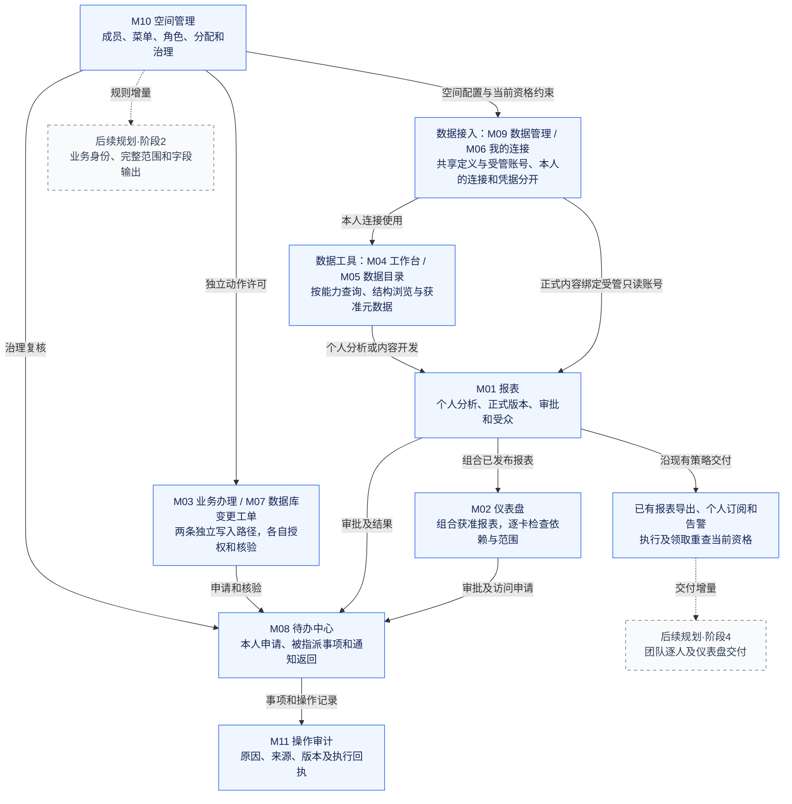
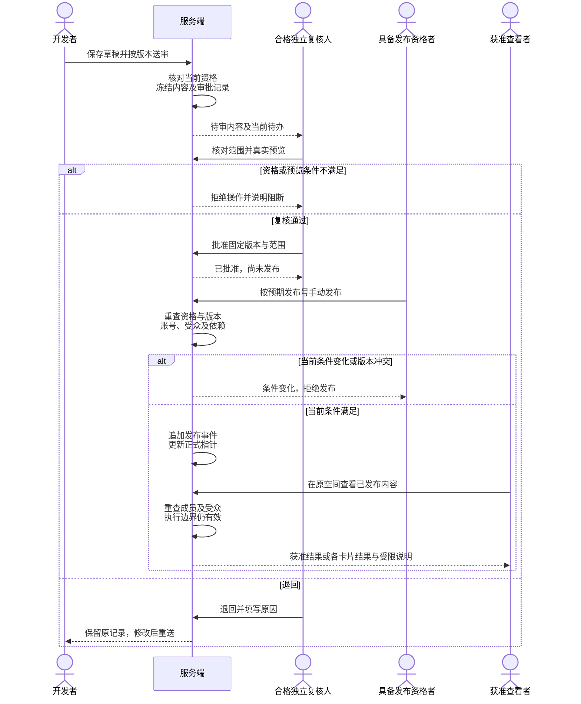
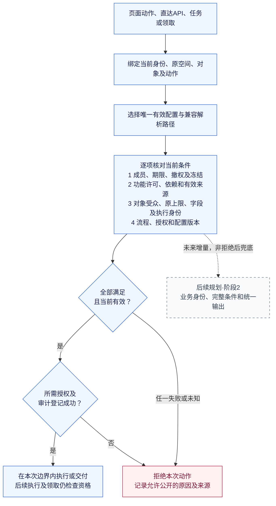
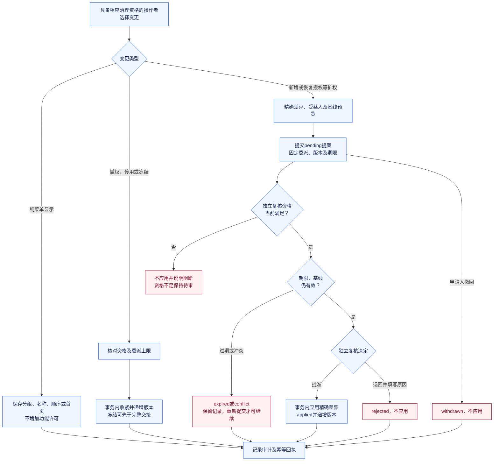
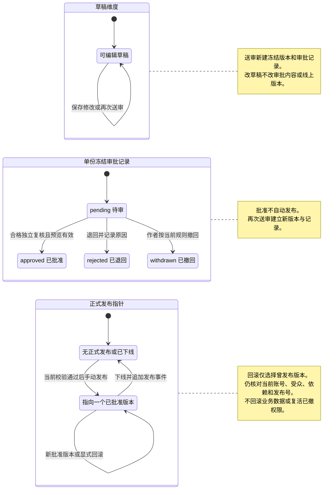
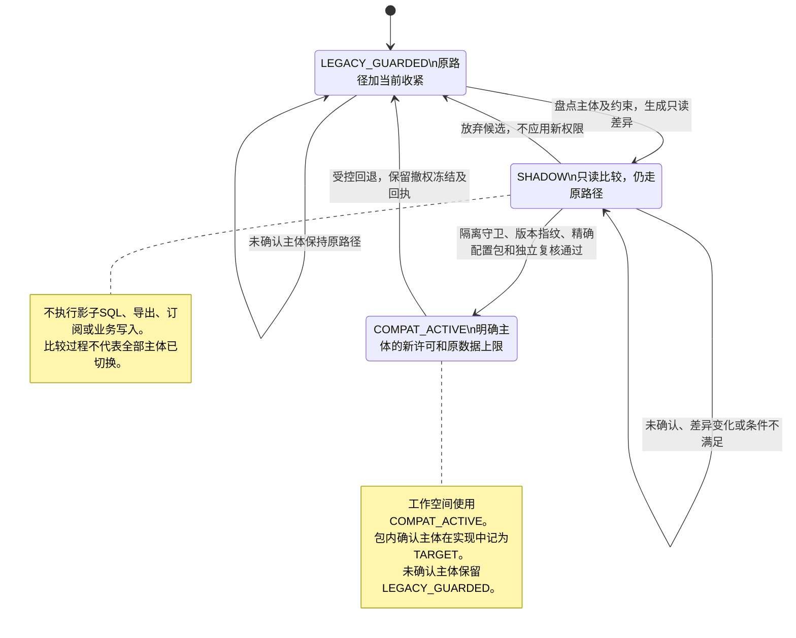

# DBHub 核心业务流程与状态图

更新日期：2026-10-24。阅读顺序：[当前路线图](开发路线图与当前任务.md) → [功能模块总览](功能模块总览与实现验收状态.md) → 本文。完整资料分类见[文档目录](../README.md)。

本文解释六类核心流程，不新增权限模型、工作流引擎或验收任务。“已实现”指当前工作区存在相应代码；既有隔离证据只证明其对应版本；当前页面、逐项证据、约定外部环境和独立责任人验收仍待完成，真实权限未切换。状态依据为[当前验收范围](开发路线图与当前任务.md)。

## 阅读与状态说明

| 图 | 已实现 | 待验收 | 后续规划 |
| --- | --- | --- | --- |
| 1 产品业务全景 | 现有连接、查询、内容、交付和治理基础 | 当前角色的模块衔接 | 阶段2统一数据规则；阶段4团队及仪表盘交付 |
| 2 角色泳道 | 冻结版本、原单级独立复核、手动发布和获准查看 | 当前角色、跨空间、异常及撤权路径 | 阶段3新业务/条件数据复核及发布策略 |
| 3 权限判定 | 身份、空间、许可、对象、原数据上限及执行边界 | 授权/审计故障拒绝、期限、冻结及逐项证据 | 阶段2业务身份、完整条件与统一输出 |
| 4 权限治理 | 扩权独立复核、立即收紧、回执及版本控制 | 当前治理页面、独立性和异常路径 | 后续能力实际交付后登记动作，不自动授予 |
| 5 内容生命周期 | 草稿、冻结审批记录和独立发布指针 | 当前状态展示及操作边界 | 阶段3新审批节点，复用已有对象及版本 |
| 6 迁移与回退 | 只读对照、隔离切换及保留收紧的回退 | 独立责任人验收及发布包确认 | 真实权限启用须明确范围并单独授权 |

Mermaid 图源直接保存在本文。蓝色表示已有能力，红色表示阻断或不生效结果；虚线及“后续规划”文字表示尚未交付的增量。**蓝色不表示验收通过。** 状态图和泳道的状态口径见上表。每图前后的文字可独立阅读；宽图可横向查看，不强行缩小文字适配手机。

## 1 产品业务全景图

同一工作空间内，个人分析使用本人连接，正式内容使用受管执行路径，报表组成仪表盘。治理、待办和审计服务这些流程。连线表示业务关系，不表示转授权限或共享凭据。

空间管理约束所有模块，个人安全与平台管理保持独立入口。获准查看报表不等于获准读取源库、办理业务或执行SQL变更；不同数据库也不等于不同工作空间。依据：[菜单目录](../../backend/internal/iam/catalog.json)、[连接器边界](../架构设计/数据接入与执行契约.md#1-数据源身份与能力)、[报表执行身份](../架构设计/内容与交付契约.md#2-开发审批与发布)。

## 2 报表与仪表盘角色泳道图

以下时序泳道表达**当前原流程**的职责交接。泳道不是固定岗位模板，同一人能否兼任仍按对应对象的当前规则判定。

无合格复核人不得自动批准或转给无数据资格的管理员。待审时可按原规则撤回；草稿变化不修改冻结内容或线上指针。仪表盘逐卡检查依赖，不能把失败当成0。依据：[报表版本与决定](../../backend/internal/db/managed_report_repo.go)、[报表发布](../../backend/internal/db/report_publication_repo.go)、[仪表盘审批发布](../../backend/internal/db/dashboard_lifecycle.go)。

**后续规划·阶段3：** 数据覆盖与分类约束具备后，补齐业务复核、条件数据复核和新发布策略；高风险复核独立性按[内容契约](../架构设计/内容与交付契约.md#8-已确认的后续内容与交付规则)执行。当前单级审批的历史签名不补造为新多节点已通过。

## 3 权限判定流程图

这是统一判定逻辑的摘要，不表示每个接口具有相同调用栈。前端快照控制显示；服务端、数据库及任务执行/领取边界共同校验当前资格。未知、过期或加载失败均不能放行。

有效功能来源可按契约合并，数据仍受原路径上限及当前收紧约束；新解析器拒绝后不能用旧admin兜底。撤权阻止后续执行/交付，不能据此声称已发送写操作已经回滚；未知结果须按原回执核实。依据：[动作判定基线](开发路线图与当前任务.md)、[接口守卫](../../backend/internal/server/iam_guard.go)、[许可依赖](../../backend/internal/iam/runtime.go)、[执行可靠性](../架构设计/数据接入与执行契约.md#3-发送前登记回执和未知结果)。

## 4 权限治理流程图

扩权独立复核，撤销/冻结先收紧，纯显示调整不授予动作。下图复用已有提案、版本、回执和审计。

申请人及全部受益人回避复核；批准时重查双方当前资格、委派和受益范围。事务失败不产生部分授权，重复幂等请求只返回原结果。解除禁止或恢复旧授权作为新扩权，新禁止优先、到期仍按当前限制处理。依据：[治理实现](../../backend/internal/db/iam_governance.go)、[空间管理页](../../frontend/src/views/governance/SpaceView.vue)。后续功能实际交付后才登记动作，已有角色及委派没有未来能力通配权。

## 5 内容生命周期状态图

内容具有**可编辑草稿、冻结审批记录、正式发布指针**三个独立维度。下图并列表达，不能把它们合成一个可任意跳转的状态字段。

图中是共同主线。仪表盘另有审批过期、生命周期变化、预检失效等专属规则，不套用到全部报表：过期或退回后重新送审；依赖/资格变化阻断本次操作，不自动批准；旧正式版是否可读仍逐次检查。新多节点策略属于阶段3规划。依据：[报表版本与决定](../../backend/internal/db/managed_report_repo.go)、[发布指针](../../backend/internal/db/report_publication_repo.go)、[仪表盘专属规则](../架构设计/内容与交付契约.md#4-仪表盘执行与依赖)、[仪表盘生命周期](../../backend/internal/db/dashboard_lifecycle.go)。

## 6 权限迁移与回退图

机制已在专用隔离环境实施并有技术证据，仍待产品与独立责任人验收。**当前真实启用为false。** 图中切换表示已有隔离机制，不是执行真实迁移的指令。

切换前重查服务兼容版本、路由指纹、授权及约束基线；任一变化则不应用。回退保留当前撤权、冻结及期限，相关新任务暂停或失效，不自动重放，不回滚业务数据库。依据：[迁移与回退实现](../../backend/internal/db/iam_migration.go)、[三种状态及迁移规则](../架构设计/数据接入与执行契约.md#73-撤权启用与回退)、[当前验收范围](开发路线图与当前任务.md)。

真实权限启用前须明确空间、主体、能力、责任人并获得独立授权。当前待验收及 SC-P1-20261024-01 移除的性能任务以[当前路线图](开发路线图与当前任务.md)为准。
